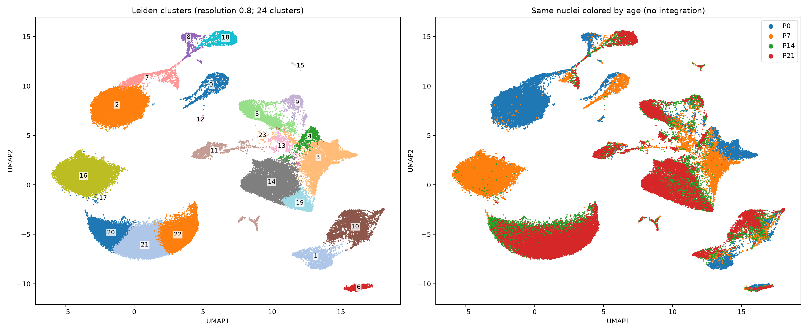

# Postnatal heart snRNA-seq and Xenium analysis

Independent QC and exploratory clustering of the mouse-heart dataset [GSE290989](https://www.ncbi.nlm.nih.gov/geo/query/acc.cgi?acc=GSE290989), covering P0, P7, P14 and P21 with two libraries per age.

Spatial analyses map candidate ventricular programs onto the four deposited Xenium sections, with measured-marker evidence and comparisons between assay-aligned transfer and CytoSPACE.

- [Endothelial QC and subclustering in RNA and Xenium: gene-based names, nuclear/boundary evidence, possible merges, count matrices and maps](results/endothelial_QC_subtypes/README.md)
- [Named P21 fibroblast substates and current neighborhoods relative to CMs, endothelial, mural and other cardiac profiles](results/fibroblast_names_and_neighborhoods/README.md)
- [Integrated fibroblast spatial assignments: explicit nuclear/cell confidence tiers, actual marker evidence and conservative maps](results/fibroblast_spatial_consensus/README.md)
- [Whole-section nuclear-anchored Xenium segmentation: antibody images, nuclear/cell transcript assignments, counts and fibroblast confidence](results/xenium_nuclear_anchored_segmentation/README.md)
- [Completed Xenium fibroblast refit: reviewed P21_F0 family, clean RNA figures, boundary confidence and updated spatial models](results/fibroblast_Xenium_reviewed_refit/README.md)
- [Fibroblast subtype catalog: all stages, markers, candidate functions and spatial evidence](results/fibroblast_subtype_catalog/INTERPRETATION.md)
- [P21 fibroblast identity review: F0 supports a Col8a1-related broad family while retaining a distinct late interstitial substate](results/fibroblast_P21_identity_review/README.md)
- [Completed fibroblast state reassessment, matrix-program comparisons, intended-panel CM maturation and spatial/boundary tests](results/fibroblast_states/README.md)
- [Fibroblast reassessment: exact CM maturation panel, measured marker coverage, library-level RNA signals and feasible questions](results/fibroblast_reassessment/README.md)
- [Xenium transcript-boundary inspection and segmentation sensitivity, retaining CM profiles without nuclear area](results/xenium_boundary_qc/README.md)
- [All cardiac cells on Xenium: reviewed non-CM identities, interactive atlas, full count matrices and spatial patterns](results/whole_heart_spatial_atlas/README.md)
- [Xenium QC: current filters, segmentation diagnostics and remaining checks](results/whole_heart_spatial_atlas/XENIUM_QC.md)
- [Whole-heart reassessment: Ankrd1 enrichment near candidate arterial structures, local matched controls and P0–P21 maps](results/whole_heart_Ankrd1_vessels/README.md)
- [Finest ventricular placements: all 28 RNA groups, individual maps and resolution limits](results/ventricular_spatial_resolution/README.md)
- [Improved weighted ventricular alignment: withheld-gene tests, library effects and uncertainty](results/ventricular_alignment_improvement/README.md)
- [Recovered published CM-state maps and an independent default-parameter CytoSPACE comparison](results/author_atlas_baseline/README.md)
- [CytoSPACE alignment: raw assignments, stability checks and held-out gene recovery](results/cytospace_xenium/README.md)
- [Xenium: ventricular candidates on cardiac sections, measured markers and spatial checks](results/xenium_ventricular_mapping/README.md)
- [Ventricular candidates at each stage, potential functions and cross-stage comparison sets](results/ventricular_stage_subtype_catalog/README.md)
- [IRX5, Slit2 and regional versus conduction-associated electrical programs](results/ventricular_electrical_regional/README.md)
- [Other segregation axes: electrical specialization and literature-guided gene checks](results/ventricular_additional_axes/README.md)
- [Ventricular wall-, oxygen-response and mechanical programs: expanded gate and annotation review](results/ventricular_microenvironment/README.md)
- [Finer ventricular states independently resolved within each stage](results/ventricular_within_stage/README.md)
- [Ventricular-only analysis across four stages with sample/batch sensitivity](results/ventricular_stage_batch/README.md)
- [Early ventricular CM states: cycling and within-stage differences](results/cardiomyocyte_early_states/README.md)
- [Cardiomyocytes: matching stage/subtype UMAPs and subtype colors within each stage](results/cardiomyocyte_focus/README.md)
- [Larger UMAPs with labeled cell types, subtypes and developmental stages](results/labeled_umaps/README.md)
- [Reviewed cell identities, subtype criteria and lineage-specific UMAPs](results/cell_identities_subtypes/README.md)
- [Cell identity and subtype report (PDF)](results/cell_identities_subtypes/cell_identity_subtype_report.pdf)
- [UMAP figures, cluster assignments and downloadable analysis tables](results/umap_clustering/README.md)
- [QC report (PDF)](snRNA_QC_report.pdf)
- [Preliminary lineage profiles (PDF)](heart_lineage_profiles.pdf)
- [Reproducible clustering script](analysis/umap_clustering.py)

73,052 of 98,371 input nuclei passed independent QC, doublet screening and ambient correction. The primary Leiden resolution of 0.8 yields 24 computational clusters; resolutions 0.4 and 1.2 yield 15 and 29 clusters. The UMAP is not batch-integrated, and cluster IDs are not final biological subtype annotations.

The repository includes per-nucleus UMAP coordinates and metadata, a metadata-only H5AD, lineage-marker expression, and cluster-level pseudobulk counts for all 32,285 input genes. The full annotated 1.3 GB cell-by-gene expression H5AD is prepared and validated in the analysis workspace but has not been uploaded: `uploads.github.com` rejected the release-upload credentials with HTTP 401. The downloadable per-cell annotation CSVs, metadata-only H5ADs, marker tables and pseudobulk counts are available in this repository.

## Identity and subtype annotation

The updated analysis reviews broad identities for all retained nuclei and evaluates 59 computational subclusters within cardiomyocytes, fibroblasts, endothelial, mural and immune populations. Subtype labels have explicit positive-marker/anchor criteria, exclusion checks, library-support requirements and candidate/unresolved flags. Numerical subclusters are not asserted to be 59 biological cell types. See the identity report for the distinction between chamber/lineage identity, marker-defined state, age association and cycling.
