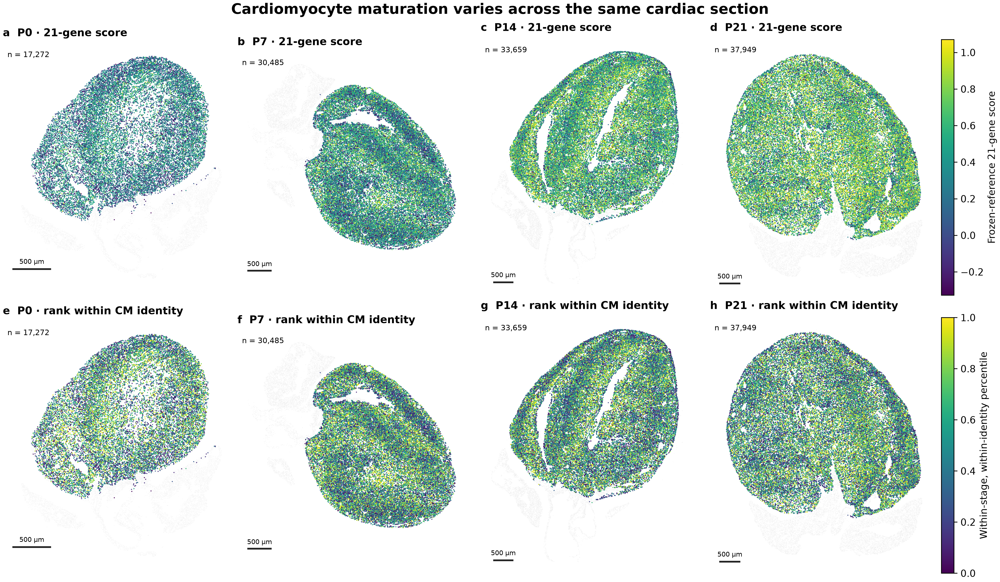
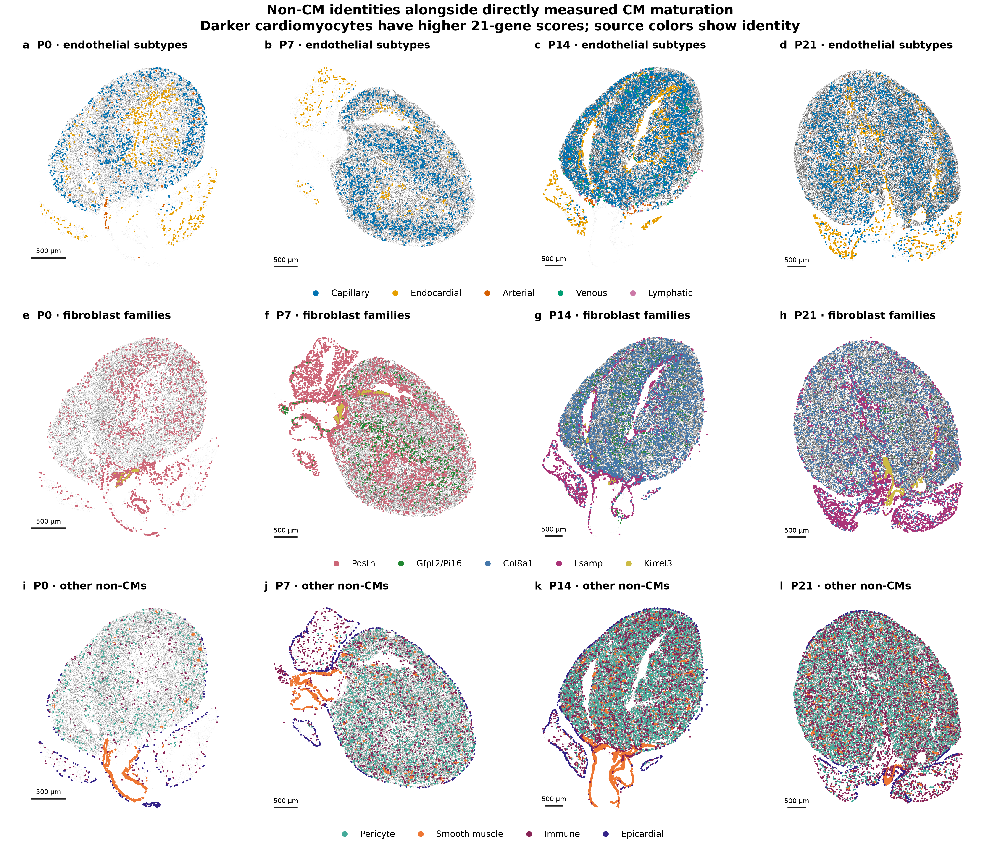
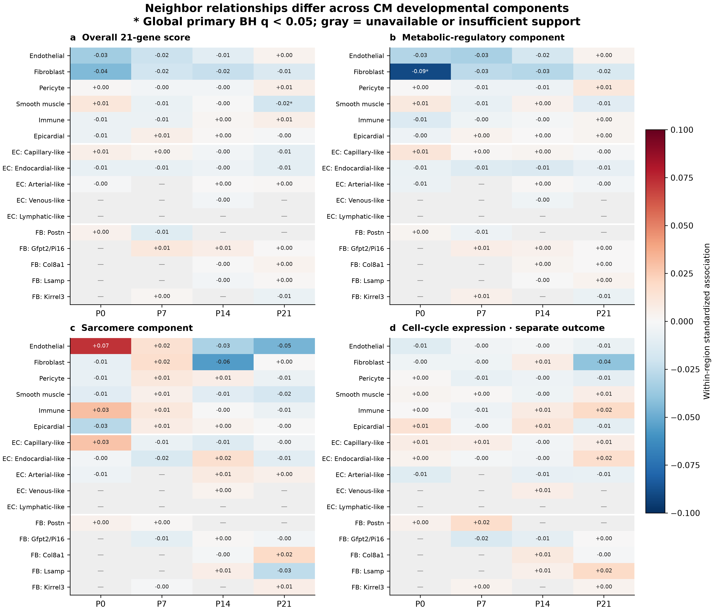
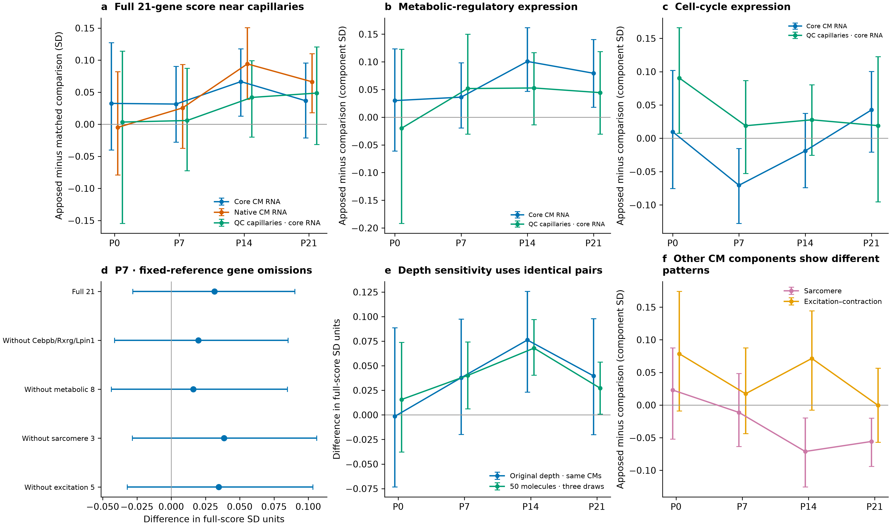
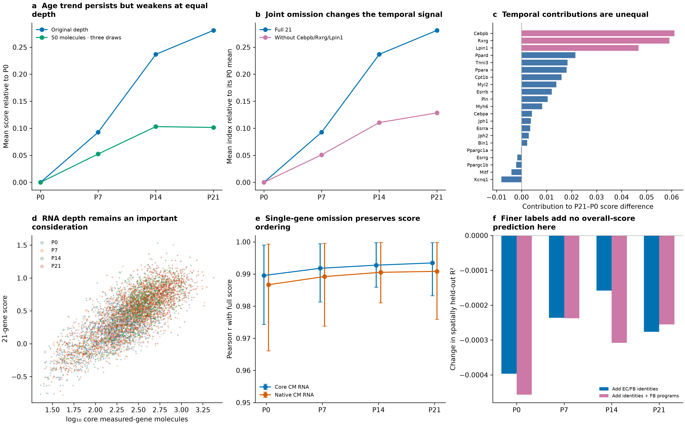
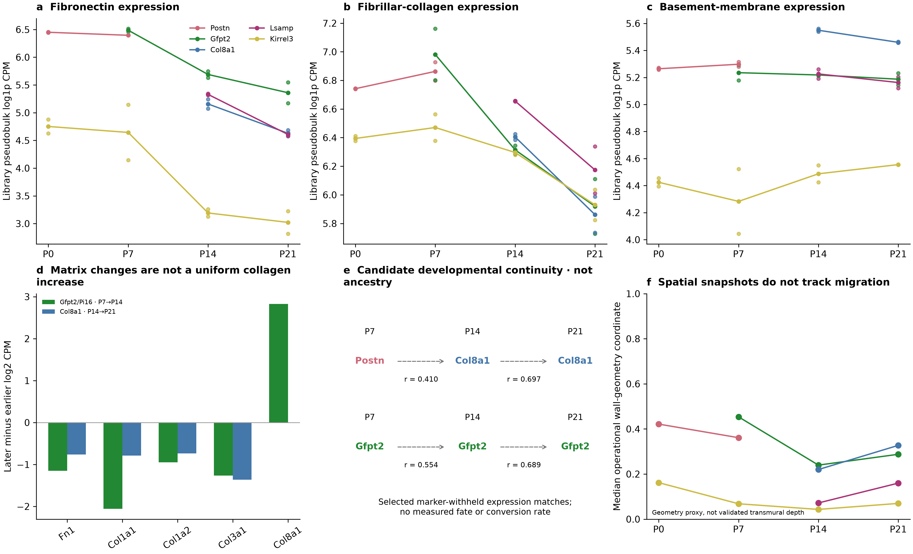

# Cardiomyocyte maturation within the developing cardiac environment

## What the new analysis says

We can calculate cardiomyocyte maturation directly from the 21 genes measured by Xenium and place those scores alongside the surrounding cardiac cells. We have now done this for P0, P7, P14 and P21, retaining Col8a1-associated fibroblasts as one family and using Gfpt2/Pi16-associated as a descriptive family name. The maps show transcriptional maturation within the original sections; they do not measure functional maturity or infer missing RNA.

The direct answer to the P7 question is that cardiomyocytes alongside capillaries are not clearly more mature overall. In 1,108 technically and locally matched ventricular-CM pairs, their mean 21-gene difference was small, with an uncertainty interval that included zero. Repeating the matching with QC-supported capillary sources gave the same broad answer. Lower cell-cycle expression in the earlier capillary definition was not reproduced with the stricter sources. We should therefore replace the earlier general interpretation with a description of a source-sensitive relationship.

There are still useful biological patterns. Fibroblast-rich surroundings at P0 are associated with lower CM metabolic-regulatory expression, and vascular surroundings can relate differently to metabolic and sarcomere expression. These observations suggest that growth, energy metabolism and structural specialization are partly separable processes. They do not establish that one neighboring cell population uniformly advances or delays CM maturation.

## Reading the maturation maps

Figure 1 shows the directly measured 21-gene score on one common reference scale across all four ages. The second row shows each CM's position within its own age and CM identity. This separates a regional difference among comparable cardiomyocytes from a difference caused by mixing CM identities. A percentile of 0.8 means that a cell ranks above 80% of its comparison group; it does not mean that it is 80% mature.

Figure 2 places five endothelial subtypes, the current fibroblast families, pericytes, smooth-muscle cells, immune cells and epicardial cells alongside the same CM scores. All source identities and coordinates are retained from the reviewed atlas. Broader fibroblast candidates improve coverage, while missing same-age reference families remain not assessable. These maps describe where labeled profiles are found, rather than unbiased population sizes or proven cell contacts.

Late Gfpt2 placement remains uncertain. At P21, the current classifier assigns 85 eligible fibroblasts to this family, whereas the public comparator labels 2,716; an earlier direct multi-gene assessment identified 1,339 Gfpt2-program-positive profiles across several candidate families. These are different evidence layers, not interchangeable subtype counts. Calling the family Gfpt2/Pi16 does not by itself resolve that disagreement, and we should not interpret its sparse candidate map as biological disappearance.

The complete score and its metabolic-regulatory, sarcomere and excitation–contraction components are analyzed separately. Cell-cycle expression is a separate outcome. A CM can reduce its cycling-associated RNA while changing little in the overall score, or express higher metabolic RNA without showing higher sarcomere RNA. Neither pattern should be reduced to a single mature-versus-immature classification.

## Does capillary proximity indicate greater maturity?

The original matched capillary analysis used the released capillary labels and operational apposition between segmented boundaries. We retained those pairs and restricted the main comparison to ventricular CMs. At P7, the overall score difference was +0.031 standard deviations, with a 95% spatial-block interval of −0.028 to +0.090. Lower cell-cycle expression was a more distinct uncorrected observation, but it did not pass the new correction across all 20 matched primary comparisons.

We also rebuilt the matching using broad EC quality control and nuclear-supported capillary identities. At P7, the overall difference was +0.006 standard deviations, with an interval of −0.072 to +0.087. Cell-cycle expression was not clearly lower. These source definitions also produce different matched CM cohorts, so the change cannot be attributed to labeling alone. Nevertheless, it prevents us from treating the earlier cycling result as settled evidence that vascular integration drives cell-cycle withdrawal.

At P14, the original-source comparison showed higher metabolic-regulatory expression near capillaries. This passed correction within the matched testing family. However, the corresponding estimate weakened with QC-supported capillary sources. At P21, the original-source sarcomere component was lower near capillaries, whereas this direction did not persist with the stricter sources. These results argue against describing capillary-adjacent CMs as uniformly more mature. They also do not establish an age at which vascular support begins.

The most useful next measurements are functional vascular access, CM metabolism and sarcomere organization in equivalent anatomical regions. A segmented boundary alongside an EC is not a measurement of perfusion, oxygen delivery or receptor-mediated contact.

## What do the other non-CMs add?

The new neighborhood models compare CMs within the same identity and 200-µm region, while accounting for capture, cell size, broad cellular surroundings and anatomical proxies. Among 235 supported primary tests, two passed the global correction. At P0, a greater proportion of eligible fibroblasts was associated with lower CM metabolic-regulatory expression. At P21, smooth-muscle-rich surroundings were associated with a small reduction in the overall 21-gene score. These are within-section associations and do not establish inhibitory actions by fibroblasts or smooth-muscle cells.

No individual fibroblast-family association passed this new pooled testing grid. The early Postn-associated and Gfpt2/Pi16-associated estimates suggested different directions in some comparisons, but their uncertainty and sensitivity prevent a claim that one family suppresses maturation while the other promotes it. Similarly, we did not establish a general difference in CM maturation around late Col8a1 versus Gfpt2/Pi16 fibroblasts.

We directly tested whether finer identities add information beyond the broader context. Models were trained and evaluated in separate spatial blocks, with a 150-µm buffer. Adding EC and fibroblast identities, followed by measured fibroblast programs, did not improve prediction of the overall 21-gene score in any section. This is a result from these specified models, rather than evidence that fibroblast diversity has no biological function. A broad RNA index may miss a local effect on matrix organization, calcium handling, innervation or a particular CM subtype.

An earlier, separately corrected subtype-specific refit identified higher sarcomere expression in P14 Ankrd1-associated CMs near endocardial-like ECs. That relationship was much weaker in working ventricular CMs and sensitive to the CM transcript-ownership view. It remains a focused structural hypothesis. The new pooled analysis does not replace that comparison or provide independent replication of it.

## How robust is the 21-gene score?

Recalculation from observed Xenium counts reproduced the existing transparent score to numerical precision. Leaving out one gene at a time preserved the ordering of CMs: among strict ventricular CMs, correlations with the full score were at least 0.974 in core RNA and 0.966 in deposited whole-cell RNA. This supports robustness to individual-gene omission. It does not establish functional validity or equal contributions from all genes.

The age-related signal is uneven. Cebpb, Rxrg and Lpin1 together accounted for approximately 58% of the P21-minus-P0 increase in the core 21-gene score under its original denominator. Removing them together retained an age-related increase, but reduced it substantially. These are descriptive section comparisons, not longitudinal measurements of the same cells. The remaining 18-gene index is re-averaged over 18 genes; its change should not be mistaken for the additive contribution of those genes to the original index.

The score also correlated strongly with the number of measured transcripts. We therefore repeated the analysis after subsampling each sufficiently captured profile to exactly 50 measured-gene molecules, without replacement, and averaging three draws. Among identical depth-eligible CMs within each age, the P21-minus-P0 mean-score difference decreased from approximately 0.281 to 0.102. This stringent test also discards substantial biological information and increases dropout. It does not show that a particular fraction of the original age difference was technical, but it demonstrates that temporal interpretation depends on capture and information content. The small P14-to-P21 increase was not retained in this sensitivity.

Capture, size and CM identity alone predicted much of the score within sections. This reinforces the need to interpret local relationships after comparable capture and CM identity are considered. At the same time, CM growth and RNA content are biological features, so conditioning on them can remove part of real maturation. We should report both measured patterns and these adjusted sensitivities, rather than treating either as a complete account of development.

## How do the later fibroblast populations emerge?

Your question about Postn/Tnc decline is central. Reduced expression of these markers does not establish loss of the cells that previously expressed them. Some early fibroblasts may change state, while populations already present at lower abundance proliferate or become easier to distinguish. Both processes could occur together. Cross-sectional cell proportions cannot distinguish these possibilities or establish absolute expansion.

Our existing marker-withheld RNA comparisons connect an early Postn-associated subgroup with a P14 Col8a1-associated subgroup. Another Col8a1-associated comparison links P14 and P21, while the Gfpt2-associated population shows continuity from P7 through P21. These are candidate expression connections, not tracked descendants. We have not fitted a new fate trajectory in this update, and neither these similarities nor the existing Wormhole neighborhood matches establish cell ancestry.

The proposed Postn-to-Col8a1 or Postn-to-Gfpt2 branching model is reasonable to test. It should not be imposed as the answer. We should initially retain all well-supported fibroblast populations in the RNA analysis and examine whether intermediate states reproducibly connect them. Thbs1/Vcan does not by itself verify valve location, and Lsamp/Htra3 does not verify outflow-tract location. Htra3 is expressed across several of our fibroblast families. Anatomical exclusion from a trajectory should follow validated location and expression continuity, rather than the proposed names alone.

Your wall-growth argument is also valid. Cardiomyocyte enlargement and uneven myocardial remodeling can change fibroblast distances from tissue boundaries without active fibroblast migration. Uniform growth would preserve a correctly measured fractional wall position, whereas uneven growth need not. The quoted normalized distances of 0.29–0.43 and 0.95–1.13 have not been reconstructed here, and their denominator needs clarification. Our bounded void-to-outer-surface coordinate is a different, operational geometry proxy; it is not a validated endocardium-to-epicardium coordinate. Its snapshots cannot determine migration or descendant relationships.

## Do fibroblasts switch from fibronectin to collagen?

Fibronectin can help organize an early scaffold for collagen assembly, making your proposed sequence biologically plausible. However, the RNA data show active collagen expression already in early Postn-associated fibroblasts. Early Kirrel3-associated fibroblasts have lower average fibronectin expression than Postn-associated fibroblasts, so the early populations do not share one uniform fibronectin-rich state.

Within Gfpt2-associated fibroblasts, Fn1 and major fibrillar-collagen transcripts decline from P7 to P14, while Col8a1 increases. These directions agree across both libraries. Within Col8a1- and Lsamp-associated fibroblasts, fibronectin and several fibrillar-collagen transcripts decline between P14 and P21. The pattern therefore concerns changing matrix composition and production activity, rather than a universal rise in collagen expression.

Later Col8a1-associated fibroblasts have stronger basement-membrane-related expression than Gfpt2-associated fibroblasts in our RNA comparisons. Gfpt2-associated fibroblasts retain relatively higher fibronectin expression at those ages. These differences suggest distinct roles in organizing the environments around muscle and vessels. They do not establish matrix stiffness, protein deposition or a direction of influence on CMs. Previously deposited collagen can persist and become more organized even while collagen RNA declines.

Early Postn-associated fibroblasts also change before their naming program declines: Col3a1 expression increases from P0 to P7 in the library-level comparison. We should therefore examine their changing activities within the early interval, rather than treating every Postn-positive cell as the same state throughout P0–P14.

## How should the Hortells study guide the biology?

The linked Hortells study reports altered cardiac sympathetic innervation, reduced CM binucleation and hypertrophic growth, and higher fetal troponin expression after targeting Postn-expressing fibroblasts during P0–P6. These observations support a developmental contribution of the targeted population under that intervention. They do not isolate a direct fibroblast-to-CM signaling mechanism from changes mediated by nerves, matrix or other cells.

Its indexed abstract attributes the loss of detectable Postn expression by P30 to repression of the gene. This makes marker expression versus cell persistence an important distinction; it does not establish the later identities of the earlier cells. The study's detailed targeting controls were not independently re-audited in this update, so an explanation involving experimental injury or incomplete specificity remains a question to investigate rather than an established flaw.

Declining Postn expression is compatible with continued CM development. Early fibroblasts may establish matrix or innervation that continues to support CMs, and surviving cells may adopt later expression states. Vascular access, mechanical loading and other signals can contribute subsequently. The proposed sequence in which CM-derived TGFβ changes fibroblast identity and thereby drives CM maturation remains a hypothesis. The current data have not established the ligand source, temporal order or causal chain.

The perinatal vascular study provides a complementary anatomical framework: pre-existing coronary vessels expand into the growing inner myocardium around birth, with regional vascular differences changing during the first postnatal week. This motivates examining matrix development and vascular integration together. It does not establish that the fibroblast changes observed here cause that vascular expansion.

## A focused biological roadmap

First, determine whether early Postn-expressing fibroblasts persist and acquire later identities. Pulse-label early cells and examine their descendants at P7, P14 and P21, alongside Gfpt2/Pi16 and Col8a1 programs. Measure proliferation and cell loss as separate processes. Denser RNA sampling around P3/P5 and P10 would help locate intermediate states, while lineage tracing establishes ancestry.

Second, distinguish matrix production from matrix accumulation and organization. Measure fibronectin, fibrillar collagen and basement-membrane proteins alongside the corresponding RNA. Compare equivalent ventricular regions, account for changing wall geometry, and examine whether the same fibroblast family changes its activity with age.

Third, test a specific CM outcome in a specific environment. Prioritize metabolic function near vascular and fibroblast contexts, structural organization in the Ankrd1/endocardial setting, or innervation in early Postn-associated regions. Include calcium handling, contraction or metabolic measurements appropriate to the hypothesis. The overall 21-gene index can remain a useful summary, but it should not substitute for the biological process being tested.

## Methods

The panel comprises Rxrg, Ppargc1a, Ppargc1b, Cebpa, Cebpb, Esrra, Esrrb, Esrrg, Mitf, Myh6, Tnni3, Myl2, Kcnq1, Jph1, Jph2, Bin1, Lpin1, Pln, Ppara, Ppard and Cpt1b. Observed target counts were normalized against the total of all 403 measured genes to 10,000 molecules and log1p transformed. The primary transparent score is the mean of gene-level Z values using the unchanged pooled all-age reference from the preceding reconstruction, separately calibrated for deposited and core RNA. No stage-specific restandardization, inferred genes, new weights or control reselection was introduced. The paper's Methods specify Seurat AddModuleScore, but the exact authors' score-generation object and parameters remain unavailable; this update does not claim exact reproduction of that precomputed score.

The ventricular map cohorts contain 17,272, 30,485, 33,659 and 37,949 CMs at P0, P7, P14 and P21. They retain the frozen reviewed ventricular and morphology selections, supported published CM states, core depth of at least 20 and outcome-excluded capture of at least 20. Neighborhood-model eligibility additionally requires at least five resolved neighbors and at least one eligible fibroblast and EC. Source categories include six broad non-CM lineages, five EC subtypes and five fibroblast families, with unknown profiles retained in lineage denominators. Col8a1 is not subdivided. Gfpt2/Pi16 is a descriptive name for the existing multi-gene candidate family, not an obligatory double-positive gate or a newly retrained classifier.

Primary neighborhood models use 50-µm frozen tissue-screened graphs. Supported exposures have at least 30 source profiles, 50 exposed CMs, adequate conditional variation, 200 CMs and eight 400-µm blocks. Regressions compare CMs within identity-by-200-µm groups and include capture, size, source capture, broad composition and geometry covariates. Redundant nuisance columns are removed by rank-revealing decomposition. Five core outcomes form one 235-test primary family with Benjamini–Hochberg correction. Other CM states, native RNA, 30-µm graphs, gene-group omissions and equal-depth outcomes are sensitivity analyses, rather than additional corrected discoveries.

Matched comparisons retain the original pairs and report a strict-ventricular subset. QC-supported capillary pairs are newly fitted using the same operational matching principles: identical CM state and 200-µm region, physical separation at most 100 µm, matching on capture, area, perimeter and capillary area, and no reused controls or score-based matching. Capillary apposition is the fraction of sampled CM boundary within 2 µm of a source boundary; it does not establish functional contact. The 20 strict-ventricular core matched tests form a separate corrected family. QC-source comparisons and fixed-depth comparisons are sensitivities. Source definitions and matched cohorts differ, so their estimates are not paired estimates of segmentation error.

Uncertainty uses 512 resamples of 400-µm spatial blocks. These intervals characterize variation within a section conditional on its masks and count view. Each age has one spatial section; spatial blocks are not independent animals. Gene-omission analyses keep normalization and reference calibration fixed. Equal-depth analyses use exact hypergeometric molecule subsampling, three repetitions and identical depth-eligible CMs within age. Buffered prediction uses five spatial folds with a minimum 150-µm training/test separation, training-only feature scaling and coordinate splines, and fixed Ridge regularization of 10. No hyperparameter search or held-out-animal validation is claimed.

Fibroblast developmental evidence reuses the ambient-corrected full-RNA library-level matrix comparisons and existing marker-withheld state similarities, with the current reviewed family names. Missing reference classes remain not assessable. RNA profiles do not measure matrix protein, and cross-stage resemblance is not a fate trajectory. No new transport model, lineage-tracing experiment, segmentation or biological replicate was generated. Independent validation reconstructs neighbor fractions, regression point estimates and matching constraints, in addition to checking scores against the frozen source calculations.

## References

Wang et al. Postnatal heart atlas. Nature Cardiovascular Research (2026). DOI: 10.1038/s44161-026-00861-z. Final panel count: 21; the earlier draft's count of 22 is not used.

Hortells et al. A specialized population of Periostin-expressing cardiac fibroblasts contributes to postnatal cardiomyocyte maturation and innervation. PNAS (2020). DOI: 10.1073/pnas.2009119117; PMID: 32817558. Experimental statements in this update were checked against the indexed abstract, not a new exhaustive audit of the full experimental record.

Lu et al. Perinatal angiogenesis from pre-existing coronary vessels via DLL4–NOTCH1 signalling. Nature Cell Biology (2021). DOI: 10.1038/s41556-021-00747-1. This provides vascular developmental context; no missing spatial stage or functional vascular measurement is inferred as an observation.

Haviv et al. Wasserstein Wormhole: Scalable Optimal Transport Distance with Transformers. ICML (2024). Existing neighborhood comparisons are contextual evidence; no individual-fibroblast ancestry is established by optimal transport.

## Integrated figure plates

### Figure 1. CM maturation varies within the original cardiac sections

a–d, Directly measured 21-gene core-RNA scores on one frozen reference scale across P0–P21; extreme colors are clipped at pooled 2nd/98th percentiles for display. e–h, Relative score ranks within the same age and CM identity. Only frozen strict ventricular map cohorts are colored. Percentile is a relative rank, not a percentage of physiological maturity. Gray retains tissue context, with display-only background subsampling. Counts and analyses use all eligible profiles. Scale bars, 500 µm.

### Figure 2. Non-CM identities provide the context for CM developmental variation

a–d, Five reviewed EC subtypes. e–h, Updated multi-gene fibroblast candidates, retaining Col8a1 as one family. Gfpt2/Pi16 names the existing Gfpt2-associated signature without demanding detection of both markers. i–l, Pericytes, smooth-muscle, immune and epicardial cells. Darker CM shading indicates higher measured 21-gene scores on the same scale across sections. Colored source points require broad source quality control. Unassigned profiles remain in background context rather than being forced into a subtype. The overlays do not establish direct contact or unbiased cell abundance. Scale bars, 500 µm.

### Figure 3. Neighbor relationships differ across developmental components

a–d, Overall 21-gene, metabolic-regulatory, sarcomere and separate cell-cycle outcomes. Values are standardized within-region, CM-identity-conditioned associations from 50-µm neighborhoods. Asterisks indicate global BH q < 0.05 among all 235 supported primary tests, including the excitation–contraction outcome supplied in tables. Gray denotes unavailable or insufficiently supported comparisons. Broad source fractions use resolved-neighbor denominators; subtype fractions use all eligible members of their lineage, including unassigned profiles. Colors do not establish causal influence. One section is available at each age.

### Figure 4. Capillary apposition does not establish uniformly greater CM maturity

a, Overall score with the original capillary sources in core and deposited CM RNA, and newly matched QC-supported capillary sources in core RNA. b,c, Metabolic-regulatory and cell-cycle outcomes with original versus QC-supported sources. d, P7 gene-group omissions retain frozen normalization/reference; original-source pairs are unchanged. e, Equal-depth sensitivity compares the same depth-eligible pairs before and after exact subsampling to 50 molecules, averaged across three draws. f, Original-source sarcomere and excitation–contraction outcomes. Intervals are 95% spatial-block intervals, not animal replication. New QC-source cohorts contain 338, 514, 913 and 680 pairs. Source definitions change matched cohorts as well as capillary identities. The 20 original-source strict-ventricular core tests form the corrected primary matched family; sensitivity panels do not create additional discoveries.

### Figure 5. Gene omission and capture sensitivity address different questions

a,b, Mean age-related differences among identical depth-eligible CMs within each age, using original versus fixed-depth scores or jointly omitting Cebpb/Rxrg/Lpin1. Each curve is centered on its own P0 mean. c, Additive gene contributions to the original 21-gene P21-minus-P0 score difference in the full strict map cohorts; the three prespecified omitted genes are highlighted. d, Display-only samples of 1,500 CMs per stage show score versus captured transcript depth. e, Mean and range of correlations across 21 single-gene omissions, separately by age and RNA view. f, Change in buffered spatially held-out R² after adding fine identities or identities plus fibroblast programs to the anatomy/capture/broad-context model. High omission correlation does not establish functional validity, and subsampling discards biological information as well as equalizing molecule number.

### Figure 6. Fibroblast development changes matrix composition rather than uniformly increasing collagen RNA

a–c, Corrected full-RNA library pseudobulk matrix scores within reviewed fibroblast families. Small points show the two libraries; lines show their unweighted means. Different gene sets have different expression baselines and are not protein measurements. d, Selected within-family gene changes; the displayed Fn1/Col1/Col3 directions agree across library cross-comparisons. Missing screened contrasts are not imputed as zero. e, Selected existing marker-withheld RNA similarities with reviewed family names. Dashed arrows indicate expression resemblance, not descendants, probabilities or conversion rates. f, Median void/outer-surface geometry within a conservative ventricular selector; only assessable groups with at least 30 profiles are shown. This is not validated transmural depth and does not track migration.
