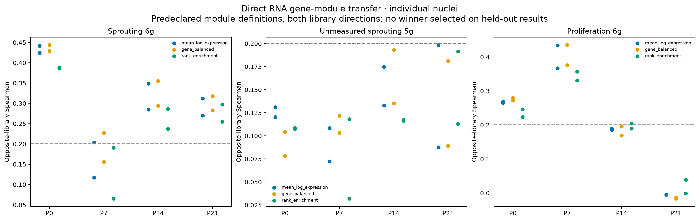

# EC gene modules: whole-program scores rather than individual-gene claims

**The existing sprouting score already is a six-gene module score.** This analysis explicitly scores the RNA module first and transfers that single score onto Xenium. With fixed reference weights, `projection(mean of genes) = mean of projected genes`. The differences are only floating-point rounding (less than0.000001), so changing aggregation order alone adds no predictive information.

[Module comparison report](EC_gene_module_comparison.pdf) · [All-stage module annotations](all_stage_gene_module_annotations.tsv.gz) · [Module definitions](gene_module_definitions.tsv) · [Opposite-library benchmark summary](module_definition_benchmark_summary.tsv) · [Aggregation-equivalence check](module_aggregation_order_equivalence.tsv) · [Validation](validation.json)

## Primary module-level readout

Each `P*/Xenium_ECs_with_gene_modules.h5ad` preserves the previous observed403-target count matrix, nuclear/boundary count layers, source identities and spatial coordinates. The main fields in `obs` are:

- **`inferred_sprouting_module`**: mean reference log1pCP10k of Apln,Esm1,Angpt2,Cxcr4,Pgf,Adm. This is numerically the existing six-gene score, now explicitly presented as one module.
- **`inferred_unmeasured_sprouting_module`**: diagnostic five-gene component excluding Angpt2, so measured Angpt2 cannot be mistaken for recovery of missing genes.
- **`inferred_proliferation_module`**: Mki67,Top2a,Cenpf,Ccnb1,Ube2c,Cdk1, kept separate from sprouting. Proliferation does not define tip-cell identity.
- **`inferred_sprouting_module_balanced`** and **`inferred_sprouting_module_rank`**: sensitivity versions of the same sprouting gene set, not automatically adopted replacements or newly validated activity measures.

The missing-five component is a validation diagnostic, not another biological EC type or independent program. All scores are inferred RNA annotations; the five requested EC identities and all actual Xenium measurements are preserved. Previous per-gene predictions remain available for auditing but are not the main module-level interpretation.

## Alternative whole-module definitions tested

1. **Mean normalized expression:** the existing mean of gene log1pCP10k values.
2. **Gene-balanced module:** standardize genes using training-library mean/SD, an SDfloor0.25 and clipping±3, then average. This reduces the influence of a single highly expressed or unusually variable gene. Spatial calibration uses equal-library moments within the matched-age reference; these scores are relative within age, not cross-age absolute activity.
3. **Rank enrichment:** mean target-gene enrichment among the top1500 expressed genes of each RNA nucleus/metacell, retaining fractional counts and excluding numerical dust below0.001. This is a rank statistic, not a probability of pathway activation.

Every module is calculated in RNA before projection. The spatial comparison keeps exactly the previously fixed reference IDs/weights; changing a score definition cannot tune the alignment toward a desired map. The three resulting maps are sensitivity comparisons, not independent experiments or a selected best-performing model.

## Does a module help here?

Aggregation can reduce independent gene-level noise and is the right presentation level for a multi-gene hypothesis. It cannot create information absent from the measured predictors, and a gene list is not automatically a coordinated biological program. The six-gene signature has weak/inconsistent within-library coherence at early stages (`sprouting_module_gene_coherence.tsv`), with sparse reference genes. Individual-gene plots remain useful for identifying single-gene domination or contamination.

We tested all three definitions in both RNA-library directions, separately atP0/P7/P14/P21, using individual nuclei and the existing disjoint5-/20-nucleus metacells. Calibration for gene-balanced scores uses only the training library. Shared-gene alignment is tested with measuredAngpt2 allowed and with all sprouting targets withheld, including from predictor normalization. Cycling targets are absent from predictors in all tests. The usual technical gates require Spearman>=0.2, family-residual Spearman>=0.15 and positive R² in both library directions.

The withholding sensitivity reuses the previously fixed RNA metacells, whose construction allowed measuredAngpt2. It therefore tests withholding from alignment predictors, not a fully independent ablation of metacell construction. The five unmeasured genes were absent from both alignment and original metacell-construction features throughout.

**Alternative scoring did not consistently improve the unmeasured-five component.** Mean-expression and balanced modules each pass only the coarseP21/20-nucleus condition; the rank module passes none of those stage/resolution pairs. This is a limited technical result, not proof that no possible module could work. The current mean module remains the default, and no alternative is promoted by choosing a winner on the same held-out query data. Some proliferation-module benchmarks benefit from a different definition, underscoring that score behavior is program-dependent.



## Interpretation and use

Use the sprouting module map as an **exploratory reference-derived propensity**, with the missing-five component and source-library/boundary uncertainty beside it. A high inferred module score does not establish actual sprouting, a tip-cell identity or new-vessel growth. Xenium directly measures onlyAngpt2 from this particular six-gene signature. Broader remodeling and cycling signatures remain separate from the sprouting signature; adding generic EC markers would change the biological question rather than validate sprouting.

```python
import scanpy as sc
ec = sc.read_h5ad("P7/Xenium_ECs_with_gene_modules.h5ad")
sc.pl.embedding(ec, basis="spatial", color=[
    "inferred_sprouting_module",
    "inferred_unmeasured_sprouting_module",
    "inferred_proliferation_module",
])
```

These files cover the same29,363 eligible EC positions as the [previous projection](../projected_sprouting_Xenium/README.md). `stage_cell_id` uniquely identifies positions across sections. Coarse RNA groups and spatial neighborhoods are not independent biological replicates; one Xenium section per age and two RNA libraries per age limit generalization. A genuinely coherent, independently validated larger sprouting module could help, but that has not been established by this score-definition comparison.

Reproduce with `python analysis/evaluate_EC_gene_modules.py`, then `python analysis/validate_EC_gene_modules.py` in the existing environment. No source matrix, reference weight, EC identity or coordinate is changed. The validation checks observed counts, module-to-reference arithmetic, exact correspondence to the original mean score, atlas membership, benchmark coverage, image/PDF integrity and source hashes.
