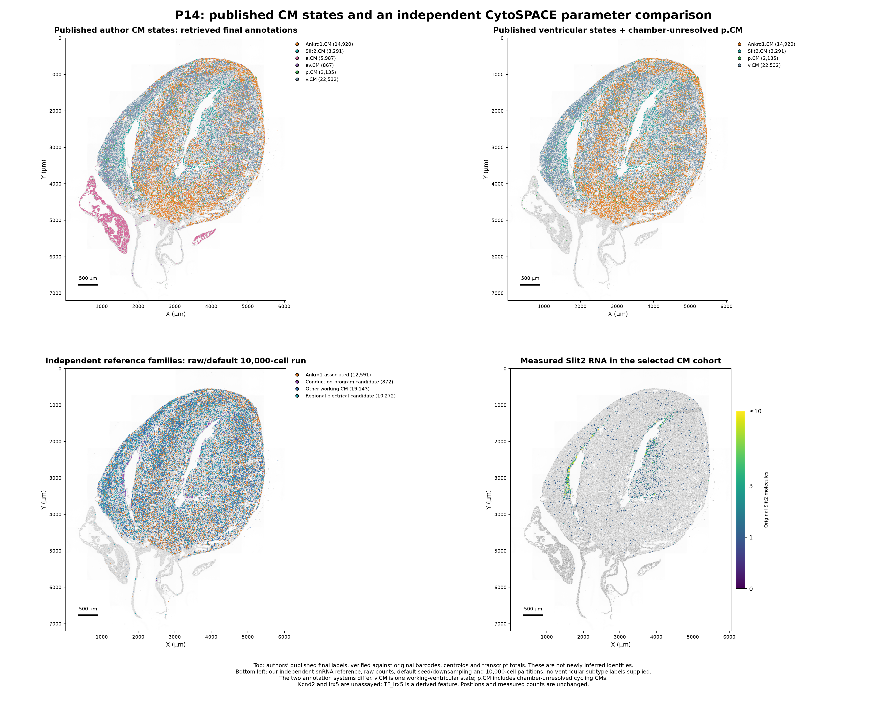

# Published heart-atlas CM states and an independent CytoSPACE parameter baseline

The authors’ public WebAtlas annotations were retrieved successfully on 22 October 2026. All **403,168 published cells** match the deposited Xenium data by explicit barcode, with **identical native centroids and transcript totals**. The maps below display the authors’ actual final CM-state labels, alongside a new independent-reference CytoSPACE run. This separates recovery of published labels from independent inference of our finer RNA groups.

**The new run is a parameter/cohort comparison, not an exact reproduction of the authors’ pipeline.** Their original annotated RNA reference objects, original spatial input-label files and original snRNA-to-Xenium barcode pairs have not been recovered. Published final labels are a comparison layer, not independent biological ground truth.

| Stage | Original segments | Published atlas labels | Selected ventricular/cycling cohort |
| --- | --- | --- | --- |
| P0 | 47,611 | 46,747 | 25,596 |
| P7 | 99,429 | 98,188 | 38,775 |
| P14 | 117,070 | 114,524 | 42,878 |
| P21 | 143,944 | 143,709 | 53,807 |

The 4,886 original segments absent from the published atlas remain in the downloadable all-cell tables, explicitly marked as absent. Their reason for exclusion is not inferred. Cell IDs are section-specific: prefix the stage before pooling.

## Published ventricular-associated states

| Published state | P0 | P7 | P14 | P21 | Interpretation |
| --- | --- | --- | --- | --- | --- |
| v.CM | 6,298 | 11,086 | 22,532 | 24,588 | Working ventricular state: contraction and myocardial function; not an umbrella for all ventricular CMs. |
| Ankrd1.CM | 6,796 | 11,795 | 14,920 | 27,877 | Mechanosensitive/stress-response-associated state; the paper describes LV/peri-arteriolar enrichment. RNA does not measure local wall stress. |
| Slit2.CM | 2,548 | 1,525 | 3,291 | 1,342 | Trabecular/endocardial-associated ventricular state in the paper. Not equivalent to verified Purkinje identity. |
| Ddc.CM | 4,867 | 7,795 | 0 | 0 | Early Ddc-expressing state. Metabolic adaptation is an exploratory interpretation from our RNA profiles; its specific function remains unresolved. |
| p.CM | 5,087 | 6,574 | 2,135 | 0 | Cycling/proliferative transcriptional state; expression does not establish completed cell division or a purely ventricular origin. |

**v.CM is one published working-ventricular state.** Ankrd1.CM, Slit2.CM and Ddc.CM are additional ventricular-associated states. The paper also includes a.CM (atrial) and av.CM (atrioventricular); those appear in the all-CM maps but are excluded from the new mapping cohort. **The p.CM label is not chamber-specific:** we retain it as a separately named cycling comparison group. The combined cohort is therefore not a strictly chamber-verified ventricular population. Mapping p.CM to our ventricular RNA reference cannot establish ventricular identity for an individual p.CM segment.

For comparisons across all four ages, the consistent published groups are **v.CM, Ankrd1.CM and Slit2.CM**. Ddc.CM can be compared at P0/P7, and p.CM at P0/P7/P14. Zero published labels at an age do not prove biological absence. Counts describe these four sections and their annotation, not independent animal-level abundance estimates.

## Section maps and measured markers

[Five-page PDF: all four sections plus measured-marker profiles](published_CM_maps_and_independent_baseline.pdf)

| Stage | Figure | Author labels and all original cells | Native pairs with RNA IDs |
| --- | --- | --- | --- |
| P0 | [PNG](P0/P0_published_CM_states_and_baseline.png) · [PDF](P0/P0_published_CM_states_and_baseline.pdf) | [TSV.gz](P0/original_cells_with_author_labels.tsv.gz) | [TSV.gz](P0/independent_default_parameters/annotated_assignments.tsv.gz) |
| P7 | [PNG](P7/P7_published_CM_states_and_baseline.png) · [PDF](P7/P7_published_CM_states_and_baseline.pdf) | [TSV.gz](P7/original_cells_with_author_labels.tsv.gz) | [TSV.gz](P7/independent_default_parameters/annotated_assignments.tsv.gz) |
| P14 | [PNG](P14/P14_published_CM_states_and_baseline.png) · [PDF](P14/P14_published_CM_states_and_baseline.pdf) | [TSV.gz](P14/original_cells_with_author_labels.tsv.gz) | [TSV.gz](P14/independent_default_parameters/annotated_assignments.tsv.gz) |
| P21 | [PNG](P21/P21_published_CM_states_and_baseline.png) · [PDF](P21/P21_published_CM_states_and_baseline.pdf) | [TSV.gz](P21/original_cells_with_author_labels.tsv.gz) | [TSV.gz](P21/independent_default_parameters/annotated_assignments.tsv.gz) |

Each section figure shows (1) the authors’ seven CM labels, (2) ventricular-associated labels plus chamber-unresolved p.CM, (3) independent-reference program families assigned under default CytoSPACE parameters, and (4) original measured Slit2 molecules. All panels retain the original section geometry in micrometers; DAPI and counts come from the deposited data. No coordinates are moved to improve apparent separation.



[Measured-marker dot plot](measured_markers_by_published_CM_state.png) · [PDF](measured_markers_by_published_CM_state.pdf) · [numerical detection/count profiles](measured_marker_profiles_by_author_CM_state.tsv)

The raw panel profiles are consistent with the naming of several published states: Slit2 is detected in approximately 45–58% of Slit2.CM segments, Ddc in almost all Ddc.CM segments, and Mki67 in approximately 68–90% of p.CM segments. These measured genes also contribute to the original annotation/matching, so this is descriptive marker support rather than independent validation. Ankrd1 is detected broadly outside Ankrd1.CM; positivity alone is not a subtype rule. The dot plot shows detection fraction and within-gene standardized mean log1p(CP10k), not significance or animal-replicated differential expression.

A descriptive spatial check places Slit2.CM close to author-labeled endocardial ECs: median nearest distances are **17.0, 19.9, 42.2 and 15.4 µm** at P0/P7/P14/P21, compared with **69.7, 108.5, 169.8 and 162.6 µm** for v.CM. This agrees with the paper’s trabecular/endocardial interpretation. These distances use the same published label system and depend on section geometry and EC density; they are not an independent anatomical test, a transmural-depth measure or evidence of Purkinje identity. [All EC-distance summaries](descriptive_distances_to_author_EC_states.tsv).

**Kcnd2 and Irx5 are absent from the 403 measured targets and from the unprefixed public-atlas feature list.** The public object contains 403 measured-panel features, 220 `TF_` features and 423 `CC_` features (424 at P0). `TF_Irx5` is a derived TF/regulon-type activity feature, not measured Irx5 RNA. Only annotations, coordinates and feature names were downloaded from the atlas here; no derived expression/activity matrix was substituted for measured counts. The public browser export is not the complete genome-wide assigned RNA assay described in the paper.

## Independent CytoSPACE baseline

Unmodified upstream CytoSPACE 1.1.0 (`bb7fe12ab4466ef5e38dcac4c3ece07012060d60`) was run in single-cell mode with original integer snRNA counts, 381 shared genes, default seed 1, default reference molecule downsampling at 1,500, duplicate sampling, Pearson/LAPJV matching and 10,000-cell partitions. Two workers were used for available memory/CPU. The independently QC-reviewed stage-matched ventricular RNA reference contains 11,046 / 13,040 / 11,042 / 9,335 nuclei; it is not the authors’ original reference. Input orders were randomized using NumPy default_rng(1).

The spatial cohort follows the five final published states above, excluding only zero shared-panel RNA. All reference and spatial input labels are the same broad `Ventricular_CM` label. **No fine subtype labels, desired subtype proportions or fixed correspondence to the five published states were supplied.** RNA families/groups are copied from the selected reference nucleus afterward. The resulting 161,056 pairs are raw native assignments; we do not apply the previous analysis’s multiseed/library/held-out fine-state acceptance rules to this baseline.

| Stage | Native pairs | Median assigned-profile r | Median shuffled-profile r | Family agreement with previous run (overlap only) |
| --- | --- | --- | --- | --- |
| P0 | 25,596 | 0.462 | 0.341 | 68.8% |
| P7 | 38,775 | 0.423 | 0.303 | 45.7% |
| P14 | 42,878 | 0.469 | 0.368 | 47.1% |
| P21 | 53,807 | 0.477 | 0.379 | 46.8% |

The reported profile correlations are descriptive fits to the same 381 genes used during matching, against the original reference profiles after log2(1+CPM) normalization. They are not held-out recovery or subtype accuracy. For approximately 0.004%, 0.005%, 0.807% and 0.913% of assigned pairs, respectively, the selected original RNA profile exceeds 1,500 shared molecules; those rows are flagged because the displayed original-profile correlation is not the exact internally downsampled fit. Shuffling the assigned reference IDs within the same-stage ventricular set supplies a descriptive baseline, not a spatial/animal-level null model.

On cells shared with the previous original-count run, family agreement is 46–69%. This is a sensitivity result, not evidence that one map is more biologically accurate: the cohort, seed, partition size, molecule handling and input order all differ. The authors’ final states and our RNA program families also have different definitions. [Cross-tabulations](P14/published_vs_independent_program_crosstab.tsv) use a documented partial correspondence (including an explicitly tentative Slit2/conduction-program correspondence); their agreement field must not be interpreted as classification accuracy. Regional electrical, DNA-associated and other unmatched families remain distinct.

Native CytoSPACE uses expression matching here; coordinates place the assignments on the section but do not supply a spatial-neighbor penalty. The paper’s separate CellCharter neighborhood analysis should not be conflated with CytoSPACE matching. Both methods can produce a complete map, while finer labels still require validation. See the [released-author-workflow comparison](../cytospace_xenium/author_pipeline_comparison.md) and [previous independent stability/held-out analysis](../cytospace_xenium/README.md).

The new cohort also retains author-labeled ventricular cells previously flagged for overlapping CM/EC programs. [Cross-tabulation of those review cells](previous_CM_EC_review_vs_author_state.tsv) preserves that discrepancy rather than declaring either annotation definitive. A published label does not resolve segmentation leakage or mixed-lineage evidence by itself.

## Files, provenance and reproduction

- [All published cell-state counts](author_cell_state_counts.tsv), [CM counts by stage](published_CM_state_counts_by_stage.tsv), [stage summary](stage_summary.tsv) and [native comparison summary](independent_parameter_baseline_summary.tsv).
- Per stage, `author_atlas_annotations.tsv.gz` preserves the exported `author_row_id`, explicit `cell_id`, final `cytoSPACE.final.anno`, count totals, native centroids and separate atlas display coordinates. Numeric row indices are not treated as barcodes.
- Per stage, `original_cells_with_author_labels.tsv.gz` retains every original segment and previous QC/review metadata, with the new `author_atlas_cell_state` and `present_in_author_atlas` fields. The native pair table includes `SpotID`, `OriginalCID`, RNA sample/group/family and profile diagnostics. Repeated RNA IDs are expected under duplicate sampling; they are not independent observed transcriptomes.
- Per-stage HTTP provenance records source URLs, SHA-256, ETag and Last-Modified. Only small Zarr annotation/coordinate arrays were fetched. The public source is `https://heart-atlas.s3.us-east-2.amazonaws.com/{stage}/heart-xenium-anndata.zarr/`, with lowercase stage names. Missing S3 objects may return 403; successful array access is verified individually.
- [Validation](validation.json), [methods](methods.json), [file checksums](manifest.json), plus per-stage acquisition and native run manifests. Original expression H5ADs and the 381-gene RNA bundle remain in the [preceding source-data report](../xenium_ventricular_mapping/README.md).

```bash
# Main scientific Python environment; CytoSPACE uses its separate pinned runtime.
python analysis/acquire_author_heart_atlas.py
python analysis/run_author_parameter_baseline.py
python analysis/analyze_author_atlas_baseline.py
python analysis/plot_author_atlas_baseline.py
python analysis/validate_author_atlas_baseline.py
python analysis/write_author_atlas_report.py
```

Paths and runtime setup follow the [CytoSPACE report](../cytospace_xenium/README.md). Acquisition caches HTTP objects; native run manifests skip completed stages. Clear the relevant derived cache/run directories before deliberately changing source inputs or parameters. Python/scientific-library versions are recorded in methods.json. Validation checks every barcode/coordinate/count-total join, native cohort and RNA IDs, reference reuse, input hashes and all marker summaries, plus 100 independently recalculated correlations per stage. These are numerical checks, not biological validation.

Sources: [postnatalheartatlas.org](https://postnatalheartatlas.org), [article](https://pmc.ncbi.nlm.nih.gov/articles/PMC13561863/), [author code snapshot](https://github.com/whfbio/PIP_seq/tree/102d80e6ea5de44f594461c727a4b3c6e1bc3508), GSE290989 and Xenium Zenodo [P0/P7](https://zenodo.org/records/14961929) / [P14/P21](https://zenodo.org/records/14961942). Credit for published state labels belongs to the paper’s authors; figures here are newly generated from the deposited data and recovered annotation tables. Xenium/DAPI source data: Wang, Dong, Song, Qian and Liu, CC BY 4.0. CytoSPACE: Vahid et al., Nature Biotechnology 2023, [DOI](https://doi.org/10.1038/s41587-023-01697-9); [upstream code/license](https://github.com/digitalcytometry/cytospace).

There is one analyzed section per stage. Stage is therefore confounded with section-level effects for spatial comparisons; no independently replicated animal-level inference is claimed. RNA program labels remain provisional, and spatial proximity or predicted expression does not establish electrophysiology, oxygen exposure or local mechanical load.
