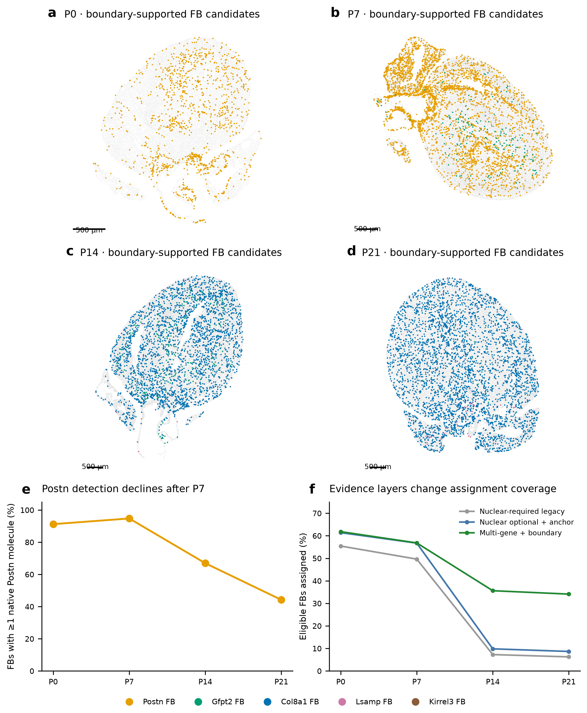
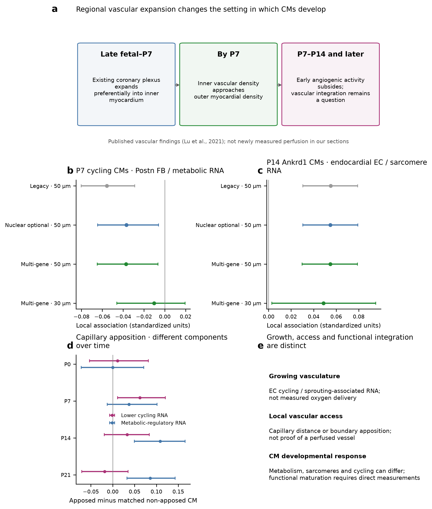
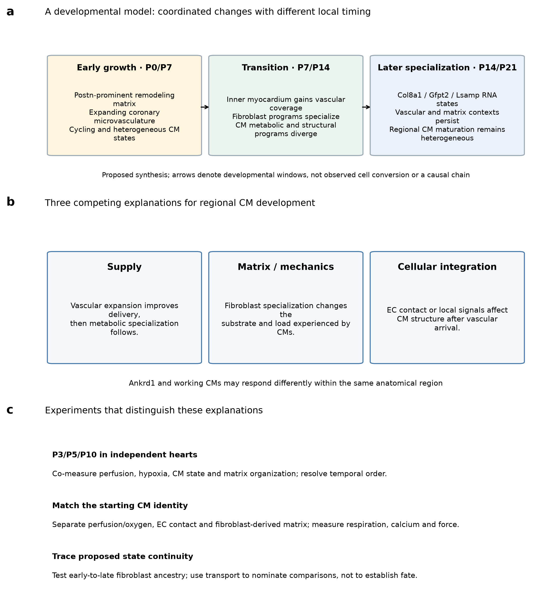

# Regional coordination of muscle, matrix and vascular development in the postnatal heart

## Abstract

After birth, the heart must enlarge its muscle mass, extend its blood supply and acquire the capacity for sustained contraction. These processes need not advance at the same rate in every region. We examined how ventricular cardiomyocyte identities and maturation-associated programs relate to fibroblast specialization and endothelial context in the deposited P0–P21 heart atlas. Ankrd1-associated and working ventricular cardiomyocytes each contained substantial maturation heterogeneity within early sections. Early Postn-prominent fibroblast states gave way to a more specialized RNA landscape containing Col8a1-, Gfpt2- and Lsamp-associated families. Col8a1 fibroblasts expressed relatively stronger basement-matrix programs, with a partial vascular-associated spatial component. Published lineage-tracing work places these changes alongside expansion of pre-existing coronary vessels, especially into the developing inner myocardium. Our spatial analyses distinguish this growth phase from vascular apposition and later cardiomyocyte specialization: relationships differ among cardiomyocyte identities and among metabolic, structural and cycling programs. Relaxing compulsory nuclear confirmation broadens fibroblast assignment, but reveals persistent reference disagreement for late Gfpt2 cells and weakens an early Postn–cardiomyocyte association. A later Ankrd1-cardiomyocyte/endocardial structural association persists in this sensitivity. Neighborhood transport nominates developmental comparisons without establishing ancestry. Together, the findings motivate a model of regional developmental coordination in which changing matrix and vascular environments accompany different aspects of cardiomyocyte development. Perfusion, mechanics and cell contact remain experimentally distinguishable explanations.

## Introduction

Postnatal cardiac development is a tissue-building problem. Cardiomyocytes increase their contractile capacity and reorganize their metabolism while the ventricular wall grows and its extracellular framework changes. A coronary network must reach and support the expanding muscle. Fibroblasts must provide an environment compatible with tissue growth, vessel organization and force transmission. The relevant biological question is therefore how these processes become coordinated in space and time, and why cardiomyocytes within the same heart can occupy different developmental states.

The Heart Atlas provides a spatial and transcriptional framework for asking this question [1]. Our extension follows specific ventricular cardiomyocyte identities, fibroblast families and endothelial types rather than pooling each lineage into one population. An Ankrd1-associated cardiomyocyte may share a maturation score with a working ventricular cardiomyocyte while occupying a different environment. Similarly, an endothelial neighbor may be part of the coronary microvasculature or the endocardial lining, with different developmental and physiological implications.

The perinatal vascular study by Lu and colleagues provides an essential anatomical context [2]. It showed that the existing coronary plexus expands into the growing myocardium around birth, with particularly strong expansion in the inner ventricular wall. This establishes a developmental process against which to interpret spatial associations. It does not establish that every nearby endothelial cell delivers blood, or that endothelial proliferation directly drives cardiomyocyte maturation. We use that distinction to organize the biological interpretation and the experiments that follow.

## Results

### Cardiomyocyte identity does not determine a single maturation state

At P0 and P7, both Ankrd1-associated and working ventricular cardiomyocytes occupied broad ranges of maturation-associated transcription within the same section (Fig. 1). Thus, the early ventricle contains a mosaic of developmental states within recognizable cardiomyocyte identities. Subtype identity and maturation describe different features of these cells; neither should substitute for the other.

Regional identity provides an additional organizing axis. Slit2-associated cardiomyocytes favored endocardial or cavity-facing environments in the released annotations. Ankrd1 expression had a partial association with candidate arterial environments, particularly at P7 and P14, but was not confined to them. Because Ankrd1 can accompany mechanical adaptation, this pattern motivates investigation of regional loading and matrix context. It does not establish a dedicated peri-arterial cardiomyocyte lineage or pathological stress in the normally developing heart.

These observations suggest that spatially uneven development should be examined within each cardiomyocyte identity. A relatively mature Ankrd1 cell and a relatively immature Ankrd1 cell can then be compared without first assuming that all differences arise from ventricular subtype composition. Conversely, two identities with similar overall maturation scores may still differ in structural or metabolic programs and in their neighboring cells.

### Early fibroblast remodeling is followed by matrix specialization

The reviewed RNA data describe a developmental change from prominent early Postn-associated states toward later Col8a1-, Gfpt2- and Lsamp-associated fibroblast families (Figs. 2 and 3). This is consistent with a transient developmental remodeling state becoming less prominent as the postnatal heart acquires more specialized extracellular environments. Early Postn-associated activity should be interpreted in the context of normal tissue construction, rather than automatically equated with pathological fibrosis.

The families also differ in what they appear equipped to contribute. Col8a1-associated fibroblasts had stronger basement-matrix-associated RNA than Gfpt2 fibroblasts at both P14 and P21, with the same direction in both RNA libraries. Gfpt2 fibroblasts retained a distinguishable matrix/metabolic-associated program. Later Col8a1/Svep1 and Col8a1/Hmcn2 substates suggest heterogeneity in adhesion and matrix organization, while Lsamp-associated substates include elastic-matrix and collagen-IV-associated features. These are functional interpretations of transcriptional programs; matrix deposition, stiffness and turnover were not directly measured.

Spatial context gives this specialization a possible tissue role. In the earlier confidence-supported P14 comparison, approximately 19% of Col8a1 fibroblasts, versus 6% of matched Gfpt2 fibroblasts, lay within 50 µm of a candidate arterial envelope. Most Col8a1 fibroblasts were outside that envelope. The relevant hypothesis is therefore a vascular-associated component within a broader matrix-specialized population, rather than an exclusively peri-arterial Col8a1 type. Such a component could participate in organizing the interface between growing muscle and vessels, a possibility requiring protein-level and anatomical validation.

Postn RNA declines substantially by P21, but the processed datasets retain residual detection in later fibroblasts. Loss of a dominant Postn-named family should therefore be distinguished from complete absence of the transcript. The biological conclusion is a change in the prominence and combination of fibroblast programs; the absence of a late Postn cluster alone cannot establish extinction of every Postn-expressing cell.

### Broader fibroblast evidence recovers spatial information without resolving every late family

We reconsidered the requirement that a fibroblast subtype be supported independently by nuclear transcripts. Whole-cell and boundary-core agreement can support a useful candidate assignment even when the nucleus contains too few informative molecules. Accordingly, the revised sensitivity treats nuclear support as additional evidence and uses a supported conflicting nuclear call as counterevidence. It does not treat missing nuclear markers as a reason to reject an otherwise concordant cell-based call.

This change recovers additional spatial sources. However, the late-stage coverage problem is broader than nuclear sparsity. Requiring detection of the family's naming marker also excludes many cells whose multi-gene profile supports Col8a1 identity. An additional boundary-supported multi-gene candidate layer therefore retains reference consistency and several measured markers without demanding that individual anchor. The resulting maps recover a larger late Col8a1 component (Fig. 2), while retaining unresolved cells and clearly separating candidate assignments from the original stringent labels.

Late Gfpt2 remains a different problem. Most P21 fibroblasts carrying the public Gfpt2 label receive another family proposal from our whole-cell classifier before nuclear confirmation. Removing the nuclear requirement cannot resolve that disagreement (Fig. S1). We therefore retain the public Gfpt2 proposal alongside the cell-based evidence instead of concluding that this population is biologically rare or forcing the cells into a preferred family. Gfpt2-specific late spatial conclusions remain provisional.

The original atlas used membrane and interior staining to improve segmentation and benchmarked its boundaries against manual outlines. Its supplement shows improvement over nucleus expansion but substantially poorer absolute boundary agreement at P21. This makes late subtype placement particularly sensitive to cell geometry and transcript ownership. It reinforces the need to preserve boundary-sensitive evidence layers, without establishing segmentation as the sole explanation for Gfpt2 reference disagreement.

### Coronary expansion provides a regional developmental sequence

Lu and colleagues showed that perinatal vascular growth proceeds from pre-existing coronary vessels, with a particularly active plexus in the inner myocardium [2]. The expansion begins before birth, extends into developing trabecular myocardium and accompanies regional hypoxia and ventricular wall growth. Inner myocardial vascular density approaches outer myocardial density by P7; the early angiogenic activity appears to subside between P7 and P14. This describes a regionally concentrated growth process, rather than uniform addition of vessels throughout the ventricular wall (Fig. 4a).

An equally important result is the distinction between the coronary plexus and the ventricular endocardium. Perinatal labeling of ventricular endocardial cells did not identify them as the source of the expanding postnatal coronary network. Endocardial proximity can therefore mark a cavity-facing developmental environment without implying that the nearby endocardial cells become coronary capillaries. Similarity between their transcriptomes or a transport correspondence would not overturn the lineage-tracing evidence.

This vascular sequence suggests that regional cardiomyocyte development occurs against a changing supply network. Initially, expanding vessels and growing cardiomyocytes can coexist in the same developmentally active territory. Subsequently, vascular coverage, perfusion, matrix organization and cell contact may change the conditions under which cardiomyocytes acquire metabolic and structural specialization. The latter sequence is a hypothesis informed by the vascular study; our four sections do not measure the arrival or perfusion of individual vessels over time.

### Vascular growth and cardiomyocyte specialization are coupled in different ways

The spatial results do not support a simple rule that cardiomyocytes near cycling endothelial cells are uniformly less mature. Early endothelial and cardiomyocyte nuclear cycling were positively associated locally, consistent with coordinated growth of muscle and vessels. This relationship was not equivalent to a consistent reduction in the overall cardiomyocyte maturation index. A growing vascular territory may contain cardiomyocytes that are still cycling while already expressing some metabolic or contractile maturation programs.

Vascular apposition shows a different pattern. In the preceding anatomically and technically matched analysis, capillary-apposed cardiomyocytes had lower cycling-associated RNA at P7 and higher metabolic-regulatory RNA at P14 and P21 (Fig. 4d). The outcome, developmental interval and source definition matter: stricter nuclear capillary definitions attenuated some effects. These observations are consistent with growth and subsequent vascular integration accompanying different components of cardiomyocyte development. They do not demonstrate perfusion, an oxygen effect or a direct contact mechanism.

Resolving the neighboring subtypes further narrows the hypotheses. In the original stringent source analysis, P7 cycling cardiomyocytes in a Postn-supported fibroblast context had lower metabolic-regulatory RNA. The negative direction persists after allowing nuclear-optional fibroblast assignments, but weakens and no longer passes the same within-section multiple-testing criterion; the relationship is also unsupported at the smaller neighborhood radius (Fig. 4b). It should therefore motivate examination of a growth-associated matrix environment, rather than a claim that Postn fibroblasts suppress cardiomyocyte maturation.

At P14, the association between endocardial-like endothelial context and sarcomere RNA within Ankrd1 cardiomyocytes persists when the fibroblast source definitions are broadened (Fig. 4c). The corresponding working-cardiomyocyte association was much smaller in the original analysis. This points to a structural response that may depend on cardiomyocyte identity and regional environment. Because the overall maturation index does not show an equivalent strong relationship, the finding concerns a component of specialization, not uniformly accelerated maturation. Cavity-facing anatomy, mechanical loading and endocardial signals remain competing explanations.

### Neighborhood correspondence nominates regional continuity, not cell fate

Optimal transport asks which observed environments at adjacent ages are most similar under an explicit molecular and cellular representation. We restricted comparisons to the same focal cardiomyocyte identity and a comparable endocardial-distance category. This prevents a broad mixture of cell lineages from being mistaken for continuity of a specific cardiomyocyte environment (Fig. 5).

Some correspondences aligned relative cardiomyocyte maturation across stages even though maturation was not used to construct the transport. In one endocardial-distant Ankrd1 comparison from P7 to P14, the matched environments had more similar within-stage maturation ranks than all possible pairs. The proximal comparison did not show the same pattern. The biological opportunity is to identify where a developmental ordering might be conserved while the surrounding cell states change, rather than assume one universal sequence across the ventricle.

Wormhole captured broad neighborhood similarity with variable agreement on fine matches. The current analysis therefore supports selected comparisons for additional sampling, rather than a definitive transition map. Separately, RNA-state resemblance nominates early Postn-to-later Col8a1 and persistent Gfpt2 comparison sets. Neither transport mass nor signature resemblance establishes that an individual fibroblast changed family or that a cardiomyocyte followed a measured trajectory.

## Discussion

The biological synthesis is a model of regional developmental coordination. The early heart contains a remodeling extracellular environment, an expanding coronary network and heterogeneous cardiomyocyte growth states. Later, fibroblast programs become more specialized and cardiomyocyte metabolic and structural programs vary with vascular and anatomical context. The observations support asking how these processes fit together within a myocardial region, while leaving their temporal order and causal dependencies open (Fig. 6).

The vascular study makes that model anatomically specific. Inner myocardial growth creates a territory in which vascular expansion is particularly pronounced, with vessel density catching up during the first postnatal week. This provides a reason to expect asynchronous cardiomyocyte development within a section. A region still undergoing rapid tissue and vascular construction may differ from a region in which vessels are already integrated. However, lower metabolic maturation cannot be assumed wherever sprouting occurs, because growth, oxygen exposure, load and cell-cycle exit can overlap rather than switch together [2,4,5].

Fibroblast specialization introduces a second dimension. A changing matrix can influence tissue compliance, mechanical coupling and the organization of the muscle–vascular interface. The late Col8a1 basement-matrix program and its partial vascular context make this a concrete hypothesis. The critical next comparison is whether matrix organization explains cardiomyocyte structural or metabolic differences after accounting for actual vascular function and starting cardiomyocyte identity. A fibroblast marker or local enrichment alone cannot answer that question.

Three explanations can be separated experimentally. A supply-led model predicts that improved perfusion and reduced regional hypoxia precede changes in cardiomyocyte metabolism. A matrix/mechanics-led model predicts that fibroblast-derived matrix organization explains additional variation after vascular access is matched. A cellular-integration model predicts an effect of endothelial apposition or local signaling beyond delivery and matrix properties. These mechanisms may cooperate, but each makes a different prediction under controlled manipulation.

The most informative developmental observations would come from independent hearts at P3/P5 and around P10, with matched ventricular regions and simultaneous measurements of vessel structure, perfusion, hypoxia, fibroblast state and cardiomyocyte phenotype. Early growth should be distinguished from later integration using three-dimensional vascular imaging and functional labeling of perfused vessels. Cardiomyocyte measurements should include cell size, sarcomere organization, calcium handling and contraction, with completed cytokinesis assessed separately from cell-cycle RNA. Inferred intermediate transcriptomes cannot supply these missing observations.

Experiments should then match the relevant subtype comparison. An early Postn-versus-Gfpt2 fibroblast environment can be tested around defined early cardiomyocyte states while holding endothelial support and oxygen constant. An endocardial-like-versus-capillary endothelial comparison can be tested with Ankrd1-associated and working cardiomyocytes while separating direct contact, diffusible support and matrix. RNA-defined identities require confirmation in the experimental system. Lineage tracing of early fibroblast states addresses the separate question of whether later specialization reflects ancestry, state change or replacement.

One spatial section per age, incomplete fine-type separation and the absence of direct vascular-function measurements limit the current claims. Broader cell-based evidence improves coverage without eliminating reference disagreement. The resulting contribution is a set of biologically focused comparisons and discriminating experiments: which matrix environments accompany which cardiomyocyte states, where coronary growth and integration occur relative to those states, and which aspect of development changes first.

## Methods

### Data, frozen identities and scope

This is a secondary analysis of deposited P0, P7, P14 and P21 snRNA-seq and Xenium heart data [1]. Original spatial coordinates, broad lineage calls and earlier released results are unchanged. Existing snRNA-seq doublet/ambient-RNA QC, reviewed fibroblast families, nuclear-anchored segmentation, tissue-screened graphs and cardiomyocyte score components are reused. There is one available spatial section per age. Processing agreement does not supply independent biological replication. The full author anatomical masks, original score objects and neighbor-level inputs were unavailable for exact replication of the original Figure 4e.

### Cardiomyocyte populations and maturation

The subtype analysis uses ventricular-marker-supported cells with compatible released CM states (v.CM, Ankrd1.CM, Slit2.CM, Ddc.CM and the ventricular-gated subset of p.CM), an independent morphology selector, at least 20 core-panel molecules and at least 20 outcome-excluded molecules. The measured 21-gene maturation panel and its metabolic-regulatory, sarcomere, excitation/contraction and cycling-withdrawal components are frozen from the preceding reconstruction. Missing nuclear area alone does not exclude a CM. Within-stage-by-identity quartiles define descriptive low/high groups; these are relative ranks, not equivalent physiological maturity across ages. The panel includes Myl2, which partly overlaps ventricular selection.

### Fibroblast assignment reassessment

The original atlas segmentation approach is reviewed separately in the supplementary assessment. It combines membrane, interior and nuclear staining, with manual boundary benchmarking in five P0 and five P21 image fields. The reported TP/(TP+FP+FN) score at a 90% overlap threshold measures object detection/boundary agreement, not transcript ownership. Visual plot readings show lower agreement at P21. The exact overlap normalization and relevant on-instrument version/parameters are not specified in the cited Methods sections. Our candidate layers preserve that uncertainty; no segmentation is treated as universally correct.

All source layers require existing eligible broad fibroblast identity and segmentation/source QC. The legacy layer additionally requires the earlier whole-cell/nuclear consensus. The new whole-cell layer applies the inherited assignment gates to nuclear-anchored cell counts: family weight at least 0.6, margin at least 0.15, agreement across both reference libraries and raw/corrected reference views, at least two supplied measured markers including one family anchor, sufficient training information, and no mixed CM/FB flag. These weights are operational model weights, not calibrated probabilities.

The boundary-supported, nuclear-optional layer requires the whole-cell and high-confidence boundary-core views to pass these gates and agree on family. Either nuclear view providing a supported alternative family vetoes the call. Absent or insufficient nuclear support does not veto it. The multi-gene boundary candidate layer applies the same rule except that no individual anchor is compulsory in either view; the requirement for at least two supplied markers and all reference-consistency, capture, margin and cell/core checks remains. This is a candidate sensitivity, not independently validated identity. Cell and core views share molecules, and their concordance is not an independent accuracy estimate. No spatial smoothing, target family quota or cross-age restoration of Postn labels is applied.

Coverage tables distinguish each evidence layer from the public label comparator. The public comparator uses eligible fibroblasts with the released family label, not the full tissue population. Gate-audit pass counts are independent, overlapping checks and must not be subtracted as a sequential attrition series. Every fibroblast profile and its conflicting or unresolved evidence is retained in the exported annotation tables. Direct Postn evidence is summarized from native Xenium counts without a fine-family requirement, with at-least-one-molecule detection and mean log-normalized expression per 10,000 measured-panel molecules. This panel normalization is not a full-transcriptome denominator or an ambient-free measurement. Existing corrected/raw library-by-family snRNA pseudobulks provide a separate expression view.

### Spatial neighborhoods and model sensitivity

The primary geometry is the frozen tissue-screened 50-µm graph; 30-µm and shared-boundary graphs provide sensitivity checks. Eligible focal CM cohorts and endothelial source definitions are held fixed when fibroblast source layers are changed. Source and focal broad lineages are disjoint. Each fibroblast-family fraction divides by all eligible fibroblast neighbors, including unresolved families. Endothelial fractions retain the corresponding eligible-lineage denominator. Models require at least five resolved neighbors and one eligible fibroblast and endothelial neighbor; tested source categories require at least 30 source profiles and at least 50 positive CM exposures.

Joint models retain all eligible source-subtype fractions, capture, cell area, nuclear missingness, neighbor counts, source capture, broad non-CM composition and anatomical distance proxies. Within-region fits demean within 200-µm blocks separately for each CM identity. Common stage-level standardization permits slope comparisons across CM identities. The same 512 shared 400-µm block resamples as the earlier model provide exploratory within-section intervals. Approximate tests use bootstrap standard errors; BH correction is calculated within each age, geometry and source layer across the full tested state/source/outcome grid. These are not heart-level tests. The changed candidate exposure scales and annotation coverage qualify comparisons of coefficient magnitude. Full model grids, including unsupported contrasts, are exported.

### Earlier results incorporated into the biological synthesis

The matrix-program plate retains full-RNA library-by-family pseudobulks, raw/corrected sensitivity and selected marker-withheld signature comparisons from the previous release. Its family maps use that earlier confidence-supported source version, explicitly distinguished from the new candidate maps. The partial vascular Col8a1 comparison likewise reuses the previous capture/area/nuclear-fraction/density-matched descriptive analysis; an arterial envelope is not a traced vessel wall. The capillary-apposition plate reuses the earlier same-region and CM-state matched reconstruction, with capture, area, perimeter and local capillary-area matching. It involves a broader CM cohort than the subtype-conditioned models. Its score-component differences do not establish contact signaling, oxygen delivery or functional maturation.

### Neighborhood transport

The transport plate retains the frozen 96 reserved neighborhoods: 12 per stage and focal identity (v.CM or Ankrd1.CM), with four at endocardial-proxy distance at most 100 µm and eight farther away. The selection does not require membership in either broad niche cluster. Up to 32 observed non-CM profiles per neighborhood enter the saved molecular/lineage representation (16 molecular PCs and six lineage features). Exact squared Wasserstein costs and the saved Wormhole encoder are compared within the same CM identity and distance stratum [3]. Uniform cross-sectional correspondence mass is not a proliferation, transition or survival rate. Maturation ranks are withheld from distances and plans. The figure's fine-source descriptors retain the frozen stringent assignment version; the new fibroblast candidates do not retrain or alter the transport. Rank-gap examples are exploratory comparisons of relative within-stage ranks, not a developmental clock or ancestry test.

### Validation and reproducibility

Assignment checks reconstruct source masks and require cell/core agreement, measured-marker and reference support, optional nuclear evidence and explicit counterevidence vetoes for every released candidate. Independent graph arithmetic is checked for sampled focal cells. Selected coefficients are independently refitted using centered least squares. Previously validated transport plans and source figure hashes are preserved. Word media hashes, figure resolution, PDF page bounds, output checksums and download integrity are verified for the release. Journal PDFs are not redistributed. Scripts, source tables, complete candidate annotations and an evidence/status table accompany the editable manuscript.

## References

1. Wang H et al. Spatially guided in vivo single-cell functional genomics of postnatal heart. Nature Cardiovascular Research (2026). https://doi.org/10.1038/s44161-026-00861-z

2. Lu P et al. Perinatal angiogenesis from pre-existing coronary vessels via DLL4–NOTCH1 signalling. Nature Cell Biology 23, 967–977 (2021). https://doi.org/10.1038/s41556-021-00747-1

3. Haviv A et al. Wasserstein Wormhole: Scalable Optimal Transport Distance with Transformers. ICML (2024). https://arxiv.org/abs/2404.09411

4. Puente BN et al. The oxygen-rich postnatal environment induces cardiomyocyte cell-cycle arrest through DNA damage response. Cell (2014). https://doi.org/10.1016/j.cell.2014.03.032

5. Mahmoud AI et al. Meis1 regulates postnatal cardiomyocyte cell cycle arrest. Nature (2013). https://doi.org/10.1038/nature12054

## Integrated figures

### Figure 1. CM identity and maturation vary independently within early hearts

a,b, Named ventricular-associated cardiomyocyte states at P0 and P7. c,d, Percentiles of the directly measured 21-gene maturation index within each section. e,f, Score distributions within each identity. Labels retain the released reference identities. These are relative transcriptional scores, not percentages of physiological maturity. Focal selection, coordinates and scores are unchanged from the preceding subtype analysis. Scale bars, 500 µm.

### Figure 2. Fibroblast programs change as the postnatal heart develops

a–d, Whole-cell/boundary-core multi-gene fibroblast candidates on the four native sections; gray shows resolved broad-lineage background. Nuclear support is optional; supported conflicting nuclear evidence vetoes assignment. Missing individual anchor detection alone does not reject these candidates. Unresolved profiles remain in the atlas. e, Direct native Postn detection among eligible broad fibroblasts; residual detection is not proof of a distinct late Postn family or ambient-free expression. f, Assignment coverage under three evidence layers. Counts are operational coverage rather than unbiased subtype abundance. Scale bars, 500 µm.

### Figure 3. Later fibroblast states differ in matrix-associated programs

The earlier integrated fibroblast plate is retained without changing its data: confidence-supported family maps, full-RNA library-by-family matrix programs, named P21 RNA substates and selected marker-withheld cross-stage signature similarities. These spatial maps retain the earlier stringent family version; the broader candidate maps are in Figure 2. Higher basement-matrix RNA in late Col8a1 versus Gfpt2 families motivates a matrix-organization hypothesis. Selected early/late signature similarities nominate tracing comparisons, rather than measured family conversion or shared ancestry. Detailed source values accompany the previous release.

### Figure 4. Vascular growth and cardiomyocyte specialization have distinct developmental relationships

a, Synthesis of the regional vascular sequence demonstrated by Lu et al. (2021); not newly observed perfusion. b,c, Within-region component associations under legacy, nuclear-optional and multi-gene fibroblast source layers, with 95% within-section block intervals. EC sources are unchanged. The P7 Postn/metabolic association weakens under broader FB definitions; the P14 Ankrd1/endocardial sarcomere association persists. The 30-µm estimates use geometry-specific cohorts. d, Earlier matched capillary-apposition component differences in a broader CM cohort; these are a separate analysis. e, Distinctions needed to interpret growth, access and function. No heart-level replication or contact mechanism is established.

### Figure 5. Developmental correspondence can preserve some regional ordering

Frozen transport plate: a, Identity-conditioned comparison design. b, Original stringent FB/EC descriptors in 96 reserved observed neighborhoods. c,d, Saved Wormhole approximation versus exact distances. e, Within-stage same- versus different-CM-identity neighborhood distances. f, Held-out relative maturation-rank correspondence by developmental interval and endocardial-distance stratum. New fibroblast candidates do not retrain or alter the distances or plans. Fine matches are variable. Uniform correspondence mass is not ancestry, cell conversion, expansion or developmental time; selected rank alignment remains exploratory.

### Figure 6. A regional developmental model leads to discriminating experiments

a, Proposed synthesis of changing early growth, matrix and vascular contexts followed by later specialization. Arrows denote developmental windows, not measured cell conversion or a proven causal chain. b, Supply, matrix/mechanics and cellular integration provide distinct, potentially cooperating explanations for CM development. c, Independent intermediate-stage hearts, matched functional perturbations and lineage tracing distinguish these explanations. Confirm actual vascular perfusion and starting CM identity; measure respiration, calcium and force alongside RNA. The model integrates our secondary analysis with published vascular biology and remains a testable interpretation.
