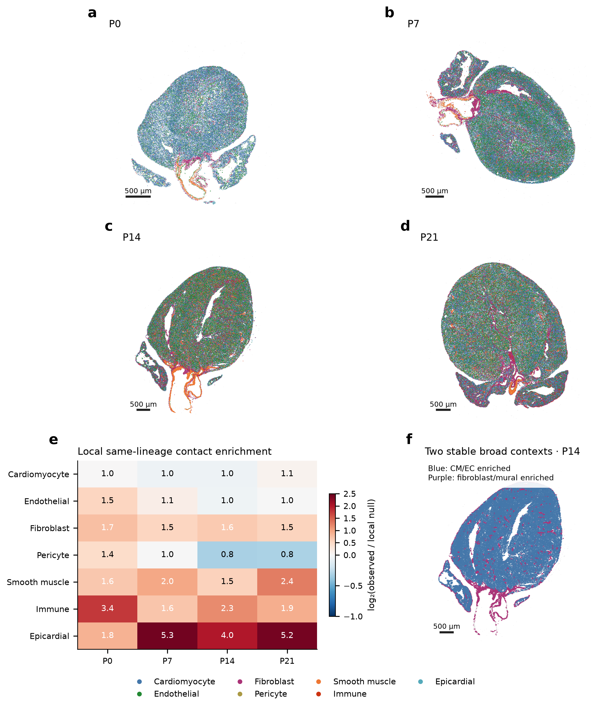
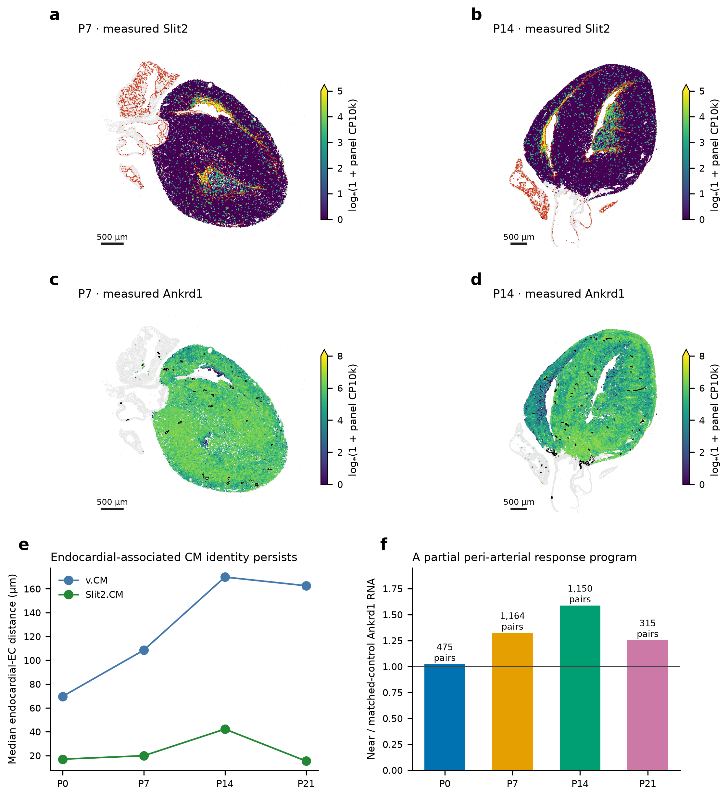
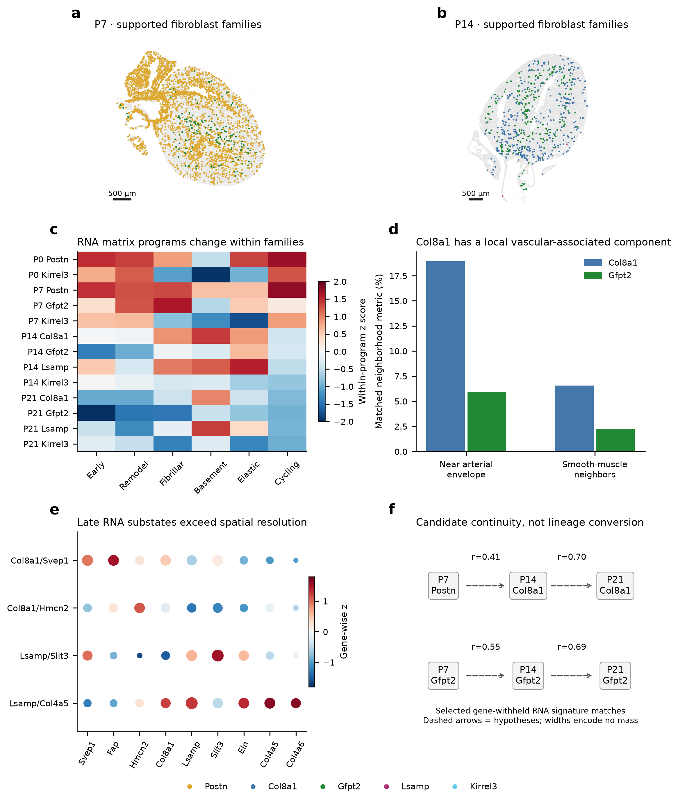
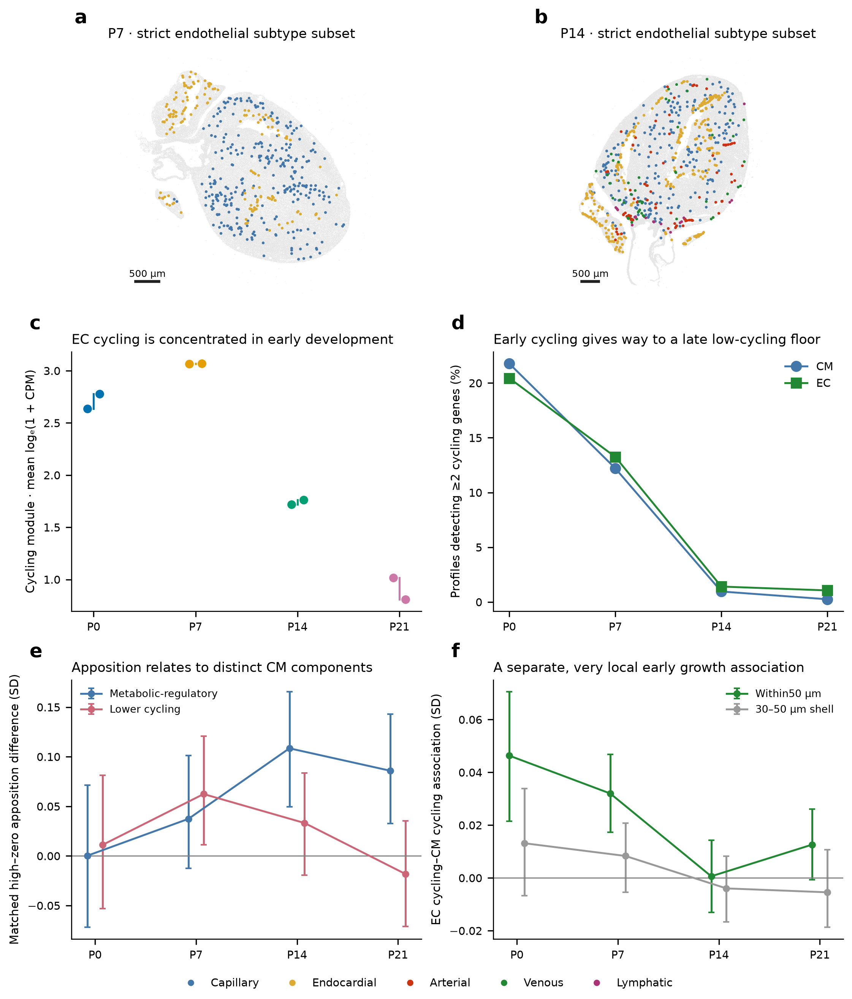
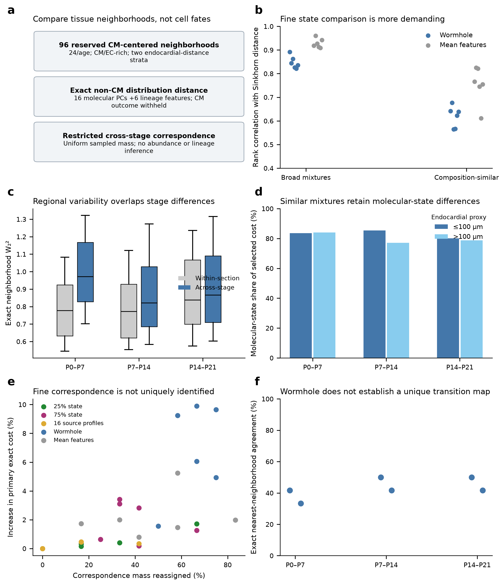
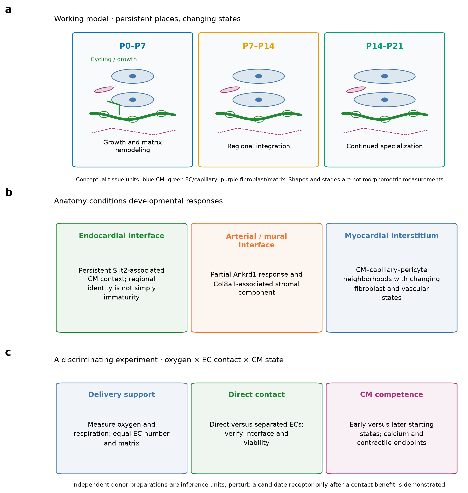

# Persistent spatial neighborhoods and changing stromal–vascular states accompany postnatal heart development
An integrated secondary analysis of P0–P21 mouse-heart snRNA-seq and Xenium data
**Central message.** Postnatal cardiac development is consistent with regional remodeling of recurring multicellular neighborhoods: fibroblast matrix specialization, vascular growth and CM developmental programs change together, but do not follow a single synchronized maturation axis.

## Abstract

Postnatal heart development requires coordinated growth and specialization of muscle, vasculature and supporting cells. Whether this coordination reflects replacement of spatial neighborhoods or changing cellular states within recurring environments remains unresolved. We integrated independently quality-controlled single-nucleus RNA sequencing with four deposited Xenium sections spanning P0, P7, P14 and P21. Original spatial profiles and coordinates were retained, and subtype placement was restricted by measured markers, nuclear/core evidence and reference sensitivity. Major myocardial, arterial/mural and surface/stromal patterns recurred across sections. Endocardial-associated CM identity persisted, whereas Ankrd1 expression showed a partial peri-arterial association. Reviewed fibroblast families shared interstitial environments but differed in matrix transcription and local vascular context; cross-stage RNA resemblance nominated state continuities without establishing ancestry. Local capillary apposition associated with lower CM cycling RNA at P7 and higher metabolic-regulatory RNA at P14/P21 after strict matching. Separately, nearby EC and CM nuclear cycling were positively associated at P0/P7. Exact optimal-transport comparisons of 96 reserved neighborhoods revealed overlapping regional and cross-stage variation. Wormhole captured broad distributional similarity, but fine correspondences were sensitive to metric and matching assumptions. These observations support a model of asynchronous, region-dependent tissue-unit remodeling and identify experiments separating oxygen delivery, EC contact and CM developmental competence. One spatial section per age and the absence of lineage tracing or functional measurements constrain developmental and causal conclusions.

## Introduction

The postnatal heart must expand its pumping capacity while its cardiomyocytes (CMs) change growth behavior, metabolism and electrophysiology. These changes occur within a developing tissue rather than in isolated muscle cells. Coronary vessels extend and reorganize, mural cells associate with vessels, fibroblasts remodel the extracellular environment, and immune and epicardial populations occupy specialized locations. An account of CM maturation therefore also requires an account of the changing environments in which CMs develop.

The postnatal Heart Atlas established a spatial and functional-genomics resource linking CM developmental programs to vascular and other local cellular contexts [1]. Perinatal vascular work additionally showed expansion of pre-existing coronary vessels into developing inner myocardium, providing a biological basis for regionally changing vascular access [2]. These studies motivate a further question: do persistent anatomical environments acquire different stromal and vascular states over time, and are those changes coupled to the same or different dimensions of CM development?

We address this question through a secondary analysis of the deposited data, not an independent biological cohort. Our contribution is a joint interpretation of reviewed cell identities, fibroblast matrix specialization, spatially persistent CM programs, component-specific CM–vascular associations and calibrated neighborhood transport. We distinguish descriptive spatial organization from possible state transitions and from causal mechanisms. In particular, Wasserstein Wormhole approximates distances between cell distributions; an optimal correspondence between cross-sectional samples is not a measured developmental fate [3].

## Results

The analysis is organized around six linked messages, corresponding to Figures 1–6: recurring spatial architecture; persistent regional CM identity; fibroblast program specialization and candidate continuity; distinct vascular-growth and apposition relationships; limits and uses of transport-based correspondence; and a testable multicellular developmental model. The purpose is to extend the interpretation of the atlas rather than present recovered public annotations as newly discovered cell types.

## Recurring anatomical organization anchors the developmental comparison

The reviewed spatial atlas retained all 408,054 deposited profiles, including 313,607 resolved broad-lineage assignments. Cardiomyocytes and endothelial cells were interspersed through myocardial regions, fibroblasts occupied both interstitial and denser stromal territories, and pericytes were distributed through myocardial vascular environments. Smooth-muscle profiles formed localized tracks and rings around larger vascular structures, with smaller intramyocardial foci. Epicardial-marker-supported profiles concentrated along surfaces, while immune cells were scattered with local accumulations (Fig. 1a–d). These are segmented-profile distributions rather than an unbiased census of complete cells.

The organization was not explained solely by global lineage proportions. Contact comparisons against labels permuted within 200-µm spatial blocks retained fibroblast, smooth-muscle, immune and epicardial homotypic enrichment (Fig. 1e). Fibroblast–immune apposition was also enriched in the reviewed contact graph, making local stromal–immune remodeling a candidate relationship rather than a consequence inferred from tissue-wide cell fractions alone. These enrichment tests condition on the sampled section and do not establish communication or independent-heart reproducibility.

Graph-derived neighborhood composition supported two reproducible broad contexts: CM/EC-enriched and fibroblast/smooth-muscle-enriched. The two-component model had perfect agreement across the assessed clustering seeds, whereas finer partitions were less stable. These contexts summarize relative local mixtures; they are not an exhaustive anatomical atlas or a claim that the heart contains only two niches (Fig. 1f). Their recurrence provides a reference frame for asking how cell programs change within recognizable tissue environments.

## Regional CM identity overlaps with local vascular-response programs

Endocardial-associated CM identity persisted across the sampled ages. In the public reference labels, median distance from Slit2.CM to endocardial ECs was 17.0, 19.9, 42.2 and 15.4 µm at P0/P7/P14/P21, compared with 69.7, 108.5, 169.8 and 162.6 µm for the published working-ventricular state. Native measured Slit2 maps were compatible with this regional pattern (Fig. 2a,b,e). The numerical label comparison is descriptive within the same public annotation system; it is not an independent anatomical validation. It nevertheless argues against treating every regional CM state as simply an earlier point on a single maturation axis.

A distinct local relationship involved Ankrd1. In strict ventricular-marker-supported CMs, expression within 0–30 µm of candidate arterial EC/smooth-muscle envelopes exceeded that in locally matched controls 60–150 µm away by approximately 1.32-fold at P7 and 1.59-fold at P14. The corresponding ratios were 1.02 at P0 and 1.25 at P21 (Fig. 2c,d,f). The positive P7/P14 direction persisted across the documented vessel-definition and distance sensitivities. This supports a partial peri-arterial response program, not an exclusively peri-arterial CM type or a direct measurement of mechanical stress.

The two spatial relationships suggest overlapping axes of specialization: a persistent endocardial-associated identity and a locally varying vascular-response state. Fine ventricular RNA groups, including mechanical-response, electrical and conduction-program candidates, remain useful comparison sets, but their resolution exceeds that of many confident spatial assignments. Kcnd2 and Irx5 are not measured by the 403-target Xenium panel, and derived TF activity is not measured RNA. Neither a transmural electrical gradient nor a verified Purkinje population is established by these maps.

## Fibroblast state remodeling occurs within overlapping interstitial environments

Reviewed fibroblast identities revealed early Postn-associated states and later Col8a1-, Gfpt2- and Lsamp-associated states, alongside a distinct Kirrel3-associated RNA family. Strict spatial assignments were strongest for early Postn and a subset of late Col8a1/Gfpt2 families. These families occurred within CM- and EC-containing environments, with partial local differences rather than mutually exclusive tissue compartments (Fig. 3a,b). Sparse Lsamp and unsupported Kirrel3 spatial calls were not used to assign outflow-tract or valve locations.

We recalculated library-level matrix programs using the current clean fibroblast reference and full-transcriptome denominators, retaining corrected and original counts separately. Early Postn-associated profiles had prominent developmental/remodeling and cycling-associated RNA. At later stages, basement-matrix-associated transcription distinguished Col8a1 from Gfpt2 fibroblasts; in corrected library-family pseudobulks, the mean panel log(1 + CPM) was approximately 5.68 versus 5.20 at P14 and 5.56 versus 5.16 at P21 (Fig. 3c). These are descriptive program contrasts, not measurements of deposited matrix, stiffness or synthetic flux.

Spatial context refined the interpretation. At P7, coverage/morphology-matched Gfpt2 fibroblasts had approximately 5.9 percentage points more CM neighbors, 5.7 points more endothelial neighbors and 11.3 points fewer fibroblast neighbors than Postn fibroblasts within 30 µm. At P14, matched Col8a1 fibroblasts more often lay within 50 µm of candidate arterial envelopes than Gfpt2 fibroblasts (19.0% versus 6.0%) and had more smooth-muscle neighbors (6.6% versus 2.2%; Fig. 3d). Most Col8a1 profiles were not near those arterial envelopes. The evidence therefore supports a vascular-associated component within a broader interstitial family.

The P21 RNA reference additionally distinguished Col8a1/Svep1 and Col8a1/Hmcn2 substates, and Lsamp/Slit3 and Lsamp/Col4a5 substates (Fig. 3e). Separate spatial locations for these named substates remain unestablished. Gene-withheld RNA signature comparisons provided candidate continuity across ages: a P7 Postn subgroup resembled a P14 Col8a1 subgroup (r≈0.41), a P14 Col8a1 subgroup resembled the reviewed P21 Col8a1/Svep1 group (r≈0.70), and Gfpt2 groups showed P7–P14 and P14–P21 similarities of approximately 0.55 and 0.69 (Fig. 3f). These selected subgroup matches nominate lineage-tracing questions. They do not show that all Postn fibroblasts become Col8a1 cells, or that the arrows represent transition probabilities.

## Vascular growth and capillary apposition relate to different CM components

Capillary-like and endocardial-like EC assignments occupied different spatial environments. Arterial-like profiles were assessed with mural context, while venous- and lymphatic-like candidates were sparse or inconsistently resolved across ages. Conservative P7 arterial subtype calls remained unresolved; zero calls were not interpreted as biological absence (Fig. 4a,b). This distinction matters because a cycling or growth-associated overlay is not an additional endothelial lineage, and the Xenium panel incompletely measures a sprouting-specific program.

Both RNA modules and nuclear marker coherence placed EC cycling predominantly in early development. In the separately selected nuclear-QC cohorts, the fraction detecting at least two measured cycling genes fell markedly after P7 for both ECs and CMs (Fig. 4c,d). Nearby EC nuclear cycling had small positive associations with CM nuclear cycling at P0 and P7 (standardized coefficients approximately +0.046 and +0.032 within 50 µm). The 30–50-µm shell did not retain these associations, and late-stage nuclear tests were not robust (Fig. 4f). This supports a very local early growth-compatible relationship, without proving completed division or an EC-induced effect.

Capillary apposition addressed a separate question. Strict local matching compared CMs with high versus zero sampled capillary-boundary apposition while balancing local region, author CM state, capture, area, perimeter and capillary abundance. Core-RNA contrasts favored lower cycling RNA at P7 (+0.062 SD; 95% within-section block interval +0.011 to +0.121), whereas metabolic-regulatory RNA was higher at P14 (+0.109 SD; +0.050 to +0.166) and P21 (+0.086 SD; +0.033 to +0.143; Fig. 4e). The P7 metabolic and P14/P21 lower-cycling contrasts did not exclude zero in this comparison. Strict nuclear-supported capillary identities attenuated some related conditional associations.

The result is compatible with developmental contingency, not a demonstrated temporal switch. Early vascular growth and local cycling can coexist with emerging cell-cycle withdrawal around integrated capillary interfaces. Later, vascular apposition may accompany metabolic-regulatory specialization when cycling is already low. Low late cycling also creates a detection floor. Metabolic-regulatory RNA is not respiration: broader RNA-only respiratory-chain and calcium-handling panels did not all rise monotonically, reinforcing the need for separate functional endpoints.

Shared anatomy remained a major baseline explanation. In the reconstructed P7 analysis, approximately 71% of capillary-area/maturation-index covariance lay between 200-µm regions. This is a covariance decomposition, not a causal percentage or explained outcome variance. The locally matched results ask what remains after narrower comparisons; they do not eliminate unmeasured loading, perfusion, matrix architecture or regional developmental history.

## Transport compares remodeling neighborhoods but does not identify unique developmental fates

Wormhole was evaluated in the context of the biological question rather than assumed to reconstruct developmental flow. The saved model represented non-CM molecular states and lineage composition while withholding CM maturation genes and focal CM outcomes. In the previous reserved 768-pair cross-stage audit, rank agreement with Sinkhorn distance was approximately 0.82–0.89 across broad mixtures but only 0.56–0.68 among composition-similar pairs. Simple mean-state features were often competitive or better (Fig. 5b). This calibration supports broad comparisons more strongly than fine state correspondence.

We added an exact transport analysis of 96 reserved observed neighborhoods: 24 per stage, restricted to public-CM-compatible strict ventricular profiles in the independent ventricular selector and the existing CM/EC-enriched context. Each stage contributed 12 neighborhoods within 100 µm of an endocardial proxy and 12 farther away, with at least 100-µm focal spacing within each category. Up to 32 observed non-CMs represented each cloud. Exact cloud-to-cloud W₂² costs were calculated before solving a separate uniform-mass neighborhood correspondence within the same distance category (Fig. 5a). These controls provide a coarse anatomical restriction; they are not registered LV/RV or compact/trabecular compartments.

Across-stage distance distributions overlapped substantially with within-section regional variability (Fig. 5c). Among selected pairs with lineage-composition L1 difference ≤0.3, molecular-state terms accounted for median fractions of approximately 77–85% of the equal-weight transport cost (Fig. 5d). That conditional decomposition is representation-dependent and partly expected after selecting similar compositions. It demonstrates that remaining distance is not solely a change in broad lineage mixture; it does not quantify a biological causal contribution, prove developmental conversion or separate age from specimen/capture effects.

Fine correspondences were not uniquely identified. In this restricted analysis, Wormhole preserved broad exact-cost ranks reasonably (approximately 0.68–0.92 across stage-pair/stratum comparisons), yet its nearest exact-neighborhood agreement was only 33–50%. Weighting molecular versus lineage features, reducing the sampled source count, or changing regularization could reassign neighborhood correspondence mass. Alternative state-weight plans changed up to about two-thirds of the mass while increasing the primary exact cost by no more than approximately 3.5%; Wormhole-based plans reassigned 50–75% with 1.6–9.9% extra primary cost (Fig. 5e,f). Similar global distances therefore do not guarantee the same local developmental matches.

The useful transport insight is a constraint on the biological story: recurring neighborhood classes can contain substantial internal molecular heterogeneity, and several cross-stage correspondences can be similarly compatible with the measured states. This supports studying remodeling within recurring tissue contexts. It does not justify a definitive cell-subtype Sankey diagram, lineage conversion, absolute expansion estimate or a temporal rate. The candidate fibroblast continuities in Figure 3 arise from RNA-state resemblance, not from treating the transport coupling as ancestry.

## A regional tissue-unit model yields discriminating experiments

The working model is asynchronous remodeling of a multicellular tissue unit (Fig. 6). Early myocardium contains growth-compatible vascular and developmental-matrix environments. Continued regional vascular integration and fibroblast specialization accompany changes in CM growth behavior and metabolic-regulatory programs. Persistent endocardial-associated identity and partial arterial-associated response states are embedded within this process, rather than assumed to disappear along a universal maturation path. The intervals summarize a biological model supported to different degrees by cross-sectional observations; they are not a tracked sequence of individual cells.

Three predictions follow. First, a region-specific CM identity should remain distinguishable after matching CM maturation components and wall geometry; direct multiplex imaging can test whether Slit2-associated identity persists at comparable maturation states. Second, an early fibroblast-state label should generate a heterogeneous later state distribution if the nominated continuities reflect ancestry; inducible lineage tracing with validated labeling specificity and serial RNA/spatial profiling can distinguish continuity from population replacement. Third, CM responses to EC proximity should depend on starting CM state and the type of vascular support. A factorial oxygen-by-contact-by-CM-state experiment, holding matrix and EC number constant, would test this prediction with respiration, calcium handling and contractile endpoints.

## Discussion

The added perspective is that cellular identity, neighborhood composition and developmental state are related but different properties. Persistent spatial organization can coexist with changing fibroblast and vascular programs, and a CM can retain regional identity while acquiring other developmental features. This helps explain why finer clustering or a single maturation score does not by itself yield a coherent developmental mechanism.

The fibroblast analysis provides a concrete example. Late Col8a1 and Gfpt2 families share myocardial environments, while differing in matrix programs and local vascular context. A partial vascular association does not require a wholly separate perivascular cell type. Conversely, distinct late RNA substates cannot be assigned distinct locations when the spatial panel lacks sufficient discriminatory evidence. This distinction preserves biological hypotheses without overstating anatomical resolution.

The vascular analysis separates network growth from integration and CM response. Perinatal coronary expansion can support increasing myocardial demand [2], while a local contact or matrix interaction may influence a narrower CM program. Oxygen-associated cell-cycle withdrawal is also distinct from complete functional maturation [4,5]. The P7 and later apposition contrasts motivate a state-dependent hypothesis, but do not establish an age interaction statistically across independent hearts. Reciprocal CM-to-vascular demand signaling and shared regional development remain plausible explanations.

Wormhole and exact transport are useful here as tools for comparing distributions and testing the stability of correspondence. They should not be made the source of a lineage claim that the data cannot identify. Approximate preservation of broad distances can coexist with unstable fine assignments because many neighborhoods have similar mixtures and states. Additional stages can refine possible correspondences, but inferred P3/P5/P10 transcript expectations do not create new hearts or recover unobserved spatial anatomy.

The strongest next study would combine independent hearts at observed and intermediate ages with matched anatomical sections, perfused-vessel labeling, regional oxygen measurements and direct matrix imaging. Culture experiments should cross measured noninjurious oxygen conditions, direct versus physically separated ECs, and early versus later CM starting states. Viability, ROS and DNA-damage responses are needed to distinguish injury-associated arrest from maturation. Candidate EC–CM receptors become targeted follow-ups after a contact benefit is demonstrated at matched oxygen and diffusible support.

The current conclusions remain bounded by one spatial section per age, a selected 403-target panel, profile segmentation, confidence-dependent subtype coverage, incomplete anatomical masks and unknown temporal histories. RNA libraries provide technical/reference sensitivity rather than assumed independent-heart replication. The contribution is an evidence-linked developmental model and a set of discriminating hypotheses, not a new validated causal mechanism or complete lineage tree.

## Methods

Data and preserved provenance. The analysis reuses GSE290989 and the deposited P0/P7 and P14/P21 Xenium datasets (Zenodo 14961929 and 14961942), together with public final WebAtlas labels for explicitly named comparisons. The independently reviewed snRNA analysis retained 73,052 of 98,371 nuclei after expression QC, doublet screening and ambient-RNA correction. Current clean RNA subsets include 43,249 ventricular-like nuclei, 14,328 fibroblasts and 4,597 endothelial nuclei. Existing original counts, native barcodes, physical centroids and frozen annotation versions were not overwritten. Spatial confidence flags and unresolved profiles remain accessible.

Identity and segmentation. The broad atlas uses reference competition and measured lineage support. Fine maps retain existing nuclear/cell-supported fibroblast families and five EC types, with public author labels shown only where stated. Transcript-level native, core and nuclear views, alternative boundaries and source-role conflicts are documented in the upstream QC releases. Profiles missing measured nuclear area remain in the main atlas; a CM section can legitimately miss a nucleus. Nuclear-depth selection applies only to the named nuclear sensitivity. Operational boundary apposition does not demonstrate membrane-protein interaction or true three-dimensional contact.

Spatial graphs and contexts. Shared-boundary contacts and tissue-screened 50-µm centroid neighborhoods follow the frozen integrated pipeline. Contact enrichment uses 199 label permutations within 200-µm spatial blocks with review positions held fixed. The existing broad contexts use one-/two-step neighbor lineage proportions, exclude focal RNA and CM outcomes, remove focal self-return, and require adequate resolved neighbors. A two-component GMM satisfies the prespecified seed-stability criterion. We reuse these contexts and do not rename unstable fine partitions as validated biological niches.

CM expression and local comparisons. Figure2 maps use original observed 403-target counts normalized to panel CP10k before log(1+x); they are not imputed spatial expression. Public-label endocardial distances retain their descriptive scope. The Ankrd1 comparison reuses independently marker-defined arterial EC/SMC envelopes and local1:1 matching, comparing0–30-µm CMs with60–150-µm controls in the same vessel neighborhood. Its outcome normalization and depth/area/endocardial calipers remain those of the frozen vessel analysis. Ankrd1 positivity alone is not a subtype assignment.

Component-specific apposition tests. The strict matched analysis reuses the reconstructed Figure4e-compatible CM population in an independent ventricular selector. Matches require the same 200-µm region and public CM state,≤100-µm physical separation, capillary-area difference≤0.1 standardized units and capture/area/perimeter differences≤0.5 units. Zero-apposition controls are not reused. The native CM polygon is sampled at 64 equally spaced arc-length positions; high/zero apposition compares the fraction within 2 µm of public capillary polygons. Aggregate post-match imbalances are below0.016, and capillary-area imbalance below0.004. Core-RNA component differences are standardized within their eligible cohort. Displayed95% intervals use 512 resamples of 400-µm spatial blocks. They are within-section exploratory intervals, not multiplicity-adjusted animal-level confidence intervals.

RNA fibroblast programs and candidate continuity. New library×reviewed-family pseudobulks aggregate corrected molecules across full RNA denominators; original raw counts are retained as a sensitivity. Duplicate gene symbols are summed. Program scores are the mean gene log(1+CPM), and heatmaps standardize each program across displayed stage-family means. Named P21 marker profiles use mean library-level expression and detection. The adjacent-stage candidate table reuses the frozen 12,783-gene interpreted-marker-withheld relative-signature comparison, updates family names from the current clean reference and preserves subgroup IDs. Figure3f shows selected subgroup correlations rather than family-wide transition rates; lineage tracing is required to test ancestry.

Nuclear cycling specificity. The frozen sensitivity uses nuclear-supported EC identities, CM/EC nuclear depth≥20 and the measured Mki67/Top2a/Cenpf panel. It evaluates within 50-µm and30–50-µm shell source neighborhoods, regional/capture covariates and within-region label-shuffle controls. The prevalence panel concerns those selected profiles. At least two detected genes establish marker coherence, not completed mitosis or cytokinesis. Sprouting programs inferred from unmeasured genes are not treated as directly observed Xenium molecules.

Wormhole representation and calibration. The saved encoder was trained on 3,200 non-CM clouds with 800 reserved assessment clouds using the existing 16-PC plus six-lineage feature representation. CM outcome genes and focal-CM RNA are excluded. PCA training sources were screened against held-out clouds, and the original region-held-out prediction benchmark used a 150-µm buffer. The saved CPU-constrained encoder is not asserted to reproduce the Wormhole paper's default architecture. The earlier 768 reserved cross-stage pairs compare broad and composition-similar selections. We reuse the encoder without additional training.

New restricted exact transport. We selected 24 reserved observed neighborhoods per stage with seed 26026: 12 with endocardial-proxy distance≤100 µm and 12 farther away, all within the existing CM/EC-enriched context, strict/public-compatible ventricular identity and independent ventricular selector. Focal spacing is at least 100 µm within a stage×stratum. Up to 32 actual non-CM profiles are sampled using the original deterministic source-sampling rule. Exact linear programs solve uniform-marginal cloud W₂² costs under the existing equal-state/lineage feature scaling. Separate uniform-marginal neighborhood plans are solved only within the same distance category. This second plan is a cross-sectional correspondence, not calibrated cell fate or developmental mass flow. All144 pairwise costs per adjacent-stage stratum and within-section pair costs are retained.

Transport sensitivities and interpretation. We vary state/lineage weighting (25/75,50/50,75/25), source-cloud size (up to16 versus32), saved Wormhole versus exact cost, and simple mean features. Entropic neighborhood plans use epsilon equal to5% of the median cost; row/column residuals must be<10⁻⁶. Total variation compares correspondence plans; cost inflation evaluates an alternative plan under the primary exact metric. Composition-similar comparisons use source-lineage L1≤0.3, with the molecular/lineage cost split taken along the primary optimal cloud plan. Fractions depend on the representation and selection. The analysis does not estimate absolute cell expansion, spatial movement, perfusion, lineage ancestry or causal influence. Coarse endocardial-distance restrictions do not constitute anatomical registration.

Reconstruction limits and validation. Original author anatomical source assignments, score-bearing reference objects and neighbor-level inputs are not publicly recovered. The upstream reconstruction reproduces released selection/plotting rules under explicitly alternative masks, scores and graphs, rather than claiming an exact original Figure 4e replication. Independent checks for this manuscript re-evaluate transport marginals/cost decomposition, selected-cohort eligibility/spacing, observed source membership, nuclear/cell confidence scope, current P21 family naming, numeric manuscript claims and document/figure integrity. Source tables and script hashes accompany the release.

## References

1. Wang H et al. Spatially guided in vivo single-cell functional genomics of postnatal heart. Nature Cardiovascular Research (2026). https://doi.org/10.1038/s44161-026-00861-z
2. Lu et al. Perinatal angiogenesis from pre-existing coronary vessels via DLL4–NOTCH1 signalling. Nature Cell Biology 23, 967–977 (2021). https://doi.org/10.1038/s41556-021-00747-1
3. Haviv et al. Wasserstein Wormhole: Scalable Optimal Transport Distance with Transformers. ICML (2024). https://arxiv.org/abs/2404.09411
4. Puente et al. The oxygen-rich postnatal environment induces cardiomyocyte cell-cycle arrest through DNA damage response. Cell (2014). https://doi.org/10.1016/j.cell.2014.03.032
5. Mahmoud et al. Meis1 regulates postnatal cardiomyocyte cell cycle arrest. Nature (2013). https://doi.org/10.1038/nature12054

## Integrated figures

### Figure 1. Recurring spatial architecture anchors the developmental comparison

a–d, Reviewed broad lineages on native P0/P7/P14/P21 sections. Each map has its own physical scale; no inter-section registration or abundance correction is implied. Gray includes unresolved/review profiles. e, Homotypic shared-boundary contacts relative to 199 lineage-label shuffles within 200-µm blocks. Heatmap color is log₂ enrichment; printed values are observed/null ratios. f, Existing seed-stable two-context map at P14, based on neighbor composition without CM outcome features. These are computational mixtures, not exhaustive anatomical compartments. Scale bars, 500 µm.

### Figure 2. Regional CM identities overlap with local vascular-response programs

a,b, Native measured Slit2 RNA in strict/public-CM-compatible ventricular profiles; red points denote public endocardial EC landmarks. c,d, Native Ankrd1 RNA, with black candidate arterial EC/SMC envelope outlines. Map scales are shared across ages for each gene: log(1+403-panel CP10k), 0–5 for Slit2 and0–8 for Ankrd1; upper clipping is indicated by the colorbar extension. e, Median distance from published v.CM and Slit2.CM labels to public endocardial ECs. This is a same-annotation-system descriptive comparison. f, Frozen local matched near/control Ankrd1 expression ratios; printed numbers are CM pairs, not independent animals. No biological-replicate uncertainty is implied. Scale bars, 500 µm.

### Figure 3. Fibroblast programs specialize within overlapping interstitial environments

a,b, Existing strict cell+nuclear-supported family placements; gray includes unresolved fibroblasts and other cardiac cells. Sparse labels are not absence claims. c, Reviewed clean RNA library-family matrix programs with full-transcriptome denominators; color is a within-program z score of mean library expression. d, Frozen P14 coverage/morphology-matched Col8a1 versus Gfpt2 context: percentage within 50 µm of arterial envelopes, and mean smooth-muscle share of30-µm neighbors. e, P21 named RNA-substate markers; color is gene-wise relative expression and area scales with detection fraction. Spatial locations of the four substates are not established. f, Selected subgroup-level interpreted-marker-withheld RNA correlations. Dashed arrows nominate continuity hypotheses and encode neither mass nor ancestry. P21_F0 uses its current Col8a1 assignment.

### Figure 4. Vascular growth and apposition relate to distinct developmental components

a,b, Strict cell+nuclear-supported five-type EC subsets on native P7/P14 geometry. Gray contains all other profiles, including unresolved ECs; P7 arterial identity is unresolved under this conservative annotation. c, EC cycling module from two observed RNA libraries per age, with library values/range rather than independent-heart intervals. d, Fractions of nuclear-QC CM/EC profiles detecting at least two measured cycling genes. e, Core-RNA high-versus-zero capillary-apposition contrasts after strict local matching. f, Conditional nuclear EC-cycling/CM-cycling associations within 50 µm or in a30–50-µm shell. Intervals in e,f are95% within-section400-µm block intervals, not biological replication or causal effects. Cycling RNA is not productive division; metabolic-regulatory RNA is not respiration.

### Figure 5. Transport compares distributions without identifying unique developmental fates

a, New anatomy-proxy-stratified comparison of96 reserved CM-centered neighborhoods. b, Earlier768-pair cross-stage Wormhole audit; each point is a stage-pair metric in broad or composition-similar selections. c, Within-section versus adjacent-stage exact cloud-distance distributions, pooling the two distance strata; boxes are quartiles, whiskers 10th–90th percentiles. Pairs share neighborhoods and are not independent biological samples. d, Molecular-state cost fractions for composition-similar pairs (L1≤0.3); this conditional representation-dependent quantity is not variance explained or causal importance. e, Alternative neighborhood plans evaluated by reassigned mass and extra primary exact cost. f, Wormhole nearest-neighborhood agreement with exact cost, with two anatomical-proxy strata per stage pair. Uniform coupling mass is not tissue abundance or a fate probability.

### Figure 6. A regional tissue-unit model generates discriminating experiments

a, Proposed coordination of early growth/remodeling, regional integration and later specialization. The intervals summarize overlapping biological hypotheses and cross-sectional evidence rather than tracked trajectories. Any illustrated cell shapes are conceptual, not morphometric measurements. b, Endocardial, arterial/mural and myocardial-interstitial environments suggest different developmental responses. c, A factorial oxygen-by-contact-by-starting-CM-state experiment separates permissive delivery, direct interaction and CM competence. Hold matrix, EC number, duration and medium comparable; monitor injury/viability. Respiration, calcium handling and contraction are functional endpoints. Independent donor preparations, not technical wells, are inference units. The schematic is a proposed model and experiment, not evidence of completed interventions.
