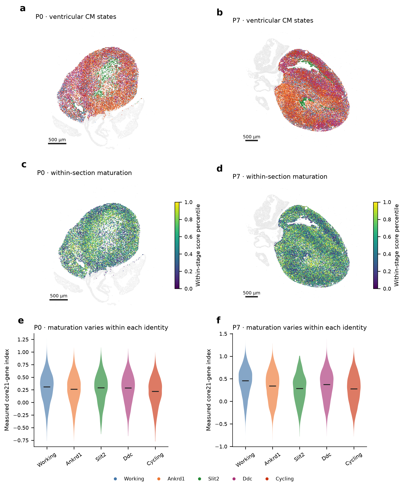
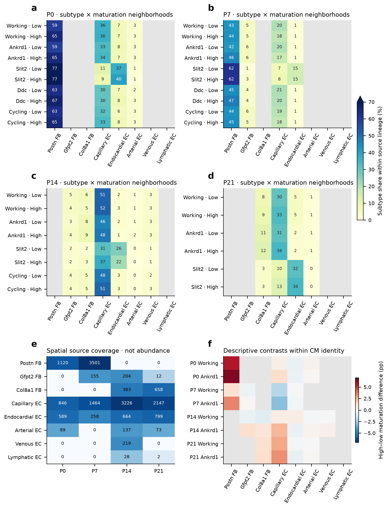
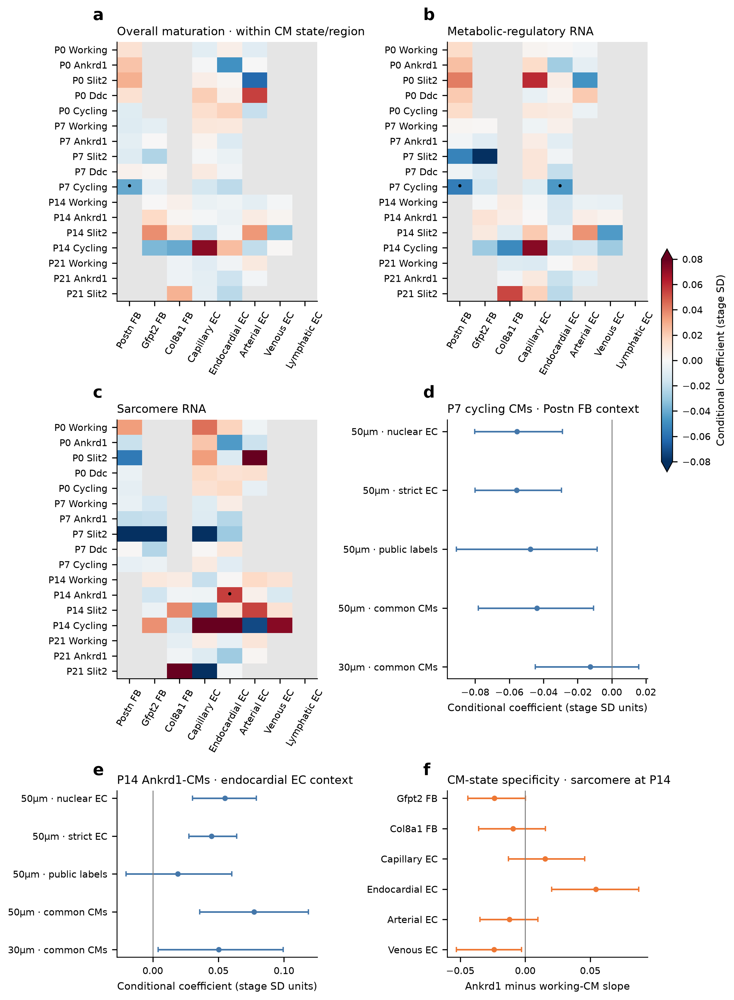
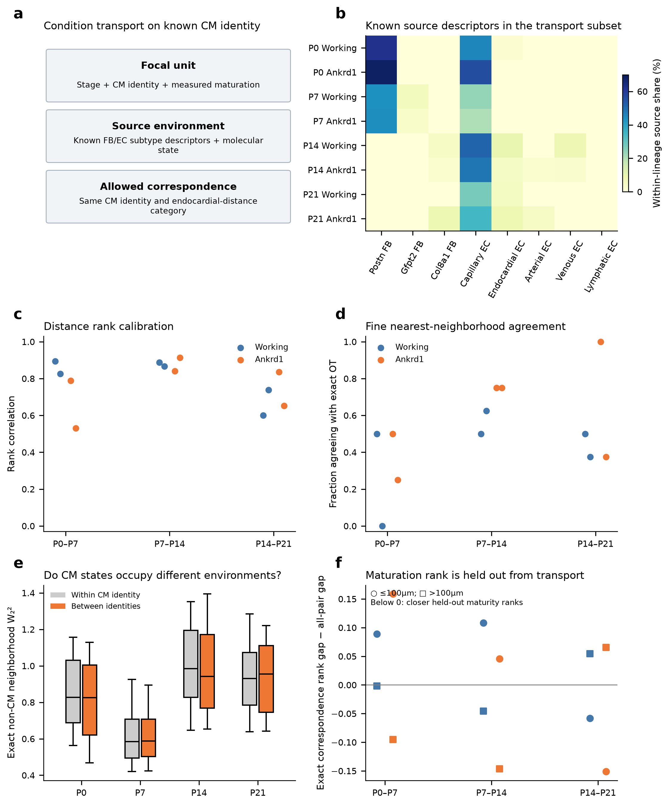
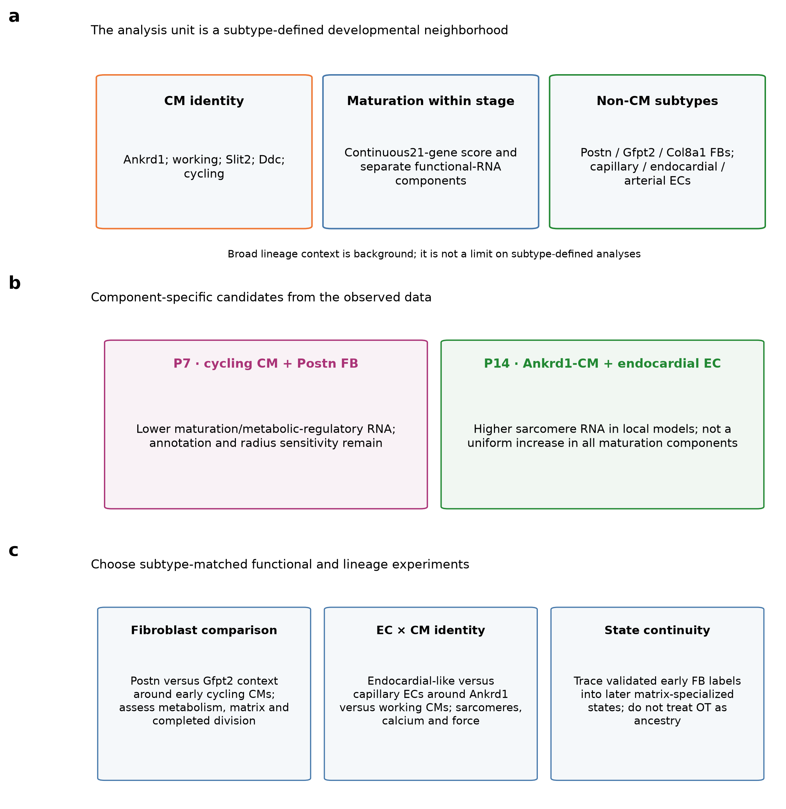

# Subtype-resolved cardiac neighborhoods and asynchronous cardiomyocyte maturation after birth
Ventricular CM identity × within-stage maturation × fibroblast and endothelial subtype context
**Central message.** A ventricular CM identity contains a range of maturation states within the same section. Resolving its fibroblast and endothelial neighbors at subtype level reveals component-specific developmental relationships that a broad CM–EC–fibroblast grouping cannot describe.

## Abstract

Cardiomyocyte (CM) identity, maturation and neighborhood composition are distinct properties of the developing heart. We therefore analyzed known ventricular CM states together with within-stage maturation and specific fibroblast (FB) and endothelial (EC) subtypes, without restricting the analysis to broad lineage-based niche clusters. Independently reviewed snRNA-seq and Xenium data at P0, P7, P14 and P21 provided Ankrd1-, working-, Slit2-, Ddc- and cycling-associated CM states, supported FB families, nuclear-supported EC types and measured CM programs. Ankrd1 and working CMs each spanned wide maturation ranges at P0/P7. Descriptive non-CM subtype composition varied with CM identity and maturation group, but many composite-score associations weakened after local and technical adjustment. More specific candidates emerged: Postn-rich FB context accompanied lower maturation/metabolic-regulatory RNA in P7 cycling CMs, whereas endocardial-like EC context accompanied higher sarcomere RNA in P14 Ankrd1-CMs. These relationships depended partly on source annotation and neighborhood scale. Reviewed fibroblast matrix specialization and RNA-state resemblance provided complementary temporal hypotheses. Exact optimal transport compared 96 reserved neighborhoods within the same CM identity and coarse anatomical category; the saved Wormhole encoder was calibrated rather than treated as a fate model. The results support a subtype- and component-resolved developmental framework, while one spatial section per age, incomplete fine-label coverage and uncertain temporal ancestry limit mechanistic inference.

## Introduction

A postnatal ventricular cardiomyocyte cannot be described adequately by its broad lineage alone. An Ankrd1-associated CM and a working-ventricular CM may occupy different environments, yet each identity also contains cells with different maturation-associated transcription. Likewise, a neighborhood containing fibroblasts and ECs can contain Postn-, Gfpt2- or Col8a1-associated fibroblasts and capillary-, endocardial- or arterial-like ECs. Pooling those states can obscure biologically meaningful relationships.

The Heart Atlas established a framework linking spatial organization and developmental CM programs [1]. Perinatal coronary growth provides additional context for changing regional vascular access [2]. Our additional question is more specific: within an observed stage and a defined CM identity, which non-CM subtypes surround CMs at different measured maturation levels, and which aspects of CM development vary with those environments?

We treat stage, CM identity, within-stage maturation and non-CM subtype context as separate axes. Known subtypes are evaluated directly; they do not need to emerge again from an unsupervised model based only on broad lineage fractions. We distinguish a descriptive neighborhood signature from its residual within-region association and from a causal cellular mechanism. Transport methods are used to compare candidate environments across ages under explicit CM-identity restrictions [3].

## Results

The primary analytical unit is a ventricular CM with a named state, a measured continuous maturation score and a neighborhood resolved into supported FB and EC subtypes. Figures 1–3 address those units directly, Figure 4 provides the temporal fibroblast counterpart, Figure 5 conditions neighborhood transport on CM identity, and Figure 6 identifies subtype-matched experiments. Broad lineage context supplies background anatomy rather than a ceiling on biological resolution.

## CM identity and maturation are separate axes within P0 and P7 sections

The focal cohort required the existing strict ventricular marker-supported gate, a compatible public CM-state label, the independent ventricular morphology selector, core-panel depth≥20 and outcome-excluded capture≥20. The public state labels were retained explicitly as comparison identities rather than relabeled as newly discovered populations. Ankrd1.CM and v.CM were the principal comparison groups; Slit2.CM, Ddc.CM and chamber-unresolved p.CM were retained where the ventricular gate supported their inclusion.

Within both early sections, each CM identity contained a substantial score distribution (Fig. 1). For Ankrd1-CMs, the 10th–90th percentile range of the measured core 21-gene index was approximately −0.151 to +0.607 at P0 and −0.146 to +0.749 at P7. Corresponding working-CM ranges were−0.112 to +0.639 and −0.030 to +0.804. These are score units, not percentages of physiological maturity. Their overlap shows why an identity label cannot substitute for the measured maturation state.

We represented maturation continuously and, for descriptive contrasts, defined low and high groups from the bottom and top quartiles within each stage×CM-state cohort. A high-ranked P0 Ankrd1-CM is therefore relatively high within that population; it is not asserted to be equivalent to a high-ranked P7 or P21 cell. The maps also show within-section percentiles, allowing spatial variation to remain visible without conflating age differences with a common color scale.

## Known fibroblast and endothelial subtypes define finer neighborhood profiles

The source representation retained Postn-, Gfpt2-, Col8a1-, Lsamp- and Kirrel3-associated FB families and capillary-, endocardial-, arterial-, venous- and lymphatic-like EC categories at their supported resolution. Primary FB sources required existing cell+nuclear family support and the additional broad-lineage/source QC mask. Primary EC sources required reviewed broad EC identity, source QC and nuclear subtype support. Strict whole-cell+nuclear EC calls and public final annotations were evaluated as distinct sensitivity layers.

Coverage was strongly subtype- and age-dependent. Eligible primary Postn FB sources numbered 1,120 at P0 and 3,501 at P7; Gfpt2 sources numbered 155 at P7 and 204 at P14; Col8a1 sources numbered 383 at P14 and 658 at P21. P21 Gfpt2 calls were sparse despite a larger RNA reference family and broader public proposals. Nuclear-supported capillary sources numbered 846,1,464,3,226 and 2,147 across the four stages. These counts measure operational annotation coverage, not biological abundance or presence/absence. Sources with fewer than 30 profiles were not promoted to modeled primary subtype predictors.

Each focal CM received tissue-screened 50-µm neighborhood measurements. A FB-family fraction used all eligible FB neighbors as the denominator, including unknown families; EC-type fractions similarly retained untyped ECs in the denominator. We did not renormalize only the confidently typed cells to 100%, which would hide uncertainty. The resulting stage×CM-identity×maturation profiles show the named source populations directly (Fig. 2).

At P0, high- versus low-ranked Ankrd1-CMs had mean Postn-supported shares of approximately 65.1% versus58.6% among eligible FB neighbors, a6.5-percentage-point descriptive difference. Working CMs showed65.1% versus59.5%. At P7, the corresponding Ankrd1-CM Postn shares were45.8% versus42.4%, whereas capillary-like shares among EC neighbors were17.2% versus20.1%. These are raw spatial composition contrasts. They neither establish a local promoting/suppressing effect nor distinguish Postn biology from typing coverage when Postn is the only well-supported FB family.

## Regional organization and local association answer different questions

We fitted a hierarchy of joint subtype models within each CM identity. The first adjusted technical capture, profile area, source capture, density and broad lineage composition while retaining regional variation. The second added anatomical distance proxies. The third compared residual variation within 200-µm regions. Source fractions entered jointly, rather than testing each against overall CM maturation in isolation.

Most overall21-gene maturation associations within Ankrd1 and working CMs were small and uncertain after local adjustment (Fig. 3a). For example, the P0 Postn coefficient within Ankrd1-CMs was approximately +0.034 stage SD units in the technical/composition model, but fell to +0.023 with a block interval including zero in the within-region model. At P7, raw high-ranked Ankrd1-CMs had more Postn-supported neighbors, yet the technical/composition association was negative and the within-region estimate was small and uncertain. Such differences show that descriptive regional enrichment and a residual local relationship are not interchangeable.

A strict high-versus-low matching analysis further exposed limited overlap. Only33/24 P0/P7 Ankrd1-CM pairs and 35/68 working-CM pairs met the prespecified same-region, capture, area, source-count, source-capture and endocardial calipers. These paired comparisons are retained, but they represent small selected subsets and cannot replace the continuous-score analysis. Failure to match many extreme-quartile cells is a limitation of overlap, not evidence that within-state maturation heterogeneity is absent.

## Specific CM-state and maturation-component relationships emerge

The subtype-resolved analysis identified a candidate relationship within P7 cycling CMs: a higher Postn-supported FB fraction accompanied lower overall maturation RNA (β≈−0.041,95% within-section block interval−0.062 to −0.017) and lower metabolic-regulatory RNA (β≈−0.056,−0.080 to −0.029). Native-profile maturation retained the negative direction (β≈−0.045,−0.070 to −0.018). These estimates used 4,462 eligible cycling CMs and controlled the same local region, broad composition and technical/anatomical variables (Fig. 3b,d).

At P14, endocardial-like EC context was positively associated with sarcomere RNA within Ankrd1-CMs (β≈+0.055,+0.030 to +0.079;9,231 eligible CMs; Fig. 3c,e). The equivalent working-CM slope was close to zero, and the exploratory Ankrd1-minus-working slope difference was approximately +0.054 (+0.020 to +0.087). This is a component-specific relationship; the global maturation index did not show the same strong pattern.

These candidates passed exploratory within-section BH thresholds in the primary50-µm models, but their interpretation remains conditional. Stricter cell+nuclear EC definitions retained the P7 Postn/metabolic and P14 endocardial/sarcomere directions. Broader public-source labels weakened the certainty. The P7 Postn relationship was not supported at 30 µm, including in the same-CM geometry audit; the P14 endocardial/sarcomere30-µm estimate was positive but less precise. Operational contact cohorts were much smaller and did not establish direct contact signaling. Full results and sensitivity layers are reported, rather than selecting only favorable plots.

The biological hypotheses are consequently narrower than a universal non-CM maturation niche. A Postn-associated developmental matrix environment may accompany a growth-compatible, metabolically different state within early cycling CMs. Endocardial-like environments may relate to structural development differently in Ankrd1 versus working CMs. Neither observation demonstrates that the source subtype causes the CM phenotype, and the component labels describe RNA rather than completed division, respiration or force.

## Fibroblast program specialization provides temporal comparison sets

The reviewed RNA reference distinguished early Postn developmental/remodeling states and later Col8a1-, Gfpt2- and Lsamp-associated programs (Fig. 4). Library-family pseudobulks used full-RNA denominators and retained raw/corrected views. Col8a1-associated fibroblasts had higher basement-matrix-associated RNA than Gfpt2 fibroblasts in both late stages and both libraries. A partial P14 vascular-associated Col8a1 component was evident in the frozen local comparison, while most Col8a1 profiles were not near candidate arterial envelopes.

The P21 RNA substates Col8a1/Svep1, Col8a1/Hmcn2, Lsamp/Slit3 and Lsamp/Col4a5 were retained without assigning unsupported separate spatial locations. Gene-withheld subgroup signature comparisons nominated a P7 Postn–P14 Col8a1 relationship(r≈0.41), a P14 Col8a1–reviewed P21 Col8a1/Svep1 relationship(r≈0.70), and Gfpt2 continuity across P7/P14 and P14/P21(r≈0.55/0.69). These selected RNA-state similarities define tracing hypotheses; they are not measured conversion rates or proof that one family becomes another.

## Transport is conditioned on CM identity and audited against held-out maturation

We revised the transport comparison to respect known ventricular CM identity. The new subset contained96 reserved observed neighborhoods: 12 per CM state(v.CM or Ankrd1.CM) per age, comprising4 endocardial-proximal(≤100 µm) and 8 more distant neighborhoods. No two-context niche-cluster membership was required. The original saved non-CM molecular/lineage representation was retained for exact cloud distances and Wormhole calibration; named FB/EC source fractions were carried as explicit descriptors rather than silently collapsed in the biological interpretation (Fig. 5a,b).

Correspondence was permitted only between the same CM identity and the same coarse anatomical category across adjacent ages. CM maturation was held out from the distance and plan. The saved encoder was not retrained to encode new subtype labels, and its distance approximation was assessed within each restricted comparison. Rank agreement was variable, approximately 0.53–0.91 for Ankrd1-centered comparisons and 0.60–0.89 for working-CM-centered comparisons, with inconsistent nearest-neighborhood agreement (Fig. 5c,d). These results do not support a unique fine-subtype fate map.

The non-CM distances also showed substantial overlap between neighborhoods of the same versus different CM identities within a stage (Fig. 5e). This is compatible with shared environments and heterogeneous internal states rather than one sharply separate niche per CM label. Held-out maturation-rank alignment depended on region and stage (Fig. 5f). In one more-distant Ankrd1-CM P7–P14 comparison, exact correspondence gave a mean absolute rank gap of approximately 0.123 versus0.269 across all candidate pairs; the endocardial-proximal comparison did not show the same improvement. This is an exploratory descriptor of the selected neighborhoods, not a biological-replicate test, calibrated developmental clock or tracked transition.

## Discussion

The main inference is that CM identity and maturation must be analyzed jointly with the identity of neighboring non-CMs. A reproducible coarse lineage partition can describe background organization while missing a cycling-CM/Postn-FB relationship or an Ankrd1-CM/endocardial-EC structural association. Known biological subtypes do not cease to be useful because a broad unsupervised niche model cannot stably recover additional classes.

The analysis also distinguishes three meanings of a spatial relationship. Descriptive enrichment identifies where a cell combination occurs. A within-region model asks whether an association remains among nearby, technically comparable cells. A causal experiment asks whether changing one subtype or interaction changes the CM phenotype. A regional relationship can be biologically meaningful even when the residual local coefficient is weak; it should then motivate a hypothesis about coordinated regional development rather than a specific local signal.

The strongest current subtype-specific candidates concern different CM components and developmental windows. The P7 cycling-CM/Postn-FB context is compatible with developmental matrix remodeling and a growth-associated metabolic state. The P14 Ankrd1-CM/endocardial-like-EC context is compatible with subtype-dependent structural specialization. Their scale and annotation sensitivities remain part of the conclusion, and direct-contact causation is not demonstrated.

Follow-up should match the specific cells and phenotype. An early cycling-CM experiment can compare Postn- and Gfpt2-associated fibroblast environments with matched EC support, matrix, oxygen and starting CM state, measuring substrate use, respiration, cycling and completed cytokinesis. A separate experiment can compare endocardial-like versus capillary ECs around Ankrd1-associated versus working CMs, measuring sarcomere organization, calcium handling and contraction while separating direct contact from diffusible support. RNA-defined identities need validation in the experimental system rather than assumed persistence in culture.

Possible subtype transitions remain a separate question. Validated early fibroblast lineage labels followed by serial RNA/spatial profiling can test whether the nominated late-state continuities reflect ancestry or replacement. Additional independent hearts at P3/P5 and around P10 would help distinguish regional developmental sequences. Interpolated ages and transport coupling mass cannot substitute for those observations.

Coverage places a material boundary on the present analysis. A confident RNA subtype is not automatically confidently located in Xenium. Sparse fine source calls, unknown families, marker-dependent typing and section orientation can influence neighborhood estimates. This is why uncertainty was retained in lineage denominators, public annotations were a separate comparator, and sparse categories were not forced into the primary models. The result is a subtype-resolved set of spatial/developmental hypotheses, not a complete validated niche taxonomy or a causal mechanism.

## Methods

Data and immutable inputs. We reused the existing independently reviewed GSE290989 snRNA reference and all four deposited Xenium sections, retaining original profile IDs,403-target counts, native physical coordinates and frozen QC/segmentation outputs. There is one available spatial section per age. The original reviewed RNA cohort retained 73,052 of 98,371 nuclei; clean ventricular, fibroblast and EC subsets remain as documented upstream. Libraries are reference/technical sensitivity units, not assumed independent hearts.

Focal CM identity and maturation. Public named CM states(v.CM,Ankrd1.CM,Slit2.CM,Ddc.CM,p.CM) were intersected with our strict ventricular gate and independent morphology selector. Atrial/AV labels were not included. Core-panel capture and capture excluding maturation outcomes each had to be≥20. The ventricular gate partly uses Myl2, itself in the21-gene panel; this selection dependence remains a limitation. Missing nuclear area alone did not exclude a CM. Maturation used the frozen directly measured native/core gene-standardized21-gene index and separately named component scores. Quartiles were defined within stage×CM state before neighborhood eligibility, with continuous scores retained.

Non-CM source definitions and unknowns. FB source identity required reviewed broad FB lineage, the existing program-source QC mask and a strict cell+nuclear-supported family label. Primary EC source identity required broad EC lineage, source QC and nuclear-supported subtype. Strict whole-cell+nuclear EC labels and public final labels were separate source views. Public valve-family labels were not automatically equated with a spatially verified Kirrel3 family. Public capillary.High.Myo profiles were not silently included in the capillary comparator. Unknown subtype neighbors remained in each eligible lineage denominator; they were not painted with the most likely fine label.

Spatial geometry and source fractions. The frozen tissue-screened 50-µm graph supplied the primary neighborhood. Thirty-micrometer and shared-boundary contact graphs supplied sensitivities. Source and focal roles were disjoint through broad lineage. Eligible modeling profiles required≥5 resolved neighbors and ≥1 eligible FB and EC neighbor. Each source fraction was subtype count divided by all eligible source-lineage counts, including untyped sources. Counts, capture, type coverage and geometry eligibility were exported per CM. Stage-subtype sources with<30 profiles or fewer than 50 positive focal exposures were not promoted to primary predictors; a zero call was not interpreted as biological absence.

Joint subtype models and adjustment hierarchy. All eligible known subtype fractions entered jointly. Technical/composition models included outcome-excluded CM capture, area, nuclear missingness, resolved-neighbor density, eligible FB/EC counts, source capture and broad non-CM composition. Anatomical models added endocardial, arterial, large-void and outer-boundary distance proxies. Within-region models demeaned predictors/outcomes inside200-µm blocks separately within each CM state. Nonlocal models used a state intercept. Common stage-level SDs preserved coefficient units across CM identities. Near-constant within-group columns were dropped using a residual SD threshold of 0.015.

Uncertainty and CM-state differences.512 shared resamples of 400-µm blocks produced exploratory within-section intervals. Approximate normal tests used bootstrap standard errors; BH adjustment was computed separately by stage×geometry×source-view×adjustment across the tested states, sources and outcomes. These are not independent-heart discoveries. Ankrd1-minus-working slope differences used the same bootstrap block weights and common units; they are not derived by comparing significant versus nonsignificant p-values. Source/maturation interactions remain observational.

Matching and geometry controls. High/low maturation pairs used the same CM state and 200-µm region,≤100-µm separation,≤50-µm endocardial-distance difference, standardized capture/area/FB-count/EC-count calipers≤0.5 and source-capture calipers≤0.75. Controls were not reused within a state. The small matched overlap is reported explicitly. The same-CM geometry audit refitted50- versus30-µm and 50-µm-versus-contact models on identical intersections; changes in geometry cannot then be attributed solely to different focal cohorts. Standardized exposure scales can still differ, so coefficient magnitudes are not direct physical-effect comparisons.

Subtype-conditioned transport. The saved800 reserved clouds and original Wormhole representation supplied candidate non-CM distributions. We selected12 neighborhoods per stage×CM identity, with4 near and 8 distant endocardial-proxy profiles and at least 75-µm spacing within that stratum. Up to 32 source profiles were sampled using the original deterministic rule. Exact W₂² cloud costs used 16 molecular PCs plus six-lineage features with the existing scaling. Same-CM-identity/same-anatomical-category uniform-marginal plans were solved independently across adjacent ages. No broad niche-cluster filter was imposed. Known source-subtype fractions and CM maturation ranks were held-out descriptors; the encoder was not retrained on new fine-label features.

Transport interpretation and validation. Exact versus saved Wormhole costs were compared by rank, nearest match and correspondence mass. Within-stage same/different-CM-identity distances were also retained. Held-out maturity alignment used absolute differences of age-relative within-state percentiles, comparing the plan-weighted gap with all candidate pairs in the stratum. This is not calendar time, a fate probability, a lineage transition rate or absolute expansion. Independent validation checks source/focal membership, graph-count arithmetic, score ranks, coefficients, shared-block contrasts, matching calipers, same-CM geometry, exact transport costs/marginals and current embedded figures. Original author masks, score objects and neighbor inputs remain unavailable for exact Figure 4e replication.

## References

1. Wang H et al. Spatially guided in vivo single-cell functional genomics of postnatal heart. Nature Cardiovascular Research (2026). https://doi.org/10.1038/s44161-026-00861-z
2. Lu et al. Perinatal angiogenesis from pre-existing coronary vessels via DLL4–NOTCH1 signalling. Nature Cell Biology 23, 967–977 (2021). https://doi.org/10.1038/s41556-021-00747-1
3. Haviv et al. Wasserstein Wormhole: Scalable Optimal Transport Distance with Transformers. ICML (2024). https://arxiv.org/abs/2404.09411
4. Puente et al. The oxygen-rich postnatal environment induces cardiomyocyte cell-cycle arrest through DNA damage response. Cell (2014). https://doi.org/10.1016/j.cell.2014.03.032
5. Mahmoud et al. Meis1 regulates postnatal cardiomyocyte cell cycle arrest. Nature (2013). https://doi.org/10.1038/nature12054

## Integrated figures

### Figure 1. CM identity and within-stage maturation are separate axes

a,b, Named ventricular-associated CM states at P0/P7 after the strict ventricular, public-label compatibility, morphology and capture gates. Labels are the retained public reference states, not newly validated anatomical identities. c,d, Within-section percentiles of the directly measured core 21-gene maturation score. e,f, Score distributions within each CM state; medians shown. A high percentile is relative to the indicated stage, not absolute physiological maturity. Quartile comparisons elsewhere use within-stage×CM-state ranks. Original coordinates are unchanged. Scale bars, 500 µm.

### Figure 2. Specific FB and EC subtypes around CM identities and maturation groups

a–d, Mean supported subtype share among all eligible source-lineage neighbors within 50 µm, separately for low/high within-CM-state maturation groups at each stage. Printed values are percentages. Primary FB labels require cell+nuclear support; primary EC labels require broad EC/source QC and nuclear type support. Gray marks stage-subtypes with fewer than 30 source profiles; it does not mean biological absence. e, Primary spatial source-profile counts, not unbiased tissue abundance. f, Raw high-minus-low source-share differences within Ankrd1/working CM identity, in percentage points. Unknown sources remain in denominators. These are descriptive spatial patterns; local conditional models follow in Figure 3.

### Figure 3. CM-state- and component-specific associations require explicit sensitivity tests

a–c, Joint subtype coefficients for measured overall, metabolic-regulatory and sarcomere outcomes, with capture/composition/anatomical controls and within 200-µm regions, separately within each CM identity. Gray indicates an unavailable/dropped exposure; dots indicate exploratory within-section BH q≤0.05. d, P7 cycling-CM/Postn-FB metabolic candidate across source definitions and same-CM50/30-µm comparisons. e, P14 Ankrd1-CM/endocardial-EC sarcomere candidate. f, P14 sarcomere slope differences, Ankrd1 minus working CMs, using shared bootstrap weights. Intervals are95%400-µm block intervals, not animal-level confirmation. Geometry and annotation sensitivity qualify the candidates; RNA components are not functional measurements.

### Figure 4. Fibroblast specialization and candidate RNA continuity complement spatial subtypes

This plate retains the earlier fibroblast family-map and RNA snapshots. The new source analysis in Figures2–3 additionally applies the program-source QC mask; these are explicitly versioned subsets. a,b, Existing strict cell+nuclear-supported family placements; gray includes unresolved fibroblasts and other cardiac cells. Sparse labels are not absence claims. c, Reviewed clean RNA library-family matrix programs with full-transcriptome denominators; color is a within-program z score of mean library expression. d, Frozen P14 coverage/morphology-matched Col8a1 versus Gfpt2 context: percentage within 50 µm of arterial envelopes, and mean smooth-muscle share of 30-µm neighbors. e, P21 named RNA-substate markers; color is gene-wise relative expression and area scales with detection fraction. Spatial locations of the four substates are not established. f, Selected subgroup-level interpreted-marker-withheld RNA correlations. Dashed arrows nominate continuity hypotheses and encode neither mass nor ancestry. P21_F0 uses its current Col8a1 assignment.

### Figure 5. Transport respects CM identity and audits fine context and held-out maturation

a, Focal identity/maturation/source framework. b, Known FB/EC subtype descriptors in the96 selected observed source clouds; these descriptors do not imply a newly subtype-trained encoder. c,d, Saved Wormhole versus exact cloud-cost rank/nearest agreement within CM identity and endocardial-distance strata. e, Within-section source-neighborhood distance distributions for same versus different CM identities; pairs share cells and are not biological replicates. f, Exact-plan mean absolute held-out maturation-rank gap minus the all-candidate-pair gap; circles/squares distinguish near/distant strata. Lower values indicate closer relative ranks in that selected comparison, not tracked advancement. All plans are uniform cross-sectional correspondences, not fate or expansion estimates.

### Figure 6. Subtype-defined developmental questions lead to subtype-matched experiments

a, The analytical unit combines CM identity, within-stage maturation and specific non-CM sources; broad lineage clustering is background. b, P7 cycling-CM/Postn-FB and P14 Ankrd1-CM/endocardial-EC component candidates, with their scope limits. c, Focused FB comparison, EC×CM-identity comparison and state-continuity tracing designs. Match oxygen, matrix, source number, starting phenotype and viability, validate RNA-defined identities in the experimental system, and measure CM function. The schematic is a proposed interpretation and experiment, not a completed intervention or a lineage map.
