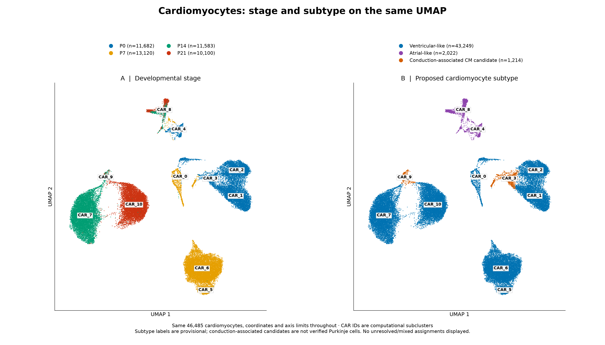
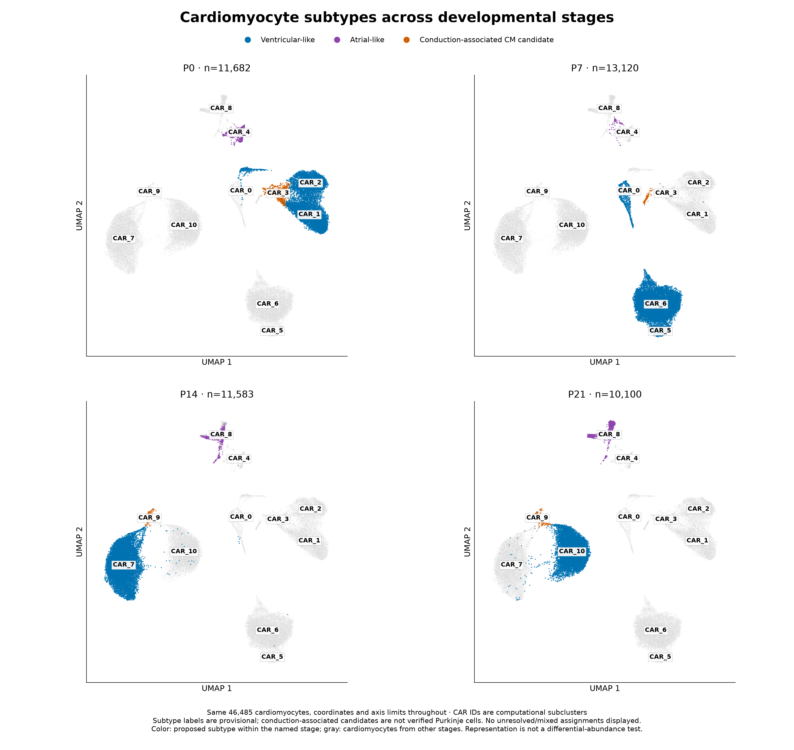

# Cardiomyocytes: stage and subtype

Only the 46,485 QC-retained cardiomyocytes are shown. Existing UMAP coordinates, CAR IDs, memberships and provisional subtype labels are preserved; no expression reanalysis or UMAP refitting was performed. All panels use the same axis limits and aspect ratio. No cardiomyocytes in this input carry unresolved/mixed labels, so the display filter hides none.

## Matching UMAPs

Left: P0/P7/P14/P21 stage colors. Right: proposed subtype colors. Identical CAR labels let you compare locations directly. Colors have different meanings between these two panels, as indicated by their legends.

[High-resolution PNG](cardiomyocyte_stage_vs_subtype.png) · [PDF](cardiomyocyte_stage_vs_subtype.pdf)

## Both stage and subtype

Each panel selects a stage; point color identifies proposed subtype, using the same three subtype colors throughout. Gray points are cardiomyocytes from other stages. Stage-specific counts describe representation, not statistically tested changes in abundance.

[High-resolution PNG](cardiomyocyte_subtypes_by_stage.png) · [PDF](cardiomyocyte_subtypes_by_stage.pdf) · [Combined two-page PDF](cardiomyocyte_stage_and_subtypes.pdf)

[Subtype-by-stage counts](subtype_by_stage_counts.tsv) · [CAR subcluster-by-stage counts](subcluster_subtype_by_stage_counts.tsv)

Subtype labels are provisional RNA-based interpretations. CAR_3 and CAR_9 are conduction-associated candidates, not anatomically or functionally verified Purkinje cells. Ventricular-like and atrial-like labels do not resolve every developmental or functional state. See [per-subcluster evidence and confidence](../cell_identities_subtypes/subcluster_identity_evidence.tsv).

Reproduce with `python analysis/plot_cardiomyocyte_stage_subtypes.py` using the existing analysis environment. The manifest records input/coordinate hashes, colors and artifact checksums.
