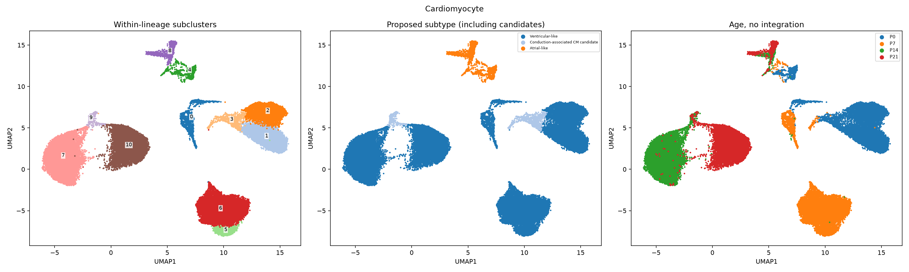
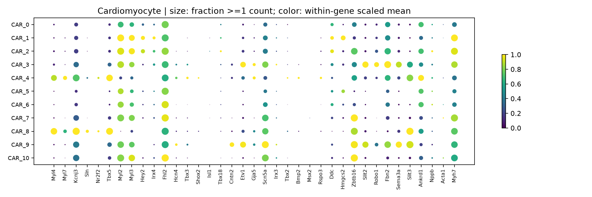
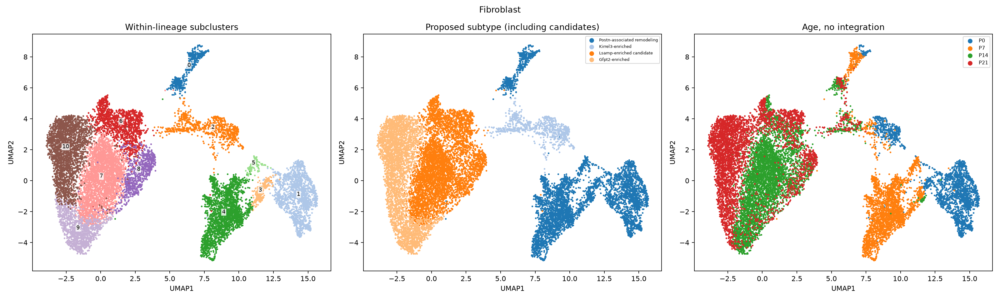
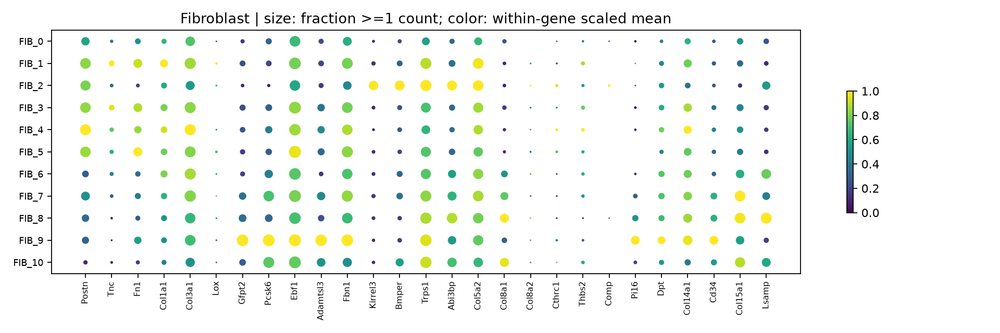
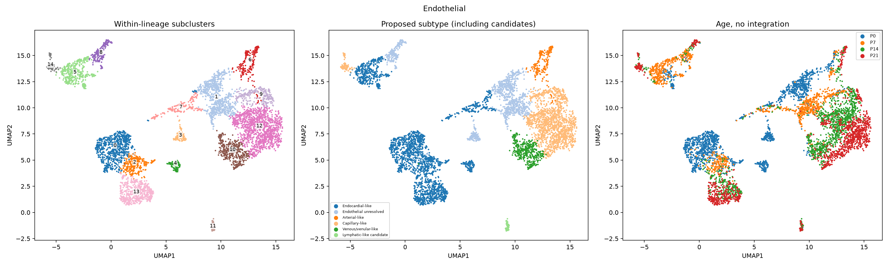
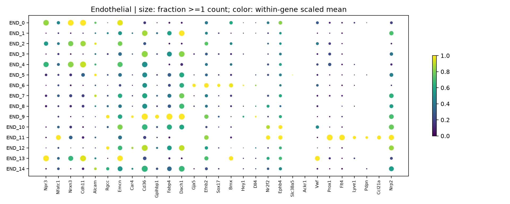
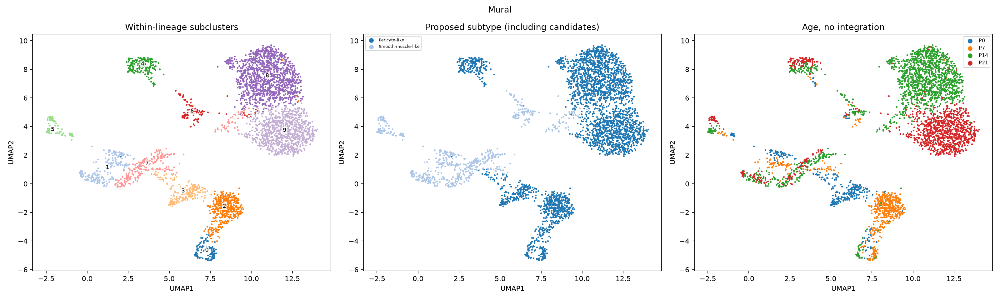
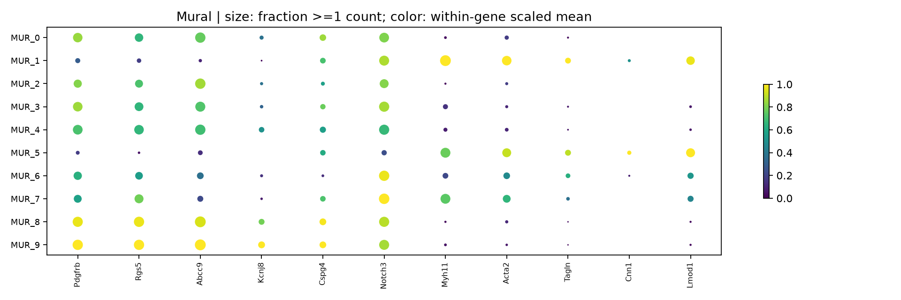
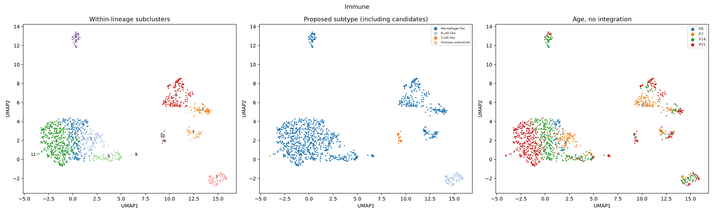
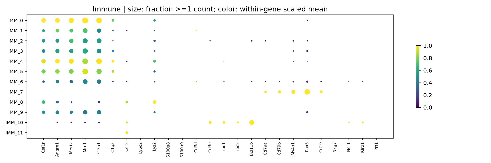

# Cell identities and within-lineage subclustering

All 73,052 QC-retained nuclei are accounted for. Broad identities were reviewed with multi-gene evidence, followed by independent subclustering of cardiomyocytes, fibroblasts, endothelial, mural and immune populations. Epicardial and neural/glial populations retain broad labels; a lineage-weak group remains unresolved.

## Main results

| Parent | Nuclei | Computational subclusters |
|---|---:|---:|
| Cardiomyocyte | 46,485 | 11 |
| Fibroblast | 14,985 | 11 |
| Endothelial | 5,573 | 15 |
| Mural | 3,804 | 10 |
| Immune | 1,248 | 12 |

There are 59 computational subclusters, not 59 validated cell types. Many subclusters share a subtype-like marker profile and differ by age or cycling state. The primary Leiden resolution is 0.6, with 0.3 and 1.0 comparisons provided. Each lineage has its own PCA, neighbor graph and UMAP; coordinates between lineage-specific UMAPs are not directly comparable. No age regression or batch integration was performed.

| Parent | Proposed phenotype | Nuclei passing all evidence rules | Candidate/review nuclei | Unresolved nuclei |
|---|---|---:|---:|---:|
| Cardiomyocyte | Atrial-like | 2,022 | 0 | 0 |
| Cardiomyocyte | Conduction-associated CM candidate | 1,214 | 0 | 0 |
| Cardiomyocyte | Ventricular-like | 9,988 | 33,261 | 0 |
| Endothelial | Arterial-like | 209 | 0 | 0 |
| Endothelial | Capillary-like | 1,467 | 92 | 0 |
| Endothelial | Endocardial-like | 1,532 | 698 | 0 |
| Endothelial | Endothelial unresolved | 0 | 0 | 1,107 |
| Endothelial | Lymphatic-like candidate | 56 | 0 | 0 |
| Endothelial | Venous/venular-like | 0 | 412 | 0 |
| Fibroblast | Gfpt2-enriched | 1,213 | 2,611 | 0 |
| Fibroblast | Kirrel3-enriched | 817 | 0 | 0 |
| Fibroblast | Lsamp-enriched candidate | 2,166 | 3,268 | 0 |
| Fibroblast | Postn-associated remodeling | 4,199 | 711 | 0 |
| Immune | B-cell-like | 76 | 0 | 0 |
| Immune | Immune unresolved | 0 | 0 | 6 |
| Immune | Macrophage-like | 672 | 466 | 0 |
| Immune | T-cell-like | 0 | 28 | 0 |
| Mural | Pericyte-like | 2,161 | 952 | 0 |
| Mural | Smooth-muscle-like | 691 | 0 | 0 |

Review flags request identity review and are not additional QC exclusions. Names explicitly containing candidate retain a review flag even if their marker/library criteria pass. Confidence describes prespecified evidence rules, not calibrated classification probability or independent biological validation. Candidate/review groups often retain coherent parent or chamber markers but fail finer enrichment or library-support requirements. For example, many ventricular-like groups share chamber markers with the rest of the CM population; lack of relative enrichment does not negate CM identity.

## Criteria used for identity

1. Broad identity: at least three canonical lineage markers with mean log1p(counts normalized to 10,000) >=0.1 and >=10% of nuclei having >=1 corrected count; at least two markers permits only candidate status. Competing lineage panels must themselves have at least two supported markers. Minimum standardized panel score 0.3 and separation 0.25; an unqualified shared ion-channel gene cannot override a coherent lineage panel.
2. Proposed subtype: at least two supported panel genes plus the required anchor genes listed below. Detection is defined using >=1 corrected count, not any tiny positive DecontX residual. Positive evidence and exclusion-marker expression are recorded separately. Exclusion genes contribute a score penalty/check; they are not required to be completely absent.
3. Evidence status: >=50 nuclei; >=2 libraries each contributing >=10 nuclei; <=80% from one library; positive panel score >=0.3; score margin >=0.25; mean panel enrichment >=0.1 log units versus the remainder of the parent; positive within-library contrasts in >=2 libraries. These are reproducible analysis thresholds, not universal diagnostic cutoffs. They do not establish animal-level independence.
4. Cycling is a separate state: a nucleus is cycling-marker positive when >=2 of Mki67, Top2a, Cenpf, Ccnb1, Ube2c and Cdk1 have >=1 corrected count; a subcluster is cycling-enriched when >=10% meet this definition. RNA positivity does not demonstrate completed cell division.
5. Ddc-, Slit2- and Ankrd1-enriched CM programs are reported as separate marker states, not mutually exclusive anatomical cell types. An anchor, another supported program gene, and anchor enrichment >0.1 log units are required.

## Positive markers, anchors and interpretation

| Parent | Proposed identity tested | Positive marker panel | Anchor requirement | Interpretation limit |
|---|---|---|---|---|
| Cardiomyocyte | Atrial-like | Myl4, Myl7, Kcnj3, Sln, Nr2f2, Tbx5 | >=2 of Myl4, Kcnj3, Sln, Nr2f2 | Requires multiple atrial markers; Myl7 or Nppa alone is insufficient in immature ventricles. |
| Cardiomyocyte | Ventricular-like | Myl2, Myl3, Hey2, Irx4, Fhl2 | >=1 of Myl2, Hey2, Irx4 | Chamber-like RNA identity; does not establish compact/trabecular location. |
| Cardiomyocyte | Nodal-like candidate | Hcn4, Tbx3, Shox2, Isl1, Tbx18 | >=2 of Hcn4, Tbx3, Shox2 | Requires multi-marker support; anatomical sinoatrial/atrioventricular localization unconfirmed. |
| Cardiomyocyte | Conduction-associated CM candidate | Cntn2, Etv1, Gja5, Scn5a, Irx3 | >=2 of Cntn2, Etv1, Gja5 | Etv1/Gja5 or Cntn2/Etv1 with CM identity supports a conduction-associated candidate. Purkinje anatomy is not assigned; Cntn2 support and spatial/functional confirmation are needed for greater specificity. |
| Cardiomyocyte | AV-like candidate | Tbx2, Tbx3, Bmp2, Msx2, Rspo3 | >=2 of Tbx2, Bmp2, Msx2 | Candidate developmental phenotype only; spatial confirmation required. |
| Fibroblast | Postn-associated remodeling | Postn, Tnc, Fn1, Col1a1, Col3a1, Lox | >=1 of Postn, Tnc, Lox | A developmental ECM state, not a diagnosis of pathological activation/fibrosis. |
| Fibroblast | Gfpt2-enriched | Gfpt2, Pcsk6, Ebf1, Adamtsl3, Fbn1 | >=1 of Gfpt2 | Marker-defined fibroblast state; anatomical niche unconfirmed. |
| Fibroblast | Kirrel3-enriched | Kirrel3, Bmper, Trps1, Abi3bp, Col5a2 | >=1 of Kirrel3 | Do not equate this RNA-defined state with valve fibroblasts without spatial evidence. |
| Fibroblast | Col8a1-enriched | Col8a1, Col8a2, Cthrc1, Thbs2, Comp | >=1 of Col8a1 | Marker-defined matrix program, not disease-specific fibrosis. |
| Fibroblast | Pi16/Dpt interstitial-like | Pi16, Dpt, Col14a1, Cd34, Col15a1 | >=1 of Pi16, Dpt | Interstitial-like transcriptional state; adventitial location not established. |
| Fibroblast | Lsamp-enriched candidate | Lsamp, Dpt, Col15a1, Fbn1 | >=1 of Lsamp | Single-anchor marker state requiring confirmed fibroblast identity; provisional. |
| Endothelial | Endocardial-like | Npr3, Nfatc1, Nrxn3, Cdh11, Alcam | >=2 of Npr3, Nfatc1, Nrxn3 | Consistent with the authors' Nrxn3-enriched endocardial ECs; location remains unconfirmed. |
| Endothelial | Capillary-like | Rgcc, Emcn, Car4, Cd36, Gpihbp1, Fabp4, Dach1 | >=2 of Rgcc, Emcn, Car4, Gpihbp1 | Capillary program can include age-associated metabolic states. |
| Endothelial | Arterial-like | Gja5, Efnb2, Sox17, Bmx, Hey1, Dll4 | >=2 of Gja5, Efnb2, Sox17, Bmx | Cannot distinguish arteriole anatomy from arterial-like RNA alone. |
| Endothelial | Venous/venular-like | Nr2f2, Ephb4, Slc38a5, Ackr1, Vwf | >=2 of Nr2f2, Ephb4, Ackr1 | Requires multiple venous anchors; Vwf alone is insufficient. |
| Endothelial | Lymphatic-like candidate | Prox1, Flt4, Lyve1, Pdpn, Ccl21a, Nrp2 | >=2 of Prox1, Flt4 | Lyve1 alone can label macrophages; endothelial parent identity and Prox1/Flt4 required. |
| Immune | Macrophage-like | Csf1r, Adgre1, Mertk, Mrc1, F13a1, C1qa | >=2 of Csf1r, Adgre1, Mertk, C1qa | Resident-like versus recruited origin cannot be established by these RNA markers alone. |
| Immune | Monocyte-like | Ccr2, Ly6c2, Lyz2, S100a8, S100a9 | >=2 of Ccr2, Ly6c2, S100a8, S100a9 | Requires multiple monocyte/inflammatory markers. |
| Immune | T-cell-like | Cd3d, Cd3e, Trbc1, Trbc2, Bcl11b | >=2 of Cd3d, Cd3e, Trbc1, Trbc2 | Broad T-cell phenotype; no TCR repertoire evidence. |
| Immune | B-cell-like | Cd79a, Cd79b, Ms4a1, Pax5, Cd19 | >=2 of Cd79a, Cd79b, Ms4a1 | Broad B-cell phenotype. |
| Immune | NK-like | Nkg7, Ncr1, Klrd1, Prf1 | >=2 of Ncr1, Klrd1, Nkg7 | Needs separation from cytotoxic T cells. |
| Mural | Pericyte-like | Pdgfrb, Rgs5, Abcc9, Kcnj8, Cspg4, Notch3 | >=2 of Rgs5, Abcc9, Kcnj8, Cspg4 | Mural continuum; vessel position unconfirmed. |
| Mural | Smooth-muscle-like | Myh11, Acta2, Tagln, Cnn1, Lmod1 | >=2 of Myh11, Cnn1, Lmod1 | Acta2 alone also labels myofibroblast-like states; multi-marker contractile program required. |

Not every tested identity was detected. No supported Col8a1-enriched or Pi16/Dpt-exclusive fibroblast subtype, nodal-like CM or AV-like CM is claimed under this rule set. Their panels remain in the criteria file so lack of support is transparent.

## Important limits

All labels remain provisional RNA-based interpretations. The conduction-associated CM candidates are not asserted to be anatomically or functionally verified Purkinje cells. CAR_3 is Etv1/Gja5-enriched with limited Cntn2 detection; CAR_9 has stronger Cntn2/Etv1 support. Kirrel3-enriched fibroblasts are not assigned valve location without spatial validation. Developmental Postn-associated remodeling is not equated with pathological fibrosis. Lyve1 alone does not establish lymphatic EC identity; the lymphatic candidate requires endothelial lineage plus Prox1/Flt4 and a broader lymphatic panel.

Two libraries per age and differential QC losses (especially P7) limit abundance and developmental inference. Candidate panels can be incomplete and neighboring programs can overlap. Low detection does not prove biological absence. Cell/nucleus proportions do not equal tissue cell proportions. Descriptive marker rankings are not replicate-aware differential-expression significance tests. Spatial and/or independent reference validation is needed before treating anatomical subtype names as established.

## Data and figures

- `all_cell_identity_and_subtype_annotations.csv.gz`: every retained nucleus, reviewed broad identity, subtype proposal, evidence status, global/subcluster IDs, age/library, QC, cycling and CM marker-state flags.
- `subcluster_identity_evidence.tsv`: each subcluster, supporting markers/anchors, library representation, positive contrasts, age composition, confidence and an explicit review reason.
- `subtype_identity_criteria.tsv` and `analysis/subtype_criteria.json`: full definitions, anchors, exclusion checks and thresholds.
- `subtype_marker_evidence.tsv`: per-subcluster mean expression and raw/corrected detection fractions for every tested marker.
- `candidate_panel_comparisons.tsv`: every candidate panel score, gate result and within-library contrast, including rejected candidates.
- `subcluster_descriptive_markers.tsv`: unbiased descriptive marker ranking within each parent, excluding mitochondrial/ribosomal genes.
- Parent directories contain UMAPs, marker dot plots, per-nucleus assignments, resolution labels, sample/age cross-tabs, all-gene subcluster pseudobulk counts and metadata-only H5AD objects. Metadata-only H5AD files contain no expression matrix.
- The full annotated count H5AD, with original integer counts and corrected fractional counts, is prepared and validated locally. Release upload failed because GitHub’s upload endpoint rejected credentials (HTTP 401); it is not available for download. Per-cell annotations, metadata-only H5ADs and pseudobulk counts below are available.

## Broad identity review

The review assigns 617 previously mixed nuclei to an endothelial profile and 178 to a pericyte profile. The 157-nucleus neural/glial group retains candidate status because of limited marker support; 103 lineage-weak nuclei remain unresolved. Earlier preliminary counts and lineage profiles used a different marker-based labeling pass and are not silently overwritten.

## Sources

https://doi.org/10.1038/s44161-026-00861-z
https://github.com/whfbio/PIP_seq/blob/102d80e6ea5de44f594461c727a4b3c6e1bc3508/Figure1/1.0_snRNA_Manual_Annotation.R

The authors explicitly used additional Xenium spatial information for final annotations. Their numeric cluster labels were not transferred to this independently processed dataset.

## Cardiomyocyte figures

## Fibroblast figures

## Endothelial figures

## Mural figures

## Immune figures

