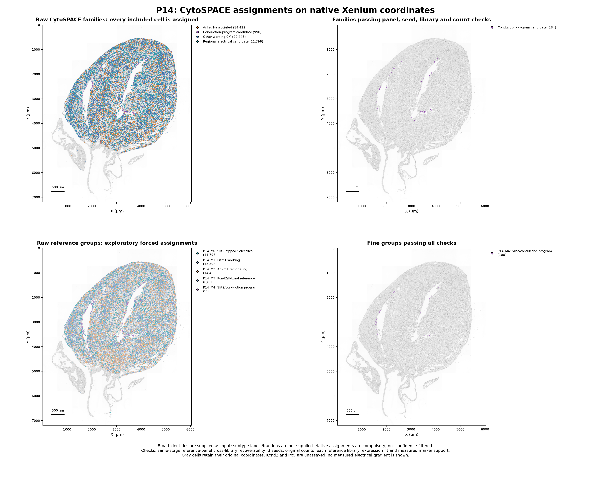
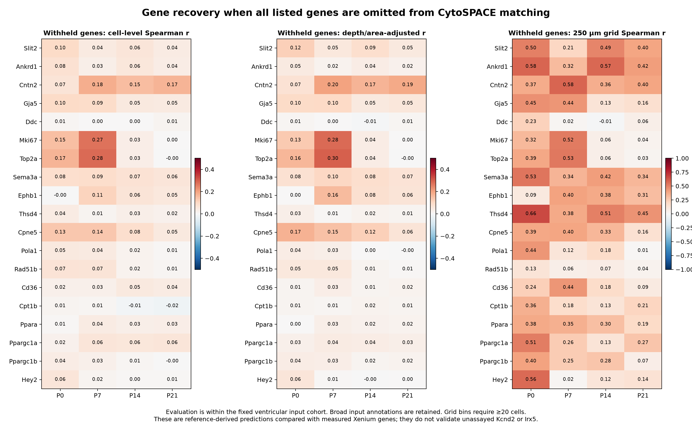

# CytoSPACE alignment of postnatal-heart snRNA-seq and Xenium

CytoSPACE **1.1.0** was run in its **single-cell mode** on all four stages. It assigns reference nuclei to **241,449 eligible Xenium segments**, including **168,588 ventricular-enriched candidates**. All **408,054 original segments** remain in the annotation tables with eligibility/review flags and unchanged physical coordinates.

**This is an independent analysis, not an exact reproduction of the authors' pipeline.** Annotation granularity, reference preparation, partition size and acceptance checks differ. The 259 accepted fine matches are an additional filtered subset, not the yield of native alignment. See the [comparison with the released author workflow](author_pipeline_comparison.md).

**Under this independent setup, most fine ventricular groups do not pass the additional panel-recoverability and stability checks.** Raw forced assignments are supplied alongside candidates that pass these checks. Neither native assignment counts nor the filtered subset estimates biological subtype abundance.

## Results by stage

| Stage | All segments retained | Included in CytoSPACE | Ventricular inputs | Supported stable families | Supported stable fine matches |
|---|---:|---:|---:|---:|---:|
| P0 | 47,611 | 28,554 | 21,994 | 8,643 | 0 |
| P7 | 99,429 | 59,404 | 38,580 | 155 | 151 |
| P14 | 117,070 | 69,048 | 49,656 | 184 | 108 |
| P21 | 143,944 | 84,443 | 58,358 | 0 | 0 |

Included context lineages are atrial-marker-enriched CM, endothelial, fibroblast, pericyte, smooth muscle, immune and epicardial candidates. Their broad identities are **supplied constraints from the preceding analysis**, not independently rediscovered or validated by CytoSPACE. CM/EC-overlap, chamber-unresolved, low-information and other unresolved segments are retained but withheld from assignment.

The class-level cross-library panel benchmark supports **P7_M6 and P14_M4**, both Slit2/conduction-program-enriched reference candidates, at the primary thresholds. Their accepted spatial matches are:

| Stage | Fine reference group | Accepted candidate segments | Median Npr3/endothelial landmark distance | All ventricular inputs |
|---|---|---:|---:|---:|
| P7 | P7_M6 | 151 | 22.8 µm | 113.4 µm |
| P14 | P14_M4 | 108 | 19.9 µm | 164.5 µm |

These are descriptive nearest-marker-cell distances in two dimensions, not traced transmural depth or an independent spatial accuracy test. Expression matching uses related cardiac programs, and anatomical validation is still needed. [Spatial summary](supported_candidate_spatial_summary.tsv).

P0 retains a supported **Other working CM** family, without a reliable fine subdivision. No P21 family/fine class meets the primary panel benchmark. This is **lack of resolution**, not absence of the biological populations. The P0 cycling and conduction classes are borderline at the precision cutoff: their worst-fold precision is approximately 0.585 and 0.544, respectively. [Threshold sensitivity](reference_panel_benchmark/precision_threshold_sensitivity.tsv) is provided rather than treating the 0.60 cutoff as a biological boundary.

The preceding measured-marker analysis remains relevant: Slit2-associated RNA was closer to Npr3-positive endothelial landmarks at all four ages. CytoSPACE is a second expression-matching method, not independent biological validation of those candidate landmarks. See the [measured spatial analysis](../xenium_ventricular_mapping/README.md).

## Maps and data

| Stage | Raw versus supported maps | All-cell annotations | Native main-run pairs |
|---|---|---|---|
| P0 | [PNG](P0/P0_cytospace_raw_and_supported_maps.png) · [PDF](P0/P0_cytospace_raw_and_supported_maps.pdf) | [TSV.gz](P0/cytospace_cell_annotations.tsv.gz) | [CSV.gz](P0/corrected_seed42/assigned_locations.csv.gz) |
| P7 | [PNG](P7/P7_cytospace_raw_and_supported_maps.png) · [PDF](P7/P7_cytospace_raw_and_supported_maps.pdf) | [TSV.gz](P7/cytospace_cell_annotations.tsv.gz) | [CSV.gz](P7/corrected_seed42/assigned_locations.csv.gz) |
| P14 | [PNG](P14/P14_cytospace_raw_and_supported_maps.png) · [PDF](P14/P14_cytospace_raw_and_supported_maps.pdf) | [TSV.gz](P14/cytospace_cell_annotations.tsv.gz) | [CSV.gz](P14/corrected_seed42/assigned_locations.csv.gz) |
| P21 | [PNG](P21/P21_cytospace_raw_and_supported_maps.png) · [PDF](P21/P21_cytospace_raw_and_supported_maps.pdf) | [TSV.gz](P21/cytospace_cell_annotations.tsv.gz) | [CSV.gz](P21/corrected_seed42/assigned_locations.csv.gz) |

[Combined five-page figure PDF](cytospace_spatial_maps_and_checks.pdf) · [Stage summary](stage_summary.tsv) · [Assignment counts](ventricular_assignment_counts.tsv) · [Reference proportion comparison](reference_sampling_and_assigned_fractions.tsv)



Every native match has a Xenium `SpotID`, snRNA `OriginalCID`, source library, coarse family, stage-specific group, expression-fit diagnostic and original µm coordinates. The six stability runs and the held-out-gene run are retained separately. Fine-group IDs and potential functions are defined in the [stage catalog](../ventricular_stage_subtype_catalog/README.md). Gray cells on supported maps remain visible as section context; they are not a new subtype.

## Stability and held-out genes

| Stage | Same fine group in all 3 seeds | Median withheld-gene cell Spearman r | Median withheld-gene 250 µm grid Spearman r |
|---|---:|---:|---:|
| P0 | 15.1% | 0.062 | 0.388 |
| P7 | 17.0% | 0.044 | 0.338 |
| P14 | 16.5% | 0.034 | 0.181 |
| P21 | 12.5% | 0.032 | 0.158 |

All **19 test genes** were removed together from the CytoSPACE cost in a separate run: Slit2, Ankrd1, Cntn2, Gja5, Ddc, Mki67, Top2a, Sema3a, Ephb1, Thsd4, Cpne5, Pola1, Rad51b, Cd36, Cpt1b, Ppara, Ppargc1a, Ppargc1b, Hey2.

Recovery is evaluated within the fixed ventricular cohort. These genes are not positive or exclusion markers in its CM/chamber gate, while total-count/QC selection is held fixed. Broad annotations and cell eligibility are retained, so this is conditional gene recovery, not end-to-end blinded atlas validation. Cell-level recovery is modest overall; averaging cells into 250 µm bins can recover regional trends more strongly. Bins require at least 20 ventricular candidates. Adjacent bins are not independent biological replicates.

[All gene-recovery metrics](heldout_gene_recovery.tsv) include detection AUC, expression correlations, within-ventricular shuffled controls, and residual correlations after accounting for RNA counts, area, detected genes and missing nuclear area. [Grid data](heldout_gene_grid250um_evaluation.tsv.gz) are for evaluation only; no coordinates or neighborhood smoothing enter matching.



## Kcnd2 and Irx5

**Neither gene is measured by the deposited Xenium panel.** CytoSPACE can carry the expression of an assigned reference nucleus to a coordinate, but this is a prediction. We have kept such values in columns named `predicted_reference_*`, separate from the 403 measured-target count matrices. They are not used to establish wall depth, orient the section or validate an electrophysiological gradient.

The tables include the mean and range of reference-derived Kcnd2/Irx5/Irx3/Etv1/Mpped2/Kcnip2 values across the three corrected-reference seeds. The source values are [measured snRNA-reference expression](snRNA_reference_marker_values_NOT_Xenium_measurements.tsv.gz), normalized as whole-transcriptome log1p(CP10k). A three-run range measures sampling sensitivity, not a confidence interval. Held-out measured genes do not directly validate any unassayed gene. Given modest cell-level recovery, **no Kcnd2 prediction map is presented as anatomical evidence**. An apparent predicted Kcnd2/Slit2 relationship could simply inherit the relationship in the reference.

## Mapping and acceptance criteria

1. **Fixed same-stage cohorts:** use the preceding QC/transfer-information thresholds and broad-lineage/chamber candidates. Match P0 to P0, P7 to P7, P14 to P14 and P21 to P21. No cross-age alignment is performed.
2. **Upstream CytoSPACE:** unmodified version 1.1.0, commit `bb7fe12ab4466ef5e38dcac4c3ece07012060d60`; single-cell mode; Pearson correlation; LAPJV 1.3.14 solver; randomized query/reference input order; chunks of at most 3,000 within broad input types; duplicate sampling; no Harmony or spatial smoothing. Counts are normalized internally as log2(1+CP1M) over exact shared genes. Optimization is within partitions, not one global whole-section solution.
3. **Reference variants:** three seeds 42/43/44 on DecontX-corrected, unnormalized fractional count estimates; seed 42 on original integer counts; seed 42 on each of the two reference libraries separately. `--downsample-off` avoids integer molecule resampling of corrected estimates. QC cell inclusion precedes every reference variant.
4. **No subtype labels/fractions supplied:** all ventricular references/queries share one broad `Ventricular_CM` input label. The upstream sampling routine nevertheless inherits subtype proportions from the sampled reference pool. Each reference nucleus is used at least once before resampling if more query segments than nuclei are present. Consequently the overall inferred subtype proportions are constrained by the reference, not estimated from Xenium.
5. **Panel recoverability:** use one snRNA library as pseudo-query and the other as reference, in both directions. Require worst-fold precision≥0.60, recall≥0.35, F1≥0.50 and≥30 query/training nuclei per class. These existing groups were defined using both libraries, and the queries remain nuclei. This benchmark tests technical panel/algorithm recoverability; it neither simulates Xenium probe/segmentation effects nor establishes independent spatial accuracy.
6. **Stable families:** require a seed majority≥2/3 that includes the primary seed, agreement with original-count and both separate-library assignments, primary expression Pearson r≥0.30,≥50 shared molecules, and passing panel recoverability. Cycling/conduction candidates additionally need≥2 measured program genes. Pearson r is an expression-fit diagnostic, not a posterior probability.
7. **Stable fine groups:** additionally require the same fine-group majority and original-count/separate-library agreement, fine-class recoverability,≥100 shared molecules,≥3 measured upstream both-library marker genes, and family consistency. More permissive robustness-only flags and all native matches are retained for sensitivity review.

[Cross-library benchmark](reference_panel_benchmark/panel_recoverability.tsv) · [Fold metrics](reference_panel_benchmark/heldout_library_metrics.tsv) · [Measured fine-marker coverage](fine_group_measured_marker_coverage.tsv) · [Expression-fit diagnostics](expression_fit_diagnostics.tsv)

## Comparison with the preceding mapping

| Stage | Prior family-assigned segments | Agreement with raw CytoSPACE family | Both methods retain a family | Agreement within that overlap |
|---|---:|---:|---:|---:|
| P0 | 11,496 | 33.5% | 4,429 | 36.0% |
| P7 | 18,805 | 22.1% | 155 | 100.0% |
| P14 | 8,439 | 48.5% | 180 | 100.0% |
| P21 | 3,784 | 39.5% | 0 | NA |

The retained P7/P14 conduction candidates agree across the two methods; working-CM assignments show substantial disagreement. Neither method is ground truth. Their cost functions, handling of assay differences, reference resampling and acceptance filters differ. Global differences in cycling/working-CM assignments should not be interpreted as developmental changes in cell abundance. [Comparison table](comparison_with_previous_mapping.tsv); each stage also includes a full prior-versus-native family cross-tabulation.

## Load annotations without altering measured counts

```python
import anndata as ad
import pandas as pd
a = ad.read_h5ad("../xenium_ventricular_mapping/P14/P14_xenium_counts_and_candidate_mapping.h5ad")
c = pd.read_csv("P14/cytospace_cell_annotations.tsv.gz", sep="\t", index_col=0, float_precision="round_trip")
assert a.obs_names.equals(c.index)
columns = c.filter(regex=r"^(cyto_|cytospace_|predicted_reference_)").columns
a.obs = a.obs.join(c[columns], validate="one_to_one")
# a.X still contains only the original measured Xenium counts.
```

Cell IDs are section-specific; prefix the stage before combining sections. No second copy of the large measured-count H5ADs is necessary: all four source H5ADs, the 381-gene reference counts, and reference metadata are already [published with the preceding analysis](../xenium_ventricular_mapping/README.md). Pair identities reconstruct upstream assigned shared-panel expression exactly; repeated reference nuclei are expected and do not represent newly observed transcriptomes.

## Reproduce and audit

Use a separate **Python 3.9.19** environment for CytoSPACE and install [pinned dependencies](../../analysis/requirements-cytospace.txt). The original recommended OR-Tools version was unavailable on PyPI; 9.3.10497 supplies the legacy import required by upstream. Assignment itself uses LAPJV. The main preparation/report scripts run in the existing scientific Python environment. The runtime/source paths are defined at the top of [the runner](../../analysis/run_cytospace_xenium.py).

```bash
git clone https://github.com/digitalcytometry/cytospace /workspace/heart-atlas/tools/cytospace
git -C /workspace/heart-atlas/tools/cytospace checkout bb7fe12ab4466ef5e38dcac4c3ece07012060d60
uv venv --python 3.9.19 /workspace/heart-atlas/venv-cytospace
uv pip install --python /workspace/heart-atlas/venv-cytospace/bin/python -r analysis/requirements-cytospace.txt
python analysis/run_cytospace_xenium.py
python analysis/benchmark_cytospace_reference.py
# Published reference-marker values can be reused; re-extraction needs the full local snRNA H5AD:
# python analysis/prepare_cytospace_reference_markers.py
python analysis/summarize_cytospace_xenium.py
python analysis/plot_cytospace_xenium.py
python analysis/validate_cytospace_xenium.py
python analysis/write_cytospace_report.py
```

Completed runs are cached by run name. Delete/rebuild the derived run directories when changing input data, gene sets, package versions or parameters; an existing manifest is a completion marker, not a cache-validity proof. Run manifests retain exact commands, source hashes, gene lists and software provenance. Transient input matrices and redundant upstream assigned-expression copies are omitted to bound disk usage; the published source matrices and assignment IDs reproduce them.

[Numerical validation](validation.json) checks all assignment IDs, broad constraints, source libraries, coordinate conservation, expected reference reuse, independent sampled expression correlations, consensus labels, filtered-rule invariants and reference-carried gene values. [Manifest and checksums](manifest.json) include all result files and analysis scripts.

One acquisition region per stage is analyzed. This is not independently replicated animal-level spatial inference. Assay-specific capture, sparse nuclear RNA, segmentation leakage and reference composition can all affect assignments. The provisional conduction label is not verified Purkinje identity; transcript programs do not measure conduction velocity, action potentials, oxygen exposure or wall stress.

CytoSPACE citation: Vahid et al., *High-resolution alignment of single-cell and spatial transcriptomes with CytoSPACE*, Nature Biotechnology 2023, [DOI 10.1038/s41587-023-01697-9](https://doi.org/10.1038/s41587-023-01697-9). [Upstream code and Stanford noncommercial software license](https://github.com/digitalcytometry/cytospace). Xenium inputs: Wang, Dong, Song, Qian and Liu, Zenodo [P0/P7](https://zenodo.org/records/14961929) and [P14/P21](https://zenodo.org/records/14961942), CC BY 4.0; snRNA inputs: GSE290989. The authors’ WebAtlas S3 annotations were not used.
