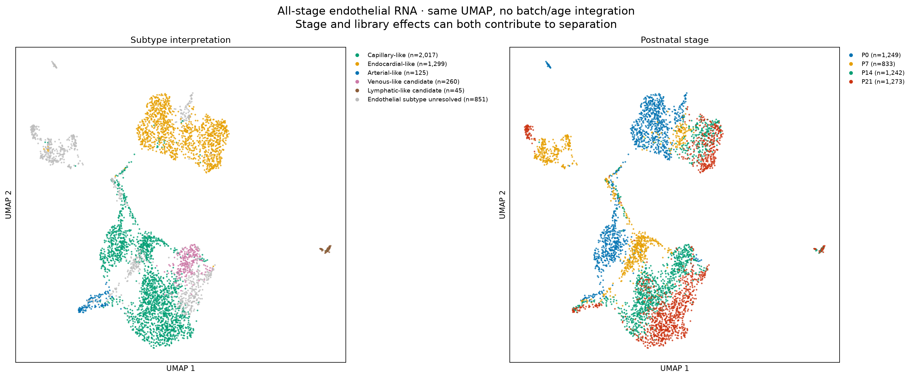
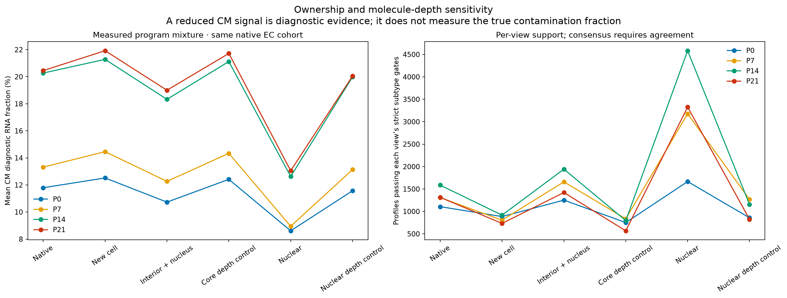

# Endothelial-specific QC, subclustering and Xenium nuclear/boundary reassessment

The completed reanalysis retains **4,597 of 5,573** previously labeled endothelial nuclei for primary discovery. All 5,573 nuclei already passed whole-heart per-library doublet filtering and ambient correction. Additional endothelial-specific review retains the excluded nuclei and their original/corrected counts as an audit. The four Xenium sections contain **69,617 native broad EC profiles**; the new audit includes these plus uncertain EC proposals, totaling **95,316 candidates**. No original spatial profile or coordinate is deleted or moved.

[Full illustrated report, 27 pages](endothelial_QC_and_subtypes_report.pdf) · [Named RNA groups, markers and support](RNA_named_subtype_catalog.tsv) · [Vascular subtype definitions and possible functions](endothelial_subtype_name_key.tsv) · [Spatial QC summary](Xenium/EC_QC_summary.tsv) · [All spatial annotations](Xenium/all_stage_EC_consensus.tsv.gz) · [Validation](validation.json)

## RNA QC and discovery

| Stage | Previously labeled EC nuclei | Primary RNA | Retained for QC review | RNA groups |
|---|---:|---:|---:|---:|
| P0 | 1,647 | 1,249 | 398 | 6 |
| P7 | 1,170 | 833 | 337 | 5 |
| P14 | 1,386 | 1,242 | 144 | 7 |
| P21 | 1,370 | 1,273 | 97 | 6 |

The inherited global QC uses scDblFinder **per entire library**, with Scrublet diagnostic only. DecontX fits converged separately in all eight libraries; called-nucleus clusters supply the contamination model because empty-droplet backgrounds are unavailable. The inherited filters require 750–7,500 detected features, at least 1,000 corrected UMIs, at most 5% mitochondrial RNA and estimated ambient fraction at most 50%. [Original QC summary](snRNA/inherited_QC_summary.tsv), [original validation/provenance](snRNA/inherited_QC_provenance.json) and unchanged upstream scripts under `analysis/endothelial_upstream_QC/` distinguish this completed upstream correction from the new analysis. We do not rerun droplet models on a purified lineage.

The new full-transcriptome screen requires at least two canonical EC genes with corrected count at least one and at least 0.1% EC-panel RNA. Strong incompatible programs (at least three genes, ten molecules and 2% of all RNA) enter review. A two-pass check also identifies **202 nuclei** in provisional groups with at least three mural markers detected in at least 15% of nuclei in both raw and corrected counts in both libraries (at least ten nuclei/library). These groups retain coherent EC/mural programs; this is **not proof that every member is a doublet**. The final primary graph excludes them and is refitted. [Every QC decision](snRNA/all_endothelial_QC_decisions.tsv.gz), [provisional group evidence](snRNA/provisional_mural_group_review.tsv) and [threshold sensitivity](snRNA/QC_threshold_sensitivity.tsv) are supplied.

Discovery is independent at each age: 2,000 variable genes, 30 PCs, 20 neighbors, Leiden resolution0.45, seed42, with Harmony only between the two same-age libraries. Mitochondrial/ribosomal, sex and broad-lineage diagnostic genes do not drive the primary graph. Comparisons include unadjusted data, raw counts, nuisance covariates, explicit subtype-marker withholding, alternate seeds/resolutions, and a newly clustered ambient<=30% cohort. The [library mixing](snRNA/EC_library_mixing.tsv), [clustering sensitivity](snRNA/EC_clustering_sensitivity.tsv), [actual markers](snRNA/EC_cluster_markers.tsv) and [raw/corrected library-level family evidence](snRNA/family_markers_by_library.tsv) show the limits of finer grouping. Two RNA libraries per age are not automatically independent animals.

**Gene-enrichment names and vascular interpretations are separate levels.** Dach1/Cd36 and Ccdc85a/Ablim3 programs are examples of capillary-like groups; Tmem108/Npr3, Tmem108/Cdh11 and related programs support endocardial-like interpretation. Eln/Ptprj, Vegfc/Pcsk5 and Arl15/Prdm16 groups can support arterial-like interpretation when a broader arterial panel qualifies. Prox1/Adamtsl1 and Adamtsl1/Sema3d groups are small lymphatic-like candidates with Prox1/Flt4 support. A Vegfc/Hdac9 group has candidate venous-like panel support at P14. Cycling-associated groups are transcriptional overlays, not an additional vessel compartment. Gpc6-, Hdac9- and other unresolved programs are not asserted to be new vessel types. The catalog includes every group, its sample support, stability and proposed function. Some named groups are candidate/sensitivity-dependent; a stable graph alone does not prove anatomical identity.

The **all-stage RNA UMAP has no age or library integration**. Stage and technical effects can both contribute to its separation. The per-stage UMAPs use within-age library adjustment and independent axes; do not compare their geometric coordinates across stages. No layout is manually moved to exaggerate subtype separation.



## Xenium RNA ownership and possible merged profiles

We reuse the completed **whole-section image-guided segmentation**, which already includes endothelial cells: deposited DAPI-derived nuclear outlines anchor watershed on the acquired ATP1A1/CD45/E-Cadherin boundary channel at0.425µm. Original profile IDs are retained; nuclear components of an existing profile share its parent ID. This is an alternative boundary refinement, **not independent new nuclear detection or demonstrated cell-number/merge-split correction**. Source nuclear transcript ownership is preserved; previously unassigned RNA is not forced into primary cells. Existing vendor segmentation also used interior stain information; the alternative is not assumed superior.

The endothelial-specific analysis compares native counts, refined whole-cell counts, nuclei plus cytoplasmic interior excluding a0.85µm boundary band, nuclear-only counts, cytoplasmic-only counts and exact per-profile molecule-depth controls. QV>=20 and the403 gene targets are retained. Nuclear and whole-cell fractions have a panel denominator, so RNA and Xenium percentage thresholds differ. Nuclear RNA is less exposed to a cell boundary but remains vulnerable to background, projected nuclear overlap and loss of genuine cytoplasmic state information. It is not independent ground truth.

Multiple deposited projected nuclear components can indicate a merged profile, a fragmented projection or true multinucleation. These profiles receive **merge review** and are excluded from the strict fine release and extra nuclear-only subtype candidate release. They are not deleted. Missing nuclear area or an absent outline alone does not remove a cell. Seed type, component count, native/refined area ratio and all original coordinates are exported. We make no claim that every homotypic merge has been detected or split.

## Fine assignment evidence

| Stage | Native broad EC profiles | Strict A/B fine labels | With moderate C | Extra nuclear-only candidates | Possible multi-nuclear merges |
|---|---:|---:|---:|---:|---:|
| P0 | 6,394 | 660 | 711 | 864 | 439 |
| P7 | 16,010 | 427 | 541 | 1,295 | 1,212 |
| P14 | 23,060 | 691 | 745 | 3,583 | 477 |
| P21 | 24,153 | 497 | 549 | 2,524 | 483 |

The table uses the same **native broad EC cohort** in each stage. The all-candidate summary separately includes uncertain original EC proposals; added profiles remain explicit candidates. A new broad reference competition includes non-EC alternatives and excludes RNA ECs set aside by the new QC. Broad competition uses same-age RNA-library/subtype centroids with separate **whole-section** query calibration; fine transfer uses same-age eligible EC nuclei with separate **EC-candidate** query calibration. These calibrations intentionally use different populations.

Fine transfer requires a30-neighbor weighted vote>=0.6, margin>=0.15, agreement with raw reference and both separate RNA libraries, at least two actually measured subtype genes including an anchor, adequate RNA information (>=20 fitting molecules,>=8 genes), EC-lineage competition and no strong competing program. Lymphatic calls require **both Prox1 and Flt4**; Lyve1 alone is insufficient. RNA-reference unknown subtypes remain competitors. No spatial smoothing, subtype quota or published spatial label enters the fit. [Opposite-library technical benchmarks](Xenium/P21/opposite_RNA_library_benchmark.tsv) are supplied at all stages; reference labels are not independent biological truth.

- **A:** native, refined whole-cell and both nuclear calibrations support the same subtype.
- **B:** a newly supported whole-cell+nuclear call where the native fine call was unresolved.
- **C:** native, refined whole-cell and boundary-core subtype agreement, with nuclear confirmation unavailable.
- **Additional nuclear-only candidate:** both nuclear calibrations support the same subtype and no supported native/cell/core subtype conflicts, but the stringent whole-cell consensus is unmet. Many have mixed cell-body RNA. These are shown separately and never described as fully clean whole cells.

Strong mixed programs, incompatible supported subtype calls and unresolved/multiple-component geometry block the corresponding fine release. These tiers describe **operational robustness, not calibrated accuracy**. Shared molecules and references make the views correlated. The original parent atlas is not overwritten, and an unresolved fine label is not loss of EC lineage or evidence that a subtype is absent. All released assignments have explicit actual marker support and source views in their per-stage tables.

The independent Xenium subclusters use the measured panel after foreign-lineage/sex/outcome genes are withheld:20 PCs,20 neighbors,Leiden0.5,seed42, with alternate seeds/resolutions and core/nuclear/depth-control graphs. Final graphs exclude reviewed geometry and mixed cell-body programs and use **a common information-eligible cohort across all compared views**. Fine graph subdivisions are not automatically given vascular identities. The spatial maps show whole-section assignments; UMAPs show only the QC-eligible graph cohort.

## What the nuclear/boundary comparison establishes

Mean cardiomyocyte diagnostic RNA fraction among the **same native broad EC profiles**:

| Stage | Native whole cell | Refined whole cell | Boundary core | Core depth control | Nuclear | Nuclear depth control |
|---|---:|---:|---:|---:|---:|---:|
| P0 | 11.8% | 12.5% | 10.7% | 12.4% | 8.6% | 11.6% |
| P7 | 13.3% | 14.5% | 12.3% | 14.3% | 8.9% | 13.1% |
| P14 | 20.3% | 21.3% | 18.3% | 21.1% | 12.6% | 20.0% |
| P21 | 20.5% | 21.9% | 19.0% | 21.7% | 13.1% | 20.1% |

Nuclear RNA has less CM-associated signal than molecule-depth-matched whole-cell controls at every age. Boundary-core counts also reduce that signal beyond the core depth control. However, the new whole-cell boundary refinement itself does **not** generally reduce CM-associated signal. Thus the useful improvement is a **nuclear-supported evidence layer and conservative boundary sensitivity**, not a claim that the alternative segmentation globally cleans every EC.

These fractions measure a diagnostic RNA program, **not the true ambient/contamination fraction**. The paper describes capillary ECs with myofiber-associated RNA. We do not erase that possible biology or establish it from mixed counts: strong mixed programs remain a review category, and their nuclear persistence, boundary sensitivity and depth controls are reported. Incomplete segmentation, ambient/background RNA and genuine expression remain alternatives.

The eight fixed, previously selected EC–CM interfaces are re-inspected using the **actual transcript coordinates, acquired stains, deposited nuclear outlines and both native/refined borders**. Rings denote deposited nuclear-overlap flags. [ROI coverage](EC_interface_ROI_coverage.tsv) and [transcript localization](EC_interface_transcript_localization.tsv) quantify ROI-observed QV>=20 molecules in fully contained native EC polygons, deduplicating transcript IDs across overlapping ROIs. These selected interfaces are descriptive; they are not a random, organ-wide estimate.

In these interfaces, nuclear RNA has lower CM-associated fractions and higher canonical EC fractions than cytoplasmic RNA. A CM-RNA spike specifically at the narrow boundary is **not consistent across stages**: cytoplasmic interiors can be similarly mixed. Thus simple edge erosion alone is insufficient, and projected nuclear/whole-cell RNA cannot establish whether all CM-associated signal is exogenous.



## Downloads and reproduction

Each `snRNA/P*/` directory contains primary and review H5ADs: **X is inherited DecontX-corrected fractional counts; `counts_raw` is original integer-valued RNA**. Together they reconstruct all5,573 original EC nuclei. The primary H5ADs include new annotations and UMAP coordinates. Duplicate full-transcriptome gene symbols are collapsed by sum; shared transfer targets have no duplicate symbols. Library-by-group raw and corrected pseudobulks are also supplied.

Each `Xenium/P*/EC_candidate_count_views.h5ad` contains **X=refined whole-cell counts**, with `native`, `high_confidence`, `nuclear_only`, `depth_matched` and `nuclear_depth_matched` layers, all403 targets, final annotations and native physical coordinates. Cytoplasmic counts equal X minus `nuclear_only`. These are alternative views of the same molecules; do not add them together or treat them as independent observations. All candidate rows, including review/unresolved rows, remain available. `EC_de_novo_embeddings_metadata_only.h5ad` contains the actual graph and independent Xenium UMAP. Per-view assignments, marker evidence, stage summaries, gene names, PDF/PNG figures and a SHA256 manifest accompany the counts.

Run the following in order with the existing input data and Python environment:

```bash
export MPLCONFIGDIR=/tmp/endothelial-mpl NUMBA_CACHE_DIR=/tmp/endothelial-numba
export OPENBLAS_NUM_THREADS=2 OMP_NUM_THREADS=2 MKL_NUM_THREADS=2
python analysis/reassess_endothelial_RNA.py
for stage in P0 P7 P14 P21; do python analysis/reassess_endothelial_Xenium.py --stage "$stage"; done
python analysis/consolidate_endothelial_QC.py
python analysis/report_endothelial_QC.py
python analysis/validate_endothelial_QC.py
```

`methods.json` and the per-stage completion files specify all gates and caveats. `runtime_versions.json`, original R session records and upstream QC provenance distinguish source and current environments. Validation checks exact downloaded count views against their sources, every retained/review RNA nucleus, actual spatial marker support, consensus logic, molecule-depth matching, original coordinates, nuclear-merge exclusions, all27 PDF pages and image integrity. No RNA count correction is silently repeated; prior CM maturation, Ankrd1 and fibroblast models are not refitted by this endothelial-specific task.

Sources: [paper](https://pmc.ncbi.nlm.nih.gov/articles/PMC13561863/), DOI10.1038/s44161-026-00861-z; [snRNA GSE290989](https://www.ncbi.nlm.nih.gov/geo/query/acc.cgi?acc=GSE290989); [P0/P7 Xenium](https://zenodo.org/records/14961929), [P14/P21 Xenium](https://zenodo.org/records/14961942). The exact Supplementary Table3 EC markers and their coverage are provided separately from our curated identity panels. One section per stage and capture/selection biases preclude independent developmental abundance claims, causal cell signaling or proof of anatomical identity from RNA alone.
