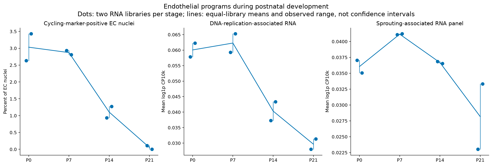

# Endothelial proliferation and angiogenesis-associated RNA across ages

**Detection-rule update:** the fractions below use the legacy corrected-count threshold of at least one. DecontX estimates are fractional, so this rule can miss retained near-one values. The [fractional-aware audit and revised support fractions](../vascular_program_detection/README.md) distinguish this threshold artifact from actual RNA removal. The original counts and results below remain an audit of the earlier rule.

The primary QC endothelial cohort shows more cycling-marker-positive nuclei at P0/P7, a decline at P14 and very few at P21. This supports greater **early endothelial proliferative activity**, an important component of angiogenesis. The six cycling genes are Mki67, Top2a, Cenpf, Ccnb1, Ube2c and Cdk1; at least two need a corrected count of at least one.

| Stage | Cycling-positive / EC nuclei | Percentage |
|---|---:|---:|
| P0 | 38 / 1,249 | 3.04% |
| P7 | 24 / 833 | 2.88% |
| P14 | 14 / 1,242 | 1.13% |
| P21 | 1 / 1,273 | 0.08% |

Proliferation is only one component of new-vessel growth. The non-cycling sprouting-associated panel (Apln, Esm1, Angpt2, Cxcr4, Pgf, Adm), VEGF/Notch machinery and stabilization-associated programs are reported separately, without assuming all genes peak together or calling RNA receptor levels direct signaling activity. Scores are mean log1p CP10k over the stated genes, not a calibrated angiogenesis index. Individual genes and raw/corrected comparisons accompany the scores. DNA-replication genes provide complementary evidence but can also participate in DNA repair.

The strongest stage difference is proliferation: the equal-library mean cycling fraction is approximately five times higher in the combined P0/P7 group than P14/P21. DNA-replication-associated RNA also declines. The direction persists with raw counts, lower estimated ambient contamination, all previously labeled ECs and the capillary-marker-supported subset. P0 and P7 cycling fractions are similar; these data do not establish a distinct P7 proliferation peak.

Broader sprouting genes are heterogeneous. Apln expression is highest at P7, Angpt2 is higher at P0 and remains detectable at P14, while Esm1 is sparse. The multi-gene sprouting panel changes much less than the cycling program. VEGF/Notch machinery expression is higher later in this comparison; receptor/Notch RNA is not a direct measure of signaling activation or vessel-growth rate. The appropriate conclusion is **greater early EC proliferative growth, with continued and changing vascular programs later**, rather than every angiogenic pathway declining in parallel.

The paper reports an overall decline in Ki67-positive ECs from P0 to P21 and early coronary plexus expansion (PMC13561863, Supplementary Fig10b). Our RNA cycling fractions are not the paper's immunostaining measurements and do not prove completed cell division or directly measure new perfused vessels.

`programs_and_cycling_by_library.tsv` preserves both RNA library labels at every age. Sensitivities include all 5,573 previously labeled ECs, primary nuclei with estimated ambient<=30%, original raw counts and a primary capillary-marker-supported subset (>=2 of Dach1/Cd36/Rgcc/Car4/Emcn/Gpihbp1). This last subset is an expression-based enrichment check, not a newly validated capillary annotation. It includes subtype-unresolved cells: restricting only to the previous Capillary-like label would omit the P7 cycling group, producing an artificial zero. Changing subtype proportions, RNA depth, capture and QC selection still limit causal or quantitative organ-wide conclusions.

`early_vs_late_descriptive_comparison.tsv` compares equal-weight means of four early versus four late RNA libraries. Two libraries per age are not assumed independent animals; no cell-level or animal-level significance claim is made. The per-library gene table is the evidence for heterogeneous gene-program trends. These are descriptive cross-sectional comparisons, not direct measurements of angiogenesis flux.

Source RNA QC, identities, count matrices and coordinates remain unchanged. Reproduce with `python analysis/compare_endothelial_angiogenesis.py` in the existing environment. See `RNA_program_definitions.tsv`, `validation.json` and `file_manifest.tsv` for definitions, accounting and provenance.
