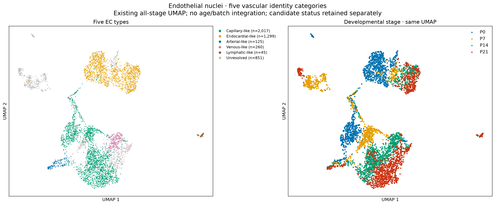

# Five endothelial types: primary presentation

The primary EC labels are **Capillary-like, Endocardial-like, Arterial-like, Venous-like and Lymphatic-like**. Finer gene-enrichment groups remain available only in the preceding audit. Cycling is a separate RNA annotation. Venous-like/lymphatic-like candidate status and all spatial confidence tiers remain explicit metadata. Unresolved profiles retain that label and are not forced into a type.

[Simplified report, 11 pages](five_endothelial_types_report.pdf) · [Marker key](five_type_marker_key.tsv) · [Stage counts](five_type_counts_by_stage.tsv) · [RNA annotations including QC-review nuclei](snRNA_five_type_annotations.tsv.gz) · [Xenium annotations](Xenium_five_type_annotations.tsv.gz)

## Primary snRNA classification

| EC type | P0 | P7 | P14 | P21 |
|---|---:|---:|---:|---:|
| Capillary-like | 480 | 277 | 690 | 570 |
| Endocardial-like | 617 | 128 | 244 | 310 |
| Arterial-like | 47 | 0 | 25 | 53 |
| Venous-like | 0 | 0 | 260 | 0 |
| Lymphatic-like | 0 | 0 | 23 | 22 |
| Unresolved | 105 | 428 | 0 | 318 |

Counts are QC-selected nuclei, not unbiased tissue abundances. Zero calls do not establish absence. In particular, arterial identity is unresolved at P7 under the current conservative model; no type was added to fill a stage quota. Small lymphatic-like groups and the P14 venous-like group remain provisional.

## Spatial evidence

`EC_type` is the main five-type classification under strict cell+nuclear agreement. `EC_type_including_cell_supported` adds the preceding moderate boundary-stable calls. `nuclear_supported_EC_type` and `additional_nuclear_only_candidate_type` expose nuclear evidence separately; mixed cell-body profiles are not silently promoted to clean whole-cell calls. Confidence, merge review, original atlas identity and source coordinates remain in the table.

The two spatial panels display strict cell+nuclear labels and nuclear-supported labels separately. Original gray review profiles remain in the background. These evidence levels do not measure independently validated accuracy.

## Scope and reproducibility

This is a presentation-only consolidation of the [completed endothelial QC and subclustering](../endothelial_QC_subtypes/README.md), source commit `d9f02610105a90ee821c2d93e05d9f77643e0e9f`. The existing 4,597 primary RNA nuclei, 976 RNA QC-review nuclei and 95,316 Xenium candidates (including all 69,617 original EC profiles) are accounted for. No model is retrained, RNA molecule removed, physical coordinate moved or UMAP recomputed. Source marker criteria and confidence remain unchanged. `Unresolved` is an assignment status, not a sixth biological EC type.

Full expression matrices and the detailed QC/segmentation evidence remain in the preceding results directory. Candidate labels are shortened for the main display, with their provisional status preserved in metadata and the marker key. The 24 finer RNA group IDs are retained only as audit references, not used as the main EC taxonomy.

Run `python analysis/present_five_endothelial_types.py` in the existing analysis environment. The script checks source identity correspondence, coordinates, coverage, category counts and preserved evidence flags; `validation.json` and `file_manifest.tsv` record the checks and SHA256 hashes.
