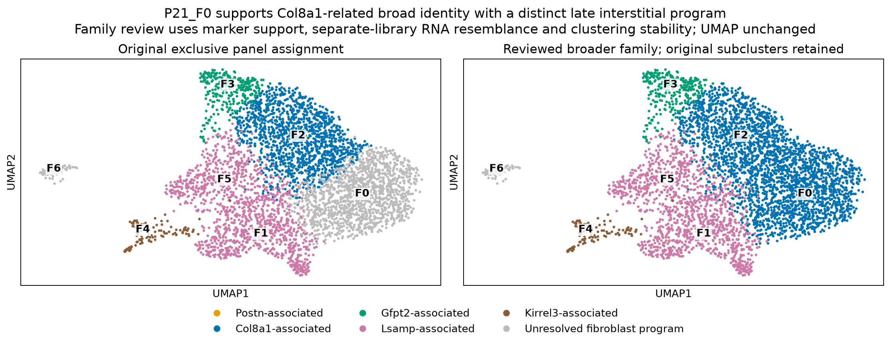
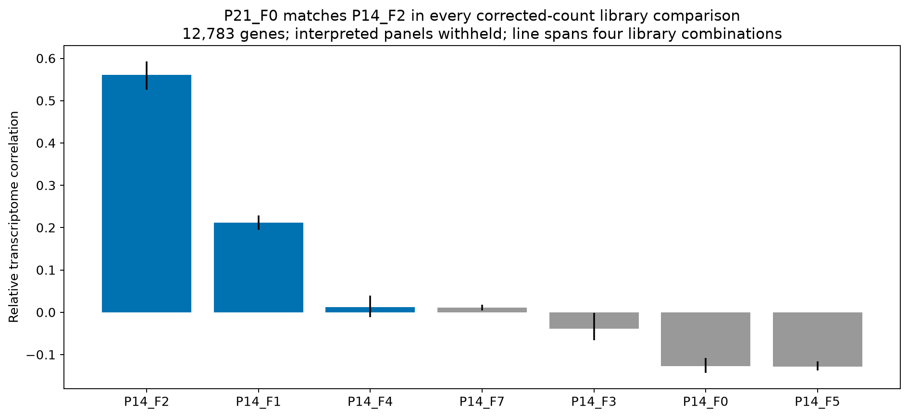

# Focused review: P21_F0 belongs to a Col8a1-related broad fibroblast program

**Spatial follow-through is complete:** [reviewed-reference Xenium refit](../fibroblast_Xenium_reviewed_refit/README.md), with updated maps, spatial models and boundary tests. The scope statements below describe this focused RNA review and the original spatial results at the time of that review.

**The evidence favors a Col8a1-associated broad family assignment for P21_F0, retaining it as a distinct Adgrl3/Svep1-associated late interstitial substate.** Its previous gray/unresolved label arose from overlapping Col8a1 and Lsamp marker panels, not a failure to detect Col8a1-associated genes. The earlier explanation that its Col8a1 marker support weakened was inaccurate for this RNA group.

[Three-page review PDF](P21_Col8a1_identity_review.pdf) · [Reviewed P21 annotations](P21_reviewed_hierarchical_annotations.tsv.gz) · [Validation](validation.json)

## Why the original assignment was unresolved

P21_F0 contains **1,330 nuclei**, including 766 and 564 from the two P21 libraries. It passes the support criteria for **all ten supplied Col8a1-state markers**: D630003M21Rik, Crispld2, Hmcn2, Cmklr1, Col15a1, Adamtsl2, Col8a1, Col6a3, Col5a3 and Htra3. It also supports nine of the ten supplied Lsamp markers.

The original standardized panel scores were 0.599 for Col8a1 and 0.636 for Lsamp. The margin, 0.037, was below our 0.10 exclusive-label cutoff. That conservative scoring rule classified the group as unresolved despite substantial Col8a1-program expression. Panel overlap is biological/annotation ambiguity, not low RNA quality or a calibrated uncertainty probability.

[Exact original panel evidence](original_panel_assignment_evidence.tsv)

## Evidence beyond UMAP position

### Actual marker expression

Each value below is the equal-weight mean of the two library summaries. Detection requires at least one corrected count, not an arbitrarily small positive ambient-correction residual.

| Marker | P21_F0 mean log1pCP10k | P21_F2 mean log1pCP10k | Detected in F0 | Detected in F2 |
|---|---:|---:|---:|---:|
| Col8a1 | 1.631 | 1.259 | 56.2% | 42.2% |
| Col15a1 | 1.837 | 1.833 | 66.9% | 67.8% |
| Htra3 | 1.550 | 1.493 | 58.8% | 56.8% |
| Hmcn2 | 0.935 | 1.512 | 33.7% | 52.5% |
| Adgrl3 | 1.854 | 1.460 | 67.1% | 53.1% |
| Svep1 | 1.544 | 0.736 | 56.2% | 23.9% |

F0 also expresses Lsamp, but its Eln expression is substantially lower than in the main Lsamp-associated P21_F1/F5 groups. Col8a1 is expressed in some Lsamp groups too, so no single marker establishes an exclusive identity.

[Original/corrected per-library expression and detection](marker_expression_by_library.tsv) · [Marker figure](P21_F0_F2_marker_comparison.png)

### Broad RNA resemblance replicates across libraries

Using **12,783 genes**, with the interpreted state-marker, matrix and maturation/Ankrd1 panels withheld, we reconstructed relative expression signatures separately for each library. Library-specific pooled fibroblast backgrounds remove broad library/stage shifts.

For **every one of eight comparisons**—two P21 query libraries×two P14 reference libraries×raw/corrected counts—P21_F0's closest P14 reference is **P14_F2**, an existing Col8a1-associated group. The corresponding correlations range 0.526–0.593 for corrected counts and 0.520–0.599 for raw counts. These library-level results differ from the earlier pooled correlation 0.697 because the background and aggregation units differ.

The earlier pooled P21_F0 resemblance to P14_F3/F4 Lsamp/overlap groups is much weaker. This favors the broader Col8a1-related interpretation despite the narrow marker-score ambiguity. Reference labels remain provisional; this is technical/RNA support rather than independent anatomical or lineage validation.

[All reference comparisons](independent_library_cross_stage_similarity.tsv)

### Clustering resolution supports a broader group, with distinct substates

At lower Leiden resolution 0.25, **1,325/1,330 F0 nuclei (99.6%)** and **1,367/1,381 F2 nuclei (99.0%)** enter the same cluster. Together they account for about 97% of that lower-resolution cluster. This result comes from the existing high-dimensional neighbor graph, not from moving or visually interpreting UMAP points.

At the primary resolution and alternate seeds, a substantial F0 group remains distinct. F0 versus F2 differences agree in both libraries:

- F0 is relatively enriched for **Adgrl3, Svep1, Fap and Abca8a**.
- F2 is relatively enriched for **Hmcn2, Pcsk6, Gfpt2 and Sema3c**.

Their shared broad identity does not erase these expression differences. The appropriate hierarchy is:

| Level | Reviewed interpretation |
|---|---|
| Broad fibroblast family | Col8a1-associated / Col8a1-related interstitial program |
| P21_F0 substate | Adgrl3/Svep1-associated late interstitial candidate |
| P21_F2 substate | Hmcn2/Pcsk6-associated substate |

Functional specialization beyond these RNA programs is not established. No specific anatomical location or ancestry is assigned.

[Resolution/seed memberships](existing_resolution_and_seed_memberships.tsv) · [Raw/corrected F0-versus-F2 gene contrasts](P21_F0_vs_F2_gene_contrasts.tsv.gz)

## Effect on matrix interpretation

Combining F0 and F2 for a broader Col8a1-family summary preserves the main comparison with the Gfpt2-associated P21_F3 group. Corrected library-pseudobulk mean log1pCPM scores, using annotation-marker-withheld panels, are:

| Program | Original F2 alone | Reviewed F0+F2 | Gfpt2-associated F3 |
|---|---:|---:|---:|
| Basement membrane | 5.460 | 5.520 | 5.187 |
| Fibronectin | 4.629 | 4.423 | 5.360 |
| Elastic-fiber-associated | 4.871 | 4.785 | 5.026 |

Thus the broader Col8a1-related grouping still has relatively higher basement-membrane RNA and lower fibronectin/elastic-fiber-associated RNA. These are transcript scores, not protein abundance, matrix deposition or tissue mechanics.

[Original/corrected matrix grouping sensitivity](matrix_grouping_sensitivity.tsv)

## Annotation scope and reproducibility

The reviewed annotation file preserves **all 4,411 P21 nuclei**, original subcluster IDs, original family labels, QC fields and the unchanged UMAP coordinates. New `reviewed_broad_family`, `reviewed_substate` and `review_status` fields make the hierarchy explicit. Only F0's broad reviewed assignment changes; the separate 74-nucleus CM-program review group F6 remains flagged.

This is an **additive RNA identity review**. The preceding spatial maps and fitted association models retain their original reference-family definitions and are not silently relabeled. Revised spatial fits would need to use the reviewed hierarchy explicitly. The revised broad family remains a candidate because the Col8a1/Lsamp programs overlap and the P14 reference annotation is RNA-based.

Reproduce with `OPENBLAS_NUM_THREADS=2 OMP_NUM_THREADS=2 /workspace/heart-atlas/venv/bin/python analysis/review_P21_Col8a1_identity.py`. The script uses existing pseudobulks and original/corrected nuclear RNA. It does not change source counts, recompute a UMAP, tune a spatial outcome or treat nuclei as independent biological replicates. Validation checks all ten supplied Col8a1 markers, all eight separate-library reference matches, nucleus accounting and unchanged UMAP coordinates.
