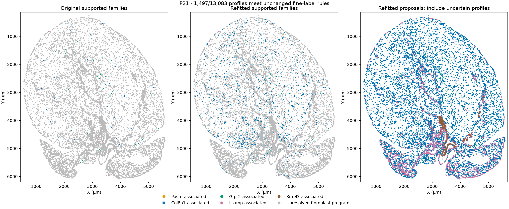
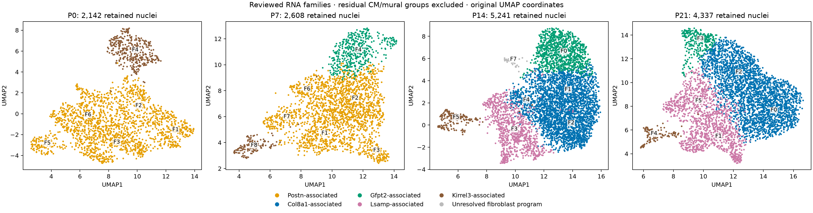
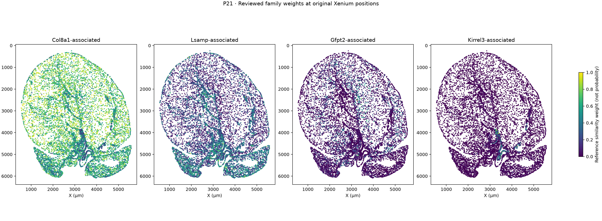

# Xenium fibroblast refit with the reviewed P21_F0 assignment

**Completed:** all four spatial sections have been rerun using the reviewed RNA hierarchy, with P21_F0 included in the Col8a1-related broad family. All five residual CM/mural-program groups remain excluded from the fine reference and are now also omitted from the clean RNA fibroblast figures and annotation export. Their source counts and QC records remain available.

[Six-page map PDF](reviewed_fibroblast_Xenium_maps.pdf) · [Assignment comparison](family_assignment_comparison.tsv) · [Clean RNA annotations](RNA_clean_fibroblast_annotations.tsv.gz) · [Excluded-nucleus audit](RNA_excluded_lineage_review_nuclei.tsv.gz) · [Validation](validation.json)

## What changed

The complete rerun uses the same native Xenium counts and positions, frozen broad cardiac-cell identities, same-age weighted-30NN transfer, and the same marker/information thresholds. Corrected, raw-count, both separate-library references and an ECM-gene-withheld reference were fitted again. Marker gates, class margins and library agreement were recalculated; no spatial smoothing or target proportions were introduced.

Only 1,330 RNA nuclei (P21_F0) change broad reference family. P21_F0 and F2 remain distinct RNA substates; this refit maps their combined broad family and does not establish separate anatomical locations for F0 and F2.

| Stage | Broad Xenium fibroblast profiles | Original supported fine labels | Reviewed supported fine labels | Reviewed fraction |
|---|---:|---:|---:|---:|
| P0 | 2,319 | 1,591 | 1,591 | 68.6% |
| P7 | 8,564 | 5,504 | 5,504 | 64.3% |
| P14 | 9,824 | 1,343 | 1,343 | 13.7% |
| P21 | 13,083 | 197 | **1,497** | **11.4%** |

P0, P7 and P14 reproduce their previous proposals and supported labels. At P21:

| Family | Original supported | Refitted supported | Refitted proposals, including uncertain profiles |
|---|---:|---:|---:|
| Col8a1-related | 76 | **1,390** | 9,896 |
| Lsamp-associated | 76 | 68 | 2,459 |
| Gfpt2-associated | 45 | 39 | 171 |
| Kirrel3-associated | 0 | 0 | 557 |
| Unresolved spatial fine identity | 12,886 | **11,586** | Not a reference-family proposal at reviewed P21 |

There are 1,314 newly supported Col8a1-related profiles; six formerly supported Gfpt2 and eight formerly supported Lsamp profiles become uncertain under the revised competition. The net gain is 1,300 supported profiles. Merging the formerly unresolved RNA reference into Col8a1 also changes competition with Lsamp/Gfpt2; it is not equivalent to recoloring only the old unresolved top proposals.

**The gain reflects a better-supported, broader reference hierarchy, not independent anatomical validation.** About 88.6% of P21 spatial fibroblasts still fail the strict fine-label rules. An unresolved spatial label remains appropriate for those profiles even though the reviewed P21 RNA reference no longer has an unresolved family among eligible nuclei. Kirrel3 still lacks a second measured supplied marker, so no valve identity is upgraded.

Gray in the first two panels means an unresolved fine spatial identity, not a removed broad fibroblast. The third panel includes uncertain proposals. The maps retain the original section orientation and coordinates.

## Handling the five flagged groups

**Exclude them from the primary fibroblast analysis and reference; preserve the original data for audit.** A residual lineage program is not by itself proof that every nucleus is a doublet, and the existing QC had already retained these nuclei. We do not automatically relabel them as CMs/mural cells or delete them from the complete cardiac dataset.

| Stage/group | Nuclei | Residual program | Median estimated ambient fraction |
|---|---:|---|---:|
| P0_F0 | 85 | CM-associated | 36.8% |
| P7_F0 | 192 | CM-associated | 33.9% |
| P7_F5 | 151 | Mural-associated | 11.2% |
| P14_F6 | 155 | CM-associated | 17.8% |
| P21_F6 | 74 | CM-associated | 9.1% |
| **Total** | **657** | | |

The 657 nuclei were already withheld from the previous fine reference; this refit does not gain labels by newly removing them. The new clean export contains **14,328/14,985** RNA fibroblast candidates: 2,142 P0, 2,608 P7, 5,241 P14 and 4,337 P21. It retains the separate 35-nucleus P14_F7 cycling candidate, whose family remains unresolved. Original UMAP coordinates are filtered for display rather than recomputed.

[Per-group evidence](excluded_group_QC_review.tsv) includes lineage-program means, fibroblast-program support and marker enrichments. [All source RNA annotations](RNA_cell_annotations.tsv.gz) preserve the 14,985 records, old family, reviewed family, eligibility and analysis disposition. [Excluded records](RNA_excluded_lineage_review_nuclei.tsv.gz) remain inspectable. No Xenium profile is removed solely because an RNA reference group was excluded: there is no one-to-one RNA-nucleus/Xenium-profile correspondence.

## Spatial results and boundary confidence

The refitted P21 Col8a1-related soft weights retain a CM/EC-containing neighborhood context: approximately 46.4% CM, 24.0% fibroblast and 20.0% EC among resolved 30-µm neighbors. Lsamp weights favor more fibroblast-rich neighborhoods (37.2% CM, 36.1% fibroblast). These are descriptive family-weighted neighborhood averages, not fractions assigned to anatomical compartments or calibrated identity probabilities.

The refit does not establish a uniquely peri-arterial Col8a1 niche, a valve location for Kirrel3, or an outflow-tract location for Eln/Lsamp. A family proposal and a supported fine label are distinct outputs.

The same geometry/image-audited transcript counts were reprojected with the revised reference and native-query calibration. For native-supported P21 Col8a1 profiles:

| Audited comparison | Profiles tested | Same top-family proposal | Same supported fine label |
|---|---:|---:|---:|
| 1-µm core erosion | 69 | 98.6% | 55.1% |
| Count-matched thinning control | 69 | 100% | 44.9% |
| Membrane-guided alternative | 44 | 93.2% | 47.7% |

Thus proposals are comparatively stable in these selected ROIs, while strict-label retention is sensitive to count loss and boundary changes. The count-matched control shows that label loss cannot all be attributed to segmentation. These ROI subsets are not representative independent sections. A membrane alternative is a sensitivity model, not anatomical truth.

[Per-variant profile assignments](boundary_profile_assignments.tsv.gz) and each stage's `Xenium_boundary_confidence.tsv.gz` distinguish **tested** profiles from **untested/NA** profiles. A retained label on a profile that was unresolved at native boundaries is not evidence of a supported fine identity; read these flags alongside `supported_family_assignment`.

## Downstream spatial models were rerun

All 30/50/100-µm CM neighborhoods, spatial-block coefficient models, five-fold buffered predictions, alternate mapping/outcome tests and matched vascular-pair models were recalculated. The 21-gene maturation score and measured CM outcomes are unchanged. At P21, the primary family weights now sum to one without an unresolved reference component, so Col8a1 is explicitly omitted as the regression reference. Family coefficients describe contrasts relative to that reference. Hard supported-label fractions usually do not exhaust the simplex and need not use that reference.

| P21 outcome, primary 50-µm model | Baseline held-out R² | Baseline plus families/matrix | Added R² |
|---|---:|---:|---:|
| CM 21-gene maturation | 0.537254 | 0.537296 | +0.000041 |
| CM Ankrd1 | 0.281880 | 0.290167 | +0.008287 |

The conclusion of little additional CM-maturation prediction persists. This does not exclude effects through deposited matrix, unmeasured signals or earlier exposures. Native Ankrd1/matrix associations remain boundary-sensitive; for example, P21's basement-membrane partial correlation changes from −0.115 to +0.014 in the identical 548-CM image subset.

One updated result deserves explicit qualification: in the **103 P21 matched pairs from 17 vascular segments**, the fully adjusted near-minus-far Ankrd1 contrast is +1.056 log-expression units, with a within-section segment-bootstrap interval of +0.039 to +1.512. The corresponding old model's interval included zero. Coarsening the family reference changes the adjustment design and interval; this small, selected subset does not establish a fibroblast-mediated mechanism or independent-animal replication. P7/P14 fully adjusted intervals still include zero. Original full-cohort vascular findings and these restricted adjusted subsets should not be equated.

## Downloads

| Stage | Maps | Refitted fibroblast annotations | Boundary confidence | 50-µm CM neighborhoods |
|---|---|---|---|---|
| P0 | [PNG](P0_reviewed_spatial_maps.png) | [TSV.gz](P0/Xenium_fibroblast_states.tsv.gz) | [TSV.gz](P0/Xenium_boundary_confidence.tsv.gz) | [TSV.gz](P0/CM_neighborhoods_50um.tsv.gz) |
| P7 | [PNG](P7_reviewed_spatial_maps.png) | [TSV.gz](P7/Xenium_fibroblast_states.tsv.gz) | [TSV.gz](P7/Xenium_boundary_confidence.tsv.gz) | [TSV.gz](P7/CM_neighborhoods_50um.tsv.gz) |
| P14 | [PNG](P14_reviewed_spatial_maps.png) | [TSV.gz](P14/Xenium_fibroblast_states.tsv.gz) | [TSV.gz](P14/Xenium_boundary_confidence.tsv.gz) | [TSV.gz](P14/CM_neighborhoods_50um.tsv.gz) |
| P21 | [PNG](P21_reviewed_spatial_maps.png) | [TSV.gz](P21/Xenium_fibroblast_states.tsv.gz) | [TSV.gz](P21/Xenium_boundary_confidence.tsv.gz) | [TSV.gz](P21/CM_neighborhoods_50um.tsv.gz) |

Additional outputs include original-versus-reviewed per-profile assignments, calibration/reference IDs, opposite-library RNA recovery, CM outcomes, 30/100-µm neighborhoods, transition tables and updated model/sensitivity tables. Opposite-library recovery is a technical consistency check on RNA-derived labels, not independent biological accuracy. The directory contains no replacement source count matrix.

[Spatial prediction](spatial_blocked_prediction.tsv) · [Coefficients](spatial_adjusted_coefficients.tsv) · [Mapping/outcome sensitivity](spatial_model_sensitivity_prediction.tsv) · [Vascular pairs](Ankrd1_vascular_pairs_after_FB_adjustment.tsv) · [Boundary retention](boundary_fibroblast_state_retention.tsv) · [Neighborhood context](FB_state_broad_spatial_context.tsv) · [Methods](refit_methods.json) · [File hashes](file_manifest.tsv)

Reproduce with `/workspace/heart-atlas/venv/bin/python analysis/refit_fibroblast_Xenium_reviewed.py --part PART`, using `OPENBLAS_NUM_THREADS=2 OMP_NUM_THREADS=2 MKL_NUM_THREADS=2`. Run parts `map`, `models`, `sensitivity`, `boundary`, `figures`, `validate`, in that order. Existing stage checkpoints skip completed maps; remove only this derived directory's checkpoints before intentionally changing mapping inputs. Original results remain in `results/fibroblast_states`.

Validation independently checks all RNA accounting, excluded reference IDs, reproduced P0/P7/P14 assignments, the exact expected P21 neighbor-weight coarsening, strict gates, P21 native marker counts, unchanged CM outcomes and coordinates, 192 physical-neighborhood examples, and explicit NA flags for untested boundaries. One Xenium section per age and two RNA libraries per age limit biological generalization.
