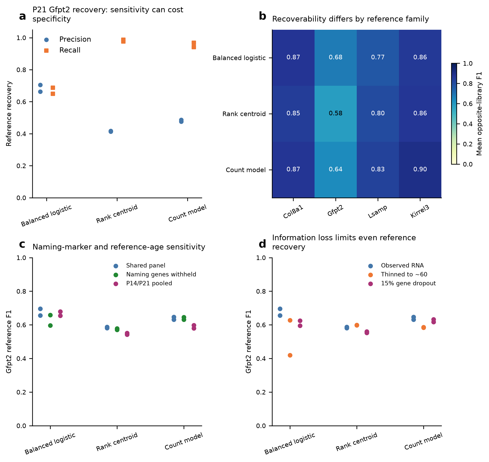
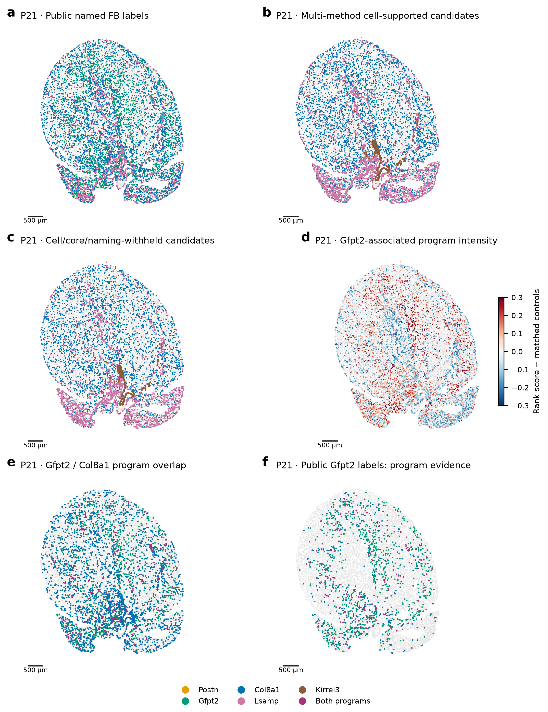
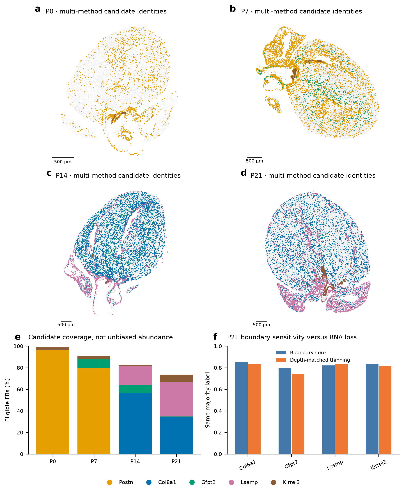
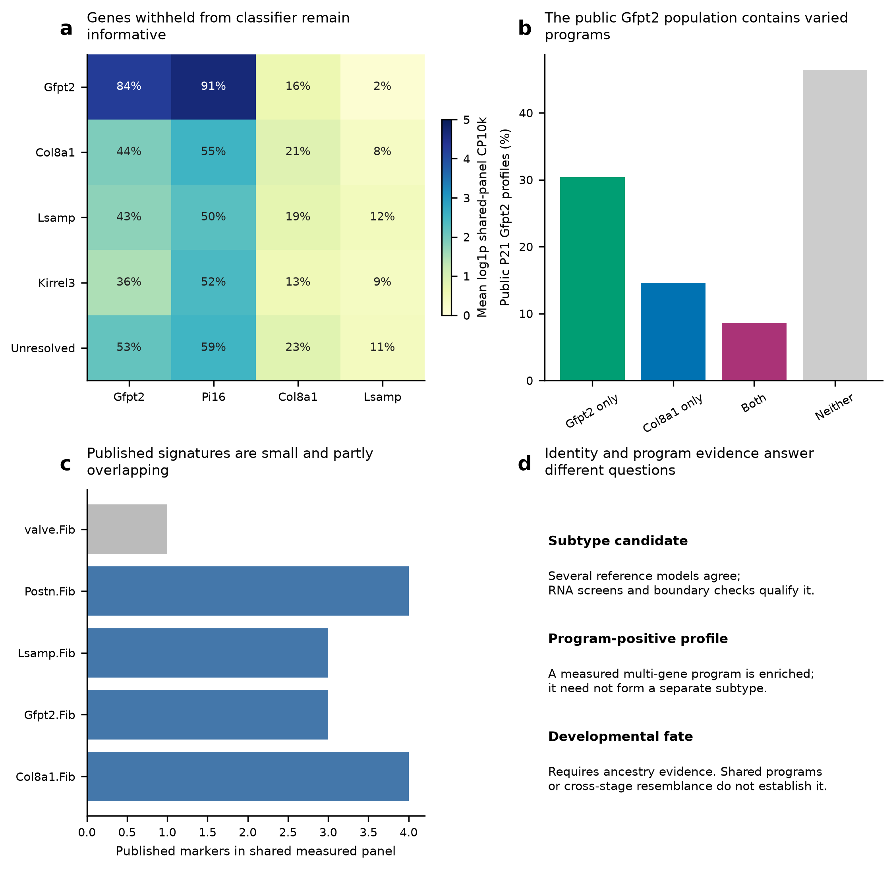

# Alternative fibroblast assignments reveal a broader Gfpt2-associated program

## What the reassessment changes

The earlier low number of P21 Gfpt2 assignments should not be interpreted as disappearance of Gfpt2-associated fibroblast biology. Alternative reference models and direct measured programs recover information that the earlier nuclear/anchor gates withheld. However, the models also show that a discrete Gfpt2 family is difficult to separate from related late fibroblast states using the measured panel. The useful result is a two-layer map: cautious identity candidates alongside continuous, potentially overlapping fibroblast programs.

This reassessment uses three different classifiers, direct scoring of the paper’s marker programs, naming-marker withholding, opposite-library RNA tests, pooled late references and native/refined/core/nuclear transcript views. None requires a subtype’s naming gene to be detected in every spatial cell. Frozen atlas labels and earlier results are preserved; these are new evidence layers rather than a claim that a replacement atlas is now anatomically proven.

## A Gfpt2 program extends beyond the narrowly defined family

Among 10,867 eligible P21 fibroblasts, 1,339 show enrichment of the directly measured Gfpt2/Pi16/Adgrd1 program under the stated descriptive module rule. This includes 327 profiles also enriched for the published Col8a1 program. Among 2,716 profiles carrying the public Gfpt2 label, 1,058—approximately 39%—show the Gfpt2-program flag. Thus, there is substantially more spatial program evidence than the earlier strict family count suggested.

A smaller subset supports a narrower identity interpretation: 85 P21 Gfpt2 candidates pass the multi-method reference screen without a strong core conflict, and 75 also retain cell/core support and the same majority label after naming markers are withheld. These are operational subsets, not estimates of the total number of Gfpt2 fibroblasts. Their restrictive size should not erase the broader measured program.

The withheld-gene check adds biological support. The 280 eligible P21 profiles called Gfpt2 by the naming-marker-withheld majority still detect Gfpt2 in approximately 84% and Pi16 in approximately 91% of profiles when those genes are inspected afterward. Other major withheld-label groups show lower detection and lower normalized expression. This supports a distinguishable Gfpt2-associated subset without requiring either gene as an individual-cell admission rule.

## Overlapping matrix programs help explain competing names

The reference itself contains overlap. In the reviewed P21 Col8a1/Hmcn2 group, Gfpt2 is detected in approximately 68% of nuclei, whereas the distinct Gfpt2 family has much stronger combined Gfpt2, Pi16 and Adgrd1 expression. The Col8a1/Svep1 and Lsamp-associated groups have their own combinations. A fibroblast can therefore carry part of a Gfpt2-associated program while remaining closer to another family in its broader transcriptome.

The publication’s marker table reinforces this point: Col8a1 is listed among the Lsamp-family markers as well as the Col8a1-family markers. It is not an exclusive identifier. In the shared measured panel, the published Gfpt2 signature contains three markers, the Col8a1 signature four and the Lsamp signature three. Such small, overlapping signatures can identify useful programs but cannot guarantee complete separation of related fibroblast states.

Our reviewed and the publication’s RNA family counts also differ. The paper reports 789 Gfpt2 nuclei at P21, versus 279 under our reviewed definition; the corresponding Col8a1 counts are 1,178 versus 2,711. These are different QC/annotation cohorts, and a matched-barcode author annotation crosswalk was not recovered. They cannot establish which individual cells changed identity. They do show that reference-family breadth must be examined alongside segmentation and classification, rather than attributing every spatial disagreement to boundaries.

## What the alternative models resolve—and what they do not

The supervised classifier balances the RNA families; the rank classifier emphasizes relative within-cell expression; and the count model compares measured counts with reference expression templates. None separately recenters the query gene distribution or imposes an expected spatial family proportion. Their agreement provides a robustness criterion, not three independent biological confirmations.

In P21 opposite-library tests, balanced logistic regression gives mean Gfpt2 precision/recall of approximately 0.68/0.67. Rank and count methods recover many more Gfpt2 reference nuclei but have lower precision, approximately 0.42 and 0.48. Merely choosing the method that produces the largest Gfpt2 population would therefore overstate resolution. Naming-marker withholding and pooled P14/P21 references do not eliminate the difficulty.

The new maps recover broader Lsamp- and Col8a1-associated candidate distributions and preserve a small distinct Gfpt2 subset. The measured Gfpt2 program is more widely distributed than that subset. These two statements can coexist. The maps are candidates for anatomical validation; Kirrel3-associated predictions are not automatically called valve fibroblasts, and profiles with supported nuclear alternatives remain flagged for review.

## How these assignments should guide the heart-development analysis

Use candidate families when the question concerns a recognizable fibroblast state, and measured program scores when the question concerns matrix/metabolic specialization shared across families. For CM maturation, this permits separate tests of the surrounding fibroblast identity and its Gfpt2- or Col8a1-associated program, instead of making the result depend entirely on a hard family label.

Keep the native, core and nuclear evidence visible, and compare boundary-core changes with depth-matched RNA loss. Nuclear support can strengthen an assignment; absent nuclear markers do not invalidate a cell-based candidate. A supported alternative nuclear call is a review flag. Previous maturation-association coefficients and transport plans are not silently updated by this reassessment.

A decisive validation would examine membrane-resolved, same-cell coexpression of Gfpt2/Pi16/Adgrd1 alongside Col8a1/Htra3 and Lsamp/Itgbl1 in independent sections and hearts. This would distinguish a narrow Gfpt2 state from a broader shared program and reveal whether apparent overlap lies within cells or across their boundaries.

These approaches assign transcriptional states and candidate spatial locations. Developmental fate requires ancestry information. Overlap, cross-stage resemblance or a transport correspondence can nominate a lineage-tracing experiment but cannot establish that one fibroblast family becomes another.

## Methods

Reference and features. The current clean RNA reference contains 14,328 fibroblast nuclei; the 35 unresolved-program nuclei are excluded from named-family model training. Primary models compete among named families observed at that age; a missing reference class is not biological absence. Counts are the existing corrected and original shared-panel matrices. Of 403 Xenium targets, 381 are represented in the shared RNA matrix. CM maturation/response genes, CM lineage markers, cycling and sex genes are withheld from all identity models. Additional naming-marker tests remove Postn, Tnc, Gfpt2, Pi16, Col8a1, Lsamp and Kirrel3. Genes must have training-fold detection in at least five cells or 0.5% of the training cohort, whichever is larger. No query labels select features.

Classifiers. Balanced multinomial logistic regression uses log1p counts per 10,000 retained-feature molecules, training-only gene means/SDs (SD floor 0.25), clipping to ±5, C=0.3, balanced class weights and an L2 penalty. Rank-centroid classification uses within-cell tied expression ranks and library-balanced family centroids; centered-rank cosine scores are converted to weights with temperature 0.02. The negative-binomial model uses library-balanced family relative-expression templates, query feature depth and training-derived gene dispersion clipped to 0.5–100; class log likelihoods are scaled by the square root of query depth. Priors are equal for primary calls, with empirical-RNA-prior proposals exported as a sensitivity. Weights/confidences are not calibrated Xenium probabilities.

Reference tests. Models train on one entire RNA library and predict the other. Results include the observed shared-panel counts, Poisson thinning toward 60 molecules and 15% random gene dropout. Pooled late references hold out the same replicate-number group across both P14 and P21. This is reference-label recovery, not an independent anatomical test. Family-specific reference confidence screens select the lowest tested score threshold with at least 20 reference predictions, both held-out libraries represented and pooled apparent precision at least 0.8. Thresholds are selected on these reference CV predictions; their apparent precision is not an unbiased prospective estimate and is not transferred as Xenium accuracy.

Candidate rules. Eligibility uses the frozen broad-FB segmentation/source QC mask. A reference-screened cell candidate requires at least two classifiers to support the same refined-cell family and at least 20 retained-feature molecules/eight detected genes. A supported core majority for a different family sends the profile to review. Cell/core candidates additionally have the same supported core label; crosschecked candidates also retain the refined-cell majority after naming markers are withheld. Nuclear support and supported alternatives are explicit fields, not compulsory marker-detection gates. Candidate groups can retain a nuclear review flag and should be checked with that subset excluded in downstream sensitivities. These correlated processing views do not provide independent truth.

Published modules. Positive family markers come directly from Supplementary Table 3, with adjusted P<0.05 and positive log2 fold change. Only measured shared-panel genes are scored; at least three are needed. Scores use mean within-cell marker rank minus the mean of 200 control sets matched to RNA-reference abundance deciles. An enrichment flag requires a score above 90% of control sets and at least two detected markers. It is a descriptive flag, not a calibrated cell-type probability, lineage test or single-cell P value. Module overlap does not itself establish a biological intermediate: related expression, shared markers and residual mixing remain possible.

Boundary and expression checks. Inference is repeated on native vendor counts, refined whole-cell counts, boundary-core counts and nuclear-only counts. Three binomial-thinning repetitions match refined counts to expected core depth without changing geometry. Withheld naming-gene expression is evaluated afterward in the naming-marker-withheld groups, using shared-panel normalization. RNA subcluster marker summaries retain raw/corrected views and both libraries. Maps preserve original coordinates; one available section per age prevents independent-heart inference.

Validation and outputs. Independently reconstructed consensus labels, recalculated CV metrics, an independent negative-binomial log-PMF calculation and a query-composition invariance test check the numerical implementation. Per-cell annotations, per-view programs, model predictions, gene lists, coverage and source hashes accompany the report. Numeric confidence/margin arrays are stored compactly as float32 in labelled NPZ axes; Boolean screens and categorical calls are preserved. No earlier atlas, maturation coefficient or transport plan is overwritten.

## Figure 1. Different methods expose the limits of family recovery

a, P21 Gfpt2 precision and recall in opposite-library RNA tests. Each point represents one held-out library. b, Mean RNA-reference F1 by family and method. c, Gfpt2 recovery with naming markers withheld or a pooled late reference. d, Lower-molecule and gene-dropout stress tests. These benchmarks evaluate recovery of our reviewed RNA definitions; they are not independent Xenium accuracy measurements. Greater recall can accompany more false-positive family calls. Fixed model settings are given in Methods.

## Figure 2. P21 identities and measured programs provide complementary spatial information

a, Public named FB labels within our eligible broad-FB cohort; public valve labels are not equated with Kirrel3 candidates and remain gray here. b, Reference-screened multi-method cell candidates, with core conflicts retained for review. c, The subset supported in the core and by a naming-marker-withheld majority. d, Direct Gfpt2/Pi16/Adgrd1 program score relative to abundance-matched control genes. e,f, Gfpt2/Col8a1 program flags in all eligible FBs or the public Gfpt2 subset. Program flags are descriptive enrichment, not separate proven cell identities. Nuclear alternatives remain explicit flags. Original coordinates are retained; scale bars, 500 µm.

## Figure 3. Broader candidate maps retain explicit boundary sensitivity

a–d, Multi-method candidate fibroblast identities across the four original sections. e, Fraction of eligible broad FBs assigned a candidate under these evidence rules; this is coverage, not unbiased abundance. f, P21 majority-label stability in boundary-core transcripts versus random thinning of whole-cell counts to the expected core depth. Three thinning repetitions are computational sensitivities, not biological replicates. Differences can reflect both transcript information and boundary ownership. Gray retains unresolved profiles; scale bars, 500 µm.

## Figure 4. Withheld genes support a distinct Gfpt2 subset within a broader program landscape

a, Measured P21 expression after grouping by classifiers trained without all seven naming/anchor genes. Color is mean log-normalized expression; printed values are detection percentages. The displayed genes were not used by those grouping models. b, Published Gfpt2/Col8a1 program combinations among eligible public P21 Gfpt2 profiles. c, Published family-marker coverage in the shared measured panel; the valve marker has insufficient genes for a multi-gene module. d, Operational identity, measured program and lineage fate are distinct. Shared markers or overlapping programs can reflect related states or mixing and do not prove transition.
