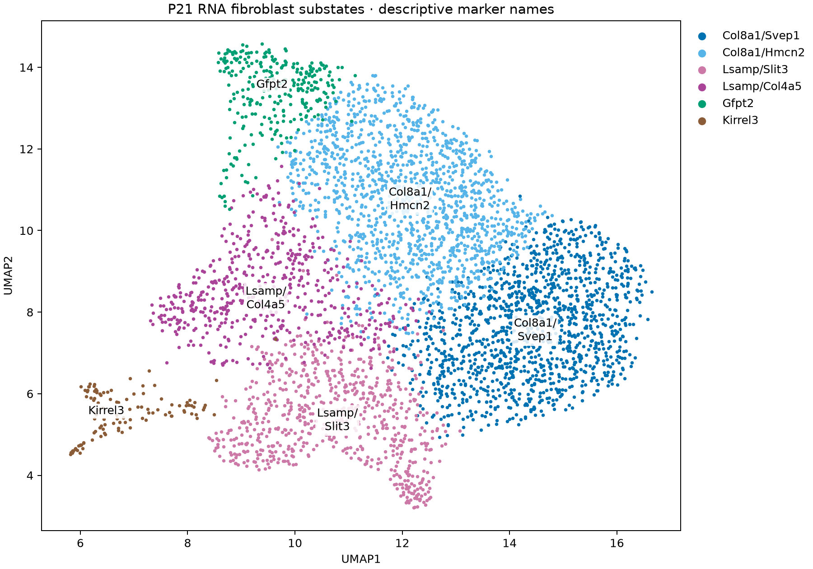
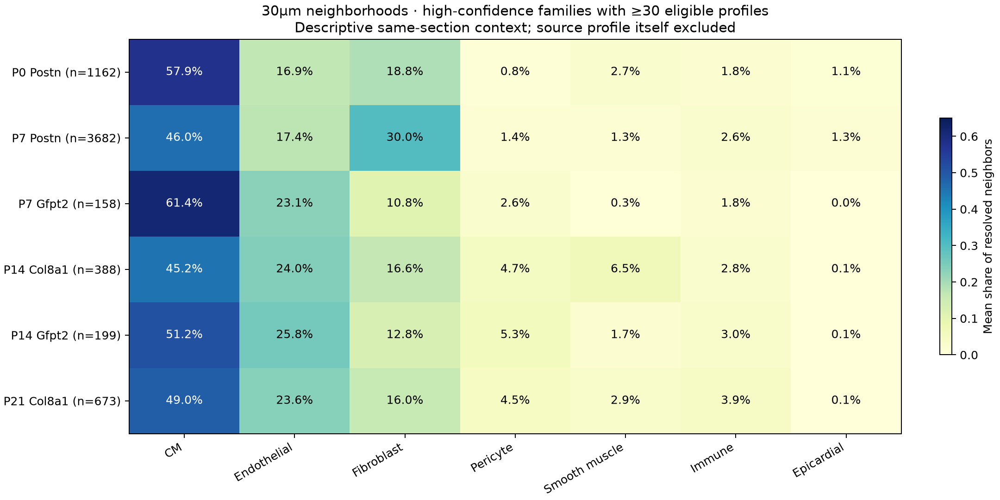

# Named P21 fibroblast substates and their cardiac-cell neighborhoods

**The P21 RNA groups now have descriptive marker names.** Original cluster IDs remain in the annotation/key for traceability. Spatial conclusions still refer to the broader families; separate locations for the named substates have not been established.

[Six-page illustrated report](named_fibroblasts_and_spatial_context.pdf) · [Name key](P21_fibroblast_name_key.tsv) · [Named RNA annotations](P21_RNA_named_annotations.tsv.gz) · [Spatial measurements](family_neighbor_context.tsv) · [Validation](validation.json)

## Names to use going forward

| Display name | Previous P21 RNA group | Distinguishing associated markers | Candidate RNA program |
|---|---|---|---|
| **Col8a1/Svep1 fibroblasts** | P21_F0 | Svep1, Adgrl3, Fap, Abca8a | Matrix organization and adhesion |
| **Col8a1/Hmcn2 fibroblasts** | P21_F2 | Hmcn2, Pcsk6, Adamtsl3, Fbln2, Lamc1 | Matrix organization and processing |
| **Lsamp/Slit3 fibroblasts** | P21_F1 | Slit3, Rgs6, Chrm3, Cfh, Eln, Angpt1 | Elastic-matrix and adhesion/signaling-associated program |
| **Lsamp/Col4a5 fibroblasts** | P21_F5 | Col4a5, Col4a6, Itgbl1, Eln, Cfh; stronger Lsamp | Elastic-matrix and collagen-IV-associated program |

The family prefix makes the classification visible: the first two belong to the Col8a1-related family, the second two to the Lsamp-associated family. These are enrichment-based RNA names, not a requirement that every nucleus detect both named genes. Functions are RNA-based interpretations, not measured matrix deposition or mechanics. No outflow, valve or perivascular location is built into a name.

The name key also retains the Gfpt2 and Kirrel3 family names and the excluded CM-program review group. All 4,411 P21 source RNA nuclei remain recorded; the clean UMAP excludes the 74-nucleus review group. The source clustering/support fields are retained for provenance, with the reviewed P21_F0 family assignment unchanged.

## What the latest spatial labels show

Primary summaries use the existing **A+B nuclear/cell-supported families**, not all soft proposals. A+B+C is supplied as a sensitivity. Neighbors are resolved broad cardiac profiles within 30µm, excluding the source fibroblast; at least five neighbors are required. The denominator includes all seven broad cardiac lineages, so the selected columns below need not sum to100%.

| Stage/family | Eligible FB profiles | CM share of neighbors | Endothelial | Fibroblast | Smooth muscle |
|---|---:|---:|---:|---:|---:|
| P0 Postn | 1,162 | 57.9% | 16.9% | 18.8% | 2.7% |
| P7 Postn | 3,682 | 46.0% | 17.4% | 30.0% | 1.3% |
| P7 Gfpt2 | 158 | 61.4% | 23.1% | 10.8% | 0.3% |
| P14 Col8a1 | 388 | 45.2% | 24.0% | 16.6% | 6.5% |
| P14 Gfpt2 | 199 | 51.2% | 25.8% | 12.8% | 1.7% |
| P21 Col8a1 | 673 | 49.0% | 23.6% | 16.0% | 2.9% |

These are mean neighborhood-composition measurements, not the percentage of fibroblasts in a named compartment or a measure of physical cell contact. Eligibility counts differ slightly from the total assigned profiles because of the five-neighbor requirement.

### Early Postn-associated fibroblasts occur in CM-containing environments

The P0 confident Postn family has approximately58% CMs and17% endothelial profiles among nearby resolved profiles. At P7, the family has more fibroblast neighbors than the contemporaneous Gfpt2 group. Together with the developmental matrix/remodeling RNA program, this is consistent with an interstitial matrix-support role during growth. It does not prove that these fibroblasts directly stimulate CM maturation or that early cells convert into later families.

### Gfpt2-associated fibroblasts have CM/endothelial-rich neighborhoods

At P7, Gfpt2-associated profiles have more CM/EC neighbors and fewer fibroblast neighbors than Postn-associated profiles. The direction persists at30/50/100µm. It also persists in the coverage/morphology-matched comparison: at30µm, Gfpt2 minus Postn is approximately **+5.9 percentage points CM, +5.7 endothelial and −11.3 fibroblast**, after matching. The unmatched CM difference is larger (+15.4 points), showing that RNA/profile-density differences explain part of the raw contrast.

At P14, Gfpt2-associated profiles again occupy CM/EC-containing environments, with fewer nearby smooth muscle profiles than the Col8a1 family. This supports different local matrix environments among families. Endothelial proximity by itself does not identify a capillary, arteriole, contact or signaling mechanism.

### A vascular-associated component of the Col8a1 family is clearest at P14

At P14, **18.8%** of eligible Col8a1-family profiles are within50µm of the preceding independent candidate arterial EC/SMC envelopes, versus **7.0%** of Gfpt2-family profiles (all eligible broad FBs:11.7%). Smooth muscle profiles make up6.5% versus1.7% of their30µm neighborhoods. The relative difference also appears with A+B+C calls (20.3% versus6.8% within50µm).

The P14 contrast persists in the matched sensitivity: 19.0% versus6.0% within50µm, and approximately+4.3 percentage points of smooth muscle neighbors for Col8a1 versus Gfpt2 at30µm. The matched smooth-muscle-neighbor difference remains positive at50/100µm in the same30µm-eligible cohort. In the unmatched primary analysis, using all profiles eligible at each radius, the difference falls from+4.8 percentage points at30µm to+1.6 at50µm and essentially zero at100µm (−0.03 points). Thus this is strongest as a local association, not a uniformly distinct broad territory. The matched and radius-specific summaries use different eligible cohorts at larger radii.

This supports **a partial P14 vascular association**, compatible with the family's matrix/basement-membrane RNA program. It does not establish an exclusively peri-arterial population: about81% of this confident Col8a1 cohort is outside50µm. The vascular envelopes are native marker-defined EC/SMC structures, not manually traced histological vessel walls.

At P21, the confident Col8a1 family remains predominantly in CM/EC-containing neighborhoods. Only3.3% are within50µm of the candidate arterial envelopes (all eligible broad FBs:2.2%). Different section planes, dimensions and visible vessels prevent interpreting18.8%→3.3% as a replicated developmental loss of vascular association. Crucially, this analysis cannot determine whether the Col8a1/Svep1 or Col8a1/Hmcn2 substate supplies the vascular-associated component.

### Lsamp substate locations remain open

Only two P14 and nine P21 profiles have the primary high-confidence Lsamp-family assignment; only one of the P14 profiles has≥5 resolved30µm neighbors. The nine P21 profiles have descriptively more fibroblast neighbors (44.4%) and fewer CMs (27.9%) than the confident Col8a1 cohort. The broader A+B+C set is also small (23 P21 profiles), and some neighborhood fractions change substantially.

These observations are compatible with fibroblast-rich connective territories, but the sample is too small to establish a family niche or separate the **Lsamp/Slit3** and **Lsamp/Col4a5** locations. Eln does not establish an outflow-tract location. Earlier soft-proposal maps provide hypotheses, not additional confidently typed cells.

The well-supported groups do not show a consistent immune-rich neighborhood pattern across ages. Sparse lymphoid/myeloid profiles and the confidence-filtered cohorts also limit that conclusion; it is not evidence against immune–fibroblast interactions. No specific fibroblast family is newly established as the driver of Ankrd1-associated CM states.

## Sensitivity and interpretation

- The [full measurements](family_neighbor_context.tsv) cover30/50/100µm, primary A+B and expanded A+B+C labels, all seven lineages, nearest-lineage distances and native arterial-envelope distances. Groups with<30 eligible profiles are explicitly marked sparse and omitted from the main heatmap.
- Two contrasts were specified for matching: P7 Gfpt2 versus Postn, and P14 Col8a1 versus Gfpt2. Nearest matching with replacement uses RNA molecule count, native profile area, nuclear RNA fraction and50µm resolved-profile density, with standardized Euclidean distance≤2. It does not match on spatial position or neighbor-lineage outcomes.
- [Matched results](matched_family_context_sensitivity.tsv), [matched pair IDs](RNA_coverage_matched_pairs.tsv.gz) and [covariate balance](matching_covariate_balance.tsv) are provided. All158 P7 target profiles and385/388 P14 target profiles match; controls comprise150 and153 unique profiles respectively. Post-match absolute standardized mean differences are below0.05 for all four covariates. Controls can recur, and no biological-replicate p-values are claimed.
- There is one spatial section per age. Neighborhoods overlap, profiles need not be complete cells, and confidence selection depends on RNA capture and marker expression. These maps are not unbiased abundance censuses, direct-contact maps or causal signaling tests.
- Other broad cardiac identities and physical centroids remain the preceding frozen atlas annotations; they were not reclassified here. Previous Ankrd1/maturation association models are not refitted by this descriptive report.

## Section maps and per-profile data

| Stage | Fibroblast families over other cardiac profiles | Per-profile neighborhoods |
|---|---|---|
| P0 | [PNG](P0_fibroblast_other_cell_context.png) | [TSV.gz](P0/FB_physical_neighbors.tsv.gz) |
| P7 | [PNG](P7_fibroblast_other_cell_context.png) | [TSV.gz](P7/FB_physical_neighbors.tsv.gz) |
| P14 | [PNG](P14_fibroblast_other_cell_context.png) | [TSV.gz](P14/FB_physical_neighbors.tsv.gz) |
| P21 | [PNG](P21_fibroblast_other_cell_context.png) | [TSV.gz](P21/FB_physical_neighbors.tsv.gz) |

New display names apply to RNA substates; spatial legends remain at the supported family resolution. No named RNA substate was painted onto a Xenium profile without evidence. Original IDs, RNA coordinates, family labels, source counts and prior confidence annotations remain intact.

Reproduce with `OPENBLAS_NUM_THREADS=2 OMP_NUM_THREADS=2 MKL_NUM_THREADS=2 /workspace/heart-atlas/venv/bin/python analysis/name_fibroblasts_and_describe_neighbors.py`. The narrative is a reviewed static file; the script rebuilds naming tables, measurements, sensitivity tables and figures. [Methods](methods.json), [validation](validation.json) and [artifact/script hashes](file_manifest.tsv) document the calculation. Validation checks source profile accounting/coordinates, exact reproduction of the previously verified30µm context, self exclusion and complete lineage denominators, with new50/100µm physical calculations.
