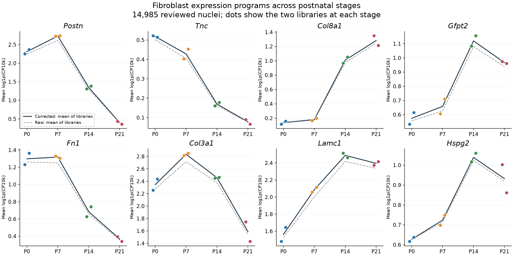

# Fibroblast questions and the intended CM maturation panel

This is a completed **feasibility and existing-signal audit**, not a newly fitted fibroblast subtype atlas, trajectory, or spatial maturation analysis. It verifies measured targets, extracts the paper's fibroblast markers, and summarizes original/corrected RNA in the existing 14,985 reviewed fibroblast nuclei across eight libraries. Native annotations, counts, and spatial coordinates are unchanged.

## The maturation panel is available

Figure 4b in the user-supplied `NCVR_ms_main_021626.docx` visibly lists **21 maturation genes**, consistent with the published article's 21-gene description. Every one is measured in Xenium:

| Figure category | Exact displayed genes |
|---|---|
| TFs | Rxrg, Ppargc1a, Ppargc1b, Cebpa, Cebpb, Esrra, Esrrb, Esrrg, Mitf |
| Sarcomere | Myh6, Tnni3, Myl2 |
| Electrophysiology | Kcnq1, Jph1, Jph2, Bin1, Lpin1 |
| Metabolism | Pln, Ppara, Ppard, Cpt1b |

Category names reproduce the figure and are not a revised functional classification. The exact list is saved in [CM_maturation_Figure4b_panel.tsv](CM_maturation_Figure4b_panel.tsv). The manuscript's source image was visually inspected locally; the full manuscript/image is not redistributed.

The original Xenium H5 contains **541 features: 403 gene-expression targets plus 138 non-gene features** (77 unassigned codewords, 41 negative-control codewords, 20 negative-control probes). Thus 541 features and 403 genes describe the same input, not different gene panels. Controls must not enter gene normalization or biological module scores.

The published Methods specify Seurat AddModuleScore with 100 expression-matched control genes per module gene. The public Figure 4 scripts consume an existing `Maturation_Features1` column and do not construct it. Gene-list recovery therefore establishes that a panel-based reassessment is possible, not that we have exactly reproduced the original index. The assay, normalization, binning, control pool, and seed need to be documented for new scoring. In particular, a 403-gene pool divided into 24 default bins cannot provide 100 distinct controls per bin; an undocumented control-pool/bin choice must not be silently substituted. A direct 21-gene expression score and a fully specified matched-control sensitivity can be compared with the original index if its construction/object is recovered. No new index or maturation plateau is claimed in this audit.

## Fibroblast identity has more measured support than a single anchor

These are the exact ten markers per state in author Supplementary Table 3, intersected with the deposited Xenium targets. They are candidate annotation evidence, not a validated spatial classifier.

| Paper state | Measured top-ten markers | Coverage |
|---|---|---:|
| Postn.Fib | Col24a1, Ptn, Tnc, Postn | 4/10 |
| Col8a1.Fib | Cmklr1, Col8a1, Col6a3, Htra3 | 4/10 |
| Gfpt2.Fib | Gfpt2, Pi16, Adgrd1 | 3/10 |
| Lsamp.Fib | Col8a1, Itgbl1, Lsamp | 3/10 |
| valve.Fib | Kirrel3 | 1/10 |
| p.Fib | Top2a | 1/10 |

**Col8a1 is a supplied marker of both Col8a1.Fib and Lsamp.Fib.** Htra3 appears in the Col8a1 list. Names from the uploaded conversation cannot be treated as mutually exclusive anatomical identities. Measured genes outside the supplied top ten can provide additional evidence: for example, the analyst cycling panel also includes Mki67/Cenpf. Low top-ten coverage is not a complete measure of all available biological information. Conversely, these counts alone do not establish that a cell has enough detected discriminating RNA.

Our historical pooled fibroblast subclustering did not support a separate Col8a1 subtype under its original criteria. It used a different Col8a1 panel and strong age-associated clusters. A new stage-aware review using the exact paper signatures and de novo marker discovery is justified. It must establish distinctness from Lsamp and mural states, retain continuous/mixed states, and allow rejection of an unsupported fine label. Kirrel3-only transfer cannot establish valve anatomy; a valve assignment needs anatomical review and broader RNA evidence.

[Exact source markers and coverage](paper_fibroblast_markers_and_coverage.tsv) · [Overlapping markers](paper_marker_overlaps.tsv)

## What the present RNA check shows

The dots show separate libraries, and lines connect the unweighted means of the two library means. All expression is normalized within a nucleus using all gene counts from the corresponding layer; corrected and raw denominators were independently verified. The figure summarizes the whole reviewed fibroblast compartment, so changes can reflect composition as well as within-state changes. Log-normalized expression differences are not fold changes in RNA or protein.

- Postn expression peaks at P7 and falls later in both libraries; Tnc and Ptn decline earlier. A constant Postn label does not imply a constant accompanying program.
- Col8a1 and Lsamp are higher at P14/P21; Gfpt2 and Pi16 are also higher later than in the neonatal libraries. This warrants testing distinguishable late states and shared continuous programs, without claiming a particular lineage transition.
- Fn1 falls after P7 in both libraries. Col3a1 peaks at P7 and subsequently falls, while Lamc1/Hspg2 increase toward P14. This supports examining matrix modules separately; it does not establish matrix deposition, protein abundance, stiffness, or a switch caused by one fibroblast state.
- Ambient burden and RNA coverage still differ among libraries. Median estimated ambient fractions in the reviewed fibroblasts range approximately 0.05–0.12. Their inclusion in sensitivity analyses remains necessary after correction.

The historical Postn proposal contains 1,847 P0, 2,810 P7, 187 P14 and 66 P21 nuclei. A four-age analysis restricted to that old label is heavily unbalanced and can miss persistent Postn-expressing cells assigned to other clusters. The stage/state review should examine continuous programs and shared-state support rather than simply reuse the old exclusive labels.

[Raw/corrected profiles by library](fibroblast_marker_profiles_by_library.tsv.gz) · [QC by library](fibroblast_QC_by_library.tsv) · [Historical proposals by library](historical_proposals_by_library.tsv)

## Questions that can now be addressed

| Question | Available analysis | Essential controls and interpretation |
|---|---|---|
| Does the Postn-associated compartment change between P0 and P7, before its later decline? | Within-state RNA comparisons, alongside continuous Postn/Tnc/Ptn programs; per-library pseudobulk and raw/corrected sensitivity | Independently review states first; inspect CM carryover, depth, ambient burden and cell cycle; require consistent library directions. Do not call every age difference a state transition. |
| Are Col8a1 and Gfpt2 distinct branches, and how does Lsamp relate? | Within-stage discovery and cross-stage graph/signature comparisons, with marker withholding and separate-library checks | Use broad fibroblast identity, distinguish mural cells, retain overlapping programs; graph connectivity is not ancestry or direction. Filtered gene counts do not supply spliced/unspliced matrices for RNA velocity. |
| What matrix programs distinguish states versus developmental stages? | Test fibronectin, fibrillar collagen, basement membrane, elastic-fiber, collagen-processing and hyaluronan programs in snRNA-seq | Withhold genes that defined the labels when testing state specificity; compare states present at the same stages, inspect stage/state collinearity, and report interactions. Small state coefficients do not prove state independence. |
| Do fibroblast environments associate with CM maturation? | Use the intended 21-gene panel on measured CM RNA; map supported fibroblast states/programs; analyze neighborhoods within each section | Condition on vessel proximity, local cell composition/density, CM state, RNA coverage and cell area; evaluate multiple radii and spatial blocks. Separate sections by age, test segmentation sensitivity, retain uncertainty and CM profiles without nuclear area. A true transmural coordinate requires independently reviewed anatomy. |
| Does the Ankrd1-associated CM state occupy a distinctive fibroblast environment? | Test fibroblast states/matrix programs around the previously matched vascular-near/far CMs; compare CM maturation separately | Compare within stage and vessel-distance strata; exclude Ankrd1 from maturation/state-fitting predictors where appropriate. Association cannot establish fibroblast-to-CM instruction. |
| Does CM-derived TGFbeta explain fibroblast changes? | Examine ligand/receptor sources and independent response-associated RNA in snRNA-seq, then nominate a spatial perturbation readout | Keep overlapping matrix genes out of response controls; transcript expression does not measure latent-ligand activation or source-specific causality. Mosaic CM perturbation plus neighboring fibroblast readouts is a future experiment, not present observational evidence. |

The practical order is **review fibroblast states and within-state stage effects; separate matrix programs; then test their spatial relationship to panel-defined CM maturation and the vascular-associated CM state**. Trajectory methods add hypotheses after reliable state definition; they do not resolve ancestry by themselves.

## What Xenium can and cannot measure directly

| Analyst-defined program | Measured targets |
|---|---|
| Fibronectin | Fn1 |
| Fibrillar collagen panel | Col1a1, Col1a2, Col3a1 |
| Basement-membrane panel | Lama4, Lama5, Lamb1, Lamb2, Lamc1, Col4a1, Col4a2, Hspg2 |
| Elastic-fiber-associated panel | Eln, Fbln1, Fbln2 |
| Collagen-processing/crosslinking panel | None of the ten tested genes |
| Hyaluronan synthesis/turnover panel | None of the six tested genes |
| TGFbeta feedback-associated panel | None of Smad7, Skil, Pmepa1, Bambi, Serpine1, Junb |
| TGFbeta ligands/receptors | Tgfb1, Tgfb2, Tgfbr1, Tgfbr2; Tgfb3/Tgfbr3 absent |

Presence refers to the target list, not expression in a particular lineage. Missing Nid1/Nid2, Has genes, crosslinking enzymes and feedback genes can be studied in snRNA-seq but cannot be presented as measured Xenium expression. Reference-imputed values would remain predictions. Matrix composition, mechanics, fibroblast lineage conversion and causal CM–fibroblast signaling require additional experimental evidence. One Xenium section per age prevents animal-level inference of a developmental spatial trend.

[All program coverage](program_panel_coverage.tsv) · [Per-gene coverage](program_gene_coverage.tsv) · [Audit validation](audit_validation.json)

## Reproduce and source

Run `OPENBLAS_NUM_THREADS=1 OMP_NUM_THREADS=1 /workspace/heart-atlas/venv/bin/python analysis/audit_fibroblast_reassessment.py` followed by `analysis/plot_fibroblast_reassessment_audit.py` using the same Python. The scripts use the existing local QC count object and source workbook; no new raw-data acquisition is required. The original full count H5AD is local, not duplicated in this small audit directory.

Source: Wang, Dong, Song et al., *Spatially guided in vivo single-cell functional genomics of postnatal heart*, DOI [10.1038/s44161-026-00861-z](https://doi.org/10.1038/s44161-026-00861-z), Supplementary Table 3 and CM maturation Methods; user-supplied manuscript Figure 4b. Author-reported marker effects are source facts, not new statistical tests.
