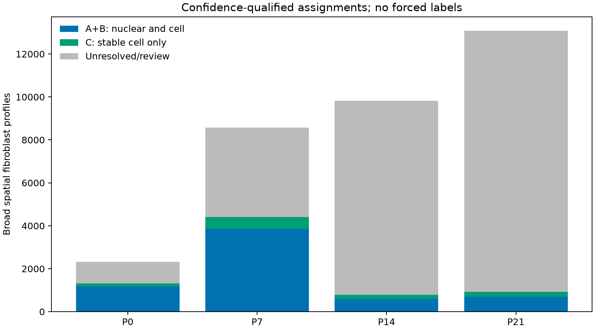

# Integrated fibroblast spatial assignments with explicit confidence

This consolidates the reviewed same-age RNA references, native Xenium labels, whole-section nuclear-anchored resegmentation, boundary-core RNA, nuclear-only RNA under two calibration schemes, and cytoplasmic-only RNA. It fits no new classifier and changes no count matrix, coordinate or broad parent identity.

[Illustrated report](fibroblast_spatial_confidence_report.pdf) · [All-profile annotations](all_stage_fibroblast_consensus.tsv.gz) · [Counts by family/tier](family_by_tier_counts.tsv) · [Rules](annotation_rules.json) · [Validation](validation.json)

## Assignment rules

- **A: stable cell and nuclear.** Native and resegmented cell assignments agree; both nuclear calibration schemes each pass the inherited gates for that same family.
- **B: new cell and nuclear.** Native fine identity was unresolved; resegmented cell and both nuclear calibration schemes pass for the same family.
- **C: stable cell only.** Native, resegmented and boundary-core cell calls all pass for the same family; the stricter A/B nuclear criterion is unmet.
- **Review/unresolved.** A strong supported family conflict, CM–FB mixed-marker compartment flag, or inadequate corroboration prevents an integrated fine call.

A/B/C all require no conflicting supported family in any of six tested views and no existing mixed CM–FB marker flag in resegmented whole-cell, nuclear-only or cytoplasmic-only RNA. A mixed-marker flag is a conservative review criterion, not proof of contamination or a doublet. Random depth controls do not vote on identity. There is no nuclear-area requirement, cross-stage label borrowing, spatial smoothing or quota.

Each source supported call already requires weight≥0.6, margin≥0.15, at least two measured supplied state markers including an anchor, original-count and both-RNA-library agreement, and sufficient training-panel RNA (≥20 molecules and≥8 detected genes). These thresholds are unchanged. In A/B, actual measured marker and anchor genes are additionally checked in nuclear counts and published per profile.

**The recommended primary confidence subset is A+B.** C is a separate moderate-confidence extension. These are operational robustness tiers, not calibrated probabilities, independent biological accuracy or anatomical validation: the views share RNA molecules and references. Both nuclear schemes agreeing tests sensitivity to gene scaling; it is not two independent experiments.

## Results

| Stage | Broad FB profiles | A+B nuclear/cell-supported | B newly supported | C stable cell-only | Unresolved/review |
|---|---:|---:|---:|---:|---:|
| P0 | 2,319 | 1,174 | 9 | 136 | 1,009 |
| P7 | 8,564 | 3,865 | 95 | 532 | 4,167 |
| P14 | 9,824 | 603 | 41 | 175 | 9,046 |
| P21 | 13,083 | 698 | 52 | 228 | 12,157 |

Total: **6,340 A+B**, including **197 B** previously unresolved profiles, plus **1,071 C** cell-supported profiles. All 33,790 broad fibroblast profiles remain accounted for. A smaller released label set reflects the additional corroboration requirements; it is not a disappearance of fibroblasts.

The preceding segmentation report found 252 previously unresolved profiles with cell/nuclear-calibrated concordance. The current B rule additionally requires nuclear frozen-calibration support, absence of cytoplasmic/core supported-family conflict, and absence of compartment mixed-marker flags. Its count therefore need not equal 252. Previously supported single-view labels remain inspectable as proposals but are not automatically promoted into this integrated annotation.

## Family identities and limits

Named families remain Postn-associated, Col8a1-related, Gfpt2-associated, Lsamp-associated and Kirrel3-associated RNA programs. This assigns broad fibroblast families; it does not distinguish all within-family RNA subclusters spatially, including separate P21_F0/F2 or F1/F5 locations. No Kirrel3 fine call passes the inherited two-marker gate because only one supplied valve-family marker is measured. No valve/outflow location is inferred from Kirrel3/Eln alone.

[Measured identity markers and assigned counts](identity_markers_and_assignment_counts.tsv) documents the assay-covered panel. Per-profile `cell_state_marker_genes`, `nuclear_state_marker_genes` and anchor columns show actual detected genes for released families. These are criteria/evidence audits, not independent differential-expression discoveries or function validation.

## Maps and data

| Stage | Family/confidence map | Full annotations |
|---|---|---|
| P0 | [PNG](P0_fibroblast_confidence_map.png) | [TSV.gz](P0/fibroblast_consensus_annotations.tsv.gz) |
| P7 | [PNG](P7_fibroblast_confidence_map.png) | [TSV.gz](P7/fibroblast_consensus_annotations.tsv.gz) |
| P14 | [PNG](P14_fibroblast_confidence_map.png) | [TSV.gz](P14/fibroblast_consensus_annotations.tsv.gz) |
| P21 | [PNG](P21_fibroblast_confidence_map.png) | [TSV.gz](P21/fibroblast_consensus_annotations.tsv.gz) |

Left panels show A+B; middle panels add C; right panels show the confidence/review tier. Gray means withheld fine identity. All use original µm positions and preserve broad fibroblast parents. Use stage+cell_id as the global key. Existing native and alternative gene-count H5ADs remain in the [preceding segmentation analysis](../xenium_nuclear_anchored_segmentation/README.md). This confidence catalog does not refit previous Ankrd1/maturation association models.

Reproduce with `OPENBLAS_NUM_THREADS=2 OMP_NUM_THREADS=2 MKL_NUM_THREADS=2 /workspace/heart-atlas/venv/bin/python analysis/consolidate_fibroblast_spatial_confidence.py`. Validation checks all source profile accounting/coordinates, every required supported view, absence of strong competing families, and observed cell/nuclear marker counts for every released label. [Artifact/script hashes](file_manifest.tsv) preserve provenance.
