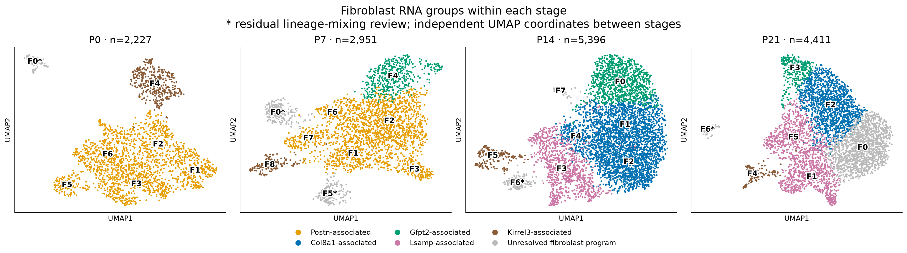
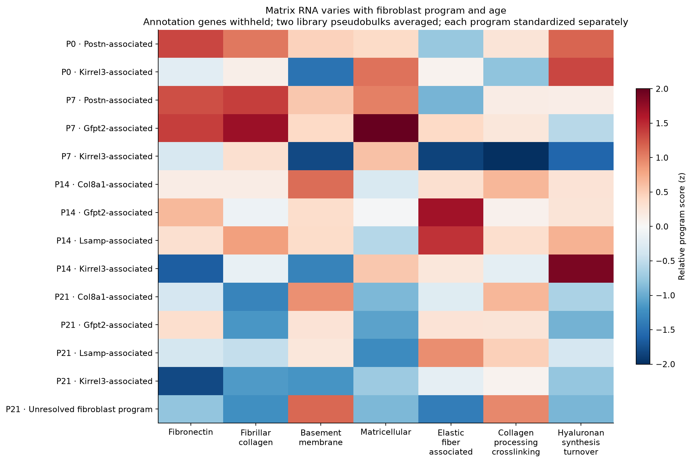
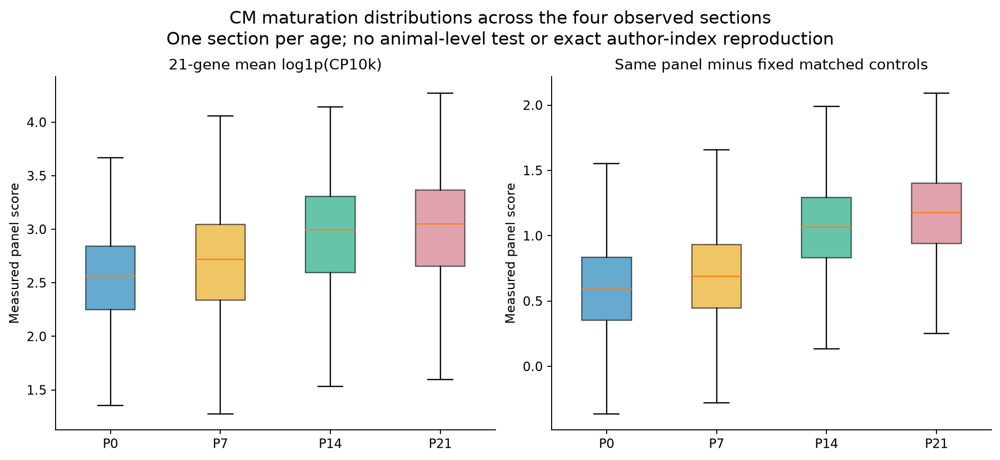
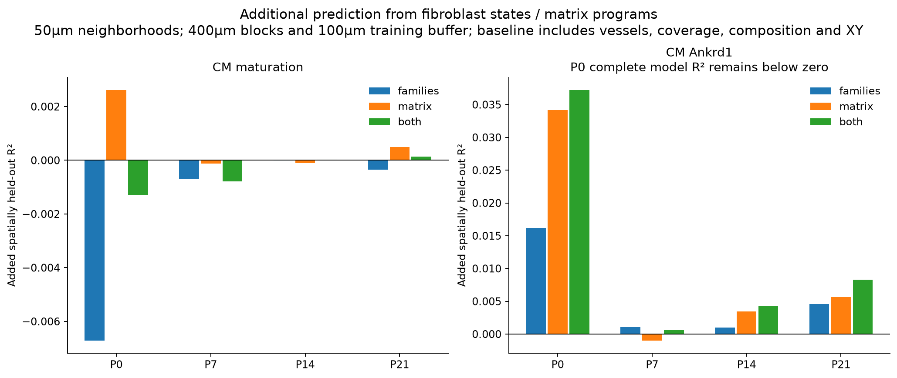

# Fibroblast states, matrix programs and their spatial relationships to ventricular CMs

**This is the completed analysis following the [initial feasibility audit](../fibroblast_reassessment/README.md).** It includes new within-stage RNA clustering, fibroblast identity review, original/corrected matrix comparisons, same-stage Xenium transfer, the intended 21-gene CM maturation readout, spatial association models, and transcript-boundary sensitivities. It does not establish fibroblast ancestry, matrix mechanics or causal CM–fibroblast signaling.

[Full illustrated report](fibroblast_states_matrix_spatial_report.pdf) · [Validation](validation.json) · [Artifact hashes](file_manifest.tsv)

## Biological findings

1. **Early Postn-associated fibroblasts contain multiple programs and change before their later decline.** P0/P7 groups differ in matrix, signaling/adhesion and cycling-associated RNA. Within the reassessed Postn family, P0→P7 increases in Postn, Col3a1 and Lamc1 accompany decreases in Ptn, Wt1 and Tbx18. Those directions survive original/corrected pseudobulk comparison and nuisance adjustment. This is a change within an RNA-defined family, potentially including different proportions of its substates, not proof that the same cells changed identity.
2. **A Gfpt2-associated program is already present at P7.** Its P7_F4→P14_F0→P21_F3 relative transcriptome similarities are approximately 0.554 and 0.689 after withholding interpreted marker/matrix/maturation genes. This supports continuity of a program present before P14; it does not require a universal Postn→Col8a1→Gfpt2 sequence. Some other P7 Postn groups resemble later Col8a1 or Lsamp groups, providing candidate relationships for lineage tracing.
3. **The matrix programs differ by state as well as stage.** Col8a1-associated groups have higher basement-membrane RNA than Gfpt2-associated groups at P14 and P21, consistently in both libraries. Gfpt2-associated groups have relatively higher fibronectin and elastic-fiber-associated RNA in those comparisons. Crosslinking-enzyme differences are modest and are not consistent at both ages. Gfpt2 identity by itself does not establish increased hyaluronan production; synthesis and turnover were analyzed separately. None of these RNA results measures deposited matrix or stiffness.
4. **A whole-transcriptome counterpart can persist when a familiar marker label weakens.** P14_F2 and P21_F0 have relative signature correlation approximately 0.697, although P21_F0 fails our exclusive named-family assignment. Preserve P21_F0 as a distinct, late interstitial-like RNA candidate rather than treating its unresolved family name as absence of a biological population.
5. **The intended CM panel gives a descriptive P0→P21 increase, but fibroblast neighborhoods add little independent predictive information.** In spatially separated test blocks, adding fibroblast families/matrix programs produces little improvement in CM maturation prediction beyond coverage, vessels, local broad composition and position. This does not exclude fibroblast effects operating through deposited matrix, other spatial scales, past exposure or unmeasured signals.
6. **Ankrd1 shows modest associations with fibroblast environments, but no secure exclusive fibroblast niche.** At P14/P21, lower neighboring basement-membrane RNA and higher remaining matricellular RNA associate with Ankrd1 in native-boundary models. These effects are small, vary with the model, and weaken/change under alternative boundaries. The broad-neighbor analysis does not consistently reproduce a uniquely mural-enriched Col8a1 compartment. A specific fibroblast subtype cannot presently be assigned as the driver of the peri-arterial CM state.

## Reassessed RNA states at each age

All **14,985 original QC-retained fibroblast nuclei** remain accounted for. Independent age-specific clustering yields **31 computational groups**, not 31 validated cell types. Five groups containing 657 nuclei have unusually strong residual CM/mural programs; their source records/counts remain intact, while they are withheld from fine reference fitting and primary matrix comparisons. These are conservative review flags, not a measured doublet or contamination rate.

The table below describes the remaining 14,328 reference-eligible nuclei. A zero means no group receives that exclusive family label under this rule set; it does not mean zero cells express its marker. In particular, Postn expression persists after P7.

| RNA family | P0 | P7 | P14 | P21 | Interpretation |
|---|---:|---:|---:|---:|---|
| Postn-associated | 1,781 | 2,021 | 0 | 0 | Developmental matrix/remodeling family with several early substates |
| Col8a1-associated | 0 | 0 | 3,117 | 1,381 | Matrix-associated family, including basement-membrane-enriched groups |
| Gfpt2-associated | 0 | 459 | 1,002 | 279 | Gfpt2/Adgrd1/Cmah/Sema3c-related program; overlaps other matrix states |
| Lsamp-associated | 0 | 0 | 908 | 1,233 | Lsamp/Eln/Cfh/Slit3-associated groups; no outflow-tract location asserted |
| Kirrel3-associated | 361 | 128 | 179 | 114 | Distinct RNA program; valve anatomy is not independently established |
| Unresolved family | 0 | 0 | 35 | 1,330 | Includes a small P14 cycling group and the P21_F0 late RNA candidate |

Cycling is separate from the matrix-family label: P0_F5/P7_F7 are cycling-associated early groups; P14_F7 is a small cycling-associated candidate. RNA cycling does not establish completed cell division. Counts/fractions reflect recovery, QC and operational assignments, not unbiased fibroblast abundance changes.

### Identity criteria and robustness

- Within each age:2,000 library-aware HVGs; mitochondrial/ribosomal, listed sex genes and specific CM markers excluded; PCA30; Harmony between the two libraries;20-neighbor graph; Leiden resolution0.45, seed42. Age is not regressed or integrated away.
- Post hoc family assignment uses the **exact paper Supplementary Table3 marker panels**, at least three supported RNA markers and one required anchor, positive panel score>0.05 and margin≥0.1. Ambiguous groups remain unresolved. Col8a1 is shared between supplied Col8a1 and Lsamp marker lists; it cannot define an exclusive subtype alone.
- A supported RNA grouping requires≥80 nuclei,≥20 from each library,≤90% from one library,≥3 coherent markers in both libraries, and best Jaccard≥0.5 under both alternate seeds and QC/panel-withheld sensitivities. Other groups remain candidates/sensitivity-dependent even if assigned a provisional family.
- Checks include unadjusted libraries, depth/ambient/cycle sensitivity, a graph with all interpreted marker/matrix/maturation genes withheld, alternate seeds7/123, and resolutions0.25/0.7. Neither UMAP separation nor a technical recovery score independently validates a biological type.

[All RNA annotations](RNA_cell_annotations.tsv.gz) · [Cluster criteria/results](RNA_cluster_summary.tsv) · [Family marker evidence](RNA_family_marker_evidence.tsv) · [Within-stage markers](RNA_within_stage_markers.tsv) · [Lineage review](RNA_residual_lineage_review.tsv) · [Clustering sensitivity](RNA_clustering_sensitivity.tsv) · [Library mixing](RNA_library_mixing.tsv)

## Stage effects and matrix programs

Primary comparisons use **library×family pseudobulks**,≥30 nuclei per unit, with original and corrected counts analyzed separately. The stage/family models use28 observed units, with additional interstitial-only and late-age restrictions. Annotation-defining genes are withheld from the principal tested matrix panels. For example, a Col8a1 label is not used as independent evidence that Col8a1 itself is enriched. Unsupervised discovery still uses transcriptome variation, so this is not fully independent validation.

Direct Col8a1-minus-Gfpt2 comparisons below use annotation-marker-withheld program scores (mean log1p pseudobulk CPM, equal library weighting). They are differences in RNA scores, not fold changes in protein or matrix deposition.

| Program | P14 difference | P21 difference | Library consistency |
|---|---:|---:|---|
| Basement membrane | +0.331 | +0.273 | Both libraries agree at both ages |
| Fibronectin | −0.532 | −0.731 | Both libraries agree at both ages |
| Elastic-fiber-associated | −0.406 | −0.155 | Both libraries agree at both ages |
| Crosslinking enzymes | +0.140 | +0.033 | Consistent at P14; mixed directions at P21 |
| Hyaluronan synthesis | −0.065 | approximately0 | No strong stable separation demonstrated |

Thus a single claim that all matrix differences are stage-governed or state-independent is too strong. Fibrillar collagen has a strong stage component; basement-membrane RNA has a strong family component in this design. Stage/family covary, some families are absent under the exclusive-label rule at some ages, and effects can change within families. Conditional DeltaR² is descriptive, not a causal decomposition or proof of independence.

The P0→P7 Postn-family gene screen requires a corrected effect magnitude≥0.5 log2CPM, consistent direction across all four cross-library comparisons, raw-count agreement, and expression support. CM-enriched/sex/mt/ribosomal/Gm genes are excluded. A further per-nucleus effect sensitivity accounts for nested within-age library contrasts, ambient estimate, depth and cycling; no nucleus-level inferential significance is claimed.

[Program definitions](RNA_pseudobulk_program_definitions.tsv) · [Corrected scores](RNA_corrected_matrix_pseudobulk_scores.tsv) · [Original scores](RNA_raw_matrix_pseudobulk_scores.tsv) · [Direct family comparisons](RNA_matrix_direct_family_pairs.tsv) · [Stage/family variation and restricted analyses](RNA_matrix_stage_family_variation.tsv) · [Within-family stage changes](RNA_matrix_within_family_stage_changes.tsv) · [Gene-stage screen](RNA_within_family_stage_gene_changes.tsv) · [Nuisance-adjusted gene effects](RNA_stage_gene_QC_adjustment.tsv)

### Cross-stage resemblance

Relative signatures compare 12,783 genes after withholding interpreted panels. They subtract the same-age pooled fibroblast background, so broad developmental changes are not automatically interpreted as state continuity. For example:

| Candidate comparison | Correlation | Reading |
|---|---:|---|
| P7_F4 → P14_F0 | 0.554 | Gfpt2-associated continuity candidate |
| P14_F0 → P21_F3 | 0.689 | Later Gfpt2-associated continuity candidate |
| P7_F2 → P14_F2 | 0.410 | Early Postn-associated versus later Col8a1-associated resemblance |
| P7_F1 → P14_F3 | 0.345 | Early Postn-associated versus later Lsamp-associated resemblance |
| P14_F2 → P21_F0 | 0.697 | Late counterpart despite unresolved exclusive P21 family label |
| P14_F3 → P21_F1 | 0.593 | Lsamp-associated continuity candidate |

These are RNA comparisons, not lineage tracing, cell migration or directed trajectories. The data do not settle state conversion versus differential survival/expansion or recruitment.

[All adjacent-stage matches](RNA_adjacent_stage_candidate_matches.tsv) · [Full similarity matrix](RNA_cross_stage_signature_similarity.tsv) · [Figure](RNA_cross_stage_program_similarity.png)

## Xenium mapping and the CM maturation readout

All 33,790 previously resolved broad fibroblast profiles retain their positions. Same-age fine reference transfer uses shared measured genes, withholding the21 maturation genes plus Ankrd1/Creb5/Tlr4/Atf3 from both fitting features and its normalization denominator. All reference families, including unresolved programs, compete. No author labels, spatial smoothing or subtype quotas determine assignments. Opposite-library RNA recovery is a technical consistency check on jointly discovered labels, not independent anatomical accuracy.

A fine label requires weight≥0.60, margin≥0.15, two measured paper markers, one anchor, agreement with original-count and both separate-library references, and expression-information QC. The current Xenium panel provides only one of the supplied top-ten Kirrel3/valve markers, so those reference proposals are not upgraded to supported fine identities. No valve location is inferred.

| Stage | Broad fibroblasts | Fine profiles meeting rules | Fraction |
|---|---:|---:|---:|
| P0 | 2,319 | 1,591 | 68.6% |
| P7 | 8,564 | 5,504 | 64.3% |
| P14 | 9,824 | 1,343 | 13.7% |
| P21 | 13,083 | 197 | 1.5% |

Late-stage fine maps therefore have substantial uncertainty. Continuous reference weights are supplied separately and are **not calibrated probabilities**. A low supported fraction is not evidence that fibroblasts disappear, and the evidence rule may sacrifice sensitivity. Maps of supported labels and all soft proposals are deliberately separate.

CM outcomes cover 149,623 strict ventricular-marker-supported spatial profiles. The exact21-gene panel produces section means2.532,2.675,2.923,2.983 at P0/P7/P14/P21; the matched-control sensitivity also increases. This recovers a descriptive developmental pattern using the intended panel. It is an independently specified score, not an exact reconstruction of the authors' precomputed index. The public plotting code consumes that index but does not show its creation. Our fixed matched-control sensitivity uses8 expression bins,10 controls/target and seed42, not an undocumented substitution for the published100-control procedure.

## Spatial association tests

The primary50µm neighborhood analysis includes 79,187 CMs with≥3 broad fibroblast neighbors and≥5 resolved neighbors. It retains 19,899 CM profiles without measured nuclear area.30/100µm radii are also reported. Exposures are mean fine-reference weights, supported-label fractions, and **measured FB-only matrix RNA with annotation markers withheld**. Crosslinking/hyaluronan genes unassayed in Xenium are never presented as measured spatial expression.

Baseline covariates include outcome-excluded RNA depth, cell area, missing-nuclear-area indicator, arterial-envelope distance, endocardial-distance proxy, neighborhood density and broad FB/EC/mural/immune composition, CM Slit2/cycling RNA, and spatial splines/interaction. These controls can also absorb biological pathways, so the results describe additional local association conditional on this baseline.

Prediction uses five400µm spatial-block folds, removing training CMs within100µm of a held-out CM. Both models use identical folds and train-only feature scaling. The table shows baseline→baseline+families+matrix **out-of-fold R²**:

| Stage | CM maturation | Ankrd1 |
|---|---|---|
| P0 | 0.292 → 0.291 | −0.155 → −0.118 |
| P7 | 0.528 → 0.528 | 0.107 → 0.108 |
| P14 | 0.545 → 0.545 | 0.240 → 0.244 |
| P21 | 0.537 → 0.537 | 0.282 → 0.290 |

The P0 Ankrd1 model remains worse than predicting the overall mean; its positive increment is not evidence of a useful predictor. Matched-control scoring, denominator changes, supported-only state fractions and mapping with ECM genes withheld give the same broad conclusion: little added prediction of CM maturation. This does not refute fibroblast involvement in maturation.

Native-boundary matrix-only models associate P14/P21 Ankrd1 with lower neighboring basement-membrane RNA (standardized coefficients approximately−0.066/−0.050) and higher remaining matricellular RNA (+0.038/+0.064). Many other effects are small or uncertain. Conditioning additionally on CM maturation and fine families changes magnitudes. These are exploratory associations across many tested definitions, not independently replicated niche mechanisms.

### Boundary and vascular checks constrain interpretation

Fine FB states and CM outcomes were recalculated under1µm erosion, exact count-matched thinning and membrane-guided boundaries, with frozen references/query calibration. Spatial sensitivities use **identical CM subsets with≥90% of their50µm FB neighbors audited** and sufficient CM expression in every variant. Original nuclear-area-missing profiles remain eligible.

For example, Ankrd1's partial correlation with FB basement-membrane RNA in the same P14 image subset changes from approximately−0.092 under native assignment to−0.020 under the membrane alternative; at P21 it changes from−0.115 to+0.014. These subset partial correlations differ from full-stage joint coefficients and cannot be compared as if they were the same estimand. They show that the finer matrix association is not robust enough to claim a fixed niche. Alternative boundaries are sensitivity models, not superior anatomical truth.

The original near-arterial CM pairs were also restricted to the same neighborhood-supported subset, then conditioned on matched covariates, CM maturation and FB environments. There are256/614/520/103 pairs at P0/P7/P14/P21. P7/P14 adjusted point estimates remain positive, but intervals widen and include zero after the full adjustment. In P7 much attenuation is already present after covariates/CM maturation; it cannot be attributed specifically to fibroblasts. P21 estimates are unstable. This does not replace the earlier full-cohort near/far ratios or prove matrix mediation.

[Adjusted coefficients](spatial_adjusted_coefficients.tsv) · [Held-out prediction](spatial_blocked_prediction.tsv) · [All fold results](spatial_blocked_prediction_folds.tsv) · [Coverage](spatial_model_coverage.tsv) · [Mapping/outcome sensitivities](spatial_model_sensitivity_coefficients.tsv) · [Sensitivity prediction](spatial_model_sensitivity_prediction.tsv) · [Boundary association tests](boundary_spatial_association_sensitivity.tsv) · [Boundary state retention](boundary_fibroblast_state_retention.tsv) · [Matched vascular pairs after adjustment](Ankrd1_vascular_pairs_after_FB_adjustment.tsv) · [Broad-cell neighborhoods around FB programs](FB_state_broad_spatial_context.tsv)

## Per-stage maps and data

| Stage | Supported FB states, CM maturation, Ankrd1 and FB matrix | Soft proposals including uncertainty | Fibroblast annotations | CM outcomes |50µm neighborhoods |
|---|---|---|---|---|---|
| P0 | [PNG](P0_fibroblast_CM_spatial_maps.png) · [PDF](P0_fibroblast_CM_spatial_maps.pdf) | [PNG](P0_fibroblast_soft_proposals.png) | [TSV.gz](P0/Xenium_fibroblast_states.tsv.gz) | [TSV.gz](P0/CM_measured_outcomes.tsv.gz) | [TSV.gz](P0/CM_neighborhoods_50um.tsv.gz) |
| P7 | [PNG](P7_fibroblast_CM_spatial_maps.png) · [PDF](P7_fibroblast_CM_spatial_maps.pdf) | [PNG](P7_fibroblast_soft_proposals.png) | [TSV.gz](P7/Xenium_fibroblast_states.tsv.gz) | [TSV.gz](P7/CM_measured_outcomes.tsv.gz) | [TSV.gz](P7/CM_neighborhoods_50um.tsv.gz) |
| P14 | [PNG](P14_fibroblast_CM_spatial_maps.png) · [PDF](P14_fibroblast_CM_spatial_maps.pdf) | [PNG](P14_fibroblast_soft_proposals.png) | [TSV.gz](P14/Xenium_fibroblast_states.tsv.gz) | [TSV.gz](P14/CM_measured_outcomes.tsv.gz) | [TSV.gz](P14/CM_neighborhoods_50um.tsv.gz) |
| P21 | [PNG](P21_fibroblast_CM_spatial_maps.png) · [PDF](P21_fibroblast_CM_spatial_maps.pdf) | [PNG](P21_fibroblast_soft_proposals.png) | [TSV.gz](P21/Xenium_fibroblast_states.tsv.gz) | [TSV.gz](P21/CM_measured_outcomes.tsv.gz) | [TSV.gz](P21/CM_neighborhoods_50um.tsv.gz) |

The stage folders also contain RNA annotations/metadata-only UMAP objects, projection calibration,30/100µm neighborhoods, per-cell21-gene expression arrays, and broad-cell neighborhood measurements. These objects add results; the original full-count atlases remain unchanged. Metadata-only RNA H5ADs contain no expression matrix.

[Original RNA pseudobulk counts](RNA_raw_pseudobulk_counts.tsv.gz) · [Corrected RNA pseudobulk counts](RNA_corrected_pseudobulk_counts.tsv.gz) · [Pseudobulk metadata](RNA_pseudobulk_metadata.tsv) · [Per-nucleus program scores](RNA_cell_program_scores.tsv.gz) · [CM score controls](CM_maturation_fixed_controls.tsv) · [RNA methods](RNA_methods.json) · [Xenium methods](Xenium_methods.json) · [Association methods](association_methods.json) · [Boundary methods](boundary_methods.json)

## Reproduction and limits

Using the existing `/workspace/heart-atlas/venv/bin/python`, with `OPENBLAS_NUM_THREADS=2 OMP_NUM_THREADS=2 MKL_NUM_THREADS=2`, run these repository scripts in order:

1. `analysis/reassess_fibroblast_RNA.py`
2. `analysis/review_fibroblast_lineage_flags.py`
3. `analysis/map_fibroblast_states_Xenium.py`
4. `analysis/compare_fibroblast_matrix_and_spatial.py --part all`
5. `analysis/compare_fibroblast_stage_signatures.py`
6. `analysis/check_fibroblast_spatial_model_sensitivity.py`
7. `analysis/check_fibroblast_boundary_sensitivity.py`
8. `analysis/summarize_fibroblast_spatial_context.py`
9. `analysis/check_Ankrd1_vessel_after_fibroblast_adjustment.py`
10. `analysis/plot_report_fibroblast_states.py`
11. `analysis/validate_fibroblast_states.py`

Inputs are the existing local full RNA count object, native Xenium matrices, frozen broad atlas/vascular geometry and previously published ROI count variants. All scripts and derived artifacts are included; the1.3GB RNA source count object is not duplicated here. Checkpoints skip completed spatial preparations; remove those derived checkpoints explicitly before intentionally changing the preparation method.

Validation accounts for every source FB nucleus and raw/corrected pseudobulk total, independently recomputes256 native CM outcomes and768 physical-neighborhood examples, reconstructs all five-fold buffer counts, checks outcome withholding/reference eligibility, and verifies identical boundary-comparison cohorts. Native transcript coordinates/counts are not rewritten.

There is one Xenium section per age and two RNA libraries per age; nucleus counts do not supply independent animal replication. Spatial-block/vascular-segment resampling measures within-section uncertainty. Fine labels, matrix RNA, ligand transcripts and spatial proximity cannot by themselves establish anatomical location, matrix protein/force, lineage conversion or causal signaling.

Source marker lists and maturation panel: Wang, Dong, Song et al., *Spatially guided in vivo single-cell functional genomics of postnatal heart*, DOI [10.1038/s44161-026-00861-z](https://doi.org/10.1038/s44161-026-00861-z), Supplementary Table3 and manuscript Figure4b. Source author statistics are not new analysis p-values.
