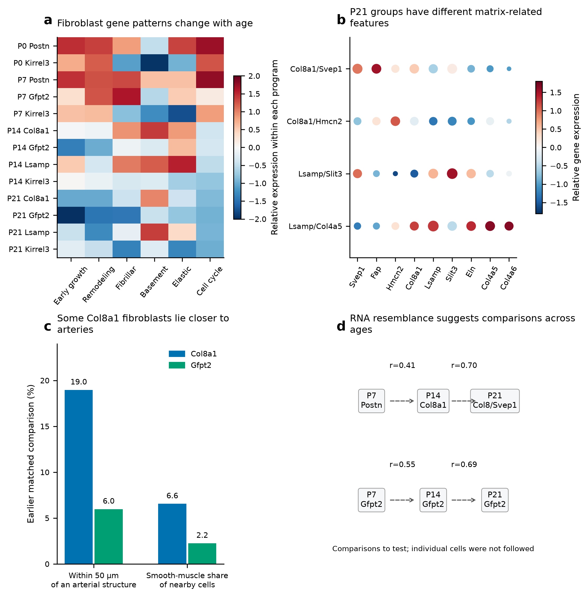

# Muscle, matrix and vascular development in the postnatal heart

## Abstract

After birth, the heart must grow while becoming capable of sustained pumping. Its muscle cells, supporting matrix and blood vessels develop together, but their timing may differ across the ventricular wall. We examined these relationships in the deposited P0, P7, P14 and P21 heart atlas. Cardiomyocytes of the same subtype showed different maturation-associated RNA patterns within a section. Fibroblasts also changed with age: early Postn-associated states became less prominent, while later groups expressed different combinations of matrix genes. Alternative ways of identifying fibroblasts recovered broader candidate maps and showed that a Gfpt2-associated program extends beyond a small, narrowly defined Gfpt2 subtype. Published vascular work places these changes alongside expansion of the existing coronary network, especially into the inner ventricular muscle. Our spatial results suggest that early growth, cell-cycle activity and later metabolic or structural development have different relationships with neighboring cells. At P14, for example, Ankrd1-associated cardiomyocytes near endocardial-like endothelial cells expressed more sarcomere genes. Comparisons across ages identified some similar cellular environments, but did not establish cell ancestry. Together, the findings support a model in which local muscle development accompanies changes in both the matrix and vascular environment. Independent hearts and direct measurements of blood flow, mechanics and cardiomyocyte function are needed to distinguish how these environments contribute.

## Introduction

The postnatal heart faces two demands: it must enlarge and increase its pumping capacity. Cardiomyocytes change their growth behavior, energy use and contractile machinery while the ventricular wall is being remodeled. Blood vessels must reach the growing muscle, and fibroblasts must help organize the material around and between cells. Understanding cardiomyocyte development therefore requires understanding the tissue in which it occurs.

The Heart Atlas provides RNA and spatial data for examining these processes [1]. We focus on differences within the major cardiac cell types. Ankrd1-associated and working ventricular cardiomyocytes may respond differently to their surroundings. Postn-, Gfpt2-, Col8a1- and Lsamp-associated fibroblasts may contribute different matrix features. Capillary, arterial and endocardial-like endothelial cells also occupy different environments. Pooling each lineage into one category can hide these differences.

The vascular study by Lu and colleagues provides a useful developmental framework [2]. It showed that pre-existing coronary vessels expand around birth, particularly into the inner myocardium. Here, the inner myocardium means the ventricular muscle closer to the chamber cavity and its endocardial lining. We use this regional growth pattern to ask how vascular development might coordinate with changes in fibroblasts and cardiomyocytes. The study supplies anatomical and lineage evidence for vascular expansion; our atlas analysis adds questions about the local cell states that accompany it.

## Results

### Cardiomyocytes of the same subtype can be at different developmental states

At P0 and P7, both Ankrd1-associated and working ventricular cardiomyocytes showed a wide range of maturation-associated RNA patterns within the same section (Fig. 1). A subtype name therefore does not specify one level of maturity. Two Ankrd1 cardiomyocytes, for example, can differ substantially in genes related to metabolism and contraction.

Our maturation score combines 21 measured genes associated with these processes. A higher score means stronger expression of this gene panel; it is not a direct measurement of contraction, calcium handling or energy production. We also examine the metabolic, structural and cell-cycle-related parts separately, because they may change at different times.

The subtypes differed in their regional surroundings. Slit2-associated cardiomyocytes favored areas near the chamber lining in the released annotations. Ankrd1 expression was partly enriched near identified arterial structures, especially at P7 and P14, but was not confined to them. This raises questions about local loading and matrix organization, because Ankrd1 can accompany mechanical adaptation. It does not establish a separate arterial-associated lineage or indicate disease in the normally developing heart.

### Fibroblasts develop different matrix-associated features

The RNA data show a shift from prominent early Postn-associated fibroblast states toward later Col8a1-, Gfpt2- and Lsamp-associated groups (Fig. 2). These names describe RNA patterns, rather than separate proven developmental origins. Early Postn-associated activity is consistent with normal tissue growth and remodeling. Postn RNA declines substantially by P21, although residual transcripts remain detectable in the processed data.

The later groups appear equipped to contribute different features of the extracellular matrix. Col8a1-associated fibroblasts expressed more basement-matrix-associated genes than Gfpt2 fibroblasts at both P14 and P21, with the same direction in both RNA libraries. Lsamp-associated groups included elastic-matrix and collagen-IV-associated features. Within the Col8a1 group, the Svep1- and Hmcn2-associated subgroups also differed in genes related to adhesion and matrix organization. These differences suggest functional specialization, but matrix deposition and stiffness were not measured directly.

Location gives this specialization a possible tissue role. In an earlier P14 comparison, about 19 of every 100 Col8a1 fibroblasts were within 50 µm of an identified arterial structure, compared with about 6 of every 100 matched Gfpt2 fibroblasts. Most Col8a1 fibroblasts were farther than 50 µm from these structures. Col8a1 fibroblasts therefore appear broadly distributed, with a subset more often found near arteries. That subset may help organize the matrix around vessels or between vessels and muscle. The comparison came from the earlier conservative assignment subset and has not been repeated using the newest classifier-based labels.

### Alternative methods recover a broader view of fibroblast identity

Many late fibroblasts were left without a subtype when assignment required both whole-cell and nuclear marker evidence. A nucleus can contain too few informative transcripts even when the rest of the cell supports an identity. We therefore compared three different classifiers and examined the paper's measured marker sets directly. We also repeated assignments after hiding the naming genes, changing the RNA reference, and using transcripts from different parts of the cell.

These methods recover broader candidate maps, especially for Col8a1- and Lsamp-associated fibroblasts (Fig. 3). At P21, they provide candidate identities for 7,992 of 10,867 eligible fibroblast profiles, or about 74%, compared with about 6% under the earlier stringent rules. This is increased coverage, not a measured improvement in accuracy. Each candidate retains information about method agreement, boundary sensitivity and any conflicting nuclear evidence.

Gfpt2 remains harder to separate as a narrow subtype. Some methods recover many Gfpt2 reference nuclei but also mislabel other families as Gfpt2. Choosing the method that gives the largest Gfpt2 population would therefore overstate what the panel can resolve (Fig. S1). We retain both the candidate subtype and the measured Gfpt2-associated pattern, rather than forcing every profile into one family.

### The Gfpt2-associated pattern extends beyond a narrowly defined subtype

Using the measured Gfpt2, Pi16 and Adgrd1 genes, 1,339 eligible P21 profiles show enrichment of a Gfpt2-associated marker pattern under our scoring rule. Of these, 327 also show the Col8a1-associated pattern (Fig. 4). Among the 2,716 eligible profiles carrying the paper's Gfpt2 label, 1,058 show the Gfpt2-pattern flag. These observations reveal a broader spatial signal than the small number of strict family assignments suggested.

The naming-gene test supports a distinguishable subset. After hiding Gfpt2, Pi16 and the other naming markers from the classifiers, 280 eligible P21 profiles still receive a Gfpt2 majority label. When the hidden genes are inspected afterward, Gfpt2 is detected in about 84% and Pi16 in about 91% of these profiles (Fig. S2). A smaller subset of 75 calls also retains stronger agreement across cell/core views and the naming-marker test. This is a consistently supported subset, not an estimate of the total Gfpt2 population.

The RNA reference helps explain why the broader pattern and the narrow subtype do not coincide. Gfpt2 is detected in about two-thirds of nuclei in the Col8a1/Hmcn2 group. The distinct Gfpt2 group expresses the combined Gfpt2/Pi16/Adgrd1 pattern more strongly. The paper also lists Col8a1 among its Lsamp-family markers. These genes are therefore useful indicators, but are not exclusive identifiers.

For the biological analysis, we should keep two kinds of information: which subtype a fibroblast most resembles, and which matrix-associated patterns it expresses. A fibroblast may resemble a Col8a1 group while carrying part of a Gfpt2-associated pattern. Such overlap can reflect related states, shared gene expression or residual RNA mixing. It does not by itself show that one subtype is becoming another.

### Coronary vessels expand most strongly toward the inner ventricular muscle

Lu and colleagues showed that the existing coronary network expands around birth, with particularly strong growth in the inner ventricular wall [2]. This growth begins before birth and extends into developing trabecular muscle. It accompanies regional hypoxia and ventricular wall growth. By P7, inner myocardial vessel density approaches that of the outer wall; the early angiogenic activity appears to subside between P7 and P14 (Fig. 5a).

The study also distinguishes the coronary network from the endocardium. The endocardium is the lining of the heart chamber. Perinatal labeling of its cells did not identify them as the source of the expanding postnatal coronary network. A cardiomyocyte near an endocardial cell therefore occupies a different setting from one beside a coronary capillary, even though both neighbors belong to the broad endothelial lineage.

This regional vascular growth provides a reason to expect uneven cardiomyocyte development within a section. Some areas may still be undergoing rapid tissue and vessel growth, while others may already have more established vascular coverage. How that coverage becomes a functioning blood supply—and how it relates to local matrix and muscle development—remains a separate question.

### Vascular growth and cardiomyocyte maturation follow different schedules

At P0 and P7, regions with more cell-cycle activity in endothelial cells also tended to show more cell-cycle activity in cardiomyocytes. This is consistent with coordinated growth of the muscle and its blood supply. Cardiomyocytes in these regions can still express genes involved in energy metabolism and contraction: cell-cycle activity and maturation are not opposite ends of a single developmental scale.

Cardiomyocytes positioned alongside capillary endothelial cells showed a changing pattern with age. At P7, they showed lower expression of cell-cycle genes. At P14 and P21, they showed higher expression of genes involved in energy metabolism (Fig. 5d). Together, these observations suggest that early vascular growth and later vascular support may accompany different steps in cardiomyocyte development. We have not yet established whether these relationships depend on blood flow, oxygen delivery or signals from neighboring cells.

The fibroblast relationship is less certain. At P7, cycling cardiomyocytes near Postn-associated fibroblasts showed lower expression of genes involved in energy metabolism. However, this relationship weakened when we changed how fibroblasts and their neighborhoods were identified (Fig. 5b). It remains a tentative link between the developing extracellular matrix and cardiomyocyte metabolism.

At P14, Ankrd1-associated cardiomyocytes near endocardial-like endothelial cells showed higher expression of genes involved in building sarcomeres—the structures that generate contraction. This relationship persisted across the earlier alternative fibroblast assignments and was much weaker in working ventricular cardiomyocytes (Fig. 5c). It suggests that the endocardial environment may relate to structural development differently across CM subtypes. The pattern could reflect local signals, regional anatomy or mechanical forces; it does not establish greater overall maturity.

These associations come from the earlier fitted models. The new classifier-based fibroblast maps in Figures 3 and 4 have not yet been used to recalculate them. The updated maps improve the questions we can ask about fibroblast identity and shared programs; they do not provide a new confirmation of the existing CM associations.

### Similar neighborhoods across ages suggest comparisons to test

We used optimal transport to compare the cells surrounding cardiomyocytes at adjacent ages. In simple terms, it asks which observed cellular environments most closely resemble one another. We compared neighborhoods around the same cardiomyocyte subtype and in a comparable position relative to the endocardium. The CM maturation score was not used to choose these matches.

Some matches also paired neighborhoods with similar relative CM maturation. In one P7-to-P14 comparison around Ankrd1 cardiomyocytes farther from the chamber lining, matched neighborhoods had closer maturation ranks than arbitrary pairs. The corresponding comparison near the lining did not show the same improvement (Fig. 6). This suggests that some regional ordering may be preserved while the surrounding cell states change, but the pattern was not consistent across all ages or regions.

Wormhole provided a faster approximation of neighborhood similarity, with variable agreement on the closest matches. We therefore use these results to select developmental comparisons for further study. Neither transport nor resemblance between early and late fibroblast RNA patterns follows an individual cell through time or establishes its descendants.

## Discussion

The findings suggest that muscle, matrix and blood vessels develop together, while different parts of this process advance at different times and in different regions. Early cardiomyocytes and endothelial cells can share cell-cycle activity. Later, vascular proximity is associated with selected metabolic or structural RNA patterns. At the same time, fibroblasts acquire different combinations of matrix-associated genes. These changes should be studied together without assuming that one overall maturation score captures every aspect of development.

The inner ventricular wall is a particularly useful setting for this question. The vascular study shows pronounced coronary expansion there during the first postnatal week. That gives a specific anatomical framework for asking whether improved blood supply precedes changes in cardiomyocyte metabolism, whether matrix remodeling helps organize the growing tissue, and whether endothelial contact contributes to contractile development.

The fibroblast reassessment changes how we should test these possibilities. A narrow subtype label can miss a program shared across several fibroblast groups. Conversely, expression of a Gfpt2-associated pattern does not make every positive cell a member of the same subtype. Analyses of CM maturation should therefore consider both nearby fibroblast identities and the programs those fibroblasts express. This is especially important at P21, where strict labels cover few profiles and boundary agreement is weaker.

Three explanations can be separated experimentally (Fig. 7). If blood supply is central, improved perfusion and reduced local hypoxia should precede changes in CM energy metabolism. If matrix organization is central, fibroblast-derived matrix properties should explain additional differences after vascular access is matched. If endothelial contact is central, changing contact or local signals should alter CM structure or function even when oxygen and matrix conditions are held constant. These mechanisms may work together, but they make different experimental predictions.

Independent hearts at P3/P5 and around P10 would help establish the order of events. The most useful measurements would combine matched ventricular regions, three-dimensional vessel imaging, actual perfusion, local hypoxia, fibroblast state and CM phenotype. CM measurements should include sarcomere organization, calcium handling, contraction and energy metabolism. Completed cell division should be measured separately from cell-cycle RNA [4,5].

For fibroblasts, membrane-resolved RNA imaging of Gfpt2/Pi16/Adgrd1 alongside Col8a1/Htra3 and Lsamp/Itgbl1 would test whether overlapping patterns occur within cells or across boundaries. Controlled CM experiments could then compare fibroblast environments while keeping oxygen and endothelial support similar. Lineage tracing would address the different question of whether early fibroblast states contribute to later groups.

The current data contain one available spatial section per age, incomplete subtype separation and no direct measurement of vascular function. The report therefore identifies useful biological comparisons and testable explanations. It does not establish a causal pathway from vessel growth or fibroblast identity to completed CM maturation.

## Methods

### Data and analysis status

This report integrates the deposited P0, P7, P14 and P21 heart data [1], the previously reviewed spatial analyses and the alternative fibroblast identity reassessment. Original spatial coordinates, broad cell identities and count matrices are retained. Earlier RNA QC included doublet screening and ambient-RNA correction. There is one available spatial section per age.

The new classifier-based fibroblast labels update identity maps and marker analyses. CM-neighbor associations, matched capillary comparisons, matrix-related spatial contrasts and transport plans retain their documented earlier source definitions. In particular, the P14 19%-versus-6% vascular comparison and Figure 5 model coefficients were not refitted using the newest classifier labels.

### Cardiomyocytes and maturation measurements

The subtype cohort includes ventricular-marker-supported profiles with compatible released CM labels: v.CM, Ankrd1.CM, Slit2.CM, Ddc.CM and the ventricular-supported subset of p.CM. It also requires the earlier morphology selector, at least 20 core-panel molecules and at least 20 molecules outside the outcome genes. Missing nuclear area alone does not exclude a CM. These are operational selection rules; the labels are not newly verified anatomical or functional identities.

The frozen 21-gene panel supplies the overall maturation index and metabolic-regulatory, sarcomere, excitation/contraction and lower-cycling components. Relative low/high groups use quartiles within each age and CM subtype. A high-ranked P0 cell is not assumed to have the same physiological maturity as a high-ranked P21 cell. The panel includes Myl2, which also partly contributes to ventricular selection.

### Fibroblast reference and alternative classifiers

The clean RNA reference contains 14,328 fibroblast nuclei; 35 with unresolved programs are excluded from named-family training. Primary models compare families present in the same-age reference. Absence of a reference class is not evidence of biological absence. Of the 403 Xenium targets, 381 are represented in the shared RNA matrix. CM maturation/response genes, CM lineage markers, cycling genes and sex genes are excluded from identity training. Feature selection uses only training data and requires detection in at least five cells or 0.5% of the training cohort, whichever is larger.

Balanced multinomial logistic regression uses log1p counts per 10,000 retained-feature molecules, training-reference gene means/SDs, an SD floor of 0.25, clipping to ±5, C=0.3 and balanced class weights. The rank-centroid method compares tied within-cell expression ranks with library-balanced family rank templates, using centered-rank cosine scores and a temperature of 0.02. The negative-binomial model compares counts with library-balanced relative-expression templates, query depth and training-derived gene dispersion clipped to 0.5–100. Its class log likelihoods are divided by the square root of query depth. Model weights are not calibrated Xenium probabilities.

Each RNA library is predicted by a model trained on the other library. Additional tests use Poisson thinning toward 60 molecules, 15% random gene dropout, raw RNA references, empirical RNA priors and a pooled P14/P21 reference. Pooled tests hold out the same replicate-number group across both ages. The naming-marker test removes Postn, Tnc, Gfpt2, Pi16, Col8a1, Lsamp and Kirrel3 from training and query normalization. These tests measure recovery of reviewed RNA labels, not independently established Xenium identity.

### Candidate labels and measured marker patterns

All candidate sources retain the existing broad-fibroblast segmentation/source QC mask. A cell candidate requires at least two classifiers to agree after passing family-specific reference score screens, with at least 20 retained-feature molecules and eight detected genes. The score screen is the lowest tested threshold with at least 20 reference predictions, both held-out libraries represented and pooled apparent precision of at least 0.8. It is selected from these same reference predictions and is not an unbiased prospective accuracy estimate.

A supported core majority for another family triggers review. The cell/core subset also requires the same supported core label. The crosschecked subset retains this support and the same refined-cell majority after naming genes are hidden. Nuclear support is optional, and supported nuclear alternatives remain explicit review fields; even a crosschecked candidate can carry such a flag. These correlated views provide sensitivity checks, not independent anatomical truth. The alternative classifiers do not separately recenter query genes or impose target spatial family proportions.

Published marker sets come from Supplementary Table 3. Only shared measured genes with positive log2 fold change and adjusted P<0.05 are used; at least three are needed to score a module. The Gfpt2 set contains Gfpt2/Pi16/Adgrd1, the Col8a1 set contains Col8a1/Cmklr1/Col6a3/Htra3, and the Lsamp set contains Lsamp/Itgbl1/Col8a1. Scores compare the mean within-cell marker rank with 200 control sets matched to RNA-reference abundance deciles. A descriptive enrichment flag requires a score above 90% of control sets and at least two detected markers. It is not a cell-type probability or a single-cell significance test.

Native, refined whole-cell, boundary-core and nuclear-only counts are analyzed separately. Three random-thinning repetitions match refined counts to expected core depth without changing geometry. Hidden naming-gene expression is examined afterward in groups formed without those genes. RNA subcluster summaries retain both libraries and raw/corrected views. Candidate coverage uses eligible broad fibroblasts as the denominator and is not a measure of tissue-wide subtype abundance.

### Earlier matrix and spatial comparisons

Matrix-program and named-substate summaries use full-RNA library-by-family pseudobulks, with raw/corrected sensitivity and duplicate gene symbols summed. Programs are means of gene log1p CPM values. The P14 Col8a1/Gfpt2 spatial comparison uses the earlier conservative family assignments and matching for RNA depth, cell area, nuclear fraction and neighbor density. Distance is to an operationally identified arterial structure, not a traced histological vessel wall. Selected cross-age RNA correlations compare signatures with interpreted markers withheld; they are not conversion rates.

The primary CM-neighborhood graph uses tissue-screened 50-µm proximity; 30-µm and shared-boundary graphs provide sensitivities. Fibroblast and endothelial fractions retain all eligible neighbors of their lineage, including those without a subtype. Eligible CM models require at least five resolved neighbors and at least one eligible fibroblast and endothelial neighbor. Tested source categories require at least 30 source profiles and at least 50 positive CM exposures.

Joint models include the eligible source fractions, capture, area, nuclear missingness, neighbor density/counts, source capture, broad non-CM composition and anatomical distance proxies. Within-region fits compare variation inside 200-µm blocks separately for each CM subtype. The 512 shared resamples of 400-µm blocks provide exploratory within-section intervals; approximate tests use bootstrap standard errors, with BH correction across the full tested state/source/outcome grid within each age, geometry and source definition. These are not independent-heart tests.

The capillary-apposition comparison uses the earlier matched reconstruction, with same-region/CM-state matching and capture, area, perimeter and capillary-area controls. It involves a broader CM cohort than the subtype-specific models. Some effects weakened under more restrictive, nuclear-supported capillary labels. Contact tests and tighter neighborhoods were smaller or less conclusive; the P7 and P14 subtype findings do not establish direct contact as the cause. Fewer cell-cycle transcripts, a higher metabolic score and direct functional maturation are distinct outcomes.

### Comparing neighborhoods across ages

The frozen transport analysis contains 96 observed neighborhoods: 12 per age and CM identity (v.CM or Ankrd1.CM), with four within 100 µm of the endocardial proxy and eight farther away. Selection does not require membership in a broad niche cluster. Up to 32 observed non-CM profiles per neighborhood enter the saved representation of 16 molecular PCs plus six lineage features. Exact squared Wasserstein costs are compared with the saved Wormhole approximation [3].

Matches are restricted to the same CM identity and endocardial-distance category. CM maturation is withheld from the distance calculation and matching. Source-type descriptors retain the earlier stringent fibroblast definitions; the new classifiers do not retrain or alter these plans. Matching mass does not estimate survival, proliferation, ancestry or a rate of transition. Similar relative maturation ranks do not define an absolute developmental clock.

### Cell boundaries and limitations

The original atlas used nuclear, membrane and cell-interior staining, with manual boundary comparisons in five P0 and five P21 image fields. It reports TP/(TP+FP+FN) at a 90% overlap threshold. Approximate visual scores are 45–50% at P0 and around 10% at P21; raw benchmark values were not recovered. This single-threshold object score is not the fraction of correctly assigned transcripts. The exact overlap normalization and relevant software version/parameters are not fully specified in the cited Methods sections. Image fields do not establish independent-heart replication of the benchmark.

A CM profile without a visible nucleus can be a valid section through a large cell. Conversely, even a small boundary error can affect a thin fibroblast or endothelial cell next to a transcript-rich CM. We therefore preserve cell, core and nuclear evidence rather than treating any one segmentation as ground truth. The original author anatomical masks, score objects and neighbor-level inputs were not recovered for exact replication of Figure 4e.

### Source data and validation

The source records retain count views, cell IDs, reference labels, marker definitions, model results and uncertainty fields. Earlier validation independently reconstructed neighbor measurements, checked reference recovery and hidden-gene exclusions, refitted selected coefficients and verified transport calculations. The current report retains those numerical results and identifies which analyses use the alternative fibroblast assignments. The matrix plate is rearranged from existing data. Source checksums, figure data and reproducible analysis scripts accompany the report.

## References

1. Wang H et al. Spatially guided in vivo single-cell functional genomics of postnatal heart. Nature Cardiovascular Research (2026). https://doi.org/10.1038/s44161-026-00861-z

2. Lu P et al. Perinatal angiogenesis from pre-existing coronary vessels via DLL4–NOTCH1 signalling. Nature Cell Biology 23, 967–977 (2021). https://doi.org/10.1038/s41556-021-00747-1

3. Haviv A et al. Wasserstein Wormhole: Scalable Optimal Transport Distance with Transformers. ICML (2024). https://arxiv.org/abs/2404.09411

4. Puente BN et al. The oxygen-rich postnatal environment induces cardiomyocyte cell-cycle arrest through DNA damage response. Cell (2014). https://doi.org/10.1016/j.cell.2014.03.032

5. Mahmoud AI et al. Meis1 regulates postnatal cardiomyocyte cell cycle arrest. Nature (2013). https://doi.org/10.1038/nature12054

## Figure plates

### Figure 1. CMs of the same subtype show different maturation-associated RNA patterns

a,b, Ventricular-associated CM labels at P0 and P7. c,d, Relative position within the section’s 21-gene maturation-score distribution. e,f, Score distributions within each CM subtype. A high score indicates stronger expression of the measured panel, rather than a direct measurement of CM function. Labels and coordinates are retained from the earlier analysis. Scale bars, 500 µm.

### Figure 2. Fibroblasts develop different matrix-associated features

a, RNA programs across ages and fibroblast groups, averaged over the two libraries and shown relative to the other displayed groups. b, Gene patterns in named P21 RNA subgroups; dot size shows detection and color shows relative expression. c, Earlier P14 matched Col8a1/Gfpt2 comparison: proximity to arterial structures and the smooth-muscle share of neighboring cells are separate measures. These values use the earlier conservative labels, not the new classifier labels. d, Selected RNA-signature similarities with interpreted markers withheld. Dashed arrows mark comparisons to test; they do not trace cell descendants.

### Figure 3. Alternative methods recover broader fibroblast candidate maps

a–d, Candidate fibroblast identities on the four original sections. e, Assignment coverage among eligible broad fibroblasts. Coverage is not subtype abundance or an independently measured accuracy. f, P21 agreement between whole-cell and boundary-core labels, compared with random loss of whole-cell transcripts to similar depth. This helps separate loss of information from sensitivity to transcript location. Nuclear alternatives remain review flags. Gray retains profiles without a confident candidate; scale bars, 500 µm.

### Figure 4. A Gfpt2-associated pattern extends beyond the narrow subtype

a, Public named fibroblast labels within the eligible P21 cohort. b, Multi-method cell candidates. c, The subset also supported in the cell core and after naming markers are hidden. d, Direct Gfpt2/Pi16/Adgrd1 marker score relative to matched control genes. e,f, Gfpt2/Col8a1 pattern combinations across eligible fibroblasts or within the public Gfpt2 subset. A pattern-positive profile is not automatically a member of one subtype. Public valve labels are not equated with Kirrel3 candidates. Gray and review flags retain uncertainty; scale bars, 500 µm.

### Figure 5. Vascular growth and CM maturation have different relationships over time

a, Regional vascular sequence from Lu et al. (2021), rather than a new measurement of blood flow. b, Earlier P7 cycling-CM/Postn-fibroblast metabolic association under different source rules and distances. This result becomes less convincing when the full set of tested relationships is considered. c, Earlier P14 Ankrd1-CM/endocardial-EC sarcomere association. Intervals summarize uncertainty within a section. d, Earlier matched comparison of CMs alongside capillary ECs with comparable CMs without that proximity; this uses a broader CM cohort. e, Vessel growth, local access and functional support are different measurements. The newest classifier-based FB labels have not been used to refit these estimates.

### Figure 6. Some cellular environments resemble one another across ages

a, Comparison design, restricted to the same CM subtype and a similar position relative to the endocardium. b, Earlier strict fibroblast/endothelial descriptors in 96 observed neighborhoods. c,d, Agreement between Wormhole and exact neighborhood distances. e, Similarity of environments around the same or different CM subtypes within an age. f, Relative maturation-rank agreement was checked after matching, rather than used to choose matches. Results vary by region and age. New FB labels do not alter these plans; no individual cells or descendants were followed.

### Figure 7. Experiments can separate blood supply, matrix and contact effects

a, Proposed sequence of early growth followed by later specialization. The arrows show developmental windows, not observed cell conversion. b, Blood supply, matrix/mechanics and cellular contact are different possible contributions to CM development. c, Independent intermediate-stage hearts, controlled functional experiments and lineage tracing can distinguish them. Direct measurements should include perfusion, CM energy use, calcium handling and contraction. This is a model to test, rather than a completed causal experiment.

### Figure S1. The reference tests show why more labels need not mean better assignments

a, P21 Gfpt2 precision and recall in opposite-library RNA tests; each point is one held-out library. b, Mean RNA-label recovery by family and method. c, Sensitivity to hidden naming markers and pooled late references. d, Sensitivity to reduced RNA information. These tests recover our reviewed RNA definitions; they do not establish independent Xenium accuracy. Some methods recover more Gfpt2 nuclei while also assigning other families incorrectly.

### Figure S2. Hidden genes help check assignments, while marker patterns can overlap

a, Measured P21 expression after grouping with classifiers that could not use the seven naming/anchor genes. Printed values show detection percentages. b, Gfpt2/Col8a1 pattern combinations among eligible profiles with public Gfpt2 labels. c, Published marker coverage in the shared panel. The valve set has too few measured genes for a multi-gene module. d, A candidate subtype, a measured marker pattern and developmental fate describe different kinds of evidence.

## Reading the cell-boundary results

Cell boundaries determine which transcripts are assigned to each spatial profile. The atlas combines membrane, cell-interior and nuclear stains to help identify these boundaries. This is more appropriate for large and multinucleated cardiomyocytes than simply drawing a fixed region around each nucleus.

The authors compared automatic boundaries with expert outlines in ten fields: five at P0 and five at P21. Multimodal segmentation performed better than nucleus expansion. However, its boundary-agreement score was only about 45–50% at P0 and around 10% at P21 under a demanding 90% overlap rule. These are approximate readings from the published plot. A low object score does not mean the same proportion of transcripts were assigned incorrectly: an outline can fail the strict overlap test while retaining many correctly assigned interior transcripts.

The poorer P21 agreement matters when interpreting small fibroblasts or endothelial cells beside transcript-rich cardiomyocytes. At the same time, a CM profile without a visible nucleus can be a valid section through a large cell. Removing all such profiles would discard real tissue information.

Our approach keeps whole-cell, inner-cell and nuclear evidence visible. Nuclear agreement can strengthen a label. A lack of informative nuclear transcripts is not sufficient to reject it, while a supported alternative nuclear identity is a reason for review. None of these views is treated as anatomical ground truth.

The next useful validation is to examine selected interfaces directly, with clear membrane outlines and several subtype markers in the same cells. This can test whether an apparent shared RNA pattern lies within one fibroblast or across a boundary. The full earlier segmentation assessment and the original paper’s Methods/Supplementary Figure 1 remain linked in the source record.
