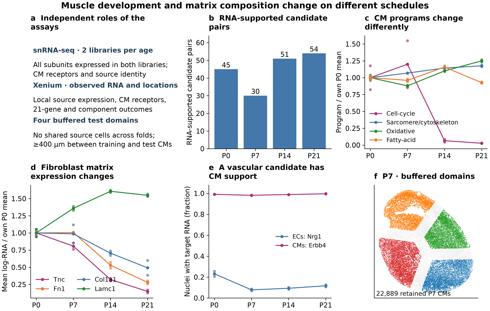
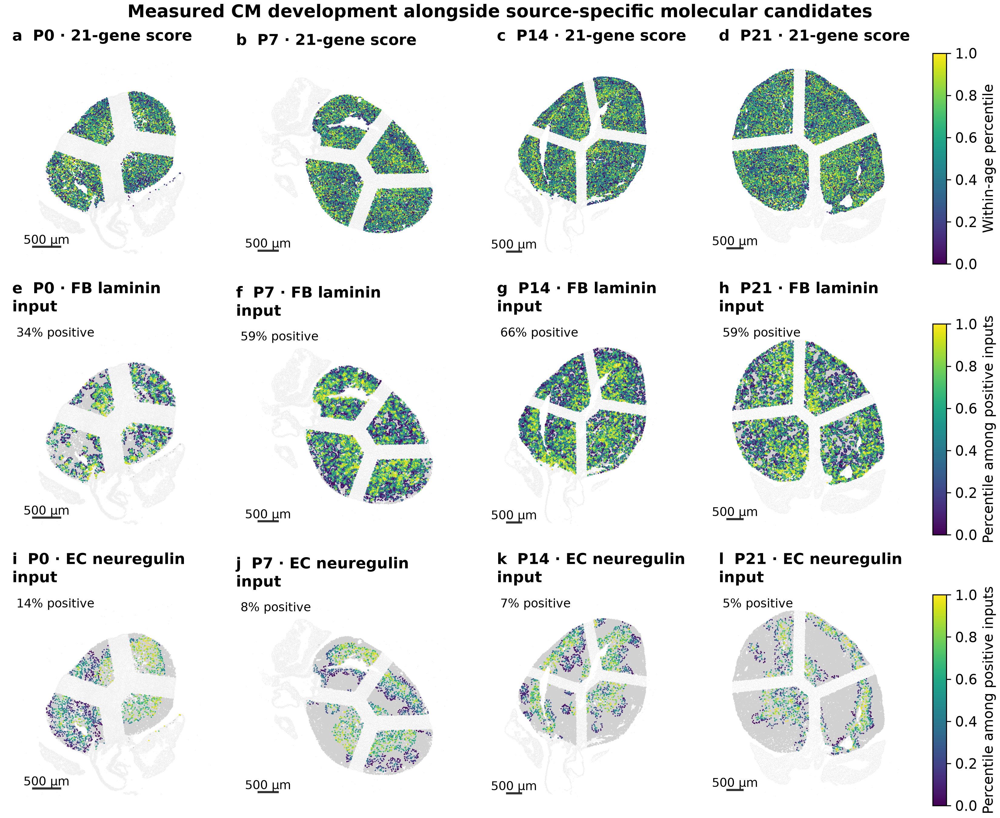
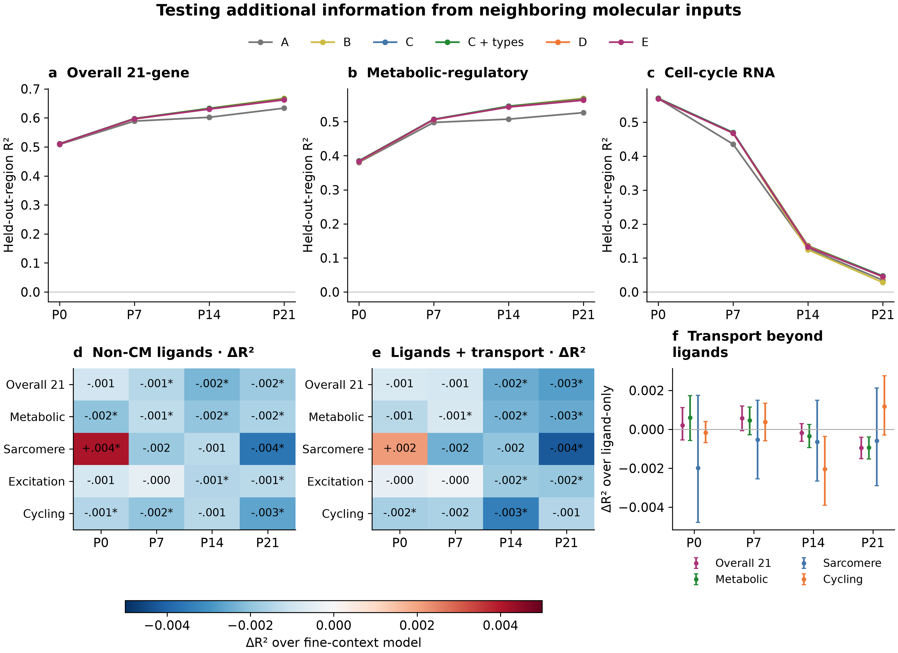
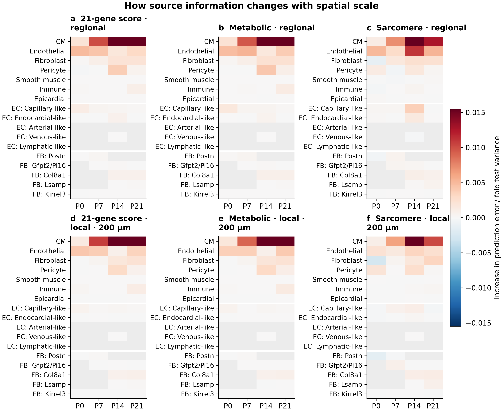

# Postnatal cardiac development: muscle programs, matrix composition and vascular context

## The biological question

Cardiomyocytes mature while their blood supply and surrounding matrix are being rebuilt. These processes occur together, but they need not follow the same timetable or affect every part of CM development in the same way. Our question is whether the molecular environment around a CM helps explain its development after accounting for its identity, location and RNA capture.

This analysis combines the assays in two steps. The corrected snRNA-seq reference establishes which surrounding populations express a candidate ligand and whether CMs express its receptor. Xenium then places the measured candidate inputs beside directly measured CM outcomes in the cardiac sections. The 21-gene index remains the overall transcriptional outcome; metabolic-regulatory, sarcomere, excitation–contraction and cell-cycle expression are tested separately. No unmeasured RNA program is presented as a Xenium measurement.

## What the joint analysis establishes

At all four ages, adding source-specific non-CM expression and collective ligand–receptor inputs did not improve prediction of the overall 21-gene score beyond the receptor, CM-to-CM and fine-context controls. The changes in held-out R² were P0, -0.0007; P7, -0.0009; P14, -0.0025; P21, -0.0028 (Fig. 3). These numbers describe prediction of observed RNA in unseen regions of the same section, rather than a biological effect of adding or removing a cell population.

Of the 40 supported primary comparisons, 1 showed a positive gain after within-section multiple-testing correction: P0 sarcomere (D minus fine context, ΔR² +0.0041, q=0.00155). These remain conditional prediction results from one section per age, requiring independent-heart validation.

For the P0 sarcomere comparison, the gain amounted to about 0.41 percentage points of explained variation. The deposited-RNA forest increment was -0.0033. The linear sensitivity also did not support the gain. The positive result therefore depends on the RNA view or learner and does not establish a reproducible source-specific mechanism.

The baseline already includes which cells surround a CM and where it is located. The added features ask whether measured molecular differences explain more of the CM outcome. Vascular support, matrix organization and regional development can therefore remain biologically important even when the molecular increment is small. CM state and receptor expression may also lie along a biological response pathway; conditioning on them does not estimate the total influence of neighboring cells.

## CM development involves several processes

The RNA reference supports separating growth from other parts of development. Cell-cycle expression remains evident at P0 and P7, then falls sharply by P14. Sarcomere-associated expression rises across the observed ages. Oxidative-metabolism expression is higher later, while the fatty-acid program is higher at P14 than at P21. The two libraries show the same broad directions. These are nuclear RNA programs, rather than measurements of respiration, contraction or completed cell division (Fig. 1c).

This distinction matters for the vascular question. A growing region can contain cycling CMs that already express structural or metabolic genes. Conversely, a CM with little cell-cycle RNA is not necessarily mature in every other respect. An association with one component should therefore be described as a relationship with that component, rather than uniformly greater or lower maturity.

CM identity adds another distinction. In both RNA libraries, Ankrd1-associated CMs have higher structural and cytoskeletal program expression than working CMs at all four ages. Their fatty-acid program is lower at P0, P7 and P14; this difference is much smaller by P21. These profiles support examining mechanical specialization and metabolic development separately, rather than assigning the Ankrd1 population one position on an immature-to-mature scale. They do not establish stronger contraction, greater mechanical load or lower metabolic flux. The library-level contrasts are provided in the source tables.

## Fibroblasts change the matrix they may supply

Across the broad fibroblast population, Tnc, Fn1 and Col1a1 expression falls between the early and later ages, while Lamc1 expression rises. Both RNA libraries support these directions (Fig. 1d). Thus, development is accompanied by a change in matrix composition; it is not adequately described as all fibroblasts producing progressively more collagen.

This concerns relative RNA expression within sampled fibroblast nuclei. It does not show that the heart contains less collagen protein: deposited matrix can persist or accumulate as the wall grows, even while expression per nucleus falls. Protein amount, organization and turnover need separate measurements.

This provides a specific biological hypothesis. Early fibroblast environments may support tissue growth and matrix remodeling, whereas later environments may contribute differently to matrix organization and the mechanical setting of CMs. The proposed link should be tested against CM structural and metabolic outcomes separately. Producer-cell RNA does not reveal where matrix protein is deposited, and this analysis does not show that a particular matrix component promotes or suppresses maturation.

The source labels retain Postn-, Gfpt2/Pi16-, Col8a1-, Lsamp- and Kirrel3-associated families, together with unresolved fibroblasts. Col8a1 remains one family. Gfpt2/Pi16 denotes a multi-gene identity and does not require both naming genes in every cell. Broad-fibroblast molecular inputs include eligible unresolved cells, which is particularly useful where late Gfpt2 labels remain uncertain. An unavailable same-age RNA family is not counted as a biological zero.

Changes in family labels and matrix expression do not establish cell ancestry. Wall growth, changing cell states, different sampling and expansion or loss of populations remain possible contributors. The current analysis does not establish a Postn-to-Gfpt2 or Postn-to-Col8a1 fate transition.

## Vascular candidates need both a source and a responsive CM

Endothelial Nrg1 and CM Erbb4 pass the two-library availability screen at all four ages. This gives a concrete candidate for testing how vascular development and CM responses are coordinated (Fig. 1e). It does not show that the nearby vessel activates the receptor or that the signal has the same effect at every age. The receptor state, available partners and downstream CM response can change during development.

The Nrg1–Erbb4 configuration recorded by the database is measurable, but Erbb2 is absent from the Xenium panel. We therefore cannot evaluate a complete ERBB2/ERBB4 receptor complex from this panel. A 200-µm neighborhood is also an assumed search range, not a measured range of ligand movement. Candidate maps show where an RNA-supported input could be compatible with CM receptor expression; they do not map active signaling (Fig. 2).

The combined assays reveal an important measurement limit. Erbb4 is detected in nearly all CM nuclei in the RNA reference, but in only about 11–17% of the modeled CM profiles in core Xenium RNA. Endothelial Nrg1 expression is observed within the specified neighborhood of about 46–80% of CMs. Their joint candidate input is consequently positive in only about 5–14% of CMs. These are measurement and model-coverage fractions, rather than the fraction of cells receiving physiological neuregulin signaling. A spatial zero should therefore remain uncertain. The ligand-only model also tests source expression without requiring a positive receiver transcript, so the prediction comparison is not limited to the sparse joint-input map.

Matrix candidates require similar care. Lamc1–Dag1 and related inputs can be supported in several cardiac lineages. Keeping the source identity attached to the calculation distinguishes candidate contributions from fibroblasts, ECs and neighboring CMs. It does not establish the protein’s cellular origin after secretion or deposition.

## How this changes the next experiment

The next priority is to connect vascular access to specific CM functions. Compare CMs of the same identity and wall region at P7 and P14, measuring perfused capillaries together with CM metabolism, sarcomere organization and calcium handling. Add independent hearts and intermediate stages, especially P3/P5 and approximately P10. This would test whether functional vascular integration explains developmental variation better than vessel proximity alone.

For fibroblasts, measure matrix protein organization around the same CMs, including early remodeling-associated matrix and later laminin-associated structures. Compare regions with similar vascular access. If a matrix difference accompanies CM structural organization while metabolic measures remain similar, prioritize a mechanical or matrix-organization experiment. If CM metabolism instead tracks perfusion, prioritize the vascular-function hypothesis. The current RNA results do not establish a single fibroblast family as the driver of the overall maturation index.

Test a particular endothelial contact or secreted signal after verifying the ligand and receptor proteins in the relevant cells. For the neuregulin candidate, include the receptor partner missing from the Xenium panel. Compare direct EC–CM contact with physically separated cultures at matched oxygen and nutrient supply, and assess contraction, calcium handling and metabolism separately from cell-cycle RNA. This would distinguish a contact-dependent response from diffusible support or altered oxygen delivery.

The reverse CM-to-fibroblast hypothesis remains separate. CM Tgfb2 and joint fibroblast Tgfbr1/Tgfbr2 availability pass the broad-fibroblast screen at P14 and P21. Earlier joint receptor detection is below the prespecified threshold; sparse nuclear detection does not establish absence of signaling. These observations nominate possible feedback during later remodeling, but do not show that CM-derived TGFβ initiates a fibroblast state switch or that such a switch causes CM maturation. Time-resolved fibroblast signaling, matrix-protein organization and functional CM responses would be needed to test that sequence.

## Methods and interpretation limits

### Assays, cohorts and existing quality control

The RNA reference contains 73,052 previously quality-controlled nuclei and uses the DecontX-corrected matrix with full-genome count normalization. Eight RNA libraries provide two libraries at each age. Duplicate gene symbols are summed. The initial CM receptor reference contains 44,463 non-atrial CMs, including provisional conduction-program candidates. A separate sensitivity excludes conduction and uncharacterized candidates; all 180 selected age–pair qualifications retain receptor support in the remaining 43,010 CMs. These RNA libraries do not provide additional spatial-heart replicates.

The spatial analysis uses the four deposited 403-target sections and the existing high-confidence transcript-assignment matrices. “Core” denotes this high-confidence view; it does not mean nuclear RNA only. The deposited-count view uses the same source profiles and CM receivers. Eligible sources require at least 20 high-confidence transcripts, alongside the existing lineage-specific source criteria. CMs with missing nuclear measurements are not automatically discarded. No new membrane segmentation or new doublet/ambient-RNA fit was performed in this analysis.

Receiver identities, anatomical proxies and directly measured CM scores are frozen from the reviewed atlas reconstruction. The receiver cohort is the strict ventricular map cohort, including supported Ankrd1-, working-, Slit2-, Ddc- and cycling-associated states where present. Anatomy includes CM coordinates, distances to arterial candidates, the endocardial proxy, large voids and the outer tissue surface, plus morphology categories. These are operational anatomical measures, not fully validated ventricular wall layers, perfusion measurements or verified cell contacts. Earlier matched boundary-apposition analyses are preserved in their own report and are not silently replaced by the new distance-based molecular model.

### Molecular availability and database provenance

The primary interaction list is the mouse CellChat database packaged with COMMOT 0.0.3. CellPhoneDB v4 pair agreement is annotated; 22 of the 58 selected pairs appear in both packaged lists. This is a database-comparison annotation, not a full alternative-database refit. Every listed ligand and receptor subunit must be measured by Xenium, and all 21 maturation genes and the three cycling-outcome genes are excluded from candidate predictors.

A source–receiver pair requires at least 30 nuclei per RNA library, mean log1p CP10k expression of at least 0.03 and detection in at least 2% of nuclei in both libraries at that age. For a complex, every subunit must have at least one corrected molecule in the same nucleus. Complex expression is the per-cell minimum across required subunits. This conservative screen establishes replicated molecular availability, rather than protein binding, receptor assembly or pathway activation.

There are 353 fully measured, outcome-disjoint candidate pairs. Of these, 154 have RNA support at one or more ages. Outcome-independent pathway reduction retains 58 for spatial testing, including prespecified atlas/matrix candidates when supported. The age-specific sets contain 45, 30, 51 and 54 pairs at P0, P7, P14 and P21. Small populations and missing same-age reference families remain unassessable under this screen. In particular, arterial-like and lymphatic-like ECs lack sufficient RNA nuclei for fine-family two-library qualification; their observed spatial counts still enter the context controls, and they remain contributors to pooled EC inputs. Database entries are hypotheses; named candidates such as NAMPT–INSR are not biochemically validated by their inclusion or predictive ranking.

### Observed outcomes and independent RNA programs

Spatial outcomes use log1p CP10k counts and the unchanged pooled gene-Z reference from the prior reconstruction. The 21-gene score is the mean of its gene-Z values. Metabolic-regulatory, sarcomere and excitation–contraction components use the previously specified panels, with cycling separate. These are transparent measured-RNA proxies. The authors’ exact final Seurat AddModuleScore object and matched control-gene selections were not recovered; the new analysis does not claim exact reproduction of that object.

Canonical RNA response panels are evaluated independently of the spatial outcomes. Candidate ligand/receptor genes and outcome genes are removed from these panels. Their library means provide biological context; they are not imputed into Xenium. Coverage is inadequate to treat several full RNA programs as direct spatial measurements. The cell-cycle panel plotted in Fig. 1 uses the three independent genes remaining after exclusions.

Predictor expression is normalized to measured counts excluding all primary outcome genes. Own-CM capture and source-cell capture controls use that same outcome-excluded denominator, separately for core and deposited RNA. This prevents direct outcome-gene reuse in the predictors. The frozen outcome normalization still uses the full measured panel, so compositional dependencies are not eliminated completely. Existing identity annotations also use broader expression evidence and should not be described as independent assays of the outcome genes.

### Spatial candidate inputs

The analysis retains exclusive source groups for CMs; five EC families plus unresolved ECs; five fibroblast families plus unresolved fibroblasts; pericytes, smooth-muscle cells, immune cells and epicardial cells. Pooled EC and fibroblast descriptors are added after the communication solve. They do not duplicate source mass in the optimization.

Secreted candidates have a maximum 200-µm search range; extracellular-matrix and contact-associated candidates use 50 µm. Self edges are excluded. Five points along each straight source–receiver segment must fall within the tissue mask, dilated by one pixel. These operational choices reduce obvious paths through cavities; they do not recover three-dimensional paths or establish physical contact. Ligand-only exposures include a distance-weighted local sum and mean, alongside source counts and source capture at both ranges.

Ligand–receptor inputs are calculated jointly across all eligible cardiac source and competitor cell types within each validation domain. The optimizer uses the collective COT objective equivalent to COMMOT’s cot_sparse component, with entropy 0.1 and unmatched-mass cost 10. It is not COMMOT’s default four-solver ensemble and is not a recovered copy of the authors’ feature matrix. All named complexes compete through shared molecular resources. Sender identities are preserved until per-CM source aggregation; full edge plans are not released as a separate edge atlas.

The sparse optimizer uses mass-preconditioned L-BFGS on the original dual followed by ordinary Sinkhorn polishing. Every domain must satisfy a maximum relative resource-equation residual of 0.001. A strict small-instance comparison agrees with the original vendored solver to less than 0.0000001 in absolute plan mass. Solver diagnostics are supplied for every completed domain. The calculation allocates compatible RNA-based mass; it does not measure ligand transport, protein concentration or receptor activation.

### Spatial validation and model comparisons

Each section is divided into four contiguous Voronoi domains by clustering CM coordinates without outcomes. Each source cell belongs to one domain, and each domain is solved independently. Receiver CMs must lie at least 200 µm inside their domain and have at least five resolved neighbors. The resulting training/test receiver gap is at least 400 µm. Source-ID separation and actual local source neighborhoods are independently checked. This prevents shared local source cells and global communication competition from linking training and test domains. It also means the calculation is domain-specific rather than a whole-section reproduction of the original atlas solver.

The nested models are A: capture, cell size, nucleus-missing status, CM identity, anatomical proxies and broad composition; B: add CM receptors; C: add CM-to-CM molecular inputs; C_fine_context: add fine source counts and capture; D: add source-resolved non-CM ligand exposures; E: add source-resolved non-CM collective transport. Broad source-capture controls are included in A. Models use identical folds and outcome-blind training subsamples, capped at 12,000 CMs per fold. Target and predictor scaling are fitted on training CMs only.

The comparison concerns additional molecular information after neighboring cell composition and CM state are known. It does not estimate the total influence of a vascular or fibroblast environment. CM identity and receptor expression could themselves lie on a biological response pathway, so conditioning on them can remove biologically meaningful variation. The resulting prediction contrast cannot be interpreted as a causal effect of adding or removing non-CMs.

The primary learner is a fixed 100-tree multi-output random forest, fitted jointly to the five training-standardized outcomes, with maximum depth 8, minimum leaf size 30 and half the features considered per split. Ridge regression with alpha 100 is a sensitivity; its target-specific coefficients are fitted independently within the multi-output call. Predictor scales beyond the baseline A have a minimum of 0.05 log-input units, preventing nearly constant training features from producing extreme extrapolation in a new region. Ridge coefficients therefore use the recorded training scale and are not uniformly unit-SD coefficients. This stabilization does not change the primary forest predictions. Model complexity was not optimized to maximize a neighborhood increment. All test CMs are retained. A gain concerns this modeling design and is not a proof that no other model could use the information differently.

Primary comparisons are D and E against C_fine_context for five outcomes across four ages in core RNA: 40 supported tests. Paired held-out error differences are summarized by 512 resamples of 800-µm spatial blocks, stratified by held-out domain. BH correction applies to supported primary tests with at least eight blocks. These intervals and q values describe within-section uncertainty conditional on already fitted models. They do not incorporate training, annotation or animal-to-animal uncertainty. A significant negative prediction gain is worse prediction, not evidence that a cell source inhibits maturation.

Exploratory source-feature permutations are performed within CM state, either across the held-out region or additionally within 200-µm squares. Geometry, counts, source capture and CM receptors remain fixed. Broad-source permutations include pooled and fine molecular descriptors; fine-family permutations leave correlated pooled descriptors intact. One fixed permutation is used per fold and scale. Importance therefore describes how the fitted model uses correlated inputs, rather than an independent or causal contribution of a source.

### Scope and next validation

One observed spatial section per age limits inference about developmental timing and reproducibility. The different ages are not repeated observations of the same cells. Source annotations, segmentation, sparse detection and the targeted panel restrict what is assessable. RNA-based matrix and ligand inputs do not measure deposited matrix, blood flow, oxygen delivery, direct contact or active receptor signaling. The new models do not directly retest the earlier EC–CM shared-cycling relationship because primary outcome genes are excluded even from source features.

This analysis uses within-section collective communication transport. It does not rerun Wormhole across ages or infer fibroblast fate from optimal transport. Cross-stage niche comparisons can follow once a local biological relationship is reproducible; they cannot substitute for independent hearts, lineage tracing or a causal intervention.

### Sources and reproducibility

Wang et al. Spatially guided in vivo single-cell functional genomics of postnatal heart. Nature Cardiovascular Research (2026). DOI: 10.1038/s44161-026-00861-z. Final article: https://pmc.ncbi.nlm.nih.gov/articles/PMC13561863/ . Public figure code was reviewed at PIP_seq commit 102d80e6ea5de44f594461c727a4b3c6e1bc3508.

The snRNA-seq source accession is GSE290989. Xenium source records are Zenodo 14961929 and 14961942. This report uses the reviewed QC/reference/assignment outputs documented by the earlier repository releases. The exact inputs and source code are identified by checksums in the new release.

COMMOT 0.0.3 source and packaged databases were obtained from the published wheel; its URL, SHA-256 and MIT license are retained under analysis/vendor_commot. Reproducible scripts, solver checks, source-level RNA support, all model comparisons, per-cell candidate maps, held-out predictions and validation receipts accompany this report. Larger design matrices are local intermediates that can be regenerated from the recorded inputs.

## Figure plates

### Figure 1. CM development and fibroblast matrix programs follow different schedules

a, Roles of the assays and spatial validation. b, Candidate pairs that pass the two-library RNA screen at each age, after outcome-independent pathway reduction. Counts reflect eligibility, not signaling activity. c, Canonical CM RNA programs, excluding candidate ligand/receptor and spatial outcome genes; lines show the two-library mean and points the libraries, scaled to each program’s own P0 mean. These are RNA programs, not flux measurements. d, Broad-fibroblast matrix transcripts on the same full-genome normalization; ratios describe changes in mean log-expression, not molecule fold changes or deposited protein. e, Endothelial Nrg1 and ventricular-CM Erbb4 detection in both RNA libraries; availability does not establish signaling or a particular ERBB receptor assembly. f, Eligible P7 ventricular CMs in the four source-disjoint test domains; gray marks excluded boundary-buffer CMs. All other ages use the same design.

### Figure 2. CM development alongside source-specific molecular candidates

a–d, Directly observed core-RNA 21-gene score, ranked within age. e–h, FB-associated Lamc1–Dag1 collective-transport input. i–l, EC-associated Nrg1–Erbb4 input. Candidates were chosen on biological grounds before inspecting prediction gains. Candidate colors rank inputs above 10⁻¹² within each age; gray CMs have no allocation above that numerical threshold. Insets show the positive fraction, not active signaling. Ranks do not establish a common inter-age magnitude. Only eligible buffered ventricular CMs are shown as foreground, and all resolved cardiac source types compete within the same domain-specific solve. Light tissue and excluded buffers retain context. A 50-µm matrix range does not establish deposition or physical contact; a 200-µm secreted range does not establish diffusion or receptor activation. Scale bars, 500 µm.

### Figure 3. Testing additional predictive information in unseen regions

a–c, Pooled out-of-fold R² across four source-disjoint spatial domains for the same CMs and fixed forest complexity. A: capture, anatomy, CM identity and broad context; B: add CM receptors; C: add CM-to-CM inputs; C + types (C_fine_context): add fine source counts and capture; D: add non-CM ligand exposure; E: add non-CM joint ligand–receptor transport. A negative R² means worse prediction than the held-out cohort mean. d,e, Incremental prediction over C_fine_context; asterisks mark BH q<0.05 in the supported primary 40-test family, including negative contrasts. f, Added transport over ligand-only features; 95% intervals use paired 800-µm block resampling conditional on fitted models, rather than independent hearts or causal effects. All components, learners, RNA views and folds are supplied in tables.

### Figure 4. Source-feature sensitivity across spatial scales

a–c, Held-out prediction change after jointly permuting the named source’s molecular features within CM state. d–f, Permutation additionally restricted to the same 200-µm spatial square. Values are test-CM-weighted averages of error changes normalized by each fold’s test variance; one fixed permutation is used per fold and scale. Positive values indicate that the fitted model uses these features, not that the source promotes maturation. Broad source perturbations include both broad and fine molecular descriptors; fine-source perturbations leave correlated pooled descriptors intact. Geometry, source counts and CM receptors remain fixed. Gray indicates no source-specific RNA-supported features, rather than absence of the cell type. This exploratory sensitivity analysis does not supply independent source-effect tests.
