# Readable labeled UMAPs

Larger single-view figures with high-contrast colors, external identity labels, connector lines, subcluster IDs and nucleus counts. Existing coordinates, memberships and annotations are preserved exactly; no geometric separation or UMAP refitting was performed. Nearby or overlapping populations remain nearby or overlapping.

[Download the combined 23-page PDF](all_labeled_umaps.pdf).

Subtype-colored views share a color across clusters with the same proposed identity. Subcluster-colored views give each computational cluster a distinct color. Candidate labels and additional review flags remain visible. Unresolved/mixed assignments are hidden from every figure in this folder, including stage plots; their original data and annotation records remain unchanged. All identities are provisional RNA-based interpretations. A cluster is not necessarily a separate biological cell type; within-lineage coordinate spaces are independent.

## Stage information and display filtering

P0, P7, P14 and P21 use the same four colors in all stage views. Each stage overlay retains cell-type/subcluster callouts. Four-panel stage comparisons use identical coordinates and axes, highlighting one stage against a gray background of the other displayed stages. Stage points are shuffled with seed 42 in combined overlays to reduce drawing-order bias. These plots describe representation and are not tests of differential abundance.

The display filter hides cells whose `reviewed_identity` or `proposed_subtype` contains `unresolved` or `mixed` (case-insensitive). This includes the broad unresolved/mixed group and unresolved endothelial/immune subclusters. It does not remove candidate or review-flagged groups. No cells are deleted from expression data, and no embeddings are refitted. Cluster IDs are not renumbered.

[Displayed nucleus counts by stage](displayed_nuclei_by_stage.tsv) · [Hidden assignments by view](hidden_unresolved_assignments.csv.gz). The audit table includes the same cell in global and lineage views when applicable.

## All cell types

[Stage overlay](all_cell_types_stage_labeled.png) · [Four-stage comparison](all_cell_types_stage_facets.png) · [Stage PDF](all_cell_types_stage_labeled.pdf)

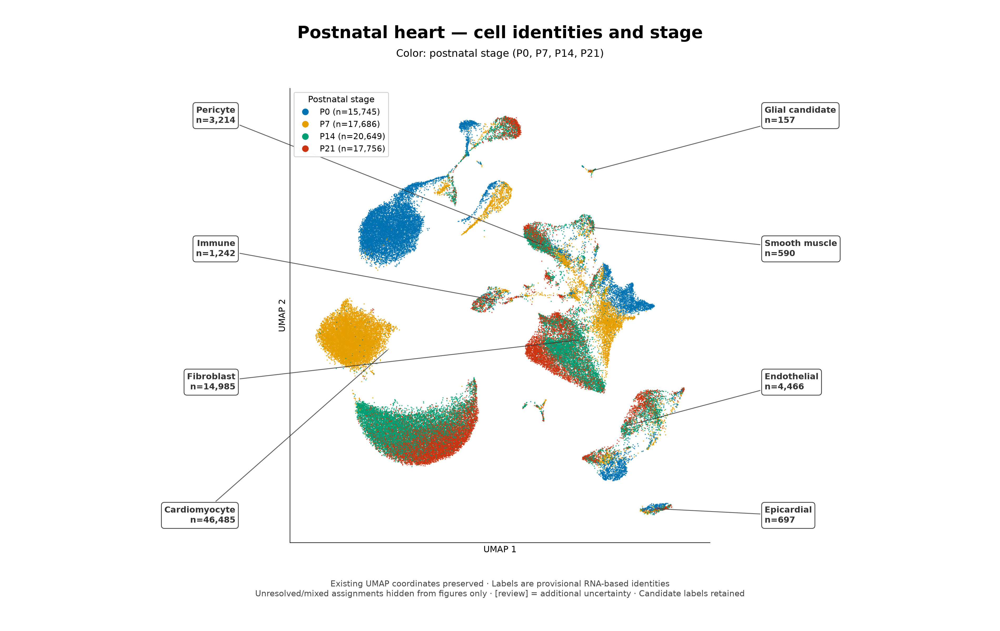

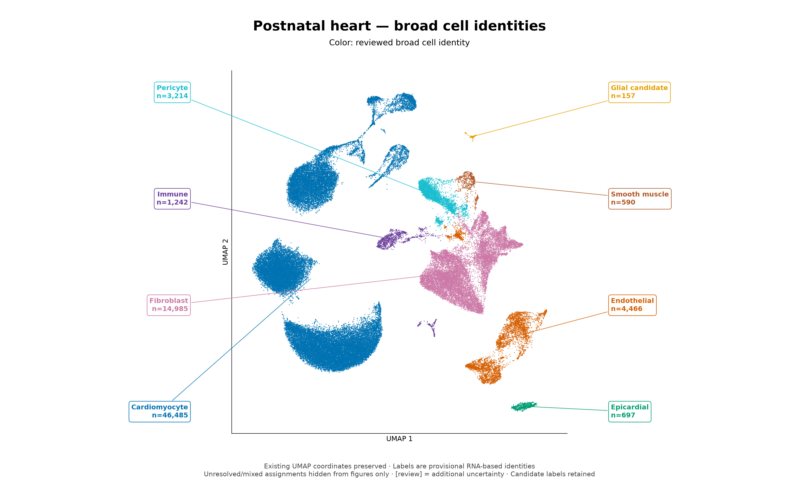

## Cardiomyocyte

[Stage overlay (PNG)](Cardiomyocyte_stage_labeled.png) · [Four-stage comparison (PNG)](Cardiomyocyte_stage_facets.png) · [Stage overlay (PDF)](Cardiomyocyte_stage_labeled.pdf) · [Four-stage comparison (PDF)](Cardiomyocyte_stage_facets.pdf)

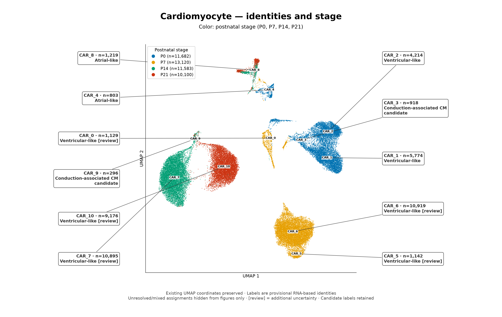

[Subtype view (PNG)](Cardiomyocyte_subtypes_labeled.png) · [Subtype view (PDF)](Cardiomyocyte_subtypes_labeled.pdf) · [Subcluster view (PNG)](Cardiomyocyte_subclusters_labeled.png) · [Subcluster view (PDF)](Cardiomyocyte_subclusters_labeled.pdf)

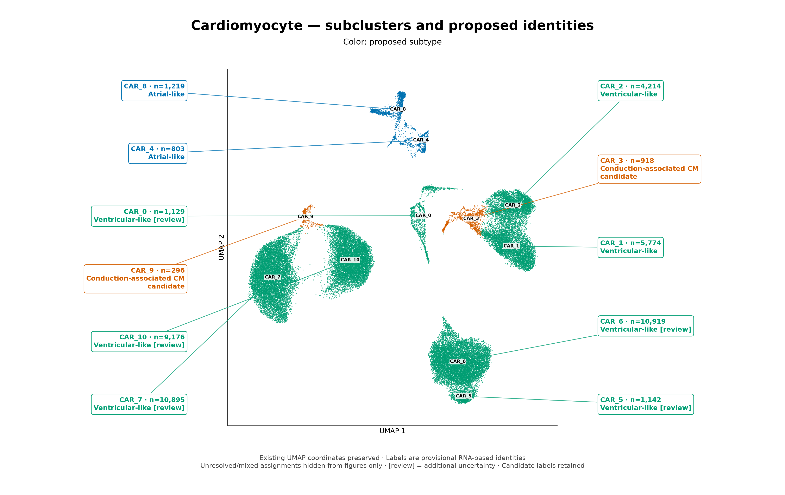

## Fibroblast

[Stage overlay (PNG)](Fibroblast_stage_labeled.png) · [Four-stage comparison (PNG)](Fibroblast_stage_facets.png) · [Stage overlay (PDF)](Fibroblast_stage_labeled.pdf) · [Four-stage comparison (PDF)](Fibroblast_stage_facets.pdf)

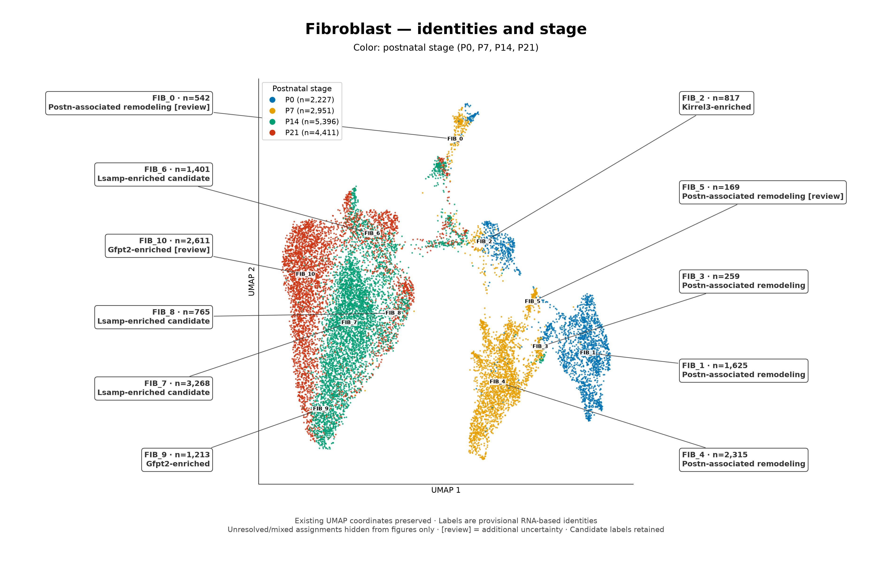

[Subtype view (PNG)](Fibroblast_subtypes_labeled.png) · [Subtype view (PDF)](Fibroblast_subtypes_labeled.pdf) · [Subcluster view (PNG)](Fibroblast_subclusters_labeled.png) · [Subcluster view (PDF)](Fibroblast_subclusters_labeled.pdf)

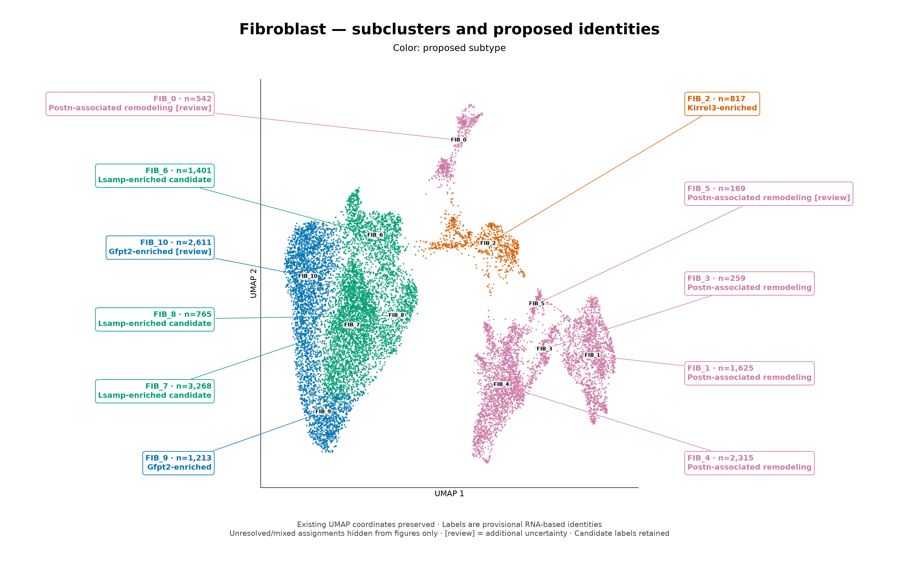

## Endothelial

[Stage overlay (PNG)](Endothelial_stage_labeled.png) · [Four-stage comparison (PNG)](Endothelial_stage_facets.png) · [Stage overlay (PDF)](Endothelial_stage_labeled.pdf) · [Four-stage comparison (PDF)](Endothelial_stage_facets.pdf)

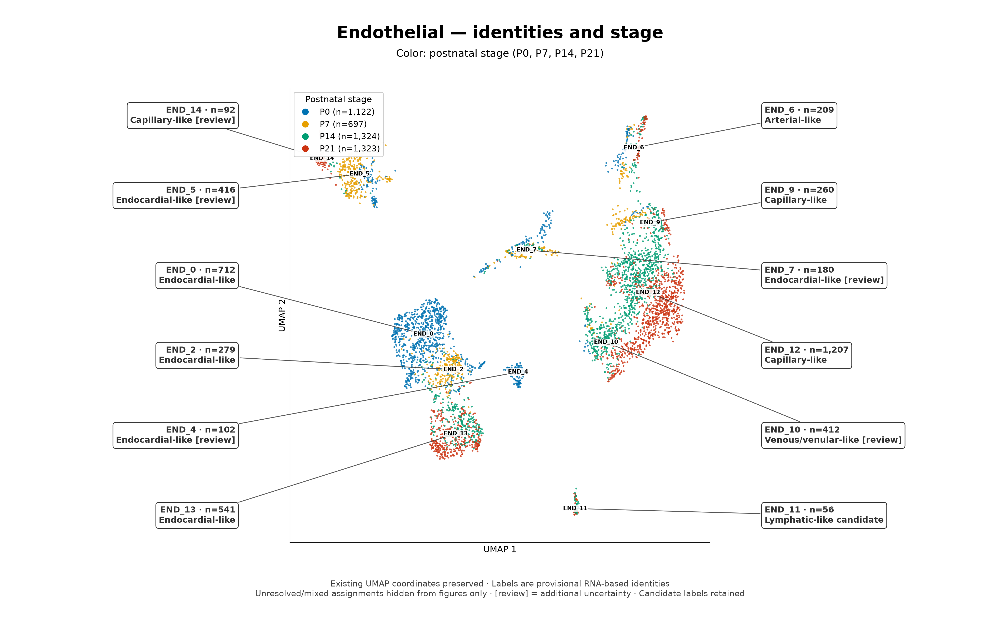

[Subtype view (PNG)](Endothelial_subtypes_labeled.png) · [Subtype view (PDF)](Endothelial_subtypes_labeled.pdf) · [Subcluster view (PNG)](Endothelial_subclusters_labeled.png) · [Subcluster view (PDF)](Endothelial_subclusters_labeled.pdf)

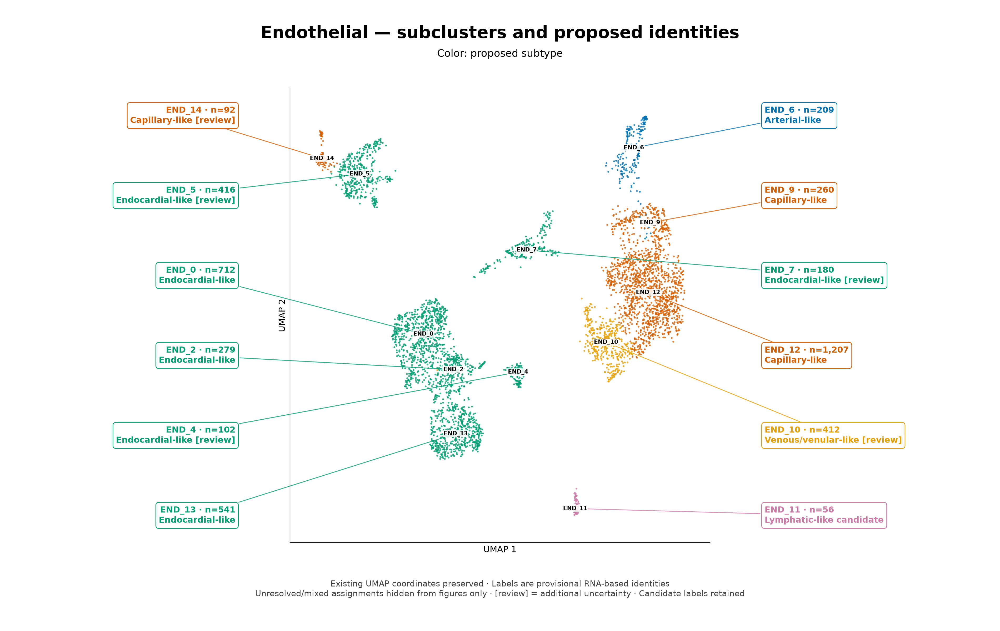

## Mural

[Stage overlay (PNG)](Mural_stage_labeled.png) · [Four-stage comparison (PNG)](Mural_stage_facets.png) · [Stage overlay (PDF)](Mural_stage_labeled.pdf) · [Four-stage comparison (PDF)](Mural_stage_facets.pdf)

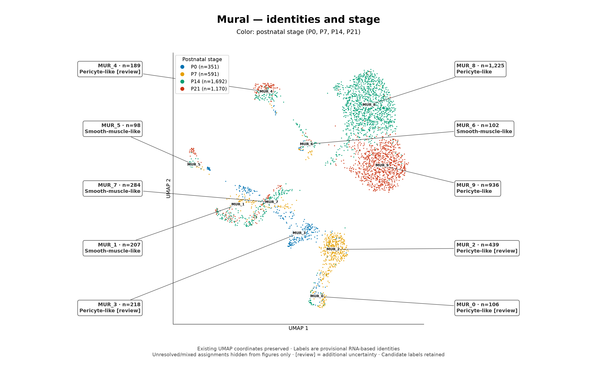

[Subtype view (PNG)](Mural_subtypes_labeled.png) · [Subtype view (PDF)](Mural_subtypes_labeled.pdf) · [Subcluster view (PNG)](Mural_subclusters_labeled.png) · [Subcluster view (PDF)](Mural_subclusters_labeled.pdf)

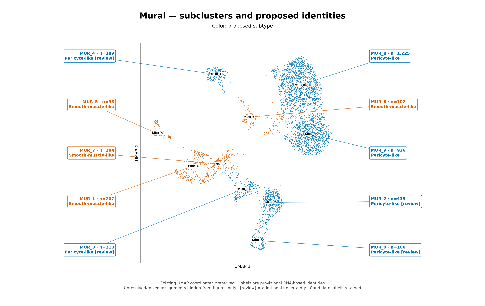

## Immune

[Stage overlay (PNG)](Immune_stage_labeled.png) · [Four-stage comparison (PNG)](Immune_stage_facets.png) · [Stage overlay (PDF)](Immune_stage_labeled.pdf) · [Four-stage comparison (PDF)](Immune_stage_facets.pdf)

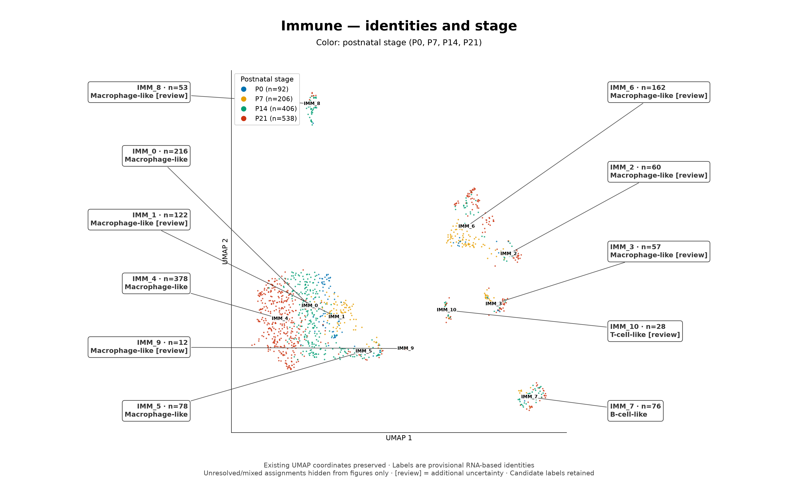

[Subtype view (PNG)](Immune_subtypes_labeled.png) · [Subtype view (PDF)](Immune_subtypes_labeled.pdf) · [Subcluster view (PNG)](Immune_subclusters_labeled.png) · [Subcluster view (PDF)](Immune_subclusters_labeled.pdf)

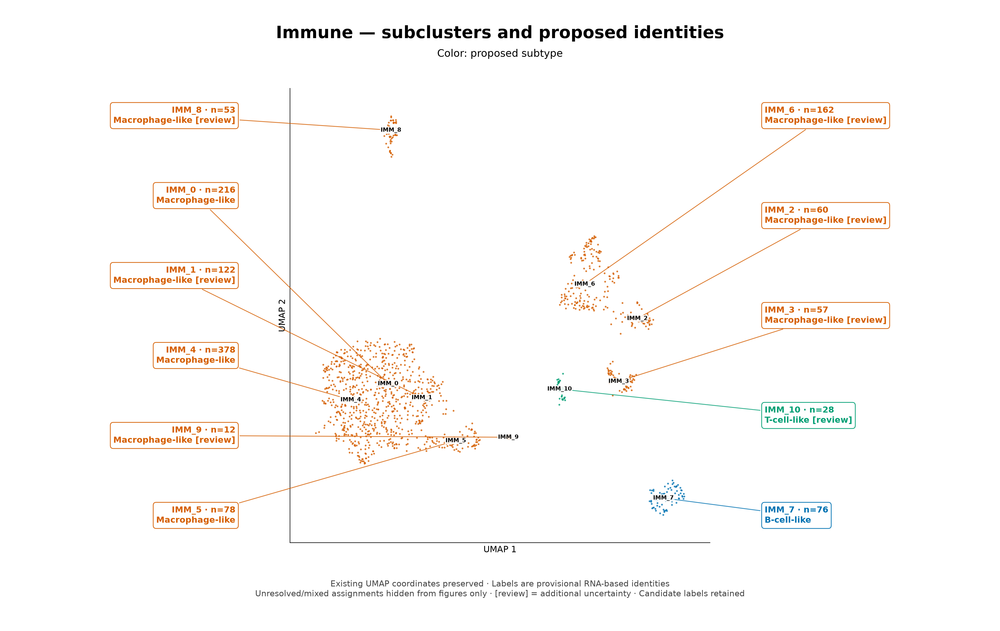

## Reproduce

Run `python analysis/plot_labeled_umaps.py` in the analysis environment. Inputs are the existing annotation CSVs in `results/cell_identities_subtypes`; no expression reanalysis is performed. `manifest.json` lists plotted nucleus counts, coordinate columns and artifact checksums.
