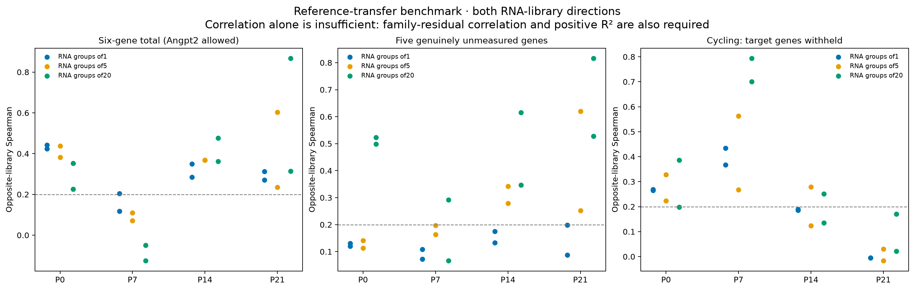
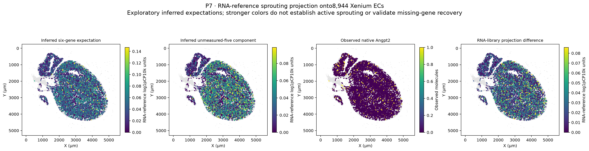

# RNA-inferred sprouting layer on the Xenium atlas

**Yes: a program absent from the Xenium panel can be added as an explicitly inferred RNA-reference annotation.** This is now implemented for all four stages. It provides an expected sprouting-associated RNA score at eligible Xenium EC positions, separate from observed transcripts. The observed403-gene matrices and five-type EC taxonomy remain unchanged.

[Illustrated report](RNA_inferred_sprouting_Xenium_report.pdf) · [Whole-heart inferred annotation layer](all_cardiac_cells_with_inferred_sprouting_layer.tsv.gz) · [Benchmark summary](primary_benchmark_summary.tsv) · [Projection coverage](projection_coverage.tsv) · [Raw/boundary/reference sensitivity](projection_sensitivity_summary.tsv) · [Validation](validation.json)

## What was added

- `inferred_sprouting_score_6g`: reference-derived expected expression of **Apln, Esm1, Angpt2, Cxcr4, Pgf and Adm**.
- `inferred_unmeasured_sprouting_score_5g`: the five genes **excluding measured Angpt2**, reported separately so measured-gene information cannot masquerade as validated recovery of missing genes.
- `inferred_neighborhood5_*` and `inferred_neighborhood20_*`: measured Xenium RNA pooled over five ECs within75µm or20 ECs within150µm, projected to corresponding RNA metacells. These overlap and are not independent observations or single-cell activity labels.
- Per-gene RNA-reference predictions in `obsm['inferred_sprouting_genes_RNA_log1pCP10k']`, plus measured Angpt2 counts and source/uncertainty metadata. The five unmeasured genes are **not** inserted into observed `var`/`X` or count layers.

| Stage | ECs with inferred layer | Five-EC positions | Twenty-EC positions |
|---|---:|---:|---:|
| P0 | 3,732 | 3,686 | 3,676 |
| P7 | 8,944 | 8,816 | 8,770 |
| P14 | 8,086 | 7,497 | 7,342 |
| P21 | 8,601 | 7,658 | 7,405 |

There are29,363 projected ECs and408,054 original cardiac positions in the whole-heart annotation layer. Unprojected profiles retain missing scores and their explicit QC/non-EC status. No subtype label or score quota forces a profile into an angiogenic state. Scores condition on the matched-age RNA reference, so between-stage differences can reflect that reference rather than independent spatial validation.

## Reference alignment and target definition

Each stage uses its own previously QC-selected EC RNA reference, totaling4,597 nuclei across eight RNA libraries. Same-age shared measured genes determine30 soft cosine neighbors (temperature0.1), with separate-assay scaling,SDfloor0.25,clipping5 and L2 normalization. Per-gene reference log1pCP10k expression is averaged with these weights; program scores average the relevant genes. These are expected normalized RNA-reference values, **not Xenium transcript counts or probabilities of active sprouting**. No spatial coordinate, inferred target label or desired program score enters the neighbor fit.

Measured Angpt2 is allowed in the primary alignment because it is actually available on Xenium. The five genuinely unmeasured targets and six cycling-control targets are absent from fitting genes. Angpt2 withholding is a sensitivity that also removes it from the predictor normalization denominator. RNA reference gene-support tables show where target genes were sparse or absent before any transfer. In particular, an unexpressed reference gene cannot become independent spatial evidence through projection.

This differs from the earlier conservative Ridge/rank-excess benchmark: it transfers reference gene-expression expectations, allows observed Angpt2 and evaluates disjoint RNA metacells as well as individual nuclei. The earlier benchmark remains intact. The present six-gene total can benefit from measured Angpt2, which is why the unmeasured-five score and its validation are central.

## Technical support for the unmeasured component

Both RNA-library directions at the same age must achieve Spearman>=0.2, within-family residual Spearman>=0.15 and positive out-of-library R². The primary setting is assay-scaled30-neighbor transfer; Pearson,10/60-neighbor and Angpt2-withheld settings are reported transparently rather than selecting a winner from the same held-out data.

| Stage | Individual RNA reference | Five-nucleus RNA groups | Twenty-nucleus RNA groups |
|---|---|---|---|
| P0 | Below gate | Below gate | Below gate |
| P7 | Below gate | Below gate | Below gate |
| P14 | Below gate | Below gate | Below gate |
| P21 | Below gate | Below gate | Pass in both libraries |

**Fine recovery of the five unmeasured genes remains weak.** Coarse20-nucleus P21 RNA groups meet this technical gate, which is limited support at a coarser level, not independent spatial validation. The total six-gene score is more recoverable at some ages, but part of that is measured Angpt2. All released spatial scores therefore remain explicitly **exploratory reference-derived hypotheses**. A high score alone does not establish tip-cell identity, completed sprouting or increased vessel formation.



## Files and use

For each `P*/` directory:

- **`Xenium_ECs_with_inferred_sprouting.h5ad`** is ready to load. `X` contains original observed native Xenium counts for403 targets. `layers['nuclear_only']` and `layers['boundary_core']` retain observed ownership views. `obs` contains the inferred scores, QC status, RNA-library difference, boundary difference and reference-similarity flags. `obsm['spatial']` holds original micrometer coordinates. Predicted gene expression is a separate `obsm` table, never a count layer.
- `EC_annotations_with_inferred_sprouting.tsv.gz` preserves every source EC candidate, including unprojected QC-review rows. `all_cardiac_cells_with_inferred_sprouting_layer.tsv.gz` covers every source cardiac profile. The root all-stage table combines all four sections with unique `stage_cell_id` keys.
- `neighborhood5_inferred_sprouting.tsv.gz` and `neighborhood20_inferred_sprouting.tsv.gz` give source cell IDs, physical radius and native/nuclear/core projected scores. Neighborhood values use a different RNA reference resolution and should not be compared numerically to single-nucleus scores as the same estimator.
- Nuclear/native/core detailed tables contain raw-reference and neighborhood-size sensitivities. Neighbor NPZ files store exact RNA source IDs and weights for reproducibility. Reference-neighbor score SD describes reference heterogeneity, not a calibrated uncertainty interval.
- Opposite-library benchmarks retain observed versus inferred RNA scores. RNA metacells are disjoint near-neighbor groups formed only from measured fitting genes, with small final remainders merged into a nearby group. Group sizes/source nuclei are exported. Sparse reference groups cap the effective number of neighbors; requested and effective counts are both recorded.

```python
import scanpy as sc
ec = sc.read_h5ad("P7/Xenium_ECs_with_inferred_sprouting.h5ad")
sc.pl.embedding(ec, basis="spatial", color=[
    "inferred_sprouting_score_6g",
    "inferred_unmeasured_sprouting_score_5g",
])
inferred_genes = ec.obsm["inferred_sprouting_genes_RNA_log1pCP10k"]
```



## Limits and provenance

This projection preserves source counts, coordinates, gene targets and EC labels. A low nearest-reference similarity, source-library difference or boundary sensitivity flags possible instability; none independently calibrates biological accuracy. Pooling can span adjacent vessels and increases spatial smoothing. Two RNA libraries per age are not assumed independent animals; one Xenium section per age does not establish reproducible developmental spatial rates. Inferred Apln/Esm1 require direct experimental validation before being treated as measured locations.

Reproduce with `python analysis/project_RNA_sprouting_to_Xenium.py --stage P0` (andP7/P14/P21), then `analysis/report_projected_sprouting.py` and `analysis/validate_projected_sprouting.py`. Original input matrices remain in `results/endothelial_QC_subtypes/`. `validation.json`, source count hashes and the file manifest record exact count preservation, weighted-reference reconstruction, withheld targets, RNA-metacell membership, spatial pool radii and complete atlas coverage.
