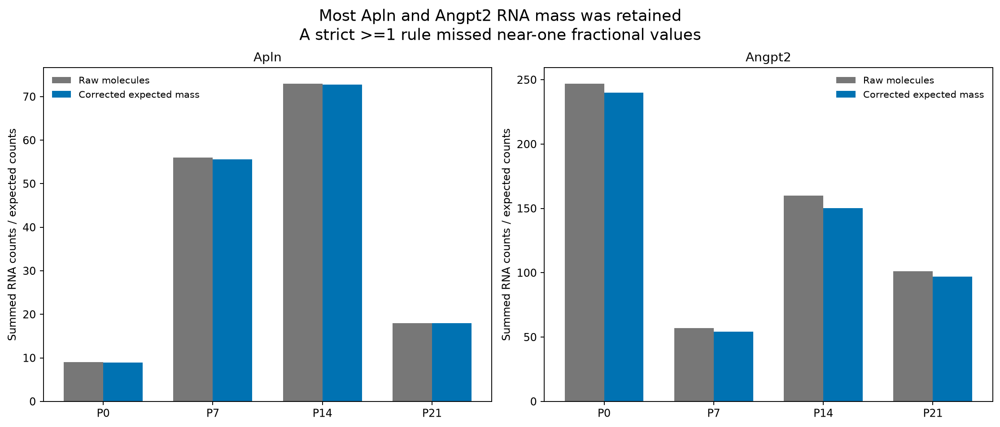
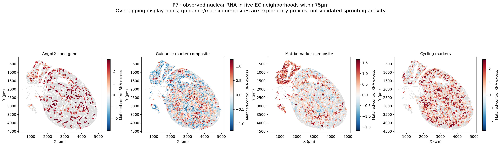

# Improved vascular-program detection: fractional RNA, pooling and validation

The main correctable problem was **using an integer detection threshold on fractional DecontX estimates**, rather than loss of most sprouting RNA. P7 Apln retains55.6 of56 raw molecules, but the legacy>=1 corrected-count rule counted only5 nuclei. Fractional-aware support recovers47 nuclei. The correction is to quantification and interpretation; no raw molecules are restored and original count matrices are unchanged.

[Illustrated report](vascular_detection_enhancement_report.pdf) · [Fractional/gene/background audit](RNA/fractional_count_and_background_audit.tsv) · [Both-library support](RNA/gene_support_across_two_libraries.tsv) · [Spatial panel coverage](RNA_Xenium_program_coverage.tsv) · [Adaptive pool coverage](all_stage_adaptive_pool_coverage.tsv) · [Validation](validation.json)

## Corrected interpretation of low-count RNA

| Stage | Apln raw molecules | Corrected expected mass | Legacy positive nuclei | Fractional-aware support ≥0.25 | Both-library pseudobulk support |
|---|---:|---:|---:|---:|---|
| P0 | 9 | 8.93 | 0 | 9 | False |
| P7 | 56 | 55.59 | 5 | 47 | True |
| P14 | 73 | 72.75 | 17 | 38 | True |
| P21 | 18 | 17.95 | 2 | 11 | True |

Fractional-aware expected-count thresholds0.1,0.25,0.5 and1 are all reported. The alternative support rule always requires an original raw observation; positive numerical dust alone does not qualify. Both-library pseudobulk support means corrected expected mass>=5 plus>=3 nuclei with expected count>=0.25 in each same-age library; it is an exploratory criterion, not independently calibrated accuracy. The full corrected mass and original observations are more informative than one binary threshold.

**Earlier cycling percentages also need qualification.** The old>=1 corrected-count rule was overly conservative for this fractional matrix. Raw-observed support at corrected expected count>=0.5 gives:

| Stage | Legacy ≥1 rule | Fractional-aware ≥0.5 + raw evidence |
|---|---:|---:|
| P0 | 3.04% | 5.68% |
| P7 | 2.88% | 8.52% |
| P14 | 1.13% | 1.61% |
| P21 | 0.08% | 0.24% |

For cycling, thresholds0.1/0.25/0.5 give identical counts here and agree with the original raw two-marker rule. This supports an early-to-late decline and a higher observed P7 fraction than P0 in this frozen cohort; it does not establish a population-level biological peak or a histological proliferation rate. The earlier3.04/2.88/1.13/0.08% values remain reproducible **strict-threshold counts**, not the best current prevalence estimates. Existing five-type identities and prior QC cohorts remain unchanged.

## RNA enhancement and background audit

The 4,597 primary EC nuclei are rescored without overwriting counts. Library-level expected-mass pseudobulks reduce dropout; fractional thresholds expose cutoff effects. Top1500 rank enrichment subtracts20 expression/detection-matched control genes per target; top3000 is a sensitivity. Controls are selected using equal-weight library raw expression and detection, excluding programs, lineage diagnostics, mitochondrial/ribosomal and sex genes. All stages share the same controls. A0.001 numerical-dust floor avoids treating arbitrarily tiny residuals as expressed genes. These are diagnostic enrichment scores, not pathway activation probabilities.

The original six-gene panel is kept separate from an expanded sprouting/guidance-support panel, an EC matrix-remodeling panel and a cycling control. New panels include multifunctional and inhibitory genes and do not redefine the original tip-cell biology. `RNA/within_library_gene_coherence.tsv` reports leave-one-gene-out correlations after log depth, ambient fraction and source EC-family adjustment. Cycling is comparatively coherent. Guidance/remodeling composites have weak single-nucleus coherence; more covered genes must not be described as established coordinated activation.

The whole RNA reference is independently audited for target-gene abundance in each lineage/library. Non-EC cellular RNA supplies a background **sensitivity proxy**, not measured empty-droplet soup. The output compares raw EC enrichment, retained expected mass, expected cellular background and a2-times-background residual sensitivity. Such evidence can flag candidate overattenuation but cannot validate a new ambient model or justify restoring counts. For P7 Apln/Angpt2, the mass-retention audit supports correcting the binary rule rather than inferring major decontamination loss.

`RNA/former_QC_review_EC_sensitivity.tsv` examines previously reviewed ECs using raw-supported fractional lineage markers with residual foreign-program and coherent mural-group exclusions. This is a secondary sensitivity cohort; no nucleus or subtype label is silently added to the frozen primary reference. Original all-EC capture, QC and library biases remain.

## Spatial enhancement with measured RNA

The original six-gene sprouting panel has only **1/6 targets on Xenium: Angpt2**. Apln, Esm1, Cxcr4, Pgf and Adm are not measured. We report the following distinct observed views:

| Spatial view | Directly measured genes | Interpretation |
|---|---|---|
| Angpt2 | Angpt2 | Single-gene evidence, not a six-gene program |
| Guidance-associated composite | Angpt2, Unc5b, Plxnd1, Itgb3, Lama4 | Exploratory guidance/remodeling proxy; weak gene coherence |
| EC matrix-associated composite | Mmp2, Itga5, Itgb3, Fn1 | Exploratory remodeling proxy; lineage/boundary sensitive and shared with other cells |
| Cycling | Mki67, Top2a, Cenpf | Proliferation-associated RNA, separate from tip/stalk identity |

The primary spatial cohort is fixed before outcome scoring: original broad EC identity plus nuclear-broad-clean evidence, excluding multiple projected nuclear components and unresolved geometry. It contains29,363 profiles across four sections. Native, refined whole-cell, boundary-core, nuclear and exact molecule-depth controls all use identical source profiles. No QV threshold is lowered, previously unassigned RNA added or missing gene imputed.

Non-overlapping25/50/100µm tiles require>=5 selected EC profiles and preserve RNA counts. The50µm cohort can be spatially selective because sparse regions fail the minimum. Five-nearest-EC pools within75µm provide a higher-coverage display:89-99% of the **selected** EC positions, not all heart ECs. Pools overlap and can span neighboring vessels. They are neighborhood expression estimates, never independent observations or individual-cell functional labels. Source cell IDs and maximum distances are supplied for each pool. The stricter cell-and-nuclear-clean cohort is a separate50µm sensitivity.

Pooling increases multi-gene detection at the cost of resolution. Profile-versus-pool coverage uses different units and is not a validated sensitivity ratio. Coherence and cross-view comparisons use non-overlapping tiles, with depth, EC count and CM-RNA fraction diagnostics. Displayed guidance/matrix scores are observed marker composites with matched-control excess. They do **not** establish coherent sprouting programs, especially where held-out gene correlations are weak or inconsistent. P21 matrix coherence is particularly uncertain. Color scales are descriptive within-section scores, not comparable rates across animals/ages.

## Missing-gene inference gate

All program genes are withheld from the364 shared RNA fitting genes. Same-age opposite-library Ridge regression (alpha10; SD floor0.25; clipping±5) predicts corrected rank scores. Required gates are Spearman>=0.2, within-family residual Spearman>=0.15 and positive query R² in both directions. No program passes all gates in this benchmark, so missing-gene inferred program maps are **not released**. This is one conservative technical test, not proof that every possible inference method must fail. Mapping broad cell identity is different from recovering a rare unmeasured state program.

## Result and remaining validation

We recovered legitimate low-count RNA evidence and increased spatial neighborhood coverage. We did not establish a universally coherent six-gene sprouting program or manufacture missing spatial measurements. Esm1 remains genuinely sparse, including zero raw P7 EC molecules. Direct Apln/Esm1 spatial validation would need additional measured targets, for example targeted RNA in situ combined with EC, membrane and nuclear markers. Proliferation is still the strongest early-growth signal; guidance and ECM composites retain their exploratory status.

There are two RNA libraries per age and one Xenium section per age. These are not assumed independent animal replicates, and no organ-wide rate, causal vascular-growth or independently calibrated detection-accuracy claim is made. The five requested EC identity categories are preserved.

Reproduce in order with `analysis/enhance_vascular_RNA_detection.py`, `analysis/enhance_vascular_Xenium_detection.py --stage P0` (andP7/P14/P21), `analysis/report_vascular_detection.py`, then `analysis/validate_vascular_detection.py`. Shared definitions are in `analysis/vascular_detection_common.py`. Earlier source matrices and QC remain under `results/endothelial_QC_subtypes/`. `validation.json` and `file_manifest.tsv` record data-level checks and SHA256 hashes.
