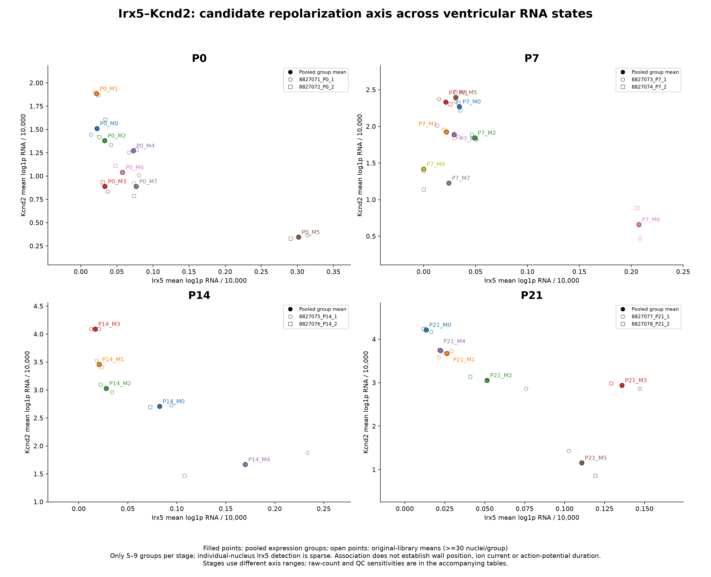

# Additional axes for ventricular cardiomyocyte segregation

The strongest new literature-grounded axis is **electrical/repolarization specialization**, followed by within-stage maturation and chamber context. These axes can overlay the same cells; an extra axis is not automatically an extra discrete cell type. This follow-up checks 94 genes in the same 44,463 ventricular-enriched nuclei and does not refit clusters or assign endocardial/epicardial/LV/RV/current/ploidy/clock labels.

## The linked Cell paper

**Costantini et al., Cell 2005**, [The homeodomain transcription factor Irx5 establishes the mouse cardiac ventricular repolarization gradient](https://doi.org/10.1016/j.cell.2005.08.004), PMID16239150. NCBI’s PII metadata verifies that this is the user’s exact link.

The central mechanism is **Irx5 repression of Kv4.2/Kcnd2**, through recruitment of the mBop/Smyd1 corepressor. Irx5 and Kv4.2 have opposing myocardial gradients. Loss of Irx5 increases endocardial Kv4.2 and fast transient outward potassium current (Ito,f), disrupting the repolarization gradient and increasing arrhythmia susceptibility. This provides a functional electrical axis beyond metabolic or mechanical programs.

A [2022 primary follow-up](https://doi.org/10.1152/ajpheart.00572.2021), PMID35245131, explicitly supports Kcnip2 and links Irx5/Ito effects to transmural calcium transients and contractility. Kcnip2 should not be attributed solely to the accessible2005 abstract. Smyd1 is a corepressor and need not show the opposite spatial pattern itself. Do not average Irx5 and Kcnd2 into one unsigned positive-gene score.

**Access limit:** the linked paper’s primary abstract and metadata were verified. Publisher/full-body APIs were unavailable (BioC returns no article, EPMC fulltext fails, PMC efetch returns front matter/abstract). Original experimental mouse ages could not be verified, so this review does not assume the established gradient is already fully developed at P0/P7. Other accessible full texts and the follow-up are documented in source files; no unavailable original methods were invented.

## What the current RNA data show

- **Direction-compatible electrical variation:** Irx5 and Kcnd2 have weak negative individual-nucleus Spearman associations in all eight original libraries, approximately−0.05 to−0.19. The same direction persists before ambient correction. After RNA-depth/complexity/contamination/mitochondrial/cycling adjustment, correlations weaken to approximately−0.02 to−0.10. No nucleus-level significance tests are used as biological replication.
- **Several Slit2-associated groups are relatively Irx5-enriched and Kcnd2-reduced.** Examples include P0_M5, P7_M6, P14_M4 and P21_M5. P21_M5 is only 72 nuclei and remains a candidate. Thus the electrical axis partly overlaps the earlier regional program; it is not proven to create an independent additional cell type.
- **Irx5 detection is sparse.** At>=1 corrected count, only approximately 0.2–1.5% of nuclei per stage meet detection, compared with 2.4–7.0% in original counts. Low corrected fractions also reflect fractional ambient-corrected values falling below the one-count detection threshold. A single-gene high/low cell classifier is not justified.
- **Kcnd2/Kcnip2 RNA is more readily detected in later samples.** This is compatible with developmental electrical specialization, but stage and stage-specific batch are partly confounded. RNA does not establish potassium current, action-potential duration, conduction speed or physical wall location.
- **The sign is not driven only by restored Slit2 references.** Original-core analyses retain a weak inverse association. Conditioning on existing RNA states further weakens it, showing overlap with current group structure. Such conditioning can also remove genuine regional biology and does not disprove regulation.



[PNG](Irx5_Kcnd2_expression_axis.png) · [PDF](Irx5_Kcnd2_expression_axis.pdf) · [Exact group profiles](electrical_axis_cluster_profiles.tsv)

Points are pooled group means and original-library means (only groups with>=30 nuclei in that library). Only 5–9 groups exist per stage, so strong group-mean correlations are not independent biological replication. Some P7 library-level group-mean associations are not inverse. Different axis ranges are used between stages; colors do not establish common cell identities across ages.

| Stage | Irx5 detection | Kcnd2 detection | Kcnip2 detection | Smyd1 detection |
|---|---:|---:|---:|---:|
| P0 | 1.2% | 49.0% | 6.9% | 49.8% |
| P7 | 0.2% | 62.6% | 4.7% | 32.9% |
| P14 | 0.6% | 95.3% | 33.8% | 73.0% |
| P21 | 1.5% | 97.4% | 38.7% | 66.3% |

Detection means>=1 corrected count. The full tables include original-count sensitivity, continuous log expression and each library separately.

## Other useful ways to stratify ventricular CMs

| Axis | Literature/readout | Relevance and current limits |
|---|---|---|
| **Repolarization/electrical specialization** | Irx5 versus Kcnd2; Kcnip2 follow-up; other potassium/sodium/gap-junction genes profiled separately | Highest-priority new functional annotation. Use multi-gene/reference-supported profiles, not an assumed endocardial/epicardial binary classifier. Functional and spatial validation remain needed. |
| **Within-stage maturation** | [DeLaughter et al., DevCell2016](https://doi.org/10.1016/j.devcel.2016.10.001), mouse E9.5–P21: Myh6/Myl2/Fabp3/Cox6c/Oxct1/Ryr2 versus early Myl7/Hmgn2/Pgam1 | Highly relevant to postnatal cells; distinguish a continuum from cell type. Maturation is multidimensional, not one universal score; compare within stage and library. |
| **LV/RV and regional identity** | [Litvinukova et al., Nature2020](https://doi.org/10.1038/s41586-020-2797-4): adult-human RV-enriched PRELID2/MYH6/CDH13; embryonic-mouse Hand1/Tbx5 versus Mfap2/Mcam references | Valuable, but needs an age-matched anatomical reference or Xenium mapping. Adult-human markers are not a validated neonatal-mouse classifier. DeLaughter reports embryonic chamber programs converge before birth. Hand1/Mfap2/Mcam are too sparsely detected here for a clean classifier. |
| **ECM-transcript-positive developmental CMs** | DeLaughter2016 reports Col1a1/Col3a1/Dcn and Tnni3–Col3a1 protein validation in isolated P0/P3 CMs | Distinct candidate beyond the prior mechanics program. Must challenge ambient RNA, remaining doublets and possible over-subtraction of real shared genes. Current corrected data do not support a clean multi-gene ECM subgroup. |
| **Circadian/electrical state** | [Schroder et al., HeartRhythm2015](https://doi.org/10.1016/j.hrthm.2015.02.019): CM Bmal1 regulates Kcnh2 and repolarization | Biological state/time-of-harvest confound, not necessarily a stable type. Analyze positive/negative clock limbs separately; do not average Arntl/Clock with phase-shifted Per/Cry genes. Harvest-time metadata are not present in the analyzed cell annotations. |
| **Ploidy/nucleation and regenerative competence** | [Patterson et al., NatGen2017](https://doi.org/10.1038/ng.3929): Tnni3k influences mononuclear-diploid CM abundance | Important postnatally, but requires DNA-content/intact-cell nucleation measurements. Tnni3k expression, total RNA and cycling genes do not classify cell ploidy or mono/binucleation. |

Additional anatomical reference: [Li et al., DevCell2016](https://doi.org/10.1016/j.devcel.2016.10.014). Embryonic heart-field/chamber signatures should not be transferred directly to postnatal nuclei. The adult-human atlas also reports candidate electrical/neuronal-associated DLC1/EBF2/SOX5/EBF1/KCNAB1 variation, but does not verify Purkinje identity. Those mouse orthologs are profiled as exploratory markers, not assigned as a subtype.

## ECM sensitivity result

Original counts contain **1,420** nuclei with at least two of Col1a1/Col3a1/Dcn detected. After ambient correction, **0** meet the joint criterion of>=2 ECM genes and>=2 of Tnnt2/Tnni3/Myh6/Myl2. This is a strong correction sensitivity, not proof that genuine ECM-producing CMs are absent. Original signal could reflect ambient RNA, unresolved doublets or a real shared transcriptional program removed by the correction model. Alternative decontamination sensitivity and independent RNA/protein colocalization are needed before declaring an ECM-CM subtype. Whole-cell and nuclear RNA preparations also differ.

## Practical recommendation

Annotate existing ventricular groups along **electrical, maturation and regional programs**, retaining cycling, sex/QC and collection-time context. These can be continuous and overlapping. Test electrical candidates against an age-matched anatomical reference or Xenium and functional electrical/calcium measurements. Do not force additional Leiden clusters solely to match each literature category. ECM and ploidy require particularly careful orthogonal validation.

## Data and sources

- [Stage/library/group expression and detection](gene_profiles_by_stage_library_cluster.tsv)
- [Within-library gene associations and raw/QC sensitivity](within_library_gene_associations.tsv)
- [Electrical gate/state sensitivity](electrical_axis_gate_state_sensitivity.tsv)
- [Targeted per-cell log expression](targeted_log_expression.csv.gz), [feature mappings](gene_mapping.tsv)
- [ECM/CM coexpression counts](ECM_CM_coexpression_counts.tsv), [corrected coexpression candidates](ECM_coexpression_candidates.csv.gz)
- [Linked paper and follow-up provenance/access levels](sources/linked_cell_paper.json)
- [Other verified primary papers, species/age/genes/limitations](sources/other_primary_papers.json)
- [Methods](methods.json), [validation/checksums](manifest.json)

The same 44,463 ventricular-enriched nuclei and existing 28 groups are used; no cells or expression values in the original H5AD are changed. For duplicated gene symbols, one original feature with highest pooled corrected-count abundance is selected. Corrected and original integer counts are independently normalized to 10,000 per nucleus then log1p transformed. Source counts are not rounded or batch-adjusted. Targeted output is expression, not a full count matrix. No causal inference, calibrated classification or animal-level statistical significance is claimed; the two libraries are not assumed independent animals.

```bash
python analysis/check_ventricular_additional_axes.py --input /path/to/snrna_qc_annotated_subclustered.h5ad
python analysis/ventricular_electrical_axis_sensitivity.py
python analysis/plot_ventricular_electrical_axis.py
python analysis/validate_ventricular_additional_axes.py
```
