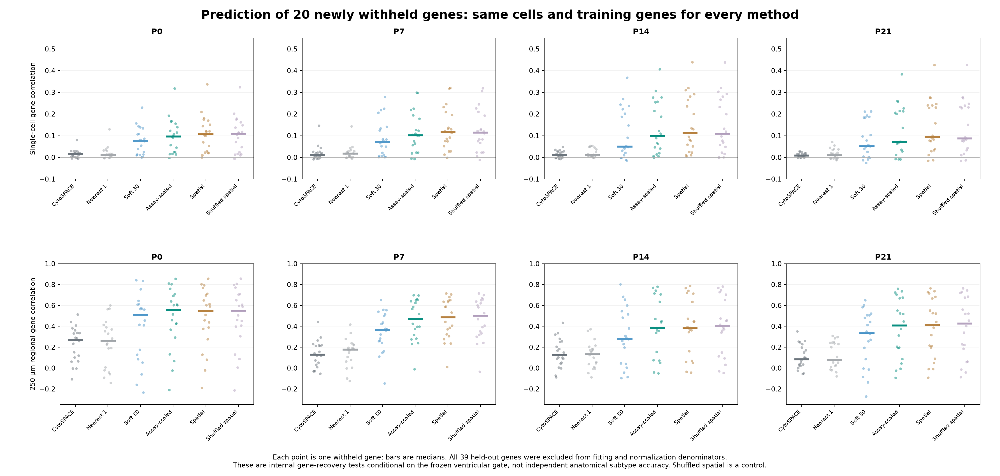

# Improving ventricular RNA–Xenium alignment with internal tests

**Weighted reference projection improves held-out measured-gene recovery at all four ages in this comparison.** It combines multiple reference nuclei, adjusts gene scales within each assay and allows projected subtype proportions to differ from the source RNA proportions. This improves expression prediction; it does not by itself prove the correct anatomical placement of every fine subtype.

| Stage | CytoSPACE cell ρ | Weighted cell ρ | CytoSPACE regional ρ | Weighted regional ρ |
| --- | --- | --- | --- | --- |
| P0 | 0.016 | 0.096 | 0.270 | 0.558 |
| P7 | 0.011 | 0.102 | 0.130 | 0.470 |
| P14 | 0.011 | 0.099 | 0.125 | 0.384 |
| P21 | 0.009 | 0.072 | 0.085 | 0.410 |

Values are median Spearman correlations across **20 newly withheld genes**, evaluated on exactly the same cells and 342 training genes. Regional values average cells in fixed 250 µm bins with at least 20 cells. No gene test p-values or animal-level confidence intervals are implied. The small single-cell correlations remain a material limit; regional recovery is stronger.

[Six-page PDF report: benchmark, four section maps and library comparison](alignment_improvement_report.pdf) · [benchmark PNG](withheld_gene_benchmark.png) · [all gene-level metrics](heldout_gene_metrics.tsv)



## What changed and why

1. **Allow subtype proportions to differ.** The weighted projection does not enforce the subtype mixture in the sampled RNA reference. Native CytoSPACE duplicate sampling inherits that mixture under the supplied broad label. The reference composition can still influence nearest neighbors, so absence of a quota does not remove all reference bias.
2. **Combine evidence from 30 nuclei.** A softmax-weighted set of similar RNA nuclei reduces the influence of sparse counts in any one nucleus. This is a weighted expression/program projection, not a one-to-one physical cell correspondence. The plain 30-neighbor comparison separates this averaging benefit from assay scaling.
3. **Adjust assay differences using training genes.** Log-normalized training genes are centered/scaled separately in the same-stage RNA and Xenium populations, with an SD floor 0.25 and clipping at ±5; cosine matching then uses 30 neighbors with temperature 0.10. All settings were fixed before reading the new test results. This is an unsupervised feature adjustment, not a fitted gene-wise sequencing-efficiency model. Differences in true population composition can also affect these statistics.
4. **Report ambiguity.** Each included cell retains family/fine weight fractions and independent assignments using each RNA library alone. A candidate flag requires ≥0.70 pooled neighbor weight and the same label from both libraries. Fine flags additionally require the family flag. These are descriptive evidence rules, not calibrated probabilities of correct Xenium identity.
5. **Test spatial smoothing against a control.** A fixed light spatial blend was tested alongside a coordinate-shuffled graph. Their similar gains indicate that averaging, rather than verified anatomical neighborhood information, explains much of the change. The published primary maps therefore use the **unsmoothed** weighted projection.

## Internal evaluation without circular marker validation

The new test set contains: Fgf1, Tnc, Mybphl, Lamb2, Fzd4, Acvr2a, Nr1d2, Cd46, Col8a1, Myl9, Adora1, Robo1, Itgbl1, Smc4, Runx1, Dag1, Rgs5, Col4a3, Igf1r, Jph1. It was fixed by a deterministic gene-name hash, excluding the previously evaluated 19 marker genes and a list of direct chamber/lineage anchors, before fitting. These 20 genes were not used to choose hyperparameters. All six fixed methods are reported; the new test set was not used for a search over methods or thresholds.

The 19 previously examined marker genes form a separate development/interpretation set. **All 39 genes are removed together from the matching features and even the library-size normalization denominators.** Target values from RNA are used only after matching to form predictions. Native CytoSPACE, nearest-one, plain soft30, assay-scaled soft30 and its spatial/shuffled controls use the same held-out query cells and RNA pool. These comparisons distinguish predictive gain from agreement on genes supplied to the match. [Frozen design](benchmark_design.json).

Native baseline: unmodified upstream CytoSPACE 1.1.0, seed 42, single-cell mode, a single supplied `Ventricular_CM` label, 3,000-cell partitions, two workers and molecule downsampling off, with the same corrected-reference values as the alternative methods. This is a controlled independent benchmark, not an exact author-pipeline reproduction. Commands, source hashes and training-gene lists are retained per stage.

The cohort is the preceding independently gated, QC/information-pass ventricular-enriched set: 21,994 / 38,580 / 49,656 / 58,358 cells, totaling 168,588. Published spatial labels were not used to fit or select this mapping. The previously frozen gate/classifier and QC used the original full panel, however, so these are **conditional gene-prediction tests within an existing ventricular cohort**, not completely blinded end-to-end cell annotation. No claim is made that all possible gate dependence was removed.

Evaluation additionally reports detection AUC, Pearson correlation, training-depth/cell-area/training-detected-gene-adjusted correlation and fixed-grid regional correlation. The adjustment covariates use training genes only. Cell and regional correlations measure different resolutions. Regional averaging can improve correlations by reducing noise; it is not proof of cell-level precision.

## RNA-library effects and subtype confidence

[Technical library comparison](cross_library_technical_comparison.png) · [per-label metrics](cross_library_technical_comparison.tsv) · [per-nucleus predictions](cross_library_predictions.tsv.gz) · [agreement versus weight threshold](cross_library_selective_agreement.tsv)

Each age is analyzed separately. RNA queries are tested against the opposite library, with no shared query/reference nuclei. Production maps also compare separate-library projections. This addresses sensitivity to the two available RNA libraries; it cannot establish independent-animal replication or remove stage/section confounding. RNA labels were previously defined using the combined data, so technical label recovery is not independent biological identity validation. The weight fractions become more selective at higher cutoffs in this technical test, but they are not calibrated Xenium probabilities.

| Stage | Included ventricular candidates | Family evidence flag | Fine-group evidence flag |
| --- | --- | --- | --- |
| P0 | 21,994 | 14,137 | 2,410 |
| P7 | 38,580 | 9,165 | 7,652 |
| P14 | 49,656 | 8,418 | 5,047 |
| P21 | 58,358 | 7,761 | 3,118 |

**These flags are different from the previous stringent CytoSPACE panel/seed/raw/library/marker acceptance rules.** Their counts must not be treated as an increase in independently validated subtypes or a biological abundance estimate. Both proposed labels and the numerical evidence are retained so that weak or rare distinctions can be evaluated separately. Conduction-program candidates remain RNA interpretations, not anatomically verified Purkinje cells.

## Maps and downloadable data

| Stage | Spatial maps | All-cell annotations | Weighted reference neighbors |
| --- | --- | --- | --- |
| P0 | [PNG](P0_weighted_family_maps.png) · [PDF](P0_weighted_family_maps.pdf) | [TSV.gz](P0/weighted_CM_annotations.tsv.gz) | [NPZ](P0/weighted_reference_neighbors.npz) |
| P7 | [PNG](P7_weighted_family_maps.png) · [PDF](P7_weighted_family_maps.pdf) | [TSV.gz](P7/weighted_CM_annotations.tsv.gz) | [NPZ](P7/weighted_reference_neighbors.npz) |
| P14 | [PNG](P14_weighted_family_maps.png) · [PDF](P14_weighted_family_maps.pdf) | [TSV.gz](P14/weighted_CM_annotations.tsv.gz) | [NPZ](P14/weighted_reference_neighbors.npz) |
| P21 | [PNG](P21_weighted_family_maps.png) · [PDF](P21_weighted_family_maps.pdf) | [TSV.gz](P21/weighted_CM_annotations.tsv.gz) | [NPZ](P21/weighted_reference_neighbors.npz) |

Maps retain all original section coordinates and include unassigned/excluded cells in gray. Left panels show the highest-weight family for all included cells; right panels show candidates meeting the stated evidence rules. Every original segment remains in the annotation tables, including exclusions. `weighted_family`/`weighted_fine_group` are proposals; `family_candidate`/`fine_group_candidate` add the evidence flags. `neighbor_weight_family__*` columns expose the full family weight distribution. Cell IDs are section-specific.

Each neighbor NPZ contains query and reference barcode arrays, query×30 neighbor indices/weights, label classes and family/fine weight fractions. Reference rows index the existing [RNA metadata](../xenium_ventricular_mapping/reference_metadata.tsv.gz). Prediction NPZs retain all six methods×cells×39 held-out expression predictions and measured normalized targets, with explicit gene/method/barcode arrays. No imputed values replace original Xenium counts.

## What this supports

The same datasets can support stronger **internal validation**: withhold measured genes, separate RNA libraries, compare simple baselines, test spatial controls and expose uncertainty. The improvement here is in reconstructing measured-gene variation and obtaining graded reference-program evidence. An exact RNA nucleus–Xenium cell pairing is generally not identifiable from these data. Stronger fine-subtype anatomy still benefits from independent histology, additional markers or sections.

**Kcnd2 and Irx5 remain unassayed.** Improved recovery of measured genes makes transfer more defensible but does not validate an unmeasured Kcnd2 gradient. No new Kcnd2 spatial map or guaranteed wall-depth coordinate is inferred here. The [actual published author-state maps](../author_atlas_baseline/README.md) remain a separate comparison layer.

## Reproduce and audit

```bash
OPENBLAS_NUM_THREADS=2 OMP_NUM_THREADS=2 python analysis/improve_ventricular_alignment.py
OPENBLAS_NUM_THREADS=2 OMP_NUM_THREADS=2 python analysis/audit_ventricular_alignment_improvement.py
python analysis/report_ventricular_alignment_improvement.py
```

Use the scientific Python and separate pinned CytoSPACE runtime described in the [previous report](../cytospace_xenium/README.md). Completion files skip existing stage fits; remove/rebuild the relevant derived stage outputs if deliberately changing inputs or parameters. The audit recomputes metrics and evidence flags from saved predictions and checks source hashes, all cell/coordinate joins, native IDs/reuse, neighbor bounds/weights and independently sampled projections. [Numerical validation](validation.json), [methods](methods.json) and [manifest/checksums](manifest.json).

Sources: GSE290989; Xenium Zenodo [P0/P7](https://zenodo.org/records/14961929) and [P14/P21](https://zenodo.org/records/14961942), Wang, Dong, Song, Qian and Liu, CC BY 4.0; [article](https://pmc.ncbi.nlm.nih.gov/articles/PMC13561863/). Figures are newly generated from deposited data. CytoSPACE: Vahid et al., Nature Biotechnology 2023, [DOI](https://doi.org/10.1038/s41587-023-01697-9), [source/license](https://github.com/digitalcytometry/cytospace), pinned commit `bb7fe12ab4466ef5e38dcac4c3ece07012060d60`.
