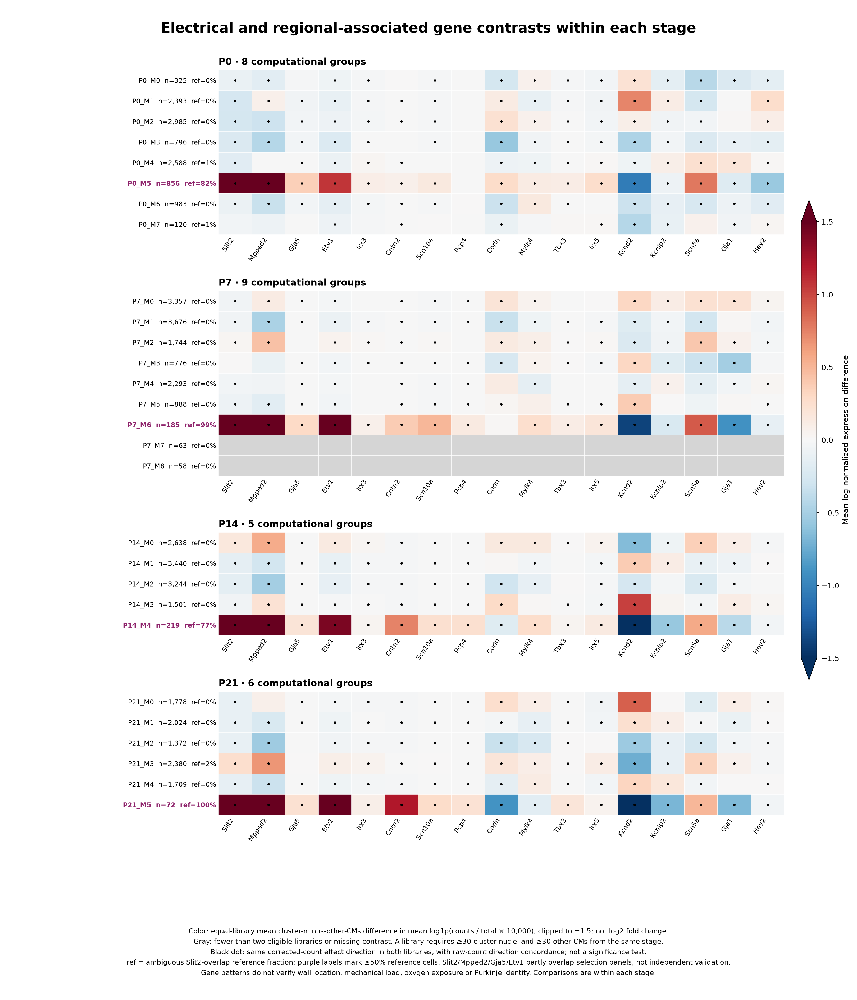

# IRX5, Slit2-associated CMs and regional electrical specialization

**The literature supports interpreting the Irx5-enriched/Kcnd2-reduced pattern as a plausible regional electrical program. Low Irx5 RNA does not imply absent IRX5 activity.** It does not establish that IRX5 becomes dispensable after the gradient forms. These are different questions, and the current nuclei measure RNA, not protein persistence, chromatin memory or ongoing functional requirement.

This follow-up reviews additional primary literature and checks 17 markers in the same **44,463 ventricular-enriched nuclei and 28 existing groups**. No cells, clusters or previous identities are changed. The strongest result is a distinction between **regional repolarization-associated variation** and a **broader conduction-program-enriched candidate pattern**. Both overlap Slit2-associated populations, but they are not interchangeable.

## What the additional papers add

| Primary paper | Evidence and insight | Limit for our interpretation |
|---|---|---|
| **Gaborit et al., Development 2012**, [Cooperative and antagonistic roles for Irx3 and Irx5](https://doi.org/10.1242/dev.081703), PMID22992950 | Postnatal myocardial combined loss changes electrical phenotypes; combined Irx3/Irx5 loss restores the repolarization gradient disrupted in Irx5 mutants. IRX-family interactions are non-additive. | Verified from the primary abstract. Exact induction age and genetic design were not verified from original methods. This is not proof that isolated adult Irx5 loss is harmless or that only developmental establishment matters. |
| **Oh et al., Nature Communications 2024**, [Transcriptional regulation of the postnatal cardiac conduction system heterogeneity](https://doi.org/10.1038/s41467-024-50849-1), PMID39095365 | Reporter-enriched P1/P2/P4 cells, P4 spatial profiling and histology identify **Slit2/Sema3a in distal ventricular conduction regions**. Mpped2, Scn10a and Pcp4 provide complementary regional information. Irx3/Tbx3 perturbations alter Slit2/Mpped2 expression in neonatal ventricular CMs. | Strong independent, age-relevant source. Some markers also extend along endomyocardium. Overexpression-induced expression does not prove a direct IRX5→Slit2 regulatory relationship. Reporter-enriched whole cells are not an unbiased census or the same assay as our nuclei. |
| **Zhang et al., PNAS 2011**, [Irx3 establishes fast conduction in the cardiac His–Purkinje network](https://doi.org/10.1073/pnas.1106911108), PMID21825130 | Irx3 loss reduces Gja5/Cx40 and causes ectopic Gja1/Cx43 in proximal bundle branches, disrupting rapid propagation. | Repolarization and propagation have related but distinct regulatory programs. Gja1 is region-dependent: the 2024 atlas reports Gja1-positive distal VCS, so “Gja1-low” is not a universal Purkinje rule. |
| **Shekhar et al., JCI 2016**, [ETV1 is essential for rapid conduction](https://doi.org/10.1172/JCI87968), PMID27775552 | ETV1 regulates a fast-conduction program including Nkx2-5, Gja5 and Scn5a. | Etv1 is also expressed in fast-conducting atrial myocardium. It is not sufficient for Purkinje identity. |
| **Kim et al., Scientific Reports 2016**, [Irx3 is required for postnatal maturation of the mouse ventricular conduction system](https://doi.org/10.1038/srep19197), PMID26786475 | VCS defects in Irx3-deficient mice progress between birth and P4. Conduction-system maturation continues after birth. | Stage separation can include maturation of a regional program, rather than different immutable cell types. Constitutive loss does not isolate adult maintenance. |
| **Al Sayed et al., Cardiovascular Research 2021**, [Human model of IRX5 mutations](https://doi.org/10.1093/cvr/cvaa259), PMID32898233 | Human IRX5 is associated with SCN5A/GJA5. Patient-derived IRX5-mutant CMs have reduced sodium current and slower depolarization; IRX5 potentiates GATA4-induced SCN5A expression. | IRX5 biology extends beyond the mouse Kcnd2-repression axis. Human congenital mutations/hiPSC-CMs do not establish the same mechanism or anatomical identity in mouse P0–P21 nuclei. |
| **Irx5/Ito follow-up, AJP–Heart 2022**, [Irx5 and transient outward K+ currents contribute to transmural contractile heterogeneities](https://doi.org/10.1152/ajpheart.00572.2021), PMID35245131 | Irx5 loss alters endocardial Kcnd2/Kcnip2, calcium transients and shortening, linking electrical and contractile heterogeneity. | Provides a possible electrical–mechanical connection; it does not demonstrate that local mechanical load or oxygen caused our clusters. |

Two additional contextual studies help avoid overclassification. [Miquerol et al., Circulation Research 2010](https://doi.org/10.1161/CIRCRESAHA.110.218156), PMID20466980, show shared progenitors and progressive restriction of Cx40-positive myocytes toward conductive fate. Shared working-myocardial and conduction programs are therefore developmentally plausible. [Mulleners et al., 2025](https://doi.org/10.1111/nyas.15296), PMID39934982, report much smaller adult trabecular-versus-compact transcriptional differences than embryonic differences. A transmural program need not produce two sharply separated adult clusters.

The original [Costantini/Bruneau Cell 2005 paper](https://doi.org/10.1016/j.cell.2005.08.004) remains the key mechanistic source for Irx5 repression of Kcnd2/Kv4.2. Its indexed abstract and metadata were verified previously; original full-body methods were inaccessible. Access levels for all papers are recorded in [sources](sources/).

## What the expanded marker check shows

The following effects compare each group with the other retained CMs **within the same age and original library**, then average the two eligible library effects equally. Values are differences in mean log1p(count/whole-nucleus total ×10,000), **not log2 fold changes**. No nucleus-level p-values or independent-animal inference are used.

| Group | Nuclei | ΔIrx5 | ΔKcnd2 | ΔEtv1 | ΔCntn2 | ΔScn10a | ΔGja1 |
|---|---:|---:|---:|---:|---:|---:|---:|
| P0_M5 | 856 | +0.259 | −1.052 | +1.072 | +0.079 | +0.143 | −0.193 |
| P7_M6 | 185 | +0.176 | −1.387 | +1.839 | +0.381 | +0.503 | −0.903 |
| P14_M4 | 219 | +0.133 | −1.564 | +1.414 | +0.747 | +0.236 | −0.401 |
| P21_M5 | 72 | +0.054 | −2.342 | +1.568 | +1.202 | +0.275 | −0.658 |
| **P14_M0** | **2,638** | **+0.057** | **−0.650** | **+0.132** | **−0.018** | **−0.002** | **+0.096** |
| **P21_M3** | **2,380** | **+0.109** | **−0.737** | **+0.090** | **−0.009** | **+0.002** | **+0.067** |

The exact, unrounded values are in [cluster_gene_contrasts.tsv](cluster_gene_contrasts.tsv).

**The smaller, reference-rich groups** P0_M5/P7_M6/P14_M4/P21_M5 combine relatively higher Irx5, Etv1, Gja5, Scn5a, Mpped2, Cntn2 and Scn10a with lower Kcnd2/Kcnip2 and Gja1. This is a broader **conduction-program-enriched candidate** pattern. Cntn2 support strengthens after P0; Pcp4 is absent at P0 and more evident in later candidate groups. P21_M5 has only 72 nuclei and remains a small candidate. The groups contain 82%, 99%, 77% and 100% of the historical Slit2-overlap references, respectively; selection history matters.

**The larger late-stage groups** P14_M0/P21_M3 have the Irx5-enriched/Kcnd2-reduced axis, higher Mpped2 and modestly higher Scn5a/Etv1, while **Cntn2, Scn10a and Pcp4 show little enrichment, Gja5 shows little or inconsistent enrichment, and Gja1 is retained**. This better supports regional electrical specialization than a blanket conduction/Purkinje assignment. Their Kcnd2 reduction is relative: corrected Kcnd2 remains detected in approximately 93%/96% of these nuclei. Mpped2 is detected in approximately 66%/82%; because it is also part of the original Slit2 state panel and can extend beyond VCS anatomy, it is not independent proof of conduction identity.

Corin is broadly detected in later ventricular groups and is not a useful standalone Purkinje discriminator here. Mylk4 and Tbx3 also have stage/region-dependent behavior. A uniform literature “conduction score” that averages every marker in the same direction would obscure this heterogeneity.



[Combined PDF](ventricular_electrical_regional_contrasts.pdf) · [P0](P0_electrical_regional_contrasts.png) · [P7](P7_electrical_regional_contrasts.png) · [P14](P14_electrical_regional_contrasts.png) · [P21](P21_electrical_regional_contrasts.png)

Colors show within-library group-versus-other-CM differences on a shared scale. Black dots indicate the same direction in both eligible libraries and in original-count sensitivity, **not statistical significance or a minimum effect size**. Near-zero effects can receive a dot. Gray rows have fewer than two eligible libraries. Purple labels identify reference-rich groups, rather than a new cell type.

## Sample, correction and selection sensitivity

- **Age/library:** all contrasts are calculated within each original library and age. Each library needs at least 30 group and 30 comparison nuclei. This limits age/batch mixing but cannot identify age effects separately from stage-confounded technical effects. The two libraries are not assumed to be independent animals.
- **Ambient correction:** original integer counts are normalized independently, and their effect directions are reported alongside corrected counts. This reduces concern about an effect created only by correction; it does not validate every inferred molecule or remove all contamination uncertainty.
- **QC/cycling:** within-library adjustment for RNA depth/complexity, mitochondrial fraction, contamination and cycling retains most selected-group marker directions. The tiny P21_M5 Irx5 effect is not concordant in both libraries after this adjustment. Such adjustment may remove biology as well as nuisance variation.
- **Historical gate:** a [core-only sensitivity](core_only_cluster_gene_contrasts.tsv) preserves the regional Irx5/Kcnd2 pattern in the large P14_M0/P21_M3 groups without the restored ambiguous references. Several smaller groups become too small or absent under that gate.
- **Discovery selection:** Slit2, Mpped2, Gja5 and Etv1 overlap the previously interpreted state panel. Historical conduction candidates were also selected using related markers. These are descriptive follow-up checks, not independent validation or a trained classifier. The external 2024 study supplies independent biological context, not an automatic label transfer.

## Updated interpretation and useful validation

Use two overlapping annotations on the existing ventricular cells: **repolarization-associated regional program** and **conduction-program enrichment**. Keep developmental stage as a separate annotation. A Slit2-associated population can contain regional working CMs, conduction-related CMs, or a mixture; no direct IRX5→Slit2 regulation or physical wall gradient is demonstrated here.

For the low-transcription-factor question, the appropriate next measurements are sensitive Irx5 RNA localization plus IRX5 protein and downstream channel expression. Spatial co-detection of Slit2/Mpped2 with Cntn2, Gja5, Scn10a and ventricular lineage markers would distinguish rare candidate conduction cells from the larger regional populations. Gene-level Scn10a counts do not distinguish its short transcript from full-length channel RNA. Action-potential/current or activation mapping would establish physiology. Temporally controlled isolated Irx5 perturbation after a documented established gradient would address maintenance directly; the current expression data cannot answer that causal question.

## Downloadable data and reproducibility

- [Group contrasts](cluster_gene_contrasts.tsv), [each original library](library_cluster_gene_contrasts.tsv), [core-only contrasts](core_only_cluster_gene_contrasts.tsv)
- [Gene expression and detection by stage/library/group](gene_profiles.tsv), [per-nucleus targeted log expression](targeted_log_expression.csv.gz)
- [Original integer counts](targeted_original_counts.npz), [fractional corrected counts](targeted_corrected_counts.npz), [row metadata](cell_metadata.tsv.gz), [column/feature mappings](gene_mapping.tsv), [whole-nucleus normalization totals](normalization_totals.tsv.gz)
- [Methods](methods.json), [primary-source provenance/access limits](sources/), [validation and checksums](manifest.json)

The NPZ files contain **17 selected genes**, not a full-transcriptome matrix. Rows follow cell_metadata.tsv.gz and columns follow gene_mapping.tsv. Existing full matrices remain unchanged.

```bash
python analysis/ventricular_electrical_regional.py --input /path/to/snrna_qc_annotated_subclustered.h5ad
python analysis/plot_ventricular_electrical_regional.py
python analysis/validate_ventricular_electrical_regional.py
```
