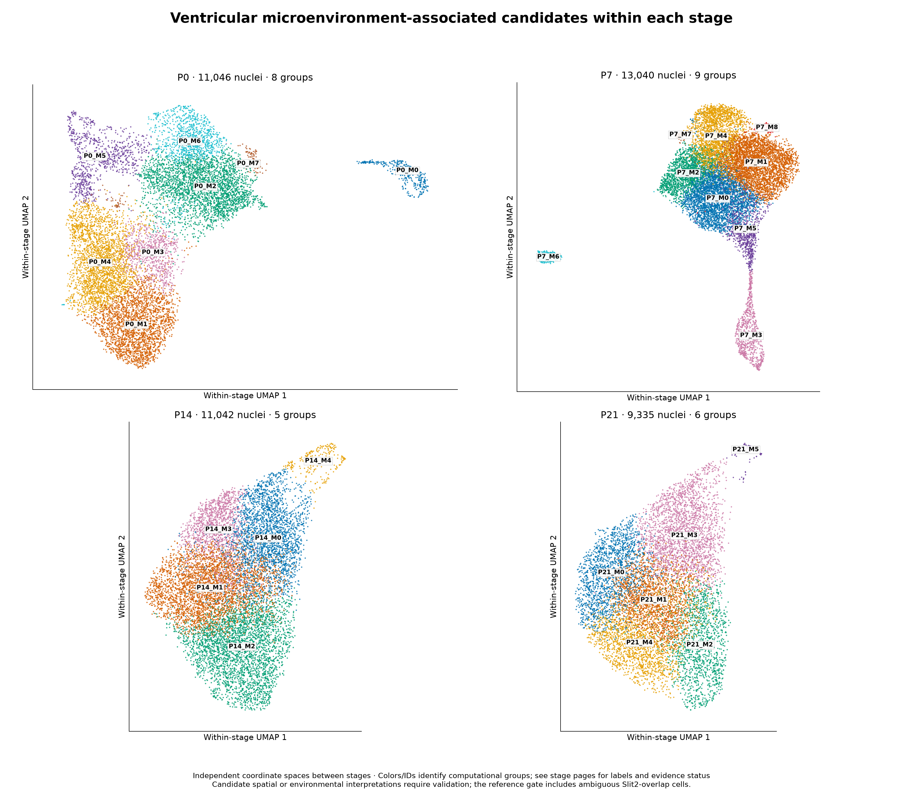
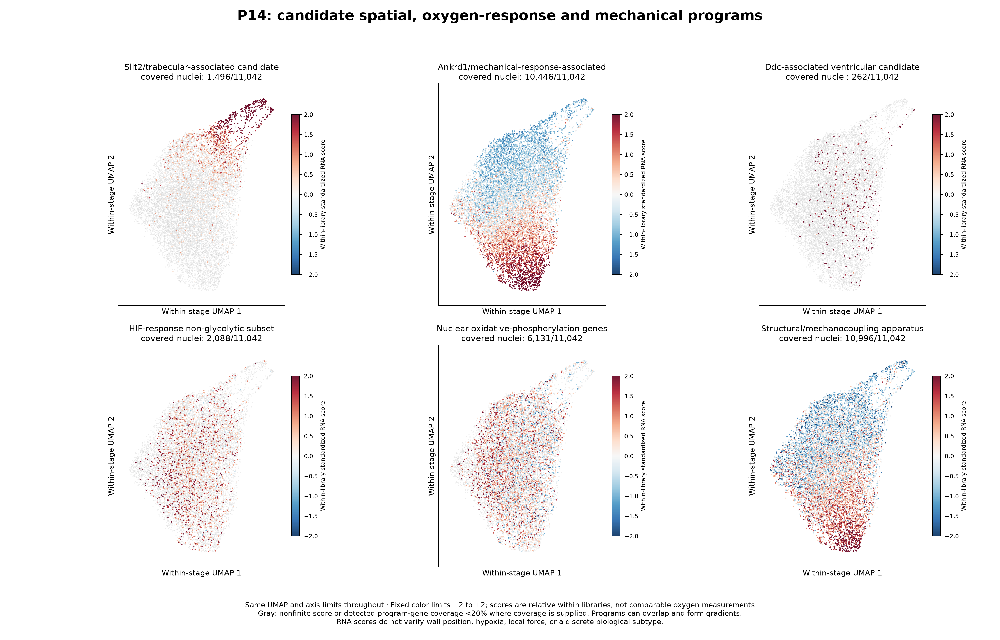

# Ventricular wall-, oxygen-response and mechanical programs

The biology is plausible, and this deeper analysis supports **paper-aligned Slit2/trabecular-associated and Ankrd1/mechanical-response-associated RNA programs** more strongly than a discrete hypoxia program. We resolve candidate groups while also testing continuous expression gradients. No wall position, oxygen concentration, local force or metabolic flux is measured here.

## Important annotation/gate correction

The paper describes Slit2.CMs as trabecular ventricular cardiomyocytes. Its exact supplementary Table3 markers include **Etv1 and Gja5**, which overlap conduction biology. Those genes alone do not justify excluding the cells as a separate conduction lineage. Our earlier CAR_3/CAR_9 conduction-associated candidate interpretation was too narrow for ventricular wall analysis.

This analysis retains **43,249 original ventricular-like nuclei plus 1,214 ambiguous Slit2-enriched references**, totaling **44,463 non-atrial cardiomyocytes**. The added cells remain explicitly tracked, not declared anatomically or functionally verified ventricular/trabecular/Purkinje cells. The earlier 43,249-cell gate is retained as a sensitivity comparison. Original counts and historical annotation fields remain unchanged; `microenvironment_label`, `support_status` and `gate_origin` are the new interpretation fields. [Annotation review](prior_annotation_review.tsv).

## Main biological findings

- **Slit2/trabecular-associated candidates recur across all four stages.** The paper-anchored marker program is coherent in expression neighborhoods, including after removing all interpreted program genes from the embedding. Some boundaries are stable while others are sensitivity-dependent. This is a candidate spatial identity, not our own spatial mapping. Etv1/Gja5 within this program do not establish Purkinje identity.
- **Ankrd1/mechanical-response-associated RNA is a strong, reproducible axis.** Neighborhood-score correlations are approximately0.65–0.79 before QC adjustment and0.63–0.77 after adjustment. Correlations remain approximately0.56–0.74 on the interpreted-gene-excluded graph. The most stable discrete Ankrd1-associated groups occur at P7/P14; at P0/P21 the program remains visible but exact subdivisions are less stable. This supports a transcriptional program/gradient, not measured force or causal exposure to strain.
- **HIF/oxygen-response evidence is weaker.** No group passes the specified multi-gene/raw-count/two-library HIF criteria. The non-glycolytic HIF panel has sparse detection: median coverage is zero genes at P0/P7 and one of eight genes at P14/P21. Neighborhood correlations are only approximately0.08–0.20. A failed panel means hypoxic subtypes are not resolved with this nuclear-RNA panel; it does not establish normoxia or absence of physiological oxygen differences.
- **Metabolic expression is not an oxygen measurement.** Nuclear respiratory-chain and fatty-acid oxidation panels are evaluated separately. P0 has a Ddc-associated candidate and exploratory FAO-associated grouping; neither establishes compact-wall location, measured respiration or local oxygen availability. Source Ddc anatomy is not specified in the article.
- **Ankrd1 and structural coupling share variation, but preparation-response RNA is a weaker correlate.** Ankrd1/structural-score correlations are approximately0.40–0.57; Ankrd1/IEG-control correlations are approximately0.05–0.13. Some structural genes overlap between panels, so those correlations are descriptive rather than independent validation. [Gene overlap](program_gene_overlap.tsv) is supplied.

The source article itself reports Slit2.CM trabecular enrichment, Ankrd1.CM LV/peri-arteriolar enrichment, and a capillary-proximity association with CM maturation. It proposes oxygen/nutrient delivery and paracrine signals as alternatives. Our snRNA-seq reanalysis recapitulates RNA signatures; it does not reproduce those spatial measurements or distinguish the proposed causal mechanisms. [Source evidence and exact marker sets](sources/README.md).

## Figures

[Combined nine-page PDF](ventricular_microenvironment_figures.pdf) · [Cluster overview](ventricular_microenvironment_overview.png)



Each stage has an independently fitted UMAP. Coordinates/orientation cannot be compared between stages. Within a stage, all program overlays use the same coordinates. Program colors are within-library standardized scores, clipped visually to[-2,2]. Gray indicates fewer than20% of panel genes detected, **not normoxia or absence of the biological program**. Programs can overlap; a gradient need not form a separate cell type.

### P0

[Cluster/reference/library UMAPs](P0_microenvironment_clusters.png) · [Program overlays](P0_microenvironment_programs.png) · [Cluster PDF](P0_microenvironment_clusters.pdf) · [Program PDF](P0_microenvironment_programs.pdf)

### P7

[Cluster/reference/library UMAPs](P7_microenvironment_clusters.png) · [Program overlays](P7_microenvironment_programs.png) · [Cluster PDF](P7_microenvironment_clusters.pdf) · [Program PDF](P7_microenvironment_programs.pdf)

### P14

[Cluster/reference/library UMAPs](P14_microenvironment_clusters.png) · [Program overlays](P14_microenvironment_programs.png) · [Cluster PDF](P14_microenvironment_clusters.pdf) · [Program PDF](P14_microenvironment_programs.pdf)



### P21

[Cluster/reference/library UMAPs](P21_microenvironment_clusters.png) · [Program overlays](P21_microenvironment_programs.png) · [Cluster PDF](P21_microenvironment_clusters.pdf) · [Program PDF](P21_microenvironment_programs.pdf)

## Subclustering and support

The expanded unsupervised analysis produces **28 primary computational groups**: eight P0, nine P7, five P14 and six P21. **Nine** pass all descriptive RNA-state support checks; **three** have replicate marker/seed support but remain sensitivity-dependent; **16** are candidates. Cycling states and marker-defined groups are included in these counts, so this is not a claim of 28 microenvironment-defined cell types.

| Stage | Expanded nuclei | Original core | Added ambiguous references | Primary groups |
|---|---:|---:|---:|---:|
| P0 | 11,046 | 10,315 | 731 | 8 |
| P7 | 13,040 | 12,854 | 186 | 9 |
| P14 | 11,042 | 10,873 | 169 | 5 |
| P21 | 9,335 | 9,207 | 128 | 6 |

| Group | Nuclei | Post hoc RNA interpretation | Support |
|---|---:|---|---|
| P0_M0 | 325 | Cycling-associated control state | supported RNA state |
| P0_M1 | 2,393 | Ddc-associated ventricular candidate | supported RNA state |
| P0_M2 | 2,985 | Marker-defined: Zbtb16/Ncam1 | supported RNA state |
| P0_M3 | 796 | Ankrd1/mechanical-response-associated | candidate/review |
| P0_M4 | 2,588 | Fatty-acid oxidation genes | candidate/review |
| P0_M5 | 856 | Slit2/trabecular-associated candidate | supported RNA state |
| P0_M6 | 983 | Ankrd1/mechanical-response-associated | candidate/review |
| P0_M7 | 120 | Marker-defined: Pola1/Rad51b | candidate/review |
| P7_M0 | 3,357 | Marker-defined: Rreb1/Ppara | replicate-supported; sensitivity-dependent |
| P7_M1 | 3,676 | Ankrd1/mechanical-response-associated | supported RNA state |
| P7_M2 | 1,744 | Marker-defined: Fgf14/Pdzrn4 | candidate/review |
| P7_M3 | 776 | Cycling-associated control state | supported RNA state |
| P7_M4 | 2,293 | Marker-defined: Ivns1abp/Myom2 | candidate/review |
| P7_M5 | 888 | Marker-defined: Rad51b/Pola1 | replicate-supported; sensitivity-dependent |
| P7_M6 | 185 | Slit2/trabecular-associated candidate | supported RNA state |
| P7_M7 | 63 | Uncharacterized ventricular-enriched group | candidate/review |
| P7_M8 | 58 | Uncharacterized ventricular-enriched group | candidate/review |
| P14_M0 | 2,638 | Slit2/trabecular-associated candidate | candidate/review |
| P14_M1 | 3,440 | Marker-defined: Lrtm1 | candidate/review |
| P14_M2 | 3,244 | Ankrd1/mechanical-response-associated | supported RNA state |
| P14_M3 | 1,501 | Marker-defined: Kcnd2/Pdzrn4 | candidate/review |
| P14_M4 | 219 | Slit2/trabecular-associated candidate | replicate-supported; sensitivity-dependent |
| P21_M0 | 1,778 | Marker-defined: Lrtm1/Stk39 | candidate/review |
| P21_M1 | 2,024 | Uncharacterized ventricular-enriched group | candidate/review |
| P21_M2 | 1,372 | Ankrd1/mechanical-response-associated | candidate/review |
| P21_M3 | 2,380 | Slit2/trabecular-associated candidate | supported RNA state |
| P21_M4 | 1,709 | Ankrd1/mechanical-response-associated | candidate/review |
| P21_M5 | 72 | Slit2/trabecular-associated candidate | candidate/review |

Some groups share the same program; conversely, one group can enrich several programs. The displayed name is the highest qualifying program, not a mutually exclusive lineage identity. Full evidence includes all tested programs, including failed rules. Primary resolution 0.6 is fixed;0.3/0.9/1.2 and seeds7/123 are checks, not a search for the largest number of subtypes.

## How sample, preparation and scoring effects were addressed

1. **Stage-specific unsupervised discovery.** Select 2,000 sample-aware HVGs independently per age, exclude mitochondrial/ribosomal and listed sex-marker genes, PCA30, Harmony between the two libraries, 15-neighbor graph, Leiden and UMAP. Curated program scores or handpicked-only genes are not used to construct the primary embedding. Primary HVGs can include interpreted genes; that is tested separately.
2. **Original expression and both libraries.** Markers are evaluated against the same-stage remainder in each original library using both corrected fractional counts and original integer counts. No corrected gene-expression matrix is generated by Harmony. Technical and sample-associated biological differences can both affect integration.
3. **Matched-expression module controls.** Mean log1p/10,000 program expression minus controls selected from 20 expression bins (up to 50 controls/bin, excluding all program genes); the same controls are used for the independently normalized original-count sensitivity. One feature per gene symbol is scored; duplicate symbols use the feature with greatest pooled corrected-count abundance. All duplicated features are withheld in feature-exclusion sensitivity. Mapping/controls are exported.
4. **Within-library scale.** Scores are centered/scaled separately in each original library. They test relative within-library heterogeneity, **not whether one whole stage/sample has a higher oxygen level, load or mean program activity**. Fractions of detected program genes are reported separately.
5. **Strong conditional sensitivities.** Regress within-library RNA depth, gene count, contamination, mitochondrial percentage, cycling-marker count and Xist/Y-marker expression; separately remove every interpreted program gene from embedding features and recompute PCA/Harmony/graphs/clustering. Those adjustments can remove genuine biological mediators or state—sensitivity dependence is not proof of artifact. HIF non-glycolytic targets are a specificity sensitivity, not an independent validation set.
6. **Original core-gate comparison.** Reuse the earlier 43,249-cell per-stage core-only graphs with common controls and restandardization in each core library. Slit2 and Ankrd1 neighborhood coherence remains in the core-only analysis, so the findings do not arise only from restoring the 1,214 references. The residual comparison uses the expanded-gate QC fit.

Cross-library neighbor mixing improves from approximately 44.4→48.0% at P0,21.6→40.0% at P7,37.4→49.2% at P14 and19.8→38.2% at P21. Mixing remains incomplete at P7/P21, and mixing by itself does not validate biology. Samples are nested in age, so stage-specific preparation effects cannot be separated fully from age. Two library labels are not assumed to be independent animals.

## Criteria and inference limits

A selected gene marker requires corrected mean log-expression difference>0.15, detected fraction>=15%, and detection enrichment>=5 percentage points versus the same-stage rest. A supporting library requires>=30 nuclei on both sides, with positive corrected and raw log-expression contrasts>0.05. Support counts distinct gene symbols among the top80 selected features.

A program requires its prespecified minimum number of supported genes/anchors (usually>=3 genes; HIF>=4 with non-glycolytic anchors), corrected standardized effect>0.35, effects>0.15 in both libraries, and positive raw-count effects. HIF labeling additionally requires the non-glycolytic HIF sensitivity to pass. Slit2 and Ankrd1 source labels require their corresponding anchor gene. Compact/trabecular developmental panels are contextual references, not definitive mature transmural markers.

RNA-state support:>=100 nuclei,>=30/library, largest-library fraction<=90%,>=3 positive raw/corrected marker symbols in both libraries, mean seed best-match Jaccard>=0.65 and minimum>=0.5. Full support additionally requires best-match Jaccard>=0.5 under QC/sex/cycling sensitivity and interpreted-gene exclusion, and>=0.4 in the uncorrected representation. These are exploratory heuristics, not calibrated probabilities or inferential significance tests. Resolution checks are supplied separately. A real cycling or paper-state population may be sensitivity-dependent by construction.

Neighborhood correlations quantify expression-graph coherence, not physical wall gradients. Twenty within-library shuffles provide descriptive reference values, not animal-level p-values. Author Table3 panels use the same source dataset and therefore are not independent biological validation. No new spatial mapping, HIF protein activity, oxygen concentration, force/strain, lineage tracing, functional physiology or causal environmental mechanism is established. Direct transmural and vascular-proximity claims require spatial validation, for which the paper’s Xenium data are the appropriate next source.

## Downloadable evidence

- [Per-cell annotations, gate origin, UMAPs and all program scores](cell_annotations_and_scores.csv.gz)
- [Group summary/support flags](cluster_summary.tsv), [all program effects/rules](cluster_program_evidence.tsv), [original-count marker evidence](cluster_gene_markers.tsv)
- [Program gene profiles/detection](program_gene_profiles.tsv), [score quality/QC associations](module_score_quality.tsv), [program correlations](program_correlations.tsv), [gene overlap](program_gene_overlap.tsv)
- [Neighborhood-gradient checks](gradient_metrics.tsv), [original core-gate sensitivity](core_gate_sensitivity.tsv), [sample mixing](sample_mixing.tsv)
- [Resolution checks](resolution_sensitivity.tsv), [partition stability](clustering_stability.tsv), [HVGs](embedding_genes.tsv), [matched control genes](matched_control_genes.tsv)
- [Exact active definitions/interpretation](program_definitions.json), [feature mappings](program_gene_mapping.tsv), [source excerpts/author marker rows](sources/README.md), [prior annotation review](prior_annotation_review.tsv)
- [Cohort accounting](cohort_summary.tsv), [methods/versions](methods.json), [validation/checksums](manifest.json)
- Stage-specific metadata-only H5ADs, per-cell tables, count pseudobulks and cross-tabs: [P0](P0), [P7](P7), [P14](P14), [P21](P21). H5ADs have no expression matrix; fractional pseudobulk sums are not independent animal replicates.

Detection means at least one corrected/original count, as indicated. Expression effects are differences of mean log-normalized RNA, not log2 fold changes. Numeric annotations retain historical inputs for provenance; use the new microenvironment fields for this analysis.

## Reproduce

```bash
python analysis/ventricular_microenvironment.py --input /path/to/snrna_qc_annotated_subclustered.h5ad
python analysis/finalize_ventricular_microenvironment.py
python analysis/plot_ventricular_microenvironment.py
python analysis/validate_ventricular_microenvironment.py
```

Use versions in `methods.json`. Validation checks 44,463 unique cells and core/reference accounting, original count conservation, all score/graph/annotation alignments, gene-feature handling, support gates and artifact checksums. Original full count H5AD remains unchanged in the analysis workspace.
