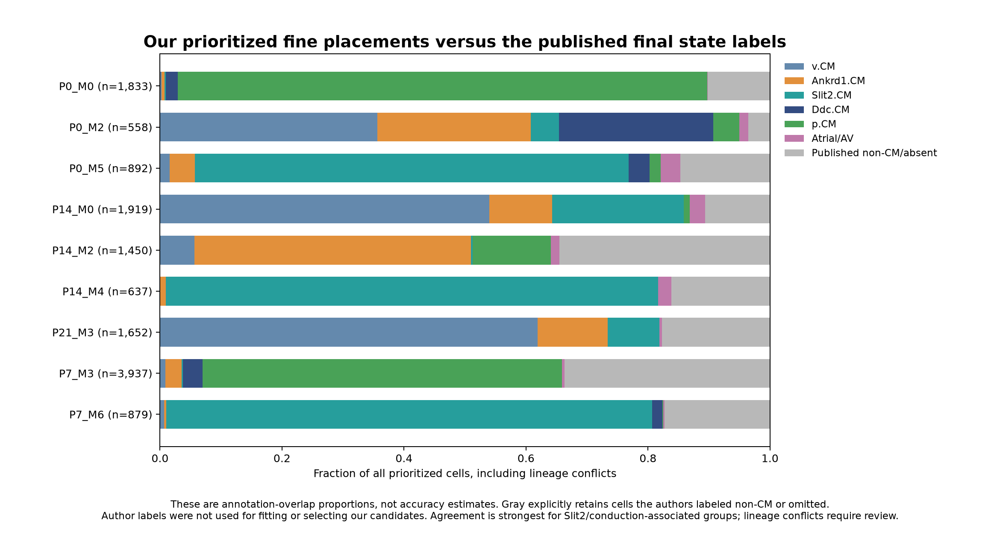

# Finest ventricular CM placements supported by the existing Xenium panel

**All 28 existing stage-specific ventricular RNA groups now have spatial maps**, including continuous weight maps for every individual group, permissive full-resolution proposals and evidence-prioritized subsets. No new RNA clusters were invented, original RNA memberships were unchanged, and no spatial coordinates were moved.

| Stage | Fine RNA groups mapped | Groups with prioritized local candidates | Prioritized cells | Stage-wide validation-selected groups |
| --- | --- | --- | --- | --- |
| P0 | 8 | 3 | 3,283 | 3 |
| P7 | 9 | 2 | 4,816 | 3 |
| P14 | 5 | 3 | 4,006 | 2 |
| P21 | 6 | 1 | 1,652 | 1 |

**Fine local placement and stage-wide separability are different questions.** Some fine groups have identifiable subsets even when a clean subdivision of every cell is unsupported. The rightmost column tests a whole-stage partition in which every union must meet minimum library-recovery criteria; it is not the number of biological cell types present or an upper bound on all local spatial detail.

[Ten-page PDF: resolution tests, four overview maps, four individual-group galleries and published-label comparison](ventricular_fine_resolution_report.pdf) · [resolution figure](resolution_and_selective_evidence.png) · [28-group evidence table](fine_group_evidence_summary.tsv)

**The cell-by-cell comparison reveals substantial lineage conflicts:** 10,842 of 13,757 prioritized cells (78.8%) are also labeled CM in the published atlas; 2,899 (21.1%) have a published non-CM label and 16 are absent. These conflicts are especially important for P7 cycling and P14 remodeling candidates. Internal RNA consistency did not establish their CM lineage on Xenium. Every conflict is flagged in the per-cell table; `prioritized_and_published_CM_compatible` identifies the annotation-compatible subset without silently removing the conflicting results.

## Finest placements and their criteria

A permissive proposal is supplied for every included cell using its largest fine-group RNA-neighbor weight. These are hypothesis maps at the maximum available reference resolution: 8 groups at P0, 9 at P7, 5 at P14 and 6 at P21. Numerical IDs are stage-specific; the same M number at different ages does not imply the same subtype.

The prioritized map retains either of two documented evidence routes. Both require agreement with separate-library projections and the original-count reference, plus at least two directly measured supporting genes. Route A requires weight≥0.70, margin≥0.20 and acceptable unrestricted fine-class recovery on the reserved RNA assessment nuclei. Route B uses a class-specific weight threshold chosen only on the validation quarter; the frozen threshold must then achieve≥75% selective precision with≥10 called nuclei in each library on the assessment quarter, with margin≥0.10. These complementary rules identify candidate placements; they are not calibrated probabilities or independent Xenium anatomical validation.

Other cells retain their proposals, weights, margins, entropy, original-reference result, separate-library results and two nonoverlapping gene-half results. The `placement_evidence` tiers additionally expose library/raw-consistent and permissive exploratory placements. We do not discard those weaker signals when showing the resolution limit.

## P0

| Group | RNA interpretation | Proposed cells | Prioritized cells | Measured supporting genes | RNA precision, unrestricted / selective |
| --- | --- | --- | --- | --- | --- |
| P0_M0 | Cycling | 2,912 | 1,833 | Atad2, Top2a, Rad51b | 0.60 / 0.74 |
| P0_M1 | Ddc / metabolic transition | 3,842 | 0 | Cacna1d, Angpt1, Ivns1abp | 0.53 / 0.74 |
| P0_M2 | Ncam1 / neonatal working | 6,366 | 558 | Ncam1, Mapk10, Kcnq5 | 0.54 / 0.80 |
| P0_M3 | Ankrd1 remodeling A | 240 | 0 | Ankrd1, Creb5, Itga9 | 0.57 / — |
| P0_M4 | Fatty-acid-use associated | 6,016 | 0 | Eda, Dnmt3a, Cd36 | 0.47 / — |
| P0_M5 | Conduction-program candidate | 1,661 | 892 | Slit2, Sema3a, Thsd4 | 0.74 / 0.83 |
| P0_M6 | Ankrd1 remodeling B | 946 | 0 | Ankrd1, Creb5, Acta2 | 0.59 / — |
| P0_M7 | DNA-maintenance associated | 11 | 0 | Pola1, Rad51b, Hells | 0.00 / — |

[Overview PNG](P0_finest_CM_overview.png) · [Every-group gallery PNG](P0_individual_fine_CM_maps.png) · [Gallery PDF](P0_individual_fine_CM_maps.pdf) · [All-cell annotations](P0/fine_CM_spatial_annotations.tsv.gz)

## P7

| Group | RNA interpretation | Proposed cells | Prioritized cells | Measured supporting genes | RNA precision, unrestricted / selective |
| --- | --- | --- | --- | --- | --- |
| P7_M0 | Ppara / working CM | 14,104 | 0 | Rreb1, Ppara, Itgb6 | 0.32 / — |
| P7_M1 | Ankrd1 remodeling | 10,526 | 0 | Creb5, Ankrd1, Itga9 | 0.33 / — |
| P7_M2 | Regional electrical candidate | 743 | 0 | Thsd4, Gm12381, Angpt1 | 0.31 / — |
| P7_M3 | Cycling | 4,821 | 3,937 | Top2a, Mki67, Hjurp | 0.74 / 0.81 |
| P7_M4 | Ivns1abp / working CM | 6,816 | 0 | Ivns1abp | 0.24 / — |
| P7_M5 | DNA-maintenance associated | 294 | 0 | Pola1, Rad51b, Hells | 0.43 / — |
| P7_M6 | Conduction-program candidate | 1,276 | 879 | Sema3a, Ntm, Ephb1 | 0.95 / 0.95 |
| P7_M7 | Uncharacterized A | 0 | 0 | Cenpf, Sox4, Nrp1 | 0.00 / — |
| P7_M8 | Uncharacterized B | 0 | 0 | Cacna1d, Igf1, Sema3a | 0.00 / — |

[Overview PNG](P7_finest_CM_overview.png) · [Every-group gallery PNG](P7_individual_fine_CM_maps.png) · [Gallery PDF](P7_individual_fine_CM_maps.pdf) · [All-cell annotations](P7/fine_CM_spatial_annotations.tsv.gz)

## P14

| Group | RNA interpretation | Proposed cells | Prioritized cells | Measured supporting genes | RNA precision, unrestricted / selective |
| --- | --- | --- | --- | --- | --- |
| P14_M0 | Slit2 / regional electrical | 10,316 | 1,919 | Thsd4, Gm12381, Angpt1 | 0.52 / 0.81 |
| P14_M1 | Working / maturation | 22,368 | 0 | None meeting rule | 0.47 / 0.60 |
| P14_M2 | Ankrd1 remodeling | 14,600 | 1,450 | Creb5, Tlr4, Ankrd1 | 0.57 / 0.90 |
| P14_M3 | Repolarization-associated RNA group | 1,025 | 0 | Acta2, Angpt1, Jam2 | 0.37 / — |
| P14_M4 | Conduction-program candidate | 1,347 | 637 | Ephb1, Sema3a, Slit2 | 0.63 / 0.70 |

[Overview PNG](P14_finest_CM_overview.png) · [Every-group gallery PNG](P14_individual_fine_CM_maps.png) · [Gallery PDF](P14_individual_fine_CM_maps.pdf) · [All-cell annotations](P14/fine_CM_spatial_annotations.tsv.gz)

## P21

| Group | RNA interpretation | Proposed cells | Prioritized cells | Measured supporting genes | RNA precision, unrestricted / selective |
| --- | --- | --- | --- | --- | --- |
| P21_M0 | Working / electrical candidate | 5,336 | 0 | Egf, Angpt1, Ppargc1a | 0.29 / — |
| P21_M1 | Working CM, weak positive markers | 22,891 | 0 | None meeting rule | 0.41 / — |
| P21_M2 | Ankrd1 remodeling A | 3,483 | 0 | Ankrd1, Creb5, Tlr4 | 0.48 / — |
| P21_M3 | Slit2 / regional electrical | 15,371 | 1,652 | Thsd4, Gm12381, Angpt1 | 0.47 / 0.79 |
| P21_M4 | Ankrd1 remodeling B | 10,036 | 0 | Tlr4, Creb5, Ankrd1 | 0.35 / — |
| P21_M5 | Conduction-program candidate | 1,241 | 0 | Slit2, Ephb1, Sema3a | 0.67 / — |

[Overview PNG](P21_finest_CM_overview.png) · [Every-group gallery PNG](P21_individual_fine_CM_maps.png) · [Gallery PDF](P21_individual_fine_CM_maps.pdf) · [All-cell annotations](P21/fine_CM_spatial_annotations.tsv.gz)

## Agreement with the published atlas



[Detailed overlap by group](published_state_overlap_summary.tsv) · [broad-lineage compatibility](published_broad_lineage_compatibility.tsv) · [comparison PDF](comparison_with_published_states.pdf)

Agreement is partial. Among all prioritized cells, the P0/P7/P14 conduction-program groups carry the published Slit2.CM label in 71.1% / 79.6% / 80.7% of cases. Cycling agrees with p.CM in 86.8% at P0 and 58.9% at P7. P14 Ankrd1-associated candidates carry Ankrd1.CM in 45.3%. The regional electrical groups mostly fall within published working v.CM (54.0% at P14, 61.9% at P21), with smaller Slit2.CM fractions; they do not correspond one-to-one to the authors’ Slit2 state. These percentages retain non-CM conflicts in the denominator and are annotation overlap, not accuracy.

The lineage discrepancies can reflect our ventricular gate, reference-transfer errors, segmentation/mixed RNA or differences in author annotation. This comparison cannot identify the correct label for each disputed cell. It is a reason to review the disputed placements before biological interpretation, rather than asserting that a fine-group evidence flag validates CM identity. The published labels were not used in fitting or evidence selection; filtering to the compatible subset is an explicit annotation-consensus restriction, not an independent validation.

The precision columns are **internal RNA-label recovery**, with the smaller value across the two library directions shown. A selective value appears only when a threshold was chosen using validation; values below 0.75 do not pass Route B. Near-cutoff cases remain visible rather than being declared biologically absent. A zero or missing value can reflect inadequate rare-class support as well as poor recovery.

Positive markers are selected from the measured shared panel: group-minus-rest mean log1p(CP10k) difference≥0.15 in both libraries using both raw and corrected reference counts, and raw detection≥15% within the group in both libraries. Up to six genes are retained; tables show the first three. Generic chamber anchors are excluded. These marker checks use genes available to matching and are descriptive corroboration, not held-out validation. Full marker/effect tables are in each stage folder.

The electrical/repolarization names originate from full RNA profiles. **Kcnd2 and Irx5 are not measured by Xenium** and do not locate or orient these cells. Conduction-program labels are not verified Purkinje identities. Ankrd1 does not establish actual wall stress, and metabolic RNA states do not establish substrate flux. Uncharacterized P7 groups remain uncharacterized.

## Measuring the resolution frontier

Within each original RNA library×fine group, hashed barcode order defines disjoint calibration halves, validation quarters and assessment quarters. For each library direction, the reference contains only calibration nuclei from the opposite library; gene-scaling statistics also use calibration nuclei. Validation and assessment nuclei never enter those reference pools or fitted scaling statistics. All 381 shared genes are used for this technical label-recovery test. Existing RNA labels were defined previously using the broader RNA data, so the labels themselves are not independently discovered truth.

Starting at the original fine resolution, the most mutually confused pair is merged using class-normalized calibration confusion only. The largest cut whose every union meets the fixed criteria on validation is selected: minimum precision 0.60, recall 0.35, F1 0.50, at least 10 query and 15 reference nuclei per library. The assessment quarter evaluates this frozen cut. All four selected cuts pass their assessment checks here; P21 selects only the unsplit union under this demanding whole-stage criterion. This does not erase its selectively supported regional group.

The selected unions are computational combinations of existing groups, not newly claimed biological types. Full memberships, library provenance, per-class metrics at every cut, RNA split probabilities and the resolution curve are downloadable. In particular, the original Ankrd1 A/B splits and many working/metabolic subdivisions are still chiefly exploratory on this panel.

Two deterministic, nonoverlapping halves of the shared genes provide an additional sensitivity check. A cell with zero RNA in a half is explicitly marked insufficient for that half. These halves are neither tuned to favor specific states nor used to impose spatial neighborhoods. Their agreement is exposed in the tables, not required as a universal filter.

The preceding [withheld-gene benchmark](../ventricular_alignment_improvement/README.md) establishes improved measured-expression prediction for the weighted projection. This new study addresses a different question: how much of the existing fine RNA labeling the panel can distinguish, and where its candidate placements lie. Prediction improvement alone is not treated as proof of fine-subtype identity.

## Files and reproducibility

- [Stage resolution summary](stage_resolution_summary.tsv), [all group-level evidence](fine_group_evidence_summary.tsv), [all resolution cuts](resolution_frontier.tsv), [numerical validation](validation.json), [design](design.json), [local threshold design](local_specificity_design.json), [methods](methods.json), [checksums](manifest.json).
- Per-stage `fine_CM_spatial_annotations.tsv.gz` retains every original cell and centroid, the published author state as a separate comparator, fine proposals/weights, sensitivity results, markers detected, evidence tiers, prioritized-candidate flags and selected union. Exclusions remain in the table. Prefix stage before pooling section-specific barcodes.
- `fine_probabilities_and_sensitivity.npz` contains query IDs, class order, full-panel weights and original-reference/gene-half weights. `RNA_split_probabilities.npz` contains RNA IDs, group truths, split assignments, library IDs and probabilities. These are weights, not measured expression or calibrated cell-identity probabilities.
- `hierarchy.json` records every cut and the exact calibration reference/scaler IDs. `RNA_resolution_metrics.tsv` and `class_specific_RNA_thresholds.tsv` retain support counts and precision/recall diagnostics. [Published author-state comparison](../author_atlas_baseline/README.md) remains separate; author labels never enter fitting or threshold selection.

```bash
OPENBLAS_NUM_THREADS=2 OMP_NUM_THREADS=2 python analysis/push_ventricular_spatial_resolution.py
OPENBLAS_NUM_THREADS=2 OMP_NUM_THREADS=2 python analysis/calibrate_ventricular_spatial_resolution.py
python analysis/compare_fine_CM_published_states.py
python analysis/report_ventricular_spatial_resolution.py
```

Use the existing scientific environment and source matrices from the [weighted alignment report](../ventricular_alignment_improvement/README.md). Completed stage files skip fits; remove/rebuild the relevant derived outputs before deliberately changing inputs or design. Validation checks all original rows/coordinates, fine-weight conservation, RNA partitions/reference isolation, validation-only cut selection, measured-marker detection and sampled original/gene-half projections. No independently replicated animal-level spatial inference is claimed.

Sources: GSE290989 and Xenium Zenodo [P0/P7](https://zenodo.org/records/14961929), [P14/P21](https://zenodo.org/records/14961942); Wang, Dong, Song, Qian and Liu, CC BY 4.0. [Article](https://pmc.ncbi.nlm.nih.gov/articles/PMC13561863/). DAPI and section plots are newly generated from deposited data; published final annotations are attributed to the article’s authors.
