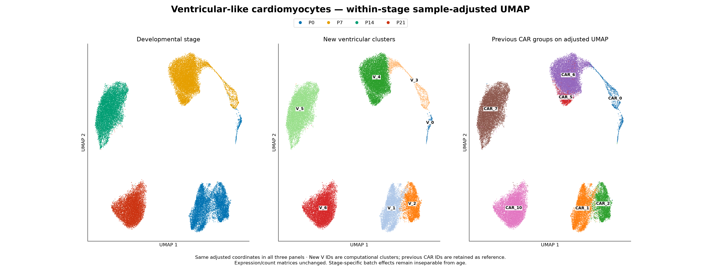
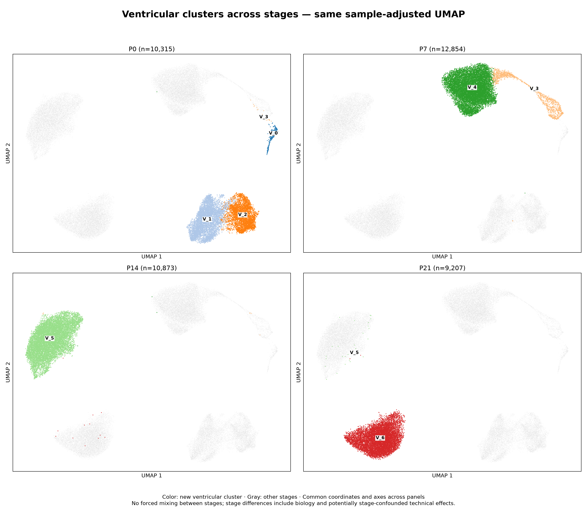
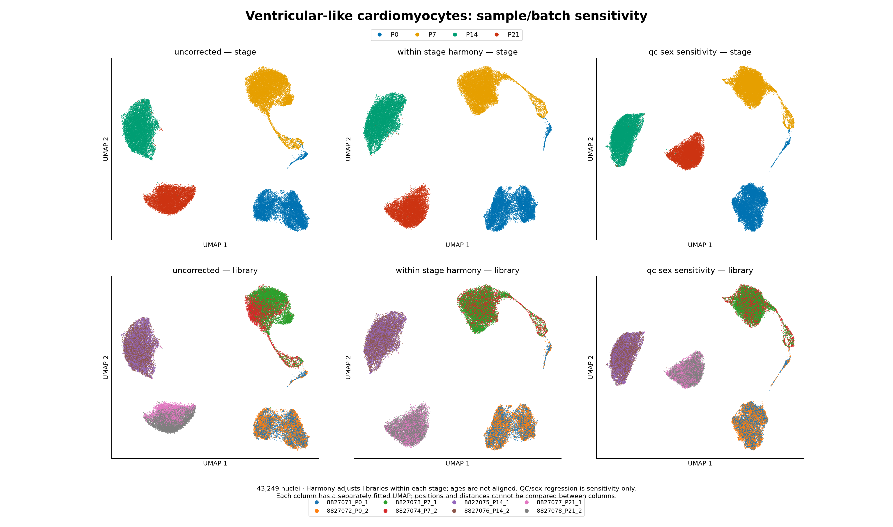

# Ventricular-like cardiomyocytes across P0, P7, P14 and P21

**Subsequent gate review:** See the [expanded microenvironment analysis](../ventricular_microenvironment/README.md), which includes 1,214 Slit2-enriched ambiguous references previously excluded by the conduction-candidate gate. Exact author markers show Etv1/Gja5 overlap with trabecular Slit2.CMs; these genes alone do not establish conduction identity. The original 43,249-cell core results below are preserved for comparison.

This analysis restricts the previously annotated dataset to **43,249 ventricular-like nuclei**. Atrial-like and conduction-associated candidates are excluded. The original expression matrices, QC and prior CAR labels are preserved. New ventricular-only embeddings and computational V-cluster IDs are added in separate outputs.

| Stage | Ventricular-like nuclei |
|---|---:|
| P0 | 10,315 |
| P7 | 12,854 |
| P14 | 10,873 |
| P21 | 9,207 |

## Figures

[Download the three-page PDF](ventricular_stage_batch_report.pdf).

**Primary adjusted UMAP:** matching coordinates colored by stage, new ventricular clusters and previous CAR groups. These are newly fitted ventricular-only coordinates; they do not match previous whole-CM UMAP positions.



[PNG](ventricular_adjusted_stage_clusters.png) · [PDF](ventricular_adjusted_stage_clusters.pdf)

**Stages separately:** one common sample-adjusted UMAP, colored by new V clusters. Gray points belong to other stages.



[PNG](ventricular_clusters_by_stage.png) · [PDF](ventricular_clusters_by_stage.pdf)

**Batch/QC comparison:** uncorrected, within-stage Harmony, and stronger QC/sex-marker sensitivity. Each column has its own UMAP, so coordinate positions and distances cannot be compared across columns. Compare stage/library distributions and quantitative neighbor metrics instead.



[PNG](ventricular_batch_comparison.png) · [PDF](ventricular_batch_comparison.pdf)

## What sample adjustment changes

The new ventricular-only baseline is compared with Harmony run separately between the two libraries within each age. Age groups are not aligned to one another. The fraction of 30 within-stage nearest neighbors from the other library increases as follows:

| Stage | Uncorrected | Within-stage Harmony | Random-mixing reference from library sizes |
|---|---:|---:|---:|
| P0 | 42.0% | 47.4% | 49.6% |
| P7 | 22.4% | 41.9% | 46.8% |
| P14 | 42.2% | 49.4% | 49.8% |
| P21 | 23.9% | 34.8% | 45.3% |

Mixing improves, especially at P7, but is not complete at P21. Random mixing is a descriptive reference, not a target or proof of correct biological integration; genuine differences in sample composition also affect it. These baseline values are from the newly fitted ventricular-only PCA, not the earlier whole-CM graph.

**P7 CAR_5/CAR_6:** 1,139 of 1,142 prior CAR_5 nuclei and 10,362 of 10,919 CAR_6 nuclei now belong to the same major low-cycling cluster, V_4. Thus their previous separation is not a stable separate-subtype result under sample adjustment. Harmony could remove real sample-associated biology as well as technical effects, so this does not prove the original difference was entirely artifact.

**P0 CAR_1/CAR_2:** the two populations remain largely separate after Harmony (V_1/V_2). Their metabolic versus structural/adhesion expression differences remain detectable in both libraries within P0. However, under stronger within-stage QC/sex-marker regression, 5,769 V_1 and 4,215 V_2 P0 nuclei join the same sensitivity cluster. The P0 cluster partition has low agreement between the primary and sensitivity analyses (adjusted Rand index 0.114). Their classification as distinct biological subtypes therefore remains uncertain. Covariate regression can also remove biological cell-size/metabolic variation; the merged sensitivity result does not prove absence of real states.

## Primary computational groups

Primary Leiden resolution is 0.6. Counts below include the small number of off-dominant-stage nuclei; exact stage/library cross-tabs are linked below.

| New ID | Dominant stage | Nuclei | Interpretation/reference |
|---|---|---:|---|
| V_0 | P0 | 303 | Cycling-enriched; mainly prior CAR_0 |
| V_1 | P0 | 5,769 | CAR_1-associated metabolic program; QC/sex-sensitive subdivision |
| V_2 | P0 | 4,220 | CAR_2-associated adhesion/structural program; QC/sex-sensitive subdivision |
| V_3 | P7 | 1,386 | Cycling-enriched; prior CAR_0 plus some CAR_6 |
| V_4 | P7 | 11,501 | Major low-cycling population; includes prior CAR_5 and CAR_6 |
| V_5 | P14 | 10,880 | Major P14 low-cycling population |
| V_6 | P21 | 9,190 | Major P21 low-cycling population |

Cycling-positive fractions are 62.4% for V_0 and 24.0% for V_3 under the existing >=2 cycling-marker rule. These are enriched populations, not pure populations of proven dividing cells. Low cycling-marker detection does not establish quiescence. V IDs are numerical computational groups, not seven validated ventricular cell types. The primary analysis does not resolve multiple robust low-cycling subtypes at P7/P14/P21 at this resolution; it does not establish biological homogeneity. Primary resolutions 0.4/0.6/0.8 yield 6/7/8 clusters.

Within-stage expression checks compare each cluster to the remaining ventricular nuclei of the same age. Selected markers must have mean log difference >0.1, >=20% corrected-count detection and >=5 percentage-point detection enrichment; supporting libraries require >=20 nuclei in both comparison groups and expression difference >0.05. These are descriptive heuristics, not significance thresholds. V_0–V_4 have selected markers supported in both libraries. V_5/V_6 lack >=50 same-stage nuclei outside their dominant cluster, so no within-stage subtype-marker comparison is reported for them. Markers against all other ages are supplied separately and should not be mistaken for within-age subtype markers.

## What is and is not corrected

Samples are nested within stage: no library spans multiple ages. **A stage-specific preparation/batch effect cannot be distinguished fully from biological age with this design.** Therefore stage separation is not claimed to be purely biological, and stages are not forced to mix.

Primary method: log-normalized corrected counts, 2,500 sample-aware HVGs initially selected, 2,484 retained after excluding mitochondrial/ribosomal and listed sex-linked markers; scaled/clipped expression; shared global ventricular PCA (30 components). Harmony uses sample within each stage (theta=2, lambda=1, 30 soft clusters, seed=42). Corrected representations are recentered to preserve each original stage PCA centroid. Neighbors (15), Leiden and UMAP are recomputed on these representations. This protects stage centroids by construction, not every within-stage biological feature. Sample-associated biology, including sex differences, can still be altered by Harmony.

Sensitivity only: regress within-stage log raw UMI count, log raw gene count, contamination, mitochondrial percentage and five sex-marker expression covariates from the primary adjusted PCs. This can remove biological variation and is not a preferred replacement for the primary result. Cell-cycle genes are retained in the primary embedding; no age regression is performed. Excluding listed sex-linked HVGs does not eliminate all sex-associated biology.

Only coordinates/graphs/clusters change. No gene-expression values are batch-adjusted, and no differential-expression significance claims are made. Expression summaries use the original corrected counts. Animal independence is not assumed from the two library labels per age.

## Downloadable data

- [Per-cell annotations, all three UMAPs and cluster assignments](ventricular_cells_embeddings_and_clusters.csv.gz)
- [Metadata-only H5AD with all PCA/UMAP representations and graphs](ventricular_embeddings_metadata_only.h5ad) — **contains no expression matrix**
- [Primary cluster summary](ventricular_cluster_summary.tsv)
- [Cluster counts by stage](ventricular_cluster_by_age.tsv), [library](ventricular_cluster_by_sample.tsv), [previous CAR ID](ventricular_cluster_by_subcluster_id.tsv), [cycling status](ventricular_cluster_by_cycling_state.tsv)
- [Within-stage marker evidence](within_stage_descriptive_markers.tsv) and [library support](within_stage_marker_library_support.tsv)
- [Descriptive markers versus all other ventricular nuclei](ventricular_cluster_descriptive_markers.tsv)
- [All-gene corrected pseudobulk sums](ventricular_cluster_corrected_pseudobulk.tsv.gz) — fractional sums, not integers or animal-level DE replicates
- [Library mixing metrics](within_stage_sample_mixing.tsv), [cluster stability](within_stage_cluster_stability.tsv), [resolution sensitivity](resolution_sensitivity.tsv)
- [Sample QC](sample_qc_summary.tsv), [embedding genes](embedding_genes.tsv), [method/package versions](methods.json), [validation/checksums](manifest.json)

## Reproduce

Use the saved package versions in `methods.json` (including `harmonypy` 2.1.0) and the existing full annotated H5AD:

```bash
python analysis/ventricular_stage_batch.py --input /path/to/snrna_qc_annotated_subclustered.h5ad
python analysis/ventricular_within_stage_markers.py --input /path/to/snrna_qc_annotated_subclustered.h5ad
python analysis/validate_ventricular_stage_batch.py
```

Validation checks population and annotation alignment, finite embeddings and aligned graphs, preserved stage PCA centroids, conserved original corrected counts, all-gene pseudobulk dimensions, metrics and artifact checksums. Original full expression data remain in the analysis workspace; this folder does not contain a full cell-by-gene expression H5AD.
