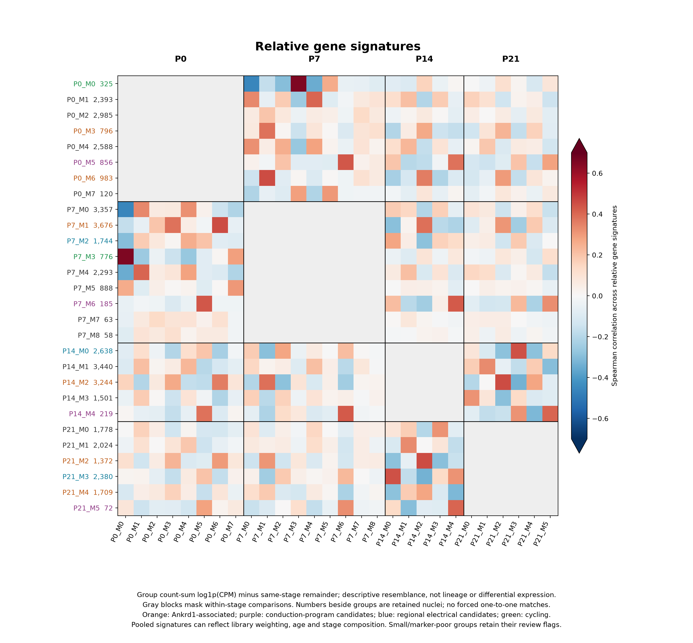

# Ventricular CM candidates by stage and comparable programs across ages

The current working catalog contains **28 existing RNA groups across 44,463 ventricular-enriched nuclei**. These are candidate states/subtypes, not 28 proven functional cell types. Several groups share a program, and one group can participate in multiple biological comparisons. No clustering, cell membership, original expression matrix or historical annotation is changed here.

**Support refers to reproducibility of an RNA group, not validation of its proposed function or anatomy:** **S** = supported RNA state (9 groups); **D** = replicate-supported, sensitivity-dependent (3); **C** = candidate/review (16). The original marker, sample and stability criteria remain in the [upstream report](../ventricular_microenvironment/README.md#criteria-and-inference-limits). Functional descriptions below are hypotheses based on gene programs. Force, ion current, oxygen, wall position and completed cell division have not been measured by this analysis.

## P0 — 11,046 nuclei

| Group | Nuclei | Candidate identity/program | Potential role | Support |
|---|---:|---|---|:---:|
| P0_M0 | 325 | Cycling-associated | Cell-cycle progression and DNA replication; completed division not established | S |
| P0_M1 | 2,393 | Ddc-associated metabolic transition | Adaptation of substrate use after birth; Hmgcs2/Pdk4/lipid-associated expression | S |
| P0_M2 | 2,985 | Zbtb16/Ncam1-enriched neonatal working CM | Possible cell-contact and structural/electrical maturation; specific function unresolved | S |
| P0_M3 | 796 | Ankrd1-associated remodeling A | Cytoskeletal/sarcomere adaptation and load-responsive signaling | C |
| P0_M4 | 2,588 | Fatty-acid-use-associated | Lipid uptake and fatty-acid-use gene program; metabolic flux not established | C |
| P0_M5 | 856 | Slit2-associated, conduction-program enriched | Potential specialized ventricular propagation within a trabecular/endomyocardial-associated program | S |
| P0_M6 | 983 | Ankrd1-associated remodeling B | Sarcomere/cytoskeletal coupling; distinction from M3 remains exploratory | C |
| P0_M7 | 120 | Pola1/Rad51b-associated DNA maintenance | DNA-synthesis/chromatin-maintenance program; not proof of active cycling or DNA damage | C |

## P7 — 13,040 nuclei

| Group | Nuclei | Candidate identity/program | Potential role | Support |
|---|---:|---|---|:---:|
| P7_M0 | 3,357 | Ppara/Rreb1-enriched working CM | Metabolic regulation and contractile maturation; standalone metabolic subtype not established | D |
| P7_M1 | 3,676 | Ankrd1-associated remodeling | Force-transmission apparatus and cytoskeletal/sarcomere adaptation | S |
| P7_M2 | 1,744 | Fgf14/Pdzrn4 regional electrical candidate | Electrical/RNA-processing specialization; partial earlier counterpart of late regional groups | C |
| P7_M3 | 776 | Cycling-associated | Cell-cycle progression and DNA replication; completed division not established | S |
| P7_M4 | 2,293 | Ivns1abp/Myom2-enriched working CM | Contractile apparatus maturation; specific subtype function uncertain | C |
| P7_M5 | 888 | Rad51b/Pola1-associated DNA maintenance | DNA-synthesis/chromatin-maintenance program; distinct from confirmed cycling-marker enrichment | D |
| P7_M6 | 185 | Slit2-associated, conduction-program enriched | Potential specialized rapid propagation; not verified Purkinje cells | S |
| P7_M7 | 63 | Small uncharacterized ventricular CM A | No defensible subtype-specific function assigned | C |
| P7_M8 | 58 | Small uncharacterized ventricular CM B | No defensible subtype-specific function assigned | C |

The last two groups are retained for accounting and review, but excluded from the proposed comparison families. These are ventricular-enriched groups with unresolved subtype programs, rather than new non-CM lineages.

## P14 — 11,042 nuclei

| Group | Nuclei | Candidate identity/program | Potential role | Support |
|---|---:|---|---|:---:|
| P14_M0 | 2,638 | Slit2/Mpped2 regional electrical candidate | Regional repolarization-associated variation: relative Irx5 enrichment and Kcnd2 reduction | C |
| P14_M1 | 3,440 | Lrtm1-enriched working CM | General contraction/maturation background; subtype-specific function unresolved | C |
| P14_M2 | 3,244 | Ankrd1-associated remodeling | Cytoskeletal/sarcomere adaptation and load-responsive signaling | S |
| P14_M3 | 1,501 | Kcnd2/Pdzrn4-enriched repolarization candidate | Potential relatively greater Kv4.2-related repolarization capacity; current not measured | C |
| P14_M4 | 219 | Slit2-associated, conduction-program enriched | Potential specialized ventricular propagation; boundary sensitivity limits confidence | D |

## P21 — 9,335 nuclei

| Group | Nuclei | Candidate identity/program | Potential role | Support |
|---|---:|---|---|:---:|
| P21_M0 | 1,778 | Lrtm1/Stk39 working/electrical candidate | Potential ion-regulatory and working-CM specialization | C |
| P21_M1 | 2,024 | Working CM without a resolved positive subtype-marker set | General contraction/maturation background; no specific new function established | C |
| P21_M2 | 1,372 | Ankrd1-associated remodeling A | Sarcomere/cytoskeletal adaptation and load-responsive signaling | C |
| P21_M3 | 2,380 | Slit2/Mpped2 regional electrical candidate | Regional repolarization-associated variation with retained Gja1 | S |
| P21_M4 | 1,709 | Ankrd1-associated remodeling B | Weaker remodeling program; distinction from M2 remains exploratory | C |
| P21_M5 | 72 | Small Slit2-associated conduction-program candidate | Potential specialized propagation; small size and historical gate dependence are important | C |

The larger P14_M0/P21_M3 regional groups differ from the smaller P14_M4/P21_M5 conduction-program candidates: the former lack the same Cntn2/Scn10a enrichment and retain Gja1. The [electrical/regional report](../ventricular_electrical_regional/README.md) gives independent literature context and per-library/raw/QC/core-gate checks. Slit2 expression alone does not separate working trabecular CMs from conduction-related cells.

## Proposed cross-stage comparisons

These are shared-program comparison sets, **not inferred developmental paths or forced one-to-one subtype matches**. Empty entries mean a convincing separate counterpart is not resolved, not that the biology is absent.

| Comparison family | P0 | P7 | P14 | P21 | Priority/interpretation |
|---|---|---|---|---|---|
| **Ankrd1-associated remodeling** | M3 + M6 | M1 | M2 | M2, with M4 secondary | Main four-stage comparison; early/late subdivisions remain exploratory |
| **Conduction-program enriched** | M5 | M6 | M4 | M5 | Main four-stage candidate comparison; P14 sensitivity and P21 n=72 limit confidence |
| **Regional electrical specialization** | Not separately resolved | M2 | M0 | M3 | Prioritize P14–P21; P7 is a partial earlier counterpart |
| **Cycling** | M0 | M3 | Not separately resolved | Not separately resolved | Strong early comparison; no completed-division inference |
| **DNA-maintenance-associated** | M7 | M5 | Not separately resolved | Not separately resolved | Early RNA-state comparison; do not equate with productive proliferation or DNA damage |
| Early metabolic/working arm A | M1 | M4 | — | — | Exploratory neonatal-to-P7 metabolic/contractile comparison |
| Early metabolic/working arm B | M4 | M0 | — | — | Exploratory metabolic-adaptation comparison |
| Later repolarization/working candidate | — | M0, tentative | M3 | M0 | P14–P21 pair is preferable; P7 extension is weak |
| Later working/maturation background | — | — | M1 | M1 | Broad resemblance with weak subtype-specific positive markers; not a novel functional type |

Within this table, M identifiers are stage-specific: for example, P0 M5 means P0_M5. Families can overlap, particularly the metabolic and working-CM comparisons. The neonatal Zbtb16/Ncam1 group P0_M2 has no convincing later counterpart in this analysis; preserve it as a stage-specific candidate rather than forcing a match.

## Quantitative cross-stage resemblance

To check these proposals beyond labels, this follow-up compares relative expression signatures across **10,773 genes**, with **10,596 genes** retained after withholding all genes in the previously interpreted program/electrical panels. It does not fit a new UMAP or use distances between independent stage UMAPs.

For each existing group, corrected aggregate count sums are normalized to CPM, log1p transformed, and contrasted with all other retained CMs from the same stage. Spearman correlations compare these **relative gene signatures**. They are not correlations between absolute age profiles, significance tests, classification probabilities or measures of shared ancestry. A top-ranked match can still be weak.

| Selected comparison | Signature correlation | Interpreted genes withheld | Shared positive markers in both libraries |
|---|---:|---:|---:|
| P0_M6 ↔ P7_M1 | 0.454 | 0.447 | 34 |
| P7_M1 ↔ P14_M2 | 0.387 | 0.381 | 33 |
| P14_M2 ↔ P21_M2 | 0.455 | 0.448 | 44 |
| P0_M5 ↔ P7_M6 | 0.437 | 0.432 | 49 |
| P7_M6 ↔ P14_M4 | 0.432 | 0.428 | 51 |
| P14_M4 ↔ P21_M5 | 0.405 | 0.402 | 57 |
| P7_M2 ↔ P14_M0 | 0.277 | 0.270 | 20 |
| P14_M0 ↔ P21_M3 | 0.445 | 0.438 | 56 |
| P0_M0 ↔ P7_M3 | 0.651 | 0.651 | 54 |
| P0_M7 ↔ P7_M5 | 0.303 | 0.304 | 24 |
| P0_M1 ↔ P7_M4 | 0.407 | 0.404 | 3 |
| P0_M4 ↔ P7_M0 | 0.322 | 0.318 | 18 |
| P14_M3 ↔ P21_M0 | 0.317 | 0.310 | 28 |
| P14_M1 ↔ P21_M1 | 0.332 | 0.324 | 0 |

Shared markers come from previously selected, truncated top80 marker lists with positive raw/corrected effects in both libraries; they are not independent validation. Zero overlap for P14_M1/P21_M1 reflects their limited positive subtype-marker sets, despite broader relative-profile resemblance. Most listed comparisons are reciprocal nearest matches between their two stages; P0_M4/P7_M0 is an exploratory alternative, not reciprocal. Exact values/ranks for **all 578 directed cross-stage pairs** are exported.

**Single-marker matching can be misleading.** Although Lrtm1 marks P14_M1 and P21_M0, the broader profile favors **P14_M1 ↔ P21_M1** (0.332 versus 0.171 for P14_M1/P21_M0). Conversely, **P14_M3 ↔ P21_M0** is a stronger comparison (0.317). The P7_M0/P14_M3 extension is weak (0.166). These findings argue for broad shared programs and cautious partial matches.



[Two-page PDF](cross_stage_signature_similarity.pdf) · [Interpreted-gene-excluded sensitivity](cross_stage_signature_similarity_interpreted_genes_excluded.png)

## How to compare these groups transcriptomically

Prioritize the remodeling and conduction candidate families across all four stages, the regional electrical P7/P14/P21 comparison, and the early cycling comparison. Keep stage and candidate family as separate variables. Test maturation, ion-channel/calcium-handling, metabolic and cytoskeletal changes within those matched programs. Do not interpret independent UMAP coordinates as trajectories.

For sample-aware expression comparisons, aggregate expression by **original library × candidate group/family**, retaining separate libraries. Establish independent-animal identities before inferential differential-expression testing; current library labels are not assumed to be independent animals. Stage and stage-specific preparation effects remain partly confounded. Count-based models require suitable original integer counts with ambient-correction sensitivity; do not silently round corrected fractional counts. The current pooled corrected signatures are descriptive matching references, not sample-level differential-expression results.

This analysis has not validated physical wall/chamber positions, hypoxic subtypes, DNA ploidy or Purkinje physiology. No multi-gene HIF-defined group passed the prior criteria. The most useful next validation is Xenium/anatomical mapping of the proposed regional and conduction programs.

## Files and reproducibility

- [Full stage catalog, markers, support and potential functions](stage_subtype_catalog.tsv)
- [Cross-stage comparison sets and limits](cross_stage_comparison_sets.tsv)
- [Per-nucleus candidate identities and overlapping comparison memberships](cell_catalog_and_comparison_memberships.tsv.gz)
- [All directed pairwise similarities, ranks, marker overlap and shared genes](cross_stage_pairwise_similarity.tsv)
- [Primary correlation matrix](relative_signature_similarity_matrix.tsv), [interpreted-gene-excluded matrix](interpreted_genes_excluded_similarity_matrix.tsv)
- [Relative expression signatures](within_stage_relative_aggregate_signatures.tsv.gz), [gene-feature mapping and inclusion flags](signature_feature_mapping.tsv)
- [Methods/limits](methods.json), [validation and checksums](manifest.json)

The similarity feature filter requires at least 5 aggregate CPM in one group and an absolute relative signature of at least 0.4 in one group; mitochondrial/ribosomal/Gm-prefixed and listed sex-associated symbols are excluded. These exploratory thresholds are not calibrated. One feature per gene symbol is selected by pooled corrected abundance, while normalization denominators retain all original features. Existing per-library/raw/QC/seed support is copied unchanged. New whole-transcriptome matching uses corrected aggregate counts, with interpreted-gene exclusion sensitivity; it can still reflect library weighting, maturation, stage composition and technical variation.

```bash
python analysis/ventricular_stage_subtype_catalog.py
python analysis/plot_ventricular_stage_comparisons.py
python analysis/validate_ventricular_stage_catalog.py
```
