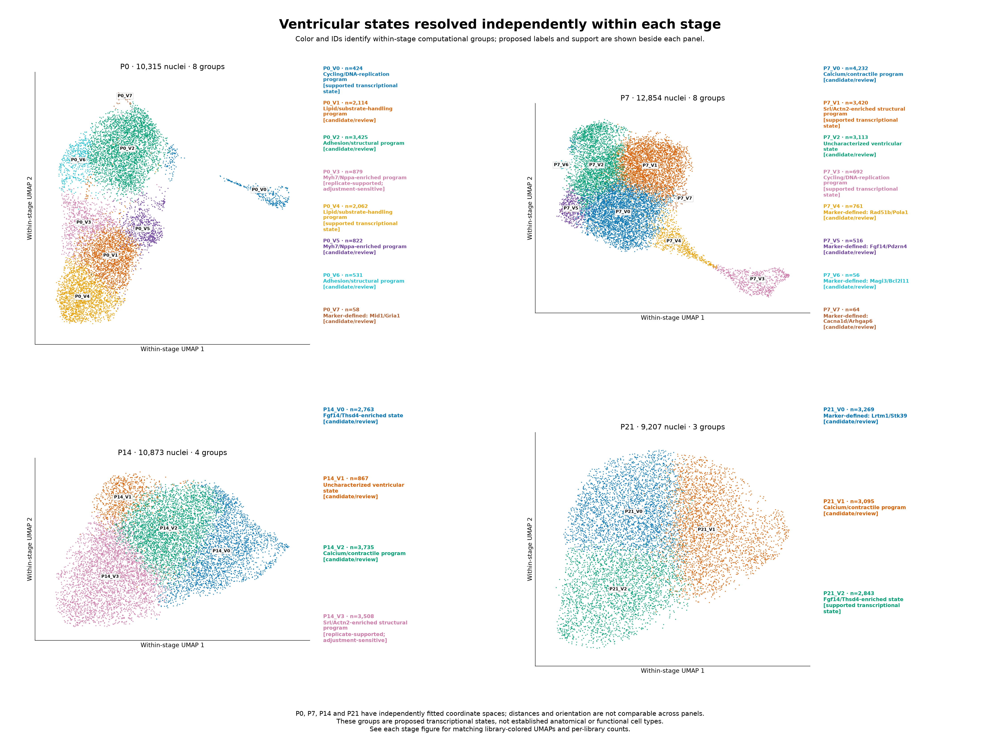

# Ventricular CM states resolved within each stage

**Subsequent gate review:** The [microenvironment analysis](../ventricular_microenvironment/README.md) retains an additional 1,214 ambiguous Slit2-enriched references. The paper’s Slit2.CM markers include Etv1/Gja5 and are trabecular-associated; the prior conduction-candidate exclusion was too narrow for ventricular wall analysis. This 43,249-cell core analysis remains a sensitivity reference, with its original data/labels preserved.

Independent P0, P7, P14 and P21 subclustering resolves **23 computational groups**, with different levels of support. **Five** pass the prespecified library/marker/seed/adjustment heuristics; **two** have replicate marker support but are adjustment-sensitive; **16** remain candidates. These results support additional transcriptional states, not 23 verified biological or anatomical cell types.

All **43,249** previously ventricular-like nuclei are retained. Atrial-like and prior conduction-associated candidate populations remain excluded. Each stage has a newly selected gene set, PCA, sample adjustment and UMAP; stage coordinates and orientations are independent and cannot be compared across panels. IDs such as `P7_V1` belong to this analysis and differ from previous global `V_1` or `CAR_1` IDs.

## Figures

[Combined five-page PDF](ventricular_within_stage_figures.pdf) · [Overview PNG](ventricular_within_stage_overview.png) · [Overview PDF](ventricular_within_stage_overview.pdf)



Each stage-specific figure shows identical coordinates colored by cluster and by its two libraries, with proposed state names, exact support status and counts. Apparent continuous boundaries are preserved; cells have not been moved to create artificial separation.

| Stage | Nuclei | Primary groups | Pass full support heuristics | Replicate-supported but adjustment-sensitive |
|---|---:|---:|---:|---:|
| P0 | 10,315 | 8 | 2 | 1 |
| P7 | 12,854 | 8 | 2 | 0 |
| P14 | 10,873 | 4 | 0 | 1 |
| P21 | 9,207 | 3 | 1 | 0 |

[P0 figure](P0_ventricular_subclusters.png) · [P7 figure](P7_ventricular_subclusters.png) · [P14 figure](P14_ventricular_subclusters.png) · [P21 figure](P21_ventricular_subclusters.png)

## Better-supported programs

| Group | Nuclei | Proposed state | Marker evidence |
|---|---:|---|---|
| P0_V0 | 424 | Cycling/DNA replication | Mki67, Top2a, Cdk1, Cenpf; 48.1% meet the existing multi-marker cycling rule |
| P0_V4 | 2,062 | Lipid/substrate handling | Hmgcs2, Cd36, Slc27a1, Cpt1b, Pdk4, Hadha; transcriptional differences, not measured metabolic flux |
| P7_V1 | 3,420 | Srl/Actn2-enriched structural program | Srl and Actn2 contribute partial panel support; leading differential genes include Ankrd1, Creb5, Xirp2 and Nrap |
| P7_V3 | 692 | Cycling/DNA replication | Mki67, Top2a, Cenpf; 45.8% meet the cycling rule |
| P21_V2 | 2,843 | Fgf14/Thsd4-enriched state | Fgf14, Thsd4, Mpped2, Slc6a6 and Pdzrn4; partial Ncam1/Tecrl support does not establish anatomical or conduction identity |

P0_V3 (879 nuclei; Myh7/Nppa-enriched program) and P14_V3 (3,508 nuclei; Srl/Actn2-enriched structural program) have reproducible marker differences but remain sensitive to sample/QC/sex-marker adjustments. The remaining groups can have real expression differences, but their exact boundaries do not pass all support checks. Most candidate flags reflect seed sensitivity, adjustment sensitivity, inadequate size/library representation, or insufficient cross-library markers. A candidate flag does not prove an artifact.

No compact-associated or trabecular-associated panel passes the specified criteria; this does not establish that anatomically compact/trabecular cells are absent. Some ventricular-gated groups (P0_V5 and P14_V0) have partial Etv1/Scn5a conduction overlap. These remain candidates, and no Purkinje identity or anatomical reclassification is assigned. Developmental or mechanical-response markers are not interpreted as pathological stress/fibrosis, and cycling RNA is not proof of completed cardiomyocyte division.

## All proposed groups

| Group | Nuclei | Proposed state | Support |
|---|---:|---|---|
| P0_V0 | 424 | Cycling/DNA-replication program | Passes heuristics |
| P0_V1 | 2,114 | Lipid/substrate-handling program | Candidate/review |
| P0_V2 | 3,425 | Adhesion/structural program | Candidate/review |
| P0_V3 | 879 | Myh7/Nppa-enriched program | Replicate-supported; adjustment-sensitive |
| P0_V4 | 2,062 | Lipid/substrate-handling program | Passes heuristics |
| P0_V5 | 822 | Myh7/Nppa-enriched program | Candidate/review |
| P0_V6 | 531 | Adhesion/structural program | Candidate/review |
| P0_V7 | 58 | Marker-defined: Mid1/Gria1 | Candidate/review |
| P7_V0 | 4,232 | Calcium/contractile program | Candidate/review |
| P7_V1 | 3,420 | Srl/Actn2-enriched structural program | Passes heuristics |
| P7_V2 | 3,113 | Uncharacterized ventricular state | Candidate/review |
| P7_V3 | 692 | Cycling/DNA-replication program | Passes heuristics |
| P7_V4 | 761 | Marker-defined: Rad51b/Pola1 | Candidate/review |
| P7_V5 | 516 | Marker-defined: Fgf14/Pdzrn4 | Candidate/review |
| P7_V6 | 56 | Marker-defined: Magi3/Bcl2l11 | Candidate/review |
| P7_V7 | 64 | Marker-defined: Cacna1d/Arhgap6 | Candidate/review |
| P14_V0 | 2,763 | Fgf14/Thsd4-enriched state | Candidate/review |
| P14_V1 | 867 | Uncharacterized ventricular state | Candidate/review |
| P14_V2 | 3,735 | Calcium/contractile program | Candidate/review |
| P14_V3 | 3,508 | Srl/Actn2-enriched structural program | Replicate-supported; adjustment-sensitive |
| P21_V0 | 3,269 | Marker-defined: Lrtm1/Stk39 | Candidate/review |
| P21_V1 | 3,095 | Calcium/contractile program | Candidate/review |
| P21_V2 | 2,843 | Fgf14/Thsd4-enriched state | Passes heuristics |

## Methods and identity criteria

**Independent analysis per age:** select 2,000 sample-aware HVGs, then exclude mitochondrial/ribosomal genes and the listed sex-linked genes; scale/clip, PCA30, Harmony across the two libraries (theta2/lambda1, 30 soft clusters, seed42), 15-neighbor graph, Leiden resolution0.6 and UMAP min_dist0.3. Independent gene sets retained after exclusions: P0=1,990; P7=1,984; P14=1,987; P21=1,984. This resolves within-stage variation obscured by the earlier global age-dominated PCA. No age-to-age alignment is performed.

**Checks, not selection for maximum subtype count:** resolutions0.3/0.6/0.9/1.2, primary seed42 plus seeds7/123, unadjusted representations, and stronger within-stage QC/sex-marker regression. Primary Harmony cluster counts at those resolutions are P0=4/8/11/13, P7=5/8/9/12, P14=2/4/7/10, P21=2/3/6/12. The prespecified primary resolution remains0.6; simply raising resolution creates more partitions without establishing more biological types.

**Marker criteria:** original corrected counts are normalized per nucleus to10,000 and log1p transformed. Each cluster is compared against the remaining ventricular cells of the same stage, separately in each original library as well as pooled. Detection means at least one corrected count; effect sizes are differences of mean log-normalized expression, not log2 fold changes. Selected markers require mean log difference>0.15, detection>=20%, and detection enrichment>=8 percentage points. Within-library comparisons require>=30 nuclei on each side and positive expression difference>0.05. Counts of cross-library markers refer to the top60 selected genes and are not pathway enrichment tests, p-values or animal-level inference.

**Program labels:** at least two panel genes must show mean log difference>0.1, detection>=10%, and positive contrasts in both libraries; aggregate relative panel enrichment must also be positive. Cycling labels additionally require>=10% cycling-marker-positive nuclei. Compact-associated candidates require Hey2 and Mycn; trabecular-associated candidates require at least two of Nppa/Bmp10/Erbb4, including Bmp10 or Erbb4. Partial two-gene panels are described conservatively with marker-defined labels where appropriate; the source panel remains recorded in `selected_program_panel`. Program names do not imply increased function, metabolic flux or a global maturity ranking. [All tested panels and positive genes](program_panel_evidence.tsv) include negative results.

**Support heuristics:**>=100 nuclei,>=30 per library, largest library fraction<=90%,>=3 cross-library marker genes, minimum best-match Jaccard>=0.5 and mean>=0.65 across the two alternative random seeds. A group passing these checks is called replicate-supported. It additionally passes the full descriptive support criteria if best-match Jaccard is>=0.5 after QC/sex regression and>=0.4 in the uncorrected representation. Otherwise it is labeled adjustment-sensitive. Resolution matches are exported separately; support status does not claim stability at every resolution. Jaccard matches are per-cluster best matches, not inferred lineage relationships or calibrated confidence probabilities.

**Batch limitations:** Harmony-induced library mixing is not independent biological validation; original-expression contrasts in each library provide a separate check. Sample-associated biological differences can also be altered by integration. The QC/sex sensitivity removes within-stage associations with raw RNA depth, gene count, contamination, mitochondrial percentage and Xist/Y-marker expression; it can remove real cell-size, metabolic or maturation variation. Disappearance after regression does not establish absence of biology. Two library labels are not assumed to be independent animals. Technical effects shared by both libraries at one stage remain confounded with age.

Expression/count matrices are unchanged; corrections affect embeddings and graphs only. All expression summaries use original corrected counts. No inferential differential expression, functional measurements, lineage tracing or spatial validation is claimed. Many partitions lie along continua rather than isolated cell types.

## Data and reproducibility

- [All-cell annotations, state support and stage-specific UMAP coordinates](cell_annotations.csv.gz)
- [Cluster summary with marker/library/seed/QC evidence](cluster_summary.tsv)
- [Within-stage and within-library marker contrasts](within_stage_markers.tsv)
- [Program expression/detection profiles](program_marker_profiles.tsv), [panel evidence](program_panel_evidence.tsv)
- [Resolution sensitivity](resolution_sensitivity.tsv), [partition stability](clustering_stability.tsv), [library mixing](sample_mixing.tsv)
- [Per-stage embedding genes](embedding_genes.tsv), [methods and versions](methods.json), [checksums/validation](manifest.json)
- Per-stage folders: [P0](P0), [P7](P7), [P14](P14), [P21](P21). Each contains annotations, metadata-only H5AD with all PCA/graphs and primary UMAP, library/prior-CAR cross-tabs, and all-gene corrected pseudobulk sums. Metadata-only H5ADs contain no expression matrix; pseudobulk values are fractional sums, not animal-level replicates.

```bash
python analysis/ventricular_within_stage.py --input /path/to/snrna_qc_annotated_subclustered.h5ad
python analysis/finalize_ventricular_within_stage_labels.py
python analysis/plot_ventricular_within_stage.py
python analysis/validate_ventricular_within_stage.py
```

The finalizer reconciles positive-panel and conservative marker-label nomenclature without changing cells, clusters or coordinates. Validation checks all 43,249 nuclei, alignment among annotations and metadata, per-stage graphs/coordinates, original-count conservation, support gates and checksums. Scientific review is reflected in conservative labels and uncertainty flags.
