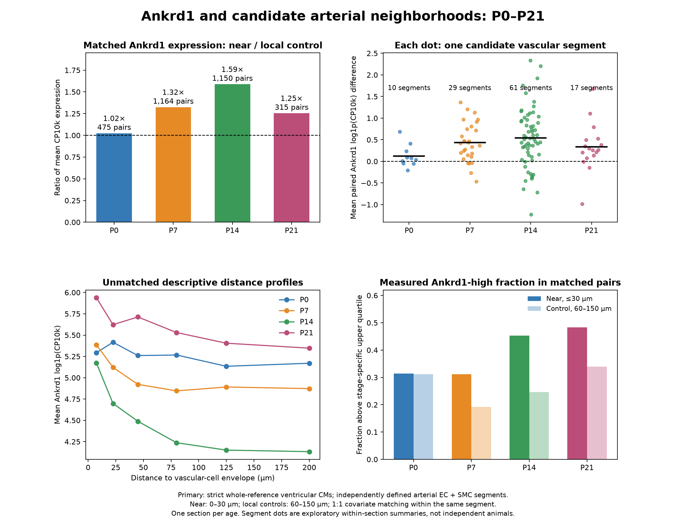
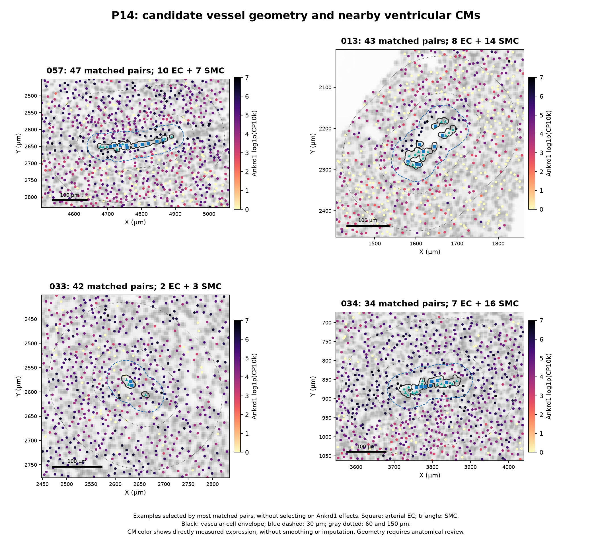
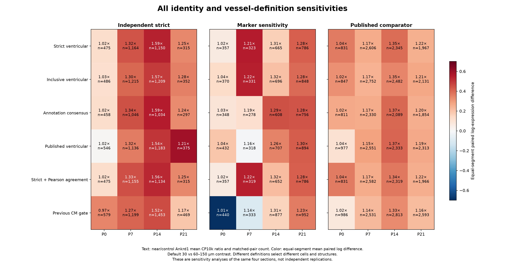

# Whole-heart reassessment of Ankrd1 and arterial neighborhoods

The revised analysis supports higher **measured Ankrd1 expression near candidate arterial structures at P7 and P14**. P0 has little difference in the primary comparison; P21 retains a smaller positive association. This revises the earlier weak/negative spatial interpretation based on whole-section nearest-endothelial-centroid distances. It supports a peri-arterial association within these sections, without establishing a distinct anatomical subtype, causation or a replicated age trajectory.

[Complete 12-page report (PDF)](whole_heart_Ankrd1_arterial_report.pdf) · [Primary results (TSV)](primary_local_Ankrd1_results.tsv) · [All 432 sensitivity contrasts](local_Ankrd1_contrasts.tsv) · [Validation](validation.json)



## Primary comparison

Strict ventricular-marker-supported CMs within **0–30 µm** of independently defined arterial EC + smooth-muscle vascular-cell envelopes are matched 1:1 to CMs **60–150 µm** away. Controls belong to the same candidate segment's neighborhood, lie within 100 µm of their paired CM, and satisfy expression-depth, cell-area and endocardial-distance calipers. Cells inside the envelope are excluded. Values compare normalized, directly measured expression, without smoothing or imputation.

| Stage | Strict ventricular CMs | Eligible small segments | Segments with matched pairs | Matched pairs | Near/control Ankrd1 mean expression | Segments with positive mean paired log difference |
|---|---:|---:|---:|---:|---:|---:|
| P0 | 19,304 | 18 | 10 | 475 | 1.02× | 70% |
| P7 | 39,383 | 33 | 29 | 1,164 | 1.32× | 83% |
| P14 | 42,796 | 73 | 61 | 1,150 | 1.59× | 80% |
| P21 | 48,140 | 22 | 17 | 315 | 1.25× | 82% |

The stage-specific Ankrd1-high fraction is also higher near vessels at P7 (31% versus 19%) and P14 (45% versus 25%). The secondary Creb5/Tlr4/Atf3 response-module score has a positive equal-segment mean paired difference at all four ages, largest at P0/P7. It is supportive expression evidence, not a direct measurement of mechanical stress.

The near/control ratio pools matched cells, whereas the segment plot gives equal weight to each candidate segment. These are different summaries. In particular, P0 has a small positive mean paired log difference despite almost identical arithmetic-mean expression. Absolute normalized values across ages are affected by assay and biological composition, so the principal interpretation uses **within-section contrasts**.

## What changed

1. **Full reference competition.** All resolved reference lineages compete for every eligible spatial cell. CM markers cannot override a stronger non-CM assignment. Uncertain, mixed and low-information cells remain in the output with flags.
2. **Vascular structures rather than isolated EC landmarks.** Candidate arterial ECs require endothelial lineage, a multi-gene arterial panel and nearby smooth muscle. Native deposited EC/SMC polygons define a vascular-cell envelope.
3. **Local covariate-matched controls.** The outcome is measured Ankrd1 intensity and a separately withheld response module in nearby CMs. Controls come from the same vessel neighborhood, with depth, area and endocardial-proximity constraints.

Several choices changed together. The revised result therefore cannot be attributed solely to adding non-CMs to the reference. Indeed, applying the new local test to the previous CM gate also gives positive P7/P14 associations. The previous analysis already used published arteriole-EC landmarks; their presence alone was insufficient to answer the local vessel-neighborhood question.

The new strict ventricular cohort agrees more frequently with published CM annotations: P0 **97.5%**, P7 **88.2%**, P14 **92.2%**, P21 **94.7%**, compared with **85.9%, 73.1%, 65.4%, 67.0%** for the previous CM gate. This is **concordance, not independent accuracy**, and cohort membership changes. Published labels were not inputs to the new primary lineage fits.

## Maps and geometry review

| Stage | Whole-heart lineages, arterial structures and measured CM Ankrd1 | Vessel-centered zooms |
|---|---|---|
| P0 | [PNG](P0_whole_heart_arterial_maps.png) · [PDF](P0_whole_heart_arterial_maps.pdf) | [PNG](P0_arterial_neighborhood_zooms.png) · [PDF](P0_arterial_neighborhood_zooms.pdf) |
| P7 | [PNG](P7_whole_heart_arterial_maps.png) · [PDF](P7_whole_heart_arterial_maps.pdf) | [PNG](P7_arterial_neighborhood_zooms.png) · [PDF](P7_arterial_neighborhood_zooms.pdf) |
| P14 | [PNG](P14_whole_heart_arterial_maps.png) · [PDF](P14_whole_heart_arterial_maps.pdf) | [PNG](P14_arterial_neighborhood_zooms.png) · [PDF](P14_arterial_neighborhood_zooms.pdf) |
| P21 | [PNG](P21_whole_heart_arterial_maps.png) · [PDF](P21_whole_heart_arterial_maps.pdf) | [PNG](P21_arterial_neighborhood_zooms.png) · [PDF](P21_arterial_neighborhood_zooms.pdf) |



Zoom examples are selected by most primary matched pairs, without selection on Ankrd1 effects. Black outlines are vascular-cell envelopes, blue dashed outlines are 30 µm, and dotted outlines are 60 and 150 µm. Arterial ECs are squares; smooth-muscle cells are triangles. Some structures are disconnected or longitudinal fragments; these are **candidate vascular segments requiring anatomical review**, not histologically verified individual arterioles.

## Sensitivity analyses

All six CM cohorts, three vessel definitions, three distance contrasts and three additional geometry alternatives are reported: **108 contrasts per stage**, 432 total. Default near/control ratios for the same strict CM cohort are:

| Vessel definition | P0 | P7 | P14 | P21 |
|---|---:|---:|---:|---:|
| Independent strict | 1.02 | 1.32 | 1.59 | 1.25 |
| Independent marker sensitivity | 1.02 | 1.21 | 1.31 | 1.28 |
| Published arteriole EC + SMC comparator | 1.04 | 1.17 | 1.35 | 1.22 |



The P7/P14 direction persists in the strict cohort across the 20/40–100, 30/60–150 and 50/100–200 µm contrasts, and when distance is measured to unbuffered cell polygons, their convex hull or the nearest constituent EC centroid. P0 effects are small and can reverse with EC-centroid distance. [Geometry and threshold figure](distance_geometry_sensitivity.png).

Primary matching gives median near/control transcript-depth ratios of **1.009, 0.981, 0.989, 0.985** and median cell-area ratios of **0.997, 1.010, 1.012, 1.012**, respectively. Mean paired physical separations are 68–71 µm. Full diagnostics: [matching balance](primary_matching_balance.tsv).

## Methods and interpretation limits

**Input and reference.** All 408,054 deposited spatial cells are retained, with unchanged native centroids and original integer counts for 403 targets. Of these, 402,227 satisfy source expression QC plus at least 20 shared training molecules and eight training genes. The reference uses 72,949 QC-passing, resolved nuclei across eight RNA libraries (two per age); libraries are technical sensitivity units, not assumed to be independent animals. It includes cardiomyocytes, endothelial cells, fibroblasts, pericytes, smooth muscle, immune, epicardial and glial reference classes. Limited panel support can prevent a reference class from receiving a resolved spatial assignment.

**Identity fitting.** Ankrd1, Creb5, Tlr4 and Atf3 are excluded from all new identity fits and their fitting size-factor denominators. The remaining **377 shared genes** enter log-normalized, separately assay-centered/scaled, clipped features and a 30-neighbor weighted projection (temperature 0.10). No spatial author labels, subtype quotas or spatial smoothing are used in primary fitting. A resolved lineage requires weight ≥0.70, margin ≥0.15, canonical marker support, agreement with the original-count RNA reference and agreement with both separate RNA-library projections. A Pearson comparator is also retained. These weights are similarity summaries, not calibrated probabilities. This is a weighted reference projection, **not a new native CytoSPACE run**.

**CM restriction.** Strict CMs additionally require at least three CM panel genes, ten CM molecules and 10% of the 403-target total; strong competing non-CM marker coexpression is flagged for review. Ventricular support requires measured Myl2 ≥2 and Myl2 ≥Myl4. This is an operational chamber-marker gate, not anatomical proof. The inclusive cohort relaxes the broad vote/marker requirements; the annotation-consensus cohort requires agreement with published ventricular states. No new fine CM subtype labels are asserted here. [Earlier fine candidates reassessed](previous_fine_candidates_reassessment.tsv).

The source expression-QC and canonical marker-fraction gates retain the original full-panel totals, which include outcome counts. Outcome genes are withheld from the new projection features and their normalization, but this is not a claim that every upstream cell-selection quantity is outcome-independent.

**Vessel definition.** Strict arterial seeds are resolved ECs with at least two Gja4/Gja5/Efnb2/Dll4/Hey1/Jag1 genes, at least one Gja4/Efnb2/Dll4 gene, and conditional arterial-reference weight ≥0.30. ECs are clustered with DBSCAN, radius 35 µm and minimum two cells. Each nearby SMC is assigned once to its nearest clustered arterial EC within 35 µm. Strict SMCs require resolved smooth-muscle lineage, at least two Myh11/Acta2/Tagln/Cnn1 genes and Myh11 or Cnn1 detection. Accepted segments require ≥2 ECs, ≥2 SMCs, ≥50% of ECs with SMC coverage within 35 µm, and mural occupancy in ≥2 angular quadrants. The primary envelope is the union of source vascular-cell polygons buffered by 3 µm. Primary small segments have convex-hull equivalent diameter ≤150 µm and maximum span ≤300 µm. These are computational size criteria, not measured lumen diameters.

**Outcome and controls.** Ankrd1 CP10k uses all 403 measured targets minus the four withheld outcome genes as its denominator; zero denominators are floored at one. The response module is the mean log1p(CP10k) of Creb5, Tlr4 and Atf3. High-expression cutoffs are stage-specific strict-CM upper quartiles. Matching is 1:1 without replacement, within the same nearest-segment assignment, with physical separation ≤100 µm, depth and area ratios 0.5–2, and endocardial-distance difference ≤50 µm. A fixed random ordering (seed 184) and covariate score determine matches without using outcomes. Endocardial distance uses published endocardial ECs as an anatomical proxy; published labels therefore enter this matching covariate and comparator cohorts, although they do not enter primary identity fitting or strict vessel definition. Local matching does **not** replace validated LV/RV, wall-depth or tissue-compartment masks.

**Replication and specificity.** There is one deposited section per stage. Cells, matched pairs and vessel fragments are not independent animals; multiple segments can belong to one vessel. The tables retain an exploratory segment sign-flip statistic, which is not an animal-level test and can be affected by correlated fragments. No biological-replication significance claim is made. Automated EC/SMC geometry, section orientation, segmentation, local tissue structure, oxygenation and mechanics remain possible influences. DAPI inspection supplies context but does not independently verify vessel anatomy. Kcnd2 and Irx5 are **not assayed** in this Xenium panel. The current analysis does not establish a Kcnd2 gradient, vascular causality, or an exact reproduction of the paper's discrete Ankrd1-CM subtype boundaries or developmental claims.

## Downloadable data

Each [P0](P0/), [P7](P7/), [P14](P14/) and [P21](P21/) directory contains:

| File | Contents |
|---|---|
| `whole_heart_cell_annotations.tsv.gz` | Every original spatial cell; coordinates, competing lineage votes, lineage/CM confidence flags, measured markers and response outcomes |
| `whole_reference_weights.npz` | Query/reference cell IDs; 30 source-nucleus indices and weights per eligible cell; broad/state classes and weights |
| `reference_pool.tsv.gz` | Eligible reference nuclei and RNA-library/state metadata |
| `arterial_segments.geojson` | Vascular-cell envelopes, native unbuffered polygons, hulls, constituent EC/SMC IDs and geometry criteria; coordinates in native µm, not longitude/latitude |
| `arterial_segment_summary.tsv` | All candidate segment counts, sizes and acceptance flags |
| `arterial_boundary_distances.tsv.gz` | Every cell's distance and nearest segment for all definitions/geometries |
| `default_contrast_matched_pairs.tsv.gz` | Original near/control cell IDs, segment IDs, outcomes and matching covariates for all default cohort/definition combinations |
| `local_Ankrd1_contrasts.tsv` | Every prespecified cohort/definition/distance contrast |
| `distance_expression_profiles.tsv` | Descriptive expression and high-expression fractions in distance bins |
| `segment_effects.tsv` | Per-segment mean paired differences at default thresholds |
| `cross_library_technical_metrics.tsv` | Opposite-library RNA transfer diagnostics; existing RNA labels are not independent biological truth |
| `*_completion.json` | Source hashes and completion provenance |

Stage-level cell IDs can repeat between sections; always use **stage + cell ID** when combining tables. Source matrices, public-author-label provenance and native DAPI images are described in the [original spatial analysis](../xenium_ventricular_mapping/README.md) and [published-label recovery](../author_atlas_baseline/README.md).

## Reproduction and validation

Run from the repository root with the previously prepared source matrices and downloaded native Xenium boundaries. The base Python environment and source-recovery requirements are documented in the linked analyses. The additional geometry requirement is [Shapely 2.1.2](../../analysis/requirements-vessel-analysis.txt).

```bash
UV_CACHE_DIR=/tmp/heart-uv-cache uv pip install --python /workspace/heart-atlas/venv/bin/python -r analysis/requirements-vessel-analysis.txt
export OPENBLAS_NUM_THREADS=2 OMP_NUM_THREADS=2 MKL_NUM_THREADS=2
/workspace/heart-atlas/venv/bin/python analysis/reassess_whole_heart_lineages.py
/workspace/heart-atlas/venv/bin/python analysis/define_heart_arterial_structures.py
/workspace/heart-atlas/venv/bin/python analysis/test_Ankrd1_arterial_neighborhoods.py
/workspace/heart-atlas/venv/bin/python analysis/validate_whole_heart_Ankrd1_vessels.py
/workspace/heart-atlas/venv/bin/python analysis/report_whole_heart_Ankrd1_vessels.py
```

The first three scripts resume completed stages using completion files. To recompute after a scientific-method change, use a fresh output directory or remove the affected stage's completion files and all dependent outputs before rerunning. Source-specific workspace paths are intentionally explicit in the scripts.

[Validation](validation.json) independently checks every source cell ID and coordinate, integer-derived outcomes and denominators, reference weights and constraints, sampled nearest-neighbor calculations, candidate membership and source-boundary reconstruction, sampled geometry distances, and all **80,493** default matched pairs across cohorts/definitions. It verifies numerical conservation and implementation, not independent anatomical or biological validity. [Manifest](file_manifest.tsv) records output and analysis-script SHA-256 hashes.

Deposited Xenium data and DAPI derivatives are attributed to Wang, Dong, Song, Qian and Liu (CC BY 4.0); the public WebAtlas labels are attributed to the article's authors. Source accession, download and attribution details remain in the linked original spatial analyses.
