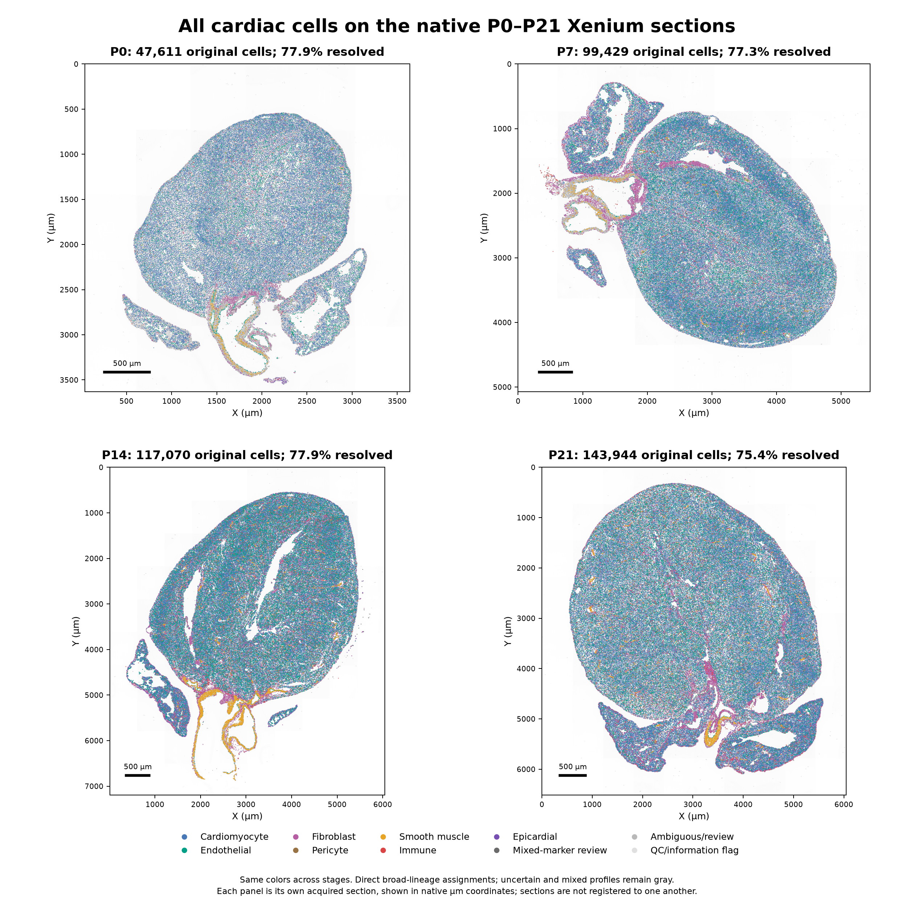
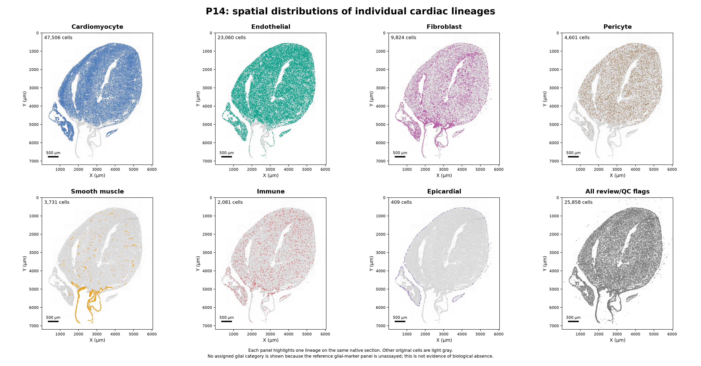
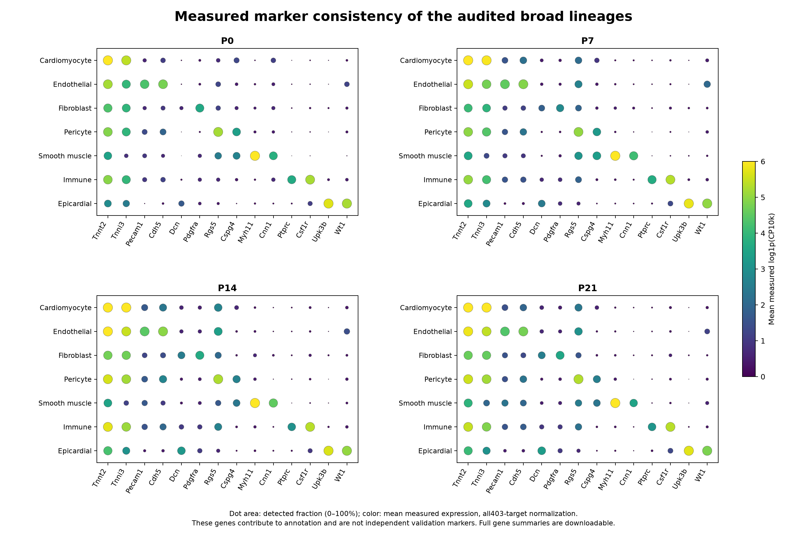
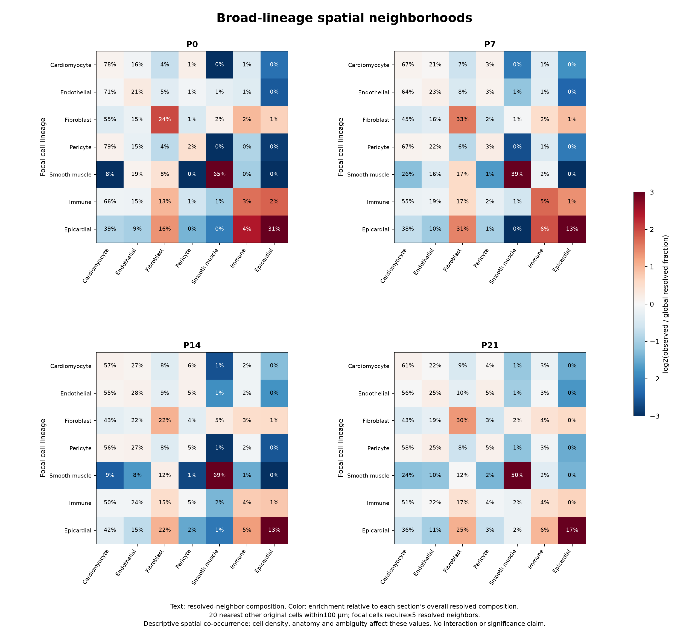

# All cardiac cells on the P0–P21 Xenium sections

**Transcript-level QC follow-up:** [Boundary inspection and segmentation sensitivity](../xenium_boundary_qc/README.md) now reconstructs the source matrices from molecules, tests alternative boundaries and provides targeted review flags while retaining CM profiles without nuclear area. The native counts/labels in this atlas remain the baseline; the follow-up does not silently replace them.

The whole-heart atlas now includes reviewed broad identities for cardiomyocytes and six non-CM classes: **endothelial cells, fibroblasts, pericytes, smooth-muscle cells, immune cells and epicardial cells**. All **408,054 original spatial profiles** remain in their native positions. There are **313,607 resolved assignments**, including **130,385 non-CMs**; mixed, ambiguous and QC-flagged profiles remain accessible.

[12-page atlas report](whole_heart_spatial_atlas_report.pdf) · [Offline interactive viewer](interactive_whole_heart_atlas.html) · [Xenium QC: implemented checks and remaining segmentation work](XENIUM_QC.md) · [Available-QC diagnostics PDF](Xenium_available_QC_diagnostics.pdf)

**Using the viewer:** download the HTML file using GitHub's Download raw file button, then open it in a current browser. It embeds all408,054 original cell positions, DAPI previews and category labels; no external service is needed. Select a stage, toggle lineages or use the Non-CMs button, zoom/pan, hover for cell IDs/review flags, and download the current stage's annotations as CSV. The viewer requires modern browser support for gzip DecompressionStream. GitHub's source-code preview does not itself run the viewer. [Viewer screenshot](interactive_atlas_preview.png).



## Reviewed cell counts

| Identity | P0 | P7 | P14 | P21 |
|---|---:|---:|---:|---:|
| Cardiomyocyte | 26,760 | 47,749 | 47,506 | 61,207 |
| Endothelial | 6,394 | 16,010 | 23,060 | 24,153 |
| Fibroblast | 2,319 | 8,564 | 9,824 | 13,083 |
| Pericyte | 460 | 1,944 | 4,601 | 4,548 |
| Smooth muscle | 598 | 909 | 3,731 | 1,851 |
| Immune | 297 | 1,275 | 2,081 | 3,375 |
| Epicardial | 238 | 367 | 409 | 294 |
| Mixed-marker review | 559 | 1,680 | 4,231 | 5,271 |
| Ambiguous/review | 8,575 | 19,352 | 20,364 | 28,588 |
| QC/information flag | 1,411 | 1,579 | 1,263 | 1,574 |

These are counts of **segmented spatial profiles passing operational annotation criteria**, not an unbiased census of complete biological cells. The deposited sections differ in size/orientation and are not independent age replicates. The count/fraction differences do not establish developmental abundance changes. [Machine-readable counts](lineage_counts.tsv).

## What the spatial distributions show

- **Cardiomyocytes and endothelial cells** are broadly interspersed through the myocardial regions. The broad EC category includes several vascular/endocardial programs; those subtypes are not individually resolved by this atlas layer.
- **Fibroblasts** occupy interstitial and surface/large-structure-associated regions, with appreciable spatial concentration. Fibroblast neighbors are enriched around fibroblast focal cells relative to each section's global resolved composition (approximately2.1–3.9-fold), consistent with nonuniform stromal organization.
- **Pericytes** are dispersed within myocardial/vascular territories. Broad centroid proximity alone does not verify capillary wrapping or distinguish all transitional mural states.
- **Smooth-muscle cells** form conspicuous localized tracks and rings associated with large vascular structures, plus smaller intramyocardial foci. Around SMC focal cells, 39–69% of resolved neighbors are also SMCs, compared with roughly1–4% globally. These broad structures include large-vessel walls, not only arterioles.
- **Epicardial-marker-supported profiles** are strongly concentrated at surface-associated sites. Their neighborhoods contain approximately16–31% fibroblasts, or2.1–2.8 times each section's global fibroblast fraction. This is consistent with a spatially organized surface/stromal compartment, without independently traced anatomical layers.
- **Immune cells** are scattered with local clusters, including stromal/surface-associated neighborhoods. Fibroblasts represent approximately13–17% of their resolved neighbors (1.4–2.0-fold relative enrichment). The broad immune category does not establish macrophage activation states or immune function.

These are descriptive patterns supported by direct maps and [neighborhood tables](neighborhood_composition.tsv), not evidence of cell–cell signaling, causal interactions or independently replicated anatomical niches. A nearest-centroid analysis does not prove physical membrane contact.



## Per-stage maps and downloadable count atlases

| Stage | All-cell maps | Individual lineages | Segmentation zoom | Full count atlas | Annotations |
|---|---|---|---|---|---|
| P0 | [PNG](P0_all_cell_atlas.png) · [PDF](P0_all_cell_atlas.pdf) | [PNG](P0_lineage_spatial_panels.png) · [PDF](P0_lineage_spatial_panels.pdf) | [PNG](P0_all_cell_geometry_zoom.png) · [PDF](P0_all_cell_geometry_zoom.pdf) | [H5AD](P0/P0_whole_heart_atlas.h5ad) | [TSV.gz](P0/all_cell_annotations.tsv.gz) |
| P7 | [PNG](P7_all_cell_atlas.png) · [PDF](P7_all_cell_atlas.pdf) | [PNG](P7_lineage_spatial_panels.png) · [PDF](P7_lineage_spatial_panels.pdf) | [PNG](P7_all_cell_geometry_zoom.png) · [PDF](P7_all_cell_geometry_zoom.pdf) | [H5AD](P7/P7_whole_heart_atlas.h5ad) | [TSV.gz](P7/all_cell_annotations.tsv.gz) |
| P14 | [PNG](P14_all_cell_atlas.png) · [PDF](P14_all_cell_atlas.pdf) | [PNG](P14_lineage_spatial_panels.png) · [PDF](P14_lineage_spatial_panels.pdf) | [PNG](P14_all_cell_geometry_zoom.png) · [PDF](P14_all_cell_geometry_zoom.pdf) | [H5AD](P14/P14_whole_heart_atlas.h5ad) | [TSV.gz](P14/all_cell_annotations.tsv.gz) |
| P21 | [PNG](P21_all_cell_atlas.png) · [PDF](P21_all_cell_atlas.pdf) | [PNG](P21_lineage_spatial_panels.png) · [PDF](P21_lineage_spatial_panels.pdf) | [PNG](P21_all_cell_geometry_zoom.png) · [PDF](P21_all_cell_geometry_zoom.pdf) | [H5AD](P21/P21_whole_heart_atlas.h5ad) | [TSV.gz](P21/all_cell_annotations.tsv.gz) |

Each H5AD contains the **unchanged integer403-target count matrix**, every original cell ID, reviewed and previous broad labels, lineage confidence/review fields, and native coordinates in `obsm['spatial']` (µm). The `.uns` fields include the stage, units, source hash, method description and the repository path to the acquired DAPI overview. To combine stages, use `stage_cell_id` (`stage::original_cell_id`): original barcodes can repeat across sections. Slashes in column names are replaced by underscores to support HDF5 keys; identity label values are unchanged. Some inherited reference-agreement columns with missing values are serialized as explicit strings in H5AD; the new principal atlas flags are boolean.

Selected zooms additionally include the original cell polygons in each stage's `geometry_zoom_polygons.geojson.gz`, cell IDs/annotations in `geometry_zoom_cells.tsv.gz`, and source/selection details in `geometry_zoom_provenance.json`. The example region is selected by broad-lineage diversity in a100µm tile, not by a preferred biological association. Both centroid and polygon maps use deposited native coordinates.

## How the non-CM identities were reassessed

The [earlier whole-reference projection](../whole_heart_Ankrd1_vessels/README.md) already let all resolved cardiac RNA lineages compete for eligible Xenium cells. This update **reuses those fits and adds an explicit non-CM audit** rather than claiming a new independent alignment. The primary projection uses377 shared genes,30-neighbor weights, and stage-matched references. Resolved labels require weight≥0.70, margin≥0.15, canonical marker support, and agreement with original-count and both separate RNA-library projections. No author spatial labels, subtype quotas or label smoothing determine primary assignments. Similarity weights are not calibrated probabilities.

Ankrd1/Creb5/Tlr4/Atf3 remain excluded from projection features and fitting denominators for consistency with the vessel analysis. The inherited source QC and canonical marker fractions use full-panel totals, so complete outcome-independent cell selection is not asserted.

The new audit additionally requires at least one detected lineage anchor in an already resolved non-CM:

| Broad identity | Additional anchor panel; ≥1 detected gene required |
|---|---|
| Endothelial | Pecam1, Cdh5, Esam, Tek, Vwf |
| Fibroblast | Dcn, Lum, Pdgfra, Tcf21 |
| Pericyte | Rgs5, Cspg4, Pdgfrb |
| Smooth muscle | Myh11, Cnn1 |
| Immune | Ptprc, Csf1r, Mertk, Cd22, Cd28, Cd8b1 |
| Epicardial | Upk3b, Wt1 |

These anchors supplement the inherited multi-gene and reference requirements; they are not stand-alone single-gene cell calling. Cells lacking an anchor move to Ambiguous/review. Previously resolved non-CMs with strong CM and non-CM panels (at least3 genes and10% of measured RNA in each) move to Mixed-marker review. Such coexpression can reflect segmentation leakage, biological expression or merged profiles; it is **not a proven doublet call**. Multiple strong non-CM panels are flagged but do not automatically remove related mural/stromal states. No previously ambiguous profile is promoted to a confident lineage. Cardiomyocyte assignments are unchanged.

The [audit table](nonCM_identity_audit.tsv) preserves counts before/after the additional checks. The conservative audit reduces resolved non-CMs from145,457 to130,385. The atlas contains11,741 mixed-marker review profiles including59 inherited mixed-CM cases. These flags are not an estimated segmentation-error rate.

The reference glial panel (Plp1/Sox10/S100b/Mpz) is not assayed. No confident glial category is assigned; this does **not** imply biological absence of neural/glial cells. Likewise, a broad lineage atlas does not claim exhaustive resolution of all rare cardiac cell types.

## Marker consistency, reference sensitivity and published comparisons



[Full403-gene profiles](measured_gene_profiles.tsv) report detection fraction, mean raw count and mean log1p(CP10k) for each stage/category. Marker plots use genes that influence annotation and therefore are **not independent validation**. The inherited [opposite-library RNA diagnostics](RNA_opposite_library_broad_metrics.tsv) address technical reference sensitivity, not anatomical accuracy or independent-animal replication.

[Published broad cross-tabulation](published_broad_comparison.tsv) compares with recovered public WebAtlas labels. They are comparators, not ground truth or fitting inputs. Published `.EC` and `.Fib` states are collapsed only for that comparison. Published `Blood` remains a separate comparator because it is not guaranteed to mean the same thing as our immune reference; `Neur` remains neural, without pretending that absent glial markers validate it.

## Spatial summaries and QC limits



For each cell, the20 nearest **other original profiles** within100µm are considered. Resolved focal profiles with at least5 resolved neighbors contribute to the neighborhood summary. Text gives resolved-neighbor composition; enrichment compares it with each stage's overall resolved composition. Unknown neighbors are excluded from that composition denominator. Local cell density, large structures, tissue edges and uncertain assignments affect these summaries; they are descriptive, unadjusted spatial co-occurrences. No animal-level p values are assigned. [100µm tile counts](spatial_100um_tile_counts.tsv.gz) describe segmented-profile counts/composition rather than histological area-normalized tissue densities.

**Segmentation remains a substantive limitation.** Native polygon overlays, centroid checks and count conservation do not establish correct biological cell boundaries. No new segmentation, transcript-level QV audit, molecule reassignment or indiscriminate ambient correction was performed. [The QC guide](XENIUM_QC.md) separates current filters/diagnostics from the remaining morphology- and transcript-level checks, including cardiomyocyte-specific size and multinucleation concerns. Missing nuclear area is flagged rather than automatically excluded.

The previous Ankrd1 vessel analysis remains a separately versioned result with its original vascular definitions. This non-CM atlas audit changes some non-CM confidence flags; it does not silently regenerate that association test. Its sensitivity to revised segmentation/vascular assignment belongs in the next QC-based reanalysis.

## Reproduction and numerical validation

The same base environment, source matrices, DAPI previews and native boundaries used in the preceding spatial analyses are required. Shapely2.1.2 is the geometry dependency; the optional viewer browser check uses Python Playwright and an installed Chromium executable (override `ATLAS_CHROMIUM_PATH` if necessary).

```bash
export OPENBLAS_NUM_THREADS=2 OMP_NUM_THREADS=2 MKL_NUM_THREADS=2
/workspace/heart-atlas/venv/bin/python analysis/build_whole_heart_spatial_atlas.py
/workspace/heart-atlas/venv/bin/python analysis/plot_whole_heart_spatial_atlas.py
/workspace/heart-atlas/venv/bin/python analysis/validate_whole_heart_spatial_atlas.py
/workspace/heart-atlas/venv/bin/python analysis/write_whole_heart_atlas_viewer.py
python analysis/check_whole_heart_atlas_viewer.py
/workspace/heart-atlas/venv/bin/python analysis/audit_xenium_segmentation_qc.py
/workspace/heart-atlas/venv/bin/python analysis/finalize_whole_heart_spatial_atlas.py
```

[Validation](validation.json) verifies unchanged source counts/IDs/gene order/coordinates for all408,054 profiles, independently recalculates lineage anchors and mixed-marker rules, checks every exported category count and measured gene detection/raw mean, reconstructs neighborhood summaries with200 additional brute-force sampled checks, and validates7,189 native zoom polygons and their memberships. The separate QC audit recomputes basic expression filters against native cell summaries. [Offline browser checks](viewer_browser_validation.json) verify stage switching, filters, DAPI toggle, zoom/reset and a complete143,944-row P21 CSV download, with no page errors. These verify implementation, not independent anatomy, segmentation correctness or biological replication. [Manifest](file_manifest.tsv) records source-derived artifact and analysis-script SHA-256 hashes; [runtime versions](runtime_versions.json) and [source provenance](source_provenance.json) are retained.

Deposited Xenium data and DAPI derivatives are attributed to Wang, Dong, Song, Qian and Liu (CC BY4.0); public atlas annotations are attributed to the article's authors. Source accessions and attribution details remain in the [original Xenium analysis](../xenium_ventricular_mapping/README.md) and [public-label recovery](../author_atlas_baseline/README.md). This repository atlas does not modify the authors' public WebAtlas site.
