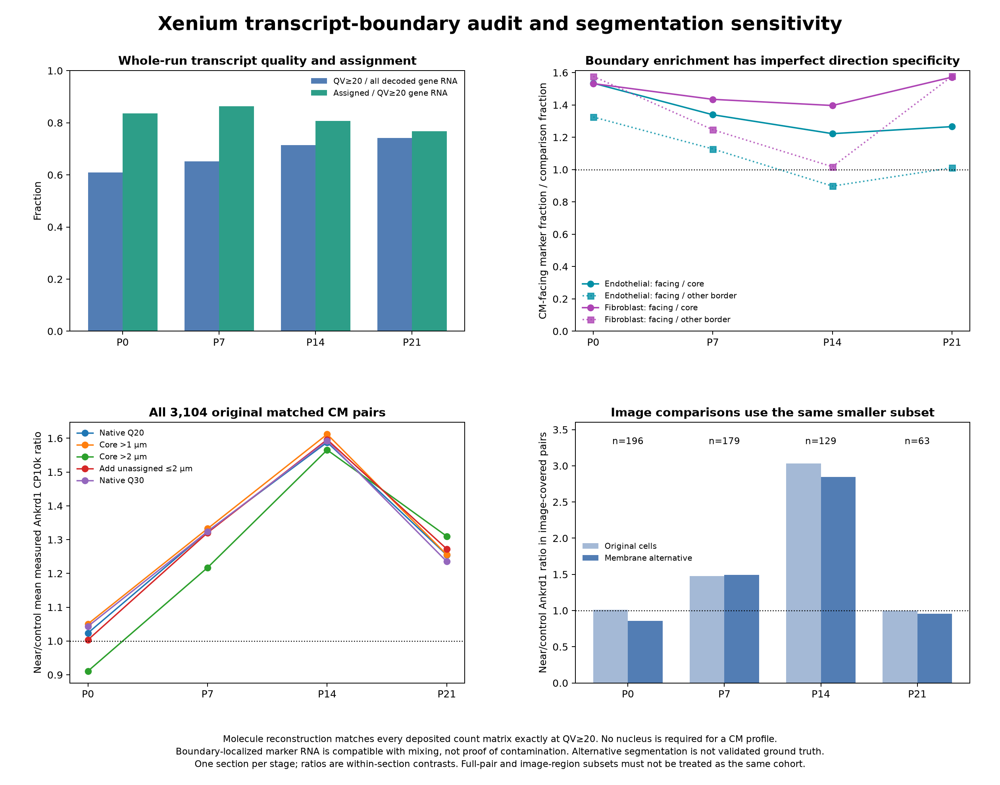
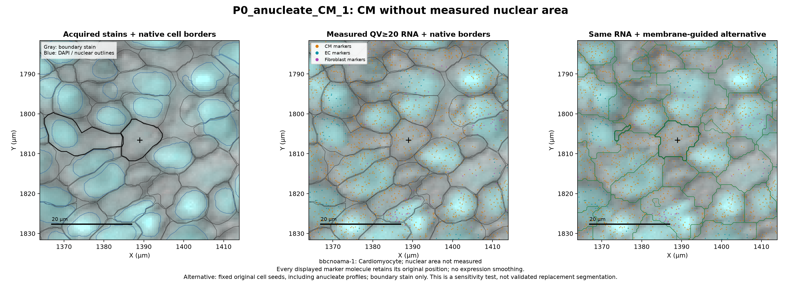
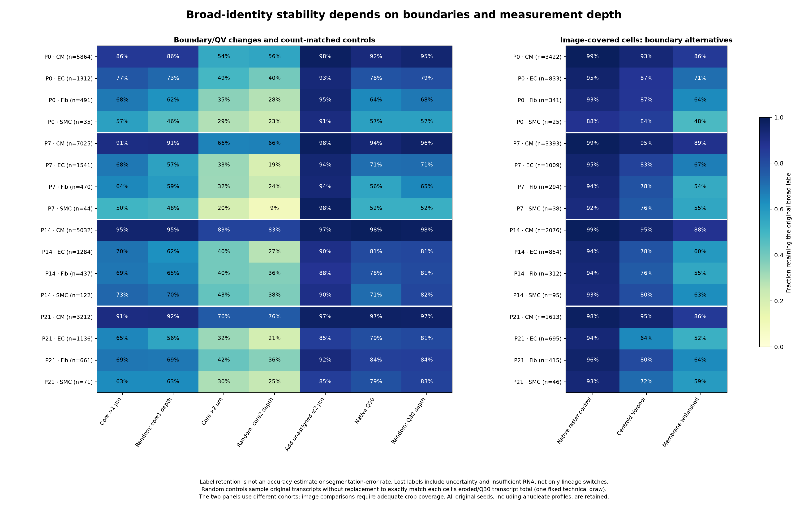

# Xenium transcript-level boundary inspection and segmentation sensitivity

**CM profiles without measured nuclear area are retained.** The new analysis inspects original transcript coordinates and acquired boundary/nuclear stains at CM–non-CM and peri-arterial interfaces, then rebuilds expression under fixed boundary alternatives. The main P7/P14 Ankrd1 association persists across the tested assignments; some broad non-CM labels are boundary-sensitive. No alternative segmentation is asserted as anatomical ground truth or automatically substituted into the native atlas.

[20-page report](Xenium_transcript_boundary_QC_report.pdf) · [All 32 inspected regions](selected_ROIs.tsv) · [Numerical validation](validation.json) · [Per-profile audit coverage](profile_audit_coverage.tsv)



## What was actually done

- Streamed **244,567,956 original decoded molecule records** across P0/P7/P14/P21. Counting assigned403-target gene molecules with **QV≥20 exactly reconstructs every deposited count matrix**, including all 408,054 original profiles and137,595,409 assigned gene transcripts. The QV/assignment fractions also match the vendor metrics with the correct gene-only denominators. Controls are not incorrectly counted as gene targets or as unassigned cell transcripts.
- Fixed **32 outcome-blind ROIs** before examining Ankrd1 effects: per stage, two arteriole-like regions with many previously matched pairs; ordinary and flagged CM–EC and CM–fibroblast interfaces; and two additional CM profiles without measured nuclear area adjacent to non-CMs. No region is selected for a positive Ankrd1 effect. The inherited count/marker gates still use full-panel totals.
- Retrieved native nuclear boundaries and the **ATP1A1/CD45/E-cadherin boundary-stain channel** in addition to existing DAPI. Cell-stain-based vendor segmentation accounts for approximately 98.1–99.9% of profiles across the four runs, consistent with detecting cytoplasmic profiles without requiring a nucleus in every section.
- Measured gene-transcript localization in deep cell interiors, the1µm boundary shell facing an opposite-lineage polygon, and other boundary-shell regions. The actual molecule coordinates remain unchanged.
- Tested **1µm and2µm erosion**, **limited2µm expansion into currently unassigned transcripts**, and **QV≥30**. The expansion considers competing deposited polygons, rejects exact nearest-cell ties, and does not steal already assigned RNA. Anucleate profiles are not excluded.
- Rebuilt **0.5µm-grid fixed-seed Voronoi and membrane-guided watershed boundaries** in the image ROIs, then regenerated QV≥20 expression from actual molecules. Every original ROI cell centroid is retained as a seed, including profiles without measured nuclear area. A native-raster control exposes numerical grid effects.
- Added exact **count-matched random thinning controls** for both erosion depths and Q30, using within-cell hypergeometric sampling without replacement. These controls were added after observing substantial RNA loss, not selected to optimize Ankrd1 effects. One fixed technical draw per condition is retained.
- Repeated broad reference assignment using the original full-stage query calibration and original same-stage RNA references. The baseline exactly reproduces the existing atlas labels for all 36,197 targeted profiles. Image-comparison cell summaries cover20,269 unique profiles with adequate crop coverage. No nuclear-area gate enters the models.
- Recalculated Ankrd1 expression in the **same 3,104 original matched CM pairs**, including informative-pair, retained-CM and nuclear-area-stratum sensitivities. In eight selected arterial image regions, the vascular envelopes are also rebuilt from the alternative EC/SMC polygons and distance-category changes are reported.

## Main findings

### Legitimate CM cytoplasmic profiles are preserved

The examples show CM-marker RNA in profiles without a recorded nuclear area, with acquired morphology providing context. Missing nuclear area is an observation, not evidence of a failed cell or doublet. The absence of a focused nuclear signal does not independently prove the absence of a nucleus throughout a full3D cell.



The alternative boundaries retain all 32,089 contextual ROI seed instances, including4,576 CM seed instances without measured nuclear area; overlapping ROIs can contain the same original profile. No nucleus or global upper-size rule discards these profiles. Strong erosion can nevertheless make a legitimate profile too sparse for confident RNA assignment: this happens especially in early anucleate-section candidates. That is not a recommendation to remove them from the native atlas.

[CM retention by nuclear-area status](anucleate_CM_retention.png) · [Targeted nuclear-area counts](target_profile_nuclear_area_summary.tsv)

### Boundary mixing is plausible, with imperfect directional specificity

In supported EC and fibroblast profiles, the CM-marker fraction in the CM-facing boundary shell is approximately**1.2–1.6 times** its fraction in the deep interior. This is compatible with boundary mixing or neighboring CM cytoplasmic signal affecting assignments. However, CM-marker RNA remains in the interiors too, and EC enrichment at CM-facing versus other borders is **not uniform**; for example, P14 ECs have a higher CM-marker fraction at the other-border comparison. These are descriptive patterns, not a measured contamination fraction or proof that every mixed profile is technical.

[Measured localization table](CM_marker_boundary_localization.tsv) · [All class/region summaries](boundary_marker_localization_summary.tsv)

### Broad identity is more stable for CMs than for some non-CMs

Under the membrane-guided alternative, approximately**86–89% of original CMs**, **52–71% of original ECs**, and **54–64% of original fibroblasts** in the image-covered comparison retain the same broad label. Lost labels often become ambiguous or information-limited; they are not all switches to another lineage. These percentages are **not accuracy estimates or segmentation-error rates**. The alternative uses one boundary channel and fixed seeds; the vendor segmentation used additional cell-interior stains and is not automatically inferior.

Random-thinning controls show why coverage matters. Across the tested profiles, CM-label retention after1µm erosion is approximately 90.5%, versus90.8% after count-matched random thinning; after2µm erosion it is68.2%, versus68.8%. EC/fibroblast identity is retained somewhat more often after erosion than after count-matched random thinning, consistent with informative spatial differences in the retained RNA. These controls do not establish which anatomical boundary is correct.



### P7/P14 Ankrd1 enrichment survives the tested assignments

Each value below is the ratio of mean measured Ankrd1 CP10k in near-vessel CMs to local controls, using the same original pairs and vascular distances. No cells are excluded just for lacking nuclear area.

| Stage | Native Q20 | Core >1µm | Core >2µm | Add unassigned ≤2µm | Native Q30 | Original pairs |
|---|---:|---:|---:|---:|---:|---:|
| P0 | 1.02 | 1.05 | 0.91 | 1.00 | 1.04 | 475 |
| P7 | 1.32 | 1.33 | 1.22 | 1.32 | 1.32 | 1,164 |
| P14 | 1.59 | 1.61 | 1.57 | 1.60 | 1.59 | 1,150 |
| P21 | 1.25 | 1.26 | 1.31 | 1.27 | 1.24 | 315 |

The P7/P14 direction also persists when both members must retain sufficient expression information. For2µm erosion, those informative-pair ratios are approximately 1.27 at P7 and1.61 at P14. The complete results retain all filters, nuclear-area strata and random controls: [assignment sensitivity](Ankrd1_boundary_sensitivity.tsv), [depth controls](Ankrd1_depth_control_sensitivity.tsv).

The membrane-informed comparison uses a **smaller, separately reported image-covered subset**:

| Stage | Native in image subset | Membrane alternative in the same subset | Pairs |
|---|---:|---:|---:|
| P0 | 1.01 | 0.86 | 196 |
| P7 | 1.48 | 1.50 | 179 |
| P14 | 3.03 | 2.84 | 129 |
| P21 | 1.00 | 0.96 | 63 |

The two selected P21 image regions already have little enrichment under the original assignment. Their membrane-alternative result must not be compared directly with the full P21 ratio1.25 to claim that resegmentation removed the signal. P0 remains weak, and P21 has regional heterogeneity. The evidence most consistently supports the P7/P14 within-section association, without establishing causal vascular effects or a replicated developmental trajectory.

[Eight-region vascular envelope sensitivity](selected_vessel_envelope_sensitivity.tsv) · [Changed pair distances](selected_vessel_pair_distances.tsv.gz) · [Geometry figure](selected_vessel_boundary_sensitivity.png)

## All transcript-level inspection figures

Each figure displays acquired stains/native outlines, original QV≥20 marker RNA/native borders, and the same RNA with the membrane-guided alternative. Individual gene-panel colors do not assert that every molecule is exclusive to that lineage. Dense marker groups are sampled to at most5,000 points for display only; the data retain all molecules. Nuclear outlines are deposited2D projections.

| Stage | Every selected region | CM–EC interfaces | CM–fibroblast interfaces | CMs without measured nuclear area | Peri-arterial regions |
|---|---|---|---|---|---|
| P0 | [8-page PDF](P0_transcript_boundary_gallery.pdf) | [ordinary](P0/P0_Endothelial_ordinary_transcript_boundary_inspection.png) · [flagged](P0/P0_Endothelial_flagged_transcript_boundary_inspection.png) | [ordinary](P0/P0_Fibroblast_ordinary_transcript_boundary_inspection.png) · [flagged](P0/P0_Fibroblast_flagged_transcript_boundary_inspection.png) | [example1](P0/P0_anucleate_CM_1_transcript_boundary_inspection.png) · [example2](P0/P0_anucleate_CM_2_transcript_boundary_inspection.png) | [region1](P0/P0_arterial_1_transcript_boundary_inspection.png) · [region2](P0/P0_arterial_2_transcript_boundary_inspection.png) |
| P7 | [8-page PDF](P7_transcript_boundary_gallery.pdf) | [ordinary](P7/P7_Endothelial_ordinary_transcript_boundary_inspection.png) · [flagged](P7/P7_Endothelial_flagged_transcript_boundary_inspection.png) | [ordinary](P7/P7_Fibroblast_ordinary_transcript_boundary_inspection.png) · [flagged](P7/P7_Fibroblast_flagged_transcript_boundary_inspection.png) | [example1](P7/P7_anucleate_CM_1_transcript_boundary_inspection.png) · [example2](P7/P7_anucleate_CM_2_transcript_boundary_inspection.png) | [region1](P7/P7_arterial_1_transcript_boundary_inspection.png) · [region2](P7/P7_arterial_2_transcript_boundary_inspection.png) |
| P14 | [8-page PDF](P14_transcript_boundary_gallery.pdf) | [ordinary](P14/P14_Endothelial_ordinary_transcript_boundary_inspection.png) · [flagged](P14/P14_Endothelial_flagged_transcript_boundary_inspection.png) | [ordinary](P14/P14_Fibroblast_ordinary_transcript_boundary_inspection.png) · [flagged](P14/P14_Fibroblast_flagged_transcript_boundary_inspection.png) | [example1](P14/P14_anucleate_CM_1_transcript_boundary_inspection.png) · [example2](P14/P14_anucleate_CM_2_transcript_boundary_inspection.png) | [region1](P14/P14_arterial_1_transcript_boundary_inspection.png) · [region2](P14/P14_arterial_2_transcript_boundary_inspection.png) |
| P21 | [8-page PDF](P21_transcript_boundary_gallery.pdf) | [ordinary](P21/P21_Endothelial_ordinary_transcript_boundary_inspection.png) · [flagged](P21/P21_Endothelial_flagged_transcript_boundary_inspection.png) | [ordinary](P21/P21_Fibroblast_ordinary_transcript_boundary_inspection.png) · [flagged](P21/P21_Fibroblast_flagged_transcript_boundary_inspection.png) | [example1](P21/P21_anucleate_CM_1_transcript_boundary_inspection.png) · [example2](P21/P21_anucleate_CM_2_transcript_boundary_inspection.png) | [region1](P21/P21_arterial_1_transcript_boundary_inspection.png) · [region2](P21/P21_arterial_2_transcript_boundary_inspection.png) |

The20-page report contains four summary pages and four examples per stage. Each eight-page stage gallery includes all selected ROIs. These are computational inspections and representative visual reviews, not an independently scored expert pathology validation set.

## Review flags and downloadable data

Every stage folder contains `boundary_QC_profile_review_flags.tsv.gz` for **all original profiles**. `boundary_audit_tested` and `image_boundary_comparison_available` distinguish evaluated from unevaluated cells. **Untested variants/flags are NA, not a pass.** The candidate review flag prioritizes informative profiles whose labels change with 1µm erosion, limited expansion or the membrane alternative. It is not an automatic exclusion and never flags a cell solely because nuclear area is missing. Native atlas identities/counts remain unchanged.

| File/pattern | Contents |
|---|---|
| `*_molecules.parquet` | Original ROI/context transcript IDs, features, native x/y/z, QV, original cell assignment and nucleus-overlap field; computed boundary-distance/inside fields are appended |
| `*_segmentation_maps.npz` | Acquired boundary/DAPI samples and native-grid/Voronoi/watershed labels, native origin,0.5µm grid and cell IDs |
| `*_native_polygons.geojson.gz`, `*_<variant>_polygons.geojson.gz` | Native and alternative cell outlines in native µm coordinates; holes and disconnected components retained |
| `*_nuclear_boundaries.parquet` | Deposited nuclear outlines in the contextual ROI |
| `geometry_sensitivity_counts.npz` | Target cell IDs,403 genes and integer counts for native Q20, core1/core2, limited dilation and Q30; measured regional count arrays included |
| `*_ROI_count_variants.npz` | RNA reassignment count matrices for each ROI, including the native-raster control and comparison-coverage flag |
| `morphology_comparison_counts.npz` | Unique-owner image-comparison cells/counts; overlapping ROI cells counted once |
| `depth_matched_control_counts.npz` | Exact count-depth-matched random gene-transcript count matrices |
| `*_projection_assignments.tsv.gz` | New/old broad labels, information QC, reference weights, agreement and marker-review fields |
| `cell_boundary_audit.tsv.gz`, `cell_shell_marker_profiles.tsv.gz` | Per-profile physical boundary and measured marker-localization diagnostics |
| `ROI_cell_comparison_coverage.tsv.gz` | Image-crop coverage and edge eligibility; nucleus not required |
| `input_archive_member_provenance.json`, `vendor_metrics_summary.csv`, `*_completion.json` | ZIP member CRC/download provenance, run metadata, full-source SHA-256 and stage completion records |

Use **stage + cell ID** or **stage + transcript ID** to combine sections. Molecules/cells can repeat across contextual ROIs; do not pool overlapping ROIs as independent observations. Coordinates are µm, not geographic coordinates. The public full transcript members are large and are not duplicated in GitHub. Verified temporary full-member caches were removed after extraction to conserve workspace disk; exact ROI molecules, CRC/SHA records and reacquisition scripts are retained.

## Method limits

- The image alternatives deliberately preserve original centroid seeds and cellular territory (native ROI polygon union expanded2µm). They test **boundary placement and transcript assignment**, not independent cell-number discovery, complete recovery of missed cells, or all merge/split errors. The original nucleus-free profile seeds remain available.
- Watershed uses robust1st–99th percentile boundary-channel scaling,0.4µm Gaussian smoothing and fixed compactness0.001. DAPI is displayed but not used to require or seed nuclei. Additional vendor interior-RNA/protein stains were not inputs to the alternative. No RNA markers or Ankrd1 outcome optimize these boundaries.
- The0.5µm morphology grid is coarser than the native0.2125µm pixel size. A native-raster control quantifies assignment changes due to discretization. Acquired staining and numerical agreement do not establish complete biological cell outlines or3D membrane contact.
- Geometry/QV sensitivity uses36,197 selected profiles (all original matched CM pairs plus ROI/context cells). The image comparison uses20,269 unique fully covered inner profiles. These deliberately selected cohorts do not estimate a whole-heart segmentation-error rate. Controls/uncertain profiles remain retained.
- Broad reclassification holds the original full-stage query/reference calibration fixed and includes original-reference and both RNA-library agreement. This isolates perturbations rather than refitting each altered assay to force agreement. Ankrd1/Creb5/Tlr4/Atf3 remain excluded from projection features/normalization; inherited full-panel count/marker fractions are not completely outcome-independent.
- Local effects use frozen original CM pairs. Selected-vessel geometry tests rebuild the same EC/SMC memberships and report changes in distance categories; they do not independently reannotate the entire vasculature. No animal-level significance or causal inference is claimed from one section per age.

## Reproduction and validation

The preceding atlas/reference/native count matrices, original DAPI files and native cell boundaries are required. [Additional pinned dependencies](../../analysis/requirements-boundary-qc.txt) and [runtime versions](runtime_versions.json) are recorded. The acquisition script extracts exact members through bounded HTTP ranges, checks response ranges, ZIP size and CRC, and does not download whole 8–20GB archives. Full-source image files are read as individual TIFF pages, avoiding accidental multi-file OME-series zero filling.

```bash
export OPENBLAS_NUM_THREADS=1 OMP_NUM_THREADS=1 MKL_NUM_THREADS=1
python analysis/design_xenium_boundary_qc.py
# Repeat these steps for P0, P7, P14 and P21 in an environment with the pinned packages.
python analysis/acquire_xenium_boundary_inputs.py --stage P0 --members metrics_summary.csv nucleus_boundaries.parquet morphology_focus_0001.ome.tif transcripts.parquet
python analysis/prepare_xenium_boundary_segmentations.py --stage P0
python analysis/process_xenium_boundary_molecules.py --stage P0
python analysis/reassign_xenium_boundary_ROIs.py --stage P0
python analysis/analyze_xenium_boundary_sensitivity.py --stage P0
python analysis/analyze_xenium_boundary_depth_controls.py --stage P0
# After all four stages complete:
python analysis/audit_xenium_vessel_boundary_changes.py
python analysis/summarize_xenium_boundary_qc.py
python analysis/validate_xenium_boundary_qc.py
python analysis/plot_xenium_boundary_qc.py
python analysis/report_xenium_boundary_qc.py
python analysis/finalize_xenium_boundary_qc.py
```

The full-source cache can be removed after verified extraction, as documented per stage. Completed numerical stages resume from their completion files; scientific-method changes require regenerating affected/dependent outputs in a clean result directory. Numerical reproduction needs the existing source/reference artifacts; the downloaded ROI products can be inspected independently.

[Validation](validation.json) checks exact Q20 reconstruction across all 408,054 profiles; all 36,197 native target labels; monotonic erosion/dilation/QV count bounds; exact random-control depths; all 32 ROI RNA reassignments;64,178 alternative cell-polygon instances and positive/negative pixel membership including holes;3,200 independently recomputed source-boundary distances; all contextual seeds including nucleus-area-missing CMs; and Ankrd1 ratios/log differences in every original matched pair for every primary assignment variant. These verify calculations and source conservation, not anatomical truth. [File/script manifest](file_manifest.tsv) records SHA-256 hashes.

Deposited Xenium data and image derivatives are attributed to Wang, Dong, Song, Qian and Liu (CC BY4.0). Source accessions and original atlas context are in the [whole-heart atlas](../whole_heart_spatial_atlas/README.md), [original Xenium analysis](../xenium_ventricular_mapping/README.md) and [earlier vessel analysis](../whole_heart_Ankrd1_vessels/README.md). The native atlas remains available; the current release adds sensitivity products and review flags rather than a claim of universally corrected segmentation.
