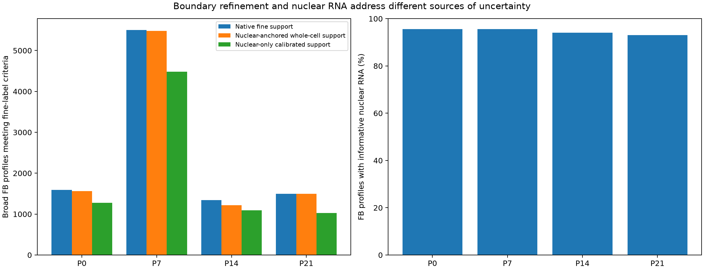
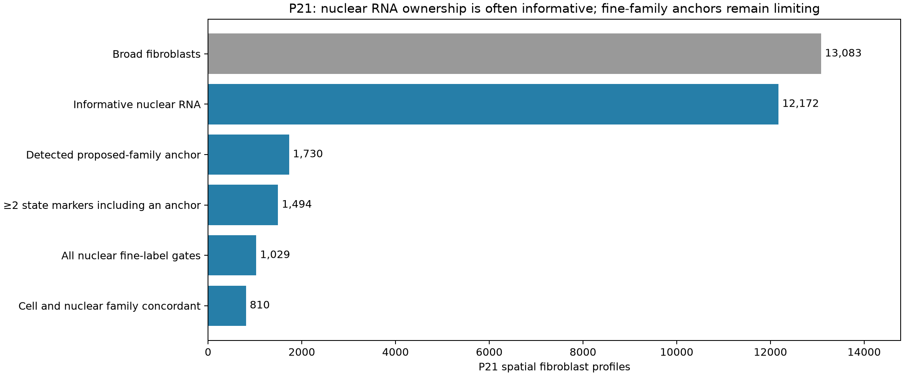

# Nuclear-anchored, antibody-guided whole-section Xenium segmentation

**Completed for P0, P7, P14 and P21:** nuclear-anchored membrane-guided refinement, molecule-level reassignment, whole-cell versus nuclear-only fibroblast mapping, paired RNA-depth controls and per-profile evidence tiers.

[Illustrated report](nuclear_anchored_segmentation_report.pdf) · [Whole-section summary](whole_section_summary.tsv) · [Evidence tiers](fibroblast_evidence_tier_summary.tsv) · [Validation](validation.json)

## What was done

The deposited DAPI-derived nuclear outlines anchor a watershed on the acquired ATP1A1/CD45/E-cadherin boundary-stain image, at 0.425µm. Multiple nuclear components belonging to one source profile retain the same profile ID. Source profiles without a nucleus retain a seed in their native cell interior. The native polygon union expanded by 2µm limits the cellular territory. No RNA marker, subtype, Ankrd1 or maturation score optimizes segmentation. This refines boundaries for existing profiles; it is not independent de novo nuclear detection or discovery of missed cells/merge-split errors.

Original Q20 gene molecules are reassigned from their actual coordinates; vendor-unassigned RNA remains unassigned in primary counts (an expanded-assignment sensitivity is supplied separately). Deposited nuclear-overlap assignments are retained rather than overturned by a coarser 2D projection. Projected nuclear ownership and disagreements are separate audit outputs. Nonnuclear RNA is assigned by the new image segmentation; projected nuclear conflicts remain unassigned unless the deposited nuclear-overlap flag supplies an owner. A high-confidence variant keeps nuclear RNA plus cytoplasmic RNA beyond a 0.85µm boundary band. Exact random depth controls match both this variant and nuclear-only RNA.

## Results

| Stage | All profiles | Nuclear anchors | Nucleus-free fallback anchors | Native supported FB labels | Nuclear-anchored supported | Nuclear RNA informative | Nuclear-only calibrated supported |
|---|---:|---:|---:|---:|---:|---:|---:|
| P0 | 47,611 | 42,605 | 5,005 | 1,591 | 1,562 | 2,217/2,319 | 1,280 |
| P7 | 99,429 | 84,597 | 14,832 | 5,504 | 5,479 | 8,190/8,564 | 4,480 |
| P14 | 117,070 | 103,729 | 13,341 | 1,343 | 1,221 | 9,242/9,824 | 1,093 |
| P21 | 143,944 | 121,416 | 22,528 | 1,497 | 1,499 | 12,172/13,083 | 1,029 |

Across stages, 6,847 profiles have concordant supported cell/nuclear family calls. Of these, **252 were previously unresolved** (15 P0, 114 P7, 60 P14 and 63 P21); 6,594 also agree with a supported native call. One P7 profile has concordant new cell/nuclear evidence for a family different from its native fine label and remains a cross-segmentation review case. These are additional evidence-qualified assignments, not validated anatomical truth.

[Per-profile resolution changes](fibroblast_segmentation_resolution_changes.tsv.gz) identify the newly corroborated profiles and stable/conflicting native calls explicitly.

All label counts use the preceding reviewed RNA hierarchy and unchanged marker/information/library gates. The native comparison exactly reproduces the preceding refit. Main variant comparisons freeze native-query gene scaling; a separately labeled nuclear-modality calibration is a sensitivity. Nuclear/cell agreement is corroborating evidence within the same profiles, not independent ground truth.

The unchanged fine-gate total changes from 9,935 to 9,761. Segmentation therefore does not generally increase fine-label coverage in these data. Retain the native vendor atlas as the primary reference and use the new nuclear concordance/resolution-change flags to qualify confidence. The new count matrices and maps remain explicitly identified alternatives; these results do not justify a blanket replacement of the native boundaries.

## How to use the labels

- **Cell and nuclear family concordant:** both assignments meet their criteria and agree; strongest available RNA/ownership corroboration, without anatomical validation.
- **Cell-supported; nuclear confirmation unavailable/unresolved:** a whole-cell fine assignment remains supported, but nuclear RNA does not establish that fine identity.
- **Nuclear-supported candidate; whole-cell strict criteria unmet:** useful follow-up candidate, kept separate from supported whole-cell calls.
- **Nuclear-cell family disagreement or mixed CM–FB marker review:** do not force a fine family.
- **Fine family unresolved:** retain the broad profile and uncertainty; no quota, smoothing or imputation creates a label.

[Gate-coverage table](fine_label_gate_coverage.tsv) distinguishes inadequate overall RNA information from absent state markers/anchors and reference disagreements. At P21, 12,172 profiles have informative nuclear RNA, but only 1,730 of those have a detected anchor under the nuclear-calibrated proposal, and 1,494 have at least two supplied state markers including an anchor. Thus enough RNA for testing is not enough evidence for a named fine family. Gates overlap, so these are not independent causes of failure.

A visible nucleus helps establish ownership; it does not guarantee that the limited Xenium panel detects enough subtype markers in that nucleus. Likewise antibody segmentation does not restore unmeasured genes. Lower support after nucleus-only/core restriction must be assessed against the exact depth controls, rather than automatically interpreted as either contamination removal or failed segmentation.

## Downloads

| Stage | Fibroblast maps | Image gallery | Full 403-gene count object | Per-profile evidence |
|---|---|---|---|---|
| P0 | [PNG](P0/P0_fibroblast_nuclear_anchored_maps.png) | [8-page PDF](P0/P0_nuclear_segmentation_gallery.pdf) | [H5AD](P0/nuclear_anchored_counts.h5ad) | [TSV.gz](P0/fibroblast_nuclear_cell_evidence.tsv.gz) |
| P7 | [PNG](P7/P7_fibroblast_nuclear_anchored_maps.png) | [8-page PDF](P7/P7_nuclear_segmentation_gallery.pdf) | [H5AD](P7/nuclear_anchored_counts.h5ad) | [TSV.gz](P7/fibroblast_nuclear_cell_evidence.tsv.gz) |
| P14 | [PNG](P14/P14_fibroblast_nuclear_anchored_maps.png) | [8-page PDF](P14/P14_nuclear_segmentation_gallery.pdf) | [H5AD](P14/nuclear_anchored_counts.h5ad) | [TSV.gz](P14/fibroblast_nuclear_cell_evidence.tsv.gz) |
| P21 | [PNG](P21/P21_fibroblast_nuclear_anchored_maps.png) | [8-page PDF](P21/P21_nuclear_segmentation_gallery.pdf) | [H5AD](P21/nuclear_anchored_counts.h5ad) | [TSV.gz](P21/fibroblast_nuclear_cell_evidence.tsv.gz) |

H5AD `X` is the nuclear-anchored whole-cell gene-count matrix. Layers contain `nuclear_only`, `high_confidence`, `depth_matched` and `nuclear_depth_matched` counts. All retain the source profile order and 403 gene targets; `atlas_identity` in metadata is the original broad annotation, not a newly validated broad identity. New counts are supplied as an alternative analysis, not silently substituted into prior biological models. Existing Ankrd1/maturation spatial models have not been refitted to these new counts.

The primary supported-label totals above count the unchanged fine gates before the additional mixed-marker and nuclear-disagreement review. The recommended cell-supported map also withholds those flagged profiles; its totals are included in `whole_section_summary.tsv`.

One P0 endothelial profile has its entire original 2D polygon covered by another profile’s projected nuclear territory. No unique nuclear-compatible image region is forced for it: its source counts/profile are retained and geometry is explicitly flagged unresolved. No CM is removed for lacking a nucleus.

The independent alternative uses the boundary channel and deposited nuclear outlines. The original vendor segmentation also had 18S and alphaSMA/Vimentin interior-stain inputs; this alternative is not automatically superior. Mixed-marker review rates and RNA-depth controls must be considered before replacing native boundaries. More supported labels are not an accuracy measure.

Each stage also contains the whole-section integer segmentation/nuclear-ownership grids and physical pixel size, segmentation area/seed audit, transcript-assignment totals, all transfer variants and per-profile evidence. Nuclear-only projected counts are a separate sparse NPZ control, with the same cell/gene order as the H5AD. There is one deposited spatial section per age; cells are not independent animal replicates.

Source: Wang, Dong, Song, Qian and Liu, deposited Xenium runs at Zenodo [14961929](https://zenodo.org/records/14961929) and [14961942](https://zenodo.org/records/14961942), CC BY4.0. The acquired stain crops and image derivatives are attributed to those authors.

Reproduce using `analysis/acquire_xenium_boundary_inputs.py` for the boundary image and full transcript member; run `analysis/nuclear_anchored_Xenium_segmentation.py --stage STAGE --part segment` then `--part count`, `analysis/project_nuclear_anchored_fibroblasts.py --stage STAGE`, and finally `analysis/report_nuclear_anchored_segmentation.py`. Use the existing heart-atlas Python environment and `OPENBLAS_NUM_THREADS=2 OMP_NUM_THREADS=2 MKL_NUM_THREADS=2`. The source DAPI/nuclear outlines, native cell polygons and reviewed RNA references must also be present. Completed stages resume from completion files; method changes require a clean derived result directory.

Full downloaded image/transcript caches can be evicted only after their CRC provenance, SHA-256 and completed derived products are recorded. Source atlas/counts remain intact. Validation checks source reconstruction, nuclear ownership conservation, coordinates, sampled serialized nuclear pixels, count controls, label gates and profile accounting; it does not establish anatomical ground truth.
