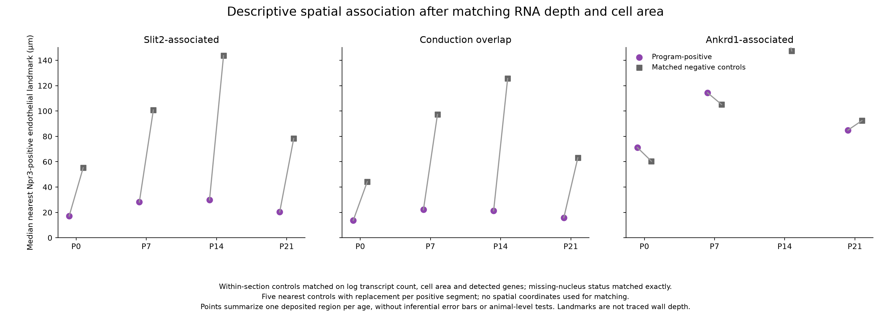
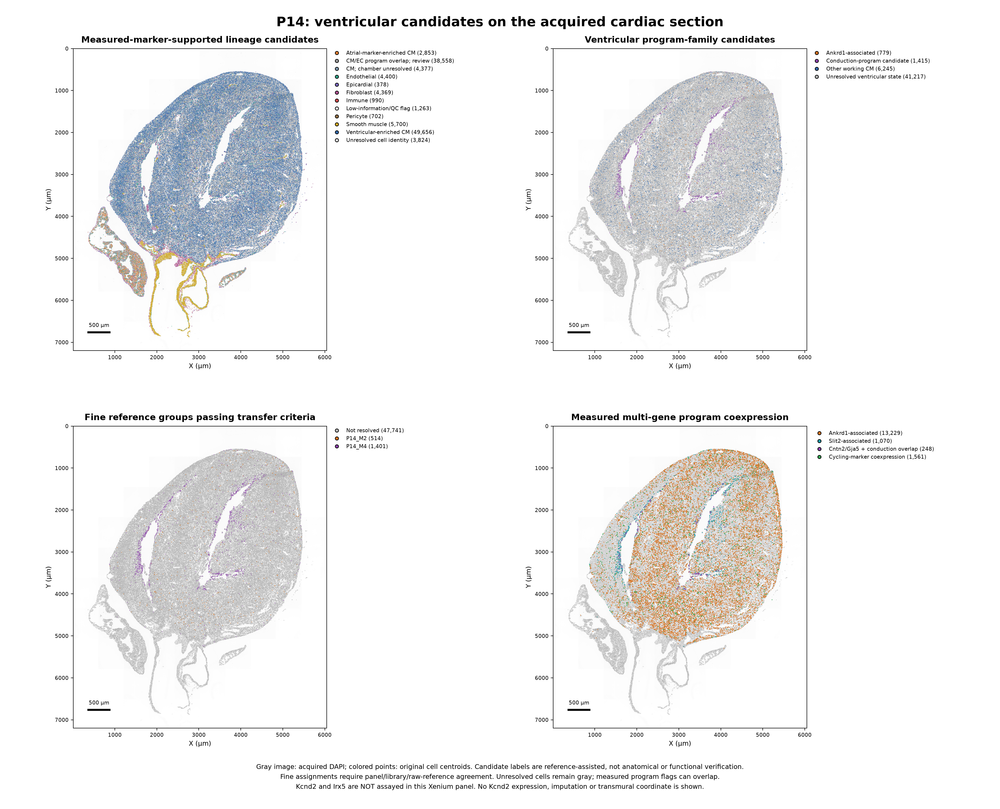

# Ventricular candidates on P0–P21 Xenium cardiac sections

This first-pass spatial analysis maps **measured RNA programs and filtered snRNA-reference-like candidates** onto all four deposited cardiac sections. It preserves **408,054 segmented cells and all 403 measured gene targets**. Reference matching uses **381 exact shared genes**; unsupported fine distinctions remain unresolved.

**Kcnd2 and Irx5 are not assayed in these Xenium files**, checked by both names and Ensembl IDs. No Kcnd2 measurement or imputation is presented. In mouse ventricular myocardium, higher Kcnd2/Kv4.2 toward the epicardial side and lower expression toward the endocardial side is consistent with the [Costantini/Bruneau mechanism](https://doi.org/10.1016/j.cell.2005.08.004). Its strength/timing should not be assumed identical from P0 to P21, and a single gene would not independently establish wall position.

## Main spatial observation

**The measured Slit2-associated program lies closer to Npr3-positive endothelial landmarks at every stage.** The difference persists when program-negative ventricular candidates are matched for transcript count, cell area, detected genes and missing-nucleus status.

| Stage | Slit2-program-positive segments | Median nearest Npr3/endothelial landmark | Matched negative controls |
|---|---:|---:|---:|
| P0 | 888 | 17.1 µm | 55.2 µm |
| P7 | 878 | 28.2 µm | 100.8 µm |
| P14 | 1,070 | 29.8 µm | 143.7 µm |
| P21 | 1,082 | 20.3 µm | 78.4 µm |

Cntn2/Gja5 conduction-overlap-positive candidates show a similar association: median distances **13.7, 22.1, 21.3 and 15.8 µm**, versus matched controls **44.3, 97.3, 125.7 and 63.1 µm**, respectively. Ankrd1-associated signals show broader, stage-dependent relationships; they are not a uniform inner-versus-outer-wall classifier.

These findings provide spatial support for an endocardial/trabecular-associated program. They do **not** demonstrate a measured Kcnd2 gradient, precise transmural depth or Purkinje identity. Distances are to candidate marker-positive cells in two dimensions, not manually traced endocardial or epicardial boundaries. No independent-animal significance test or causal interpretation is made.



[Matched summary](landmark_depth_area_matched_summary.tsv) · [Matching methods](landmark_matching_methods.json) · [Control pairs](landmark_matched_control_pairs.tsv.gz)

Matching uses five nearest negative controls with replacement in standardized log RNA count, log cell area and log detected genes, within exact missing-nucleus-status strata. No coordinates or landmark distances are used to select controls. Maximum absolute standardized covariate mean differences are below 0.013. This is a conditional sensitivity: RNA depth and cell size may also carry biology. It does not remove chamber/geometry, segmentation or marker-specific biases.

## Section maps and measured evidence

Each section has three figure pages: candidate maps, twelve directly measured marker maps, and a 600 × 600 µm zoom with original cell boundaries. Gray cells are retained unresolved/reference-ineligible segments, not a newly named subtype. Backgrounds are acquired DAPI images; points use the original µm centroids.

| Stage | Candidate maps | Measured markers | Original-boundary zoom | Counts + candidate metadata |
|---|---|---|---|---|
| P0 | [PNG](P0/P0_spatial_candidate_maps.png) | [PNG](P0/P0_measured_marker_maps.png) | [PNG](P0/P0_boundary_zoom.png) | [H5AD](P0/P0_xenium_counts_and_candidate_mapping.h5ad) |
| P7 | [PNG](P7/P7_spatial_candidate_maps.png) | [PNG](P7/P7_measured_marker_maps.png) | [PNG](P7/P7_boundary_zoom.png) | [H5AD](P7/P7_xenium_counts_and_candidate_mapping.h5ad) |
| P14 | [PNG](P14/P14_spatial_candidate_maps.png) | [PNG](P14/P14_measured_marker_maps.png) | [PNG](P14/P14_boundary_zoom.png) | [H5AD](P14/P14_xenium_counts_and_candidate_mapping.h5ad) |
| P21 | [PNG](P21/P21_spatial_candidate_maps.png) | [PNG](P21/P21_measured_marker_maps.png) | [PNG](P21/P21_boundary_zoom.png) | [H5AD](P21/P21_xenium_counts_and_candidate_mapping.h5ad) |

[Combined 12-page figure PDF](xenium_ventricular_spatial_figures.pdf) · [Landmark comparison PDF](landmark_depth_area_matched.pdf)



Measured maps show Tnnt2, Myl2, Myl7, Ankrd1, Slit2, Cntn2, Gja5, Sema3a, Ddc, Mki67/Top2a, Npr3 and Upk3b/Wt1. All QC-pass cells are shown for these raw gene maps; Gja5, for example, is also expressed in endothelial cells. Each gene uses a pooled positive-count 99.5th-percentile display cap shared across ages. Raw counts remain unchanged; probe efficiencies, cell sizes and stage effects limit quantitative interpretation between genes/ages.

The zoom is selected from candidate signal density, so it is illustrative rather than an unbiased enrichment test. Marker coexpression flags can overlap. Colors in the combined coexpression panel may cover previously drawn colors; separate raw marker panels provide the underlying evidence.

## Cohort and mapping coverage

| Stage | Original segmented cells | QC-pass cells | Ventricular-marker-supported candidates | Accepted family matches | Accepted fine reference-group matches |
|---|---:|---:|---:|---:|---:|
| P0 | 47,611 | 46,200 | 21,994 | 11,496 | 7,858 |
| P7 | 99,429 | 97,850 | 38,580 | 18,805 | 15,176 |
| P14 | 117,070 | 115,807 | 49,656 | 8,439 | 1,915 |
| P21 | 143,944 | 142,370 | 58,358 | 3,784 | 1,712 |

QC passes **402,227** segments. The **168,588** ventricular candidates form the pool for subtype transfer. These are operational, conservatively gated segment counts, not an unbiased cell census or subtype prevalence estimate. Rejected/uncertain classifications do not remove cells or counts from the H5ADs.

Accepted fine matches include:

- **P0:** P0_M0 (6,905), P0_M1 (83), P0_M5 (761), P0_M6 (108); P0_M2 has **one isolated match**, insufficient to establish a spatial population.
- **P7:** P7_M3 (14,100) and P7_M6 (1,076).
- **P14:** P14_M2 (514) and P14_M4 (1,401).
- **P21:** P21_M3 (127) and P21_M5 (1,585).

These are reference-like candidate assignments. Many of the 28 original groups cannot be distinguished reliably with this panel. Missing key markers include Kcnd2, Irx5, Irx3, Etv1, Mpped2, Fgf14, Pdzrn4, Lrtm1 and Stk39. A zero in the [coverage table](fine_group_spatial_mapping_coverage.tsv) means **not resolved**, not biological absence. Fine cycling-group matches are broader than the stringent measured cycling-marker-positive subset; neither estimates completed CM division or a proliferation rate.

The measured Ankrd1 and Slit2 partial programs can still be localized when a precise fine-group assignment is withheld. Likewise, Ddc RNA is directly visible, while its full snRNA metabolic-state identity is only partly recovered. Regional/repolarization groups should not be assigned endocardial/epicardial positions solely from the transferred name.

## How the mapping was checked

1. **Assay-aware QC.** RNA>=30, measured genes>=10, positive area/finite coordinates and negative-probe fraction<=10%; transfer also requires shared RNA>=20 and shared genes>=8. Missing nuclear area is flagged rather than automatically excluded in a thin cardiac section. Droplet ambient/doublet methods are not applied blindly to Xenium.
2. **Measured lineage evidence.** Require at least three CM markers, at least ten corresponding molecules, at least 10% of panel RNA and a CM-marker fraction exceeding other lineage-marker fractions. Segments with an endothelial regulator (Erg/Fli1), at least three vascular markers and CM RNA are retained in a **CM/EC overlap review category**. This may reflect genuine shared programs or segmentation leakage; it is not a doublet diagnosis. The paper itself reports ECs with muscle-associated transcripts.
3. **Development-aware chamber gates.** Ventricular candidates require Myl2>=2 and Myl2>=Myl4. **Myl7 is not negative evidence against ventricular identity**, because immature ventricular CMs express it. Atrial-marker candidates require Myl4/Myl7 with little Myl2; other CM-positive segments remain chamber-unresolved.
4. **Same-stage assay alignment.** Shared-panel normalization and PCA/Harmony align reference and Xenium within each age. A separate ventricular-only alignment supports subtype transfer. Harmony changes coordinates only, never counts or physical locations. No spatial neighbor smoothing or anatomical warping is used.
5. **Held-out libraries and sensitivity.** Each original same-age reference library is held out in turn. Family/fine classes need minimum precision>=0.60, recall>=0.35, F1>=0.50 and at least 30 reference nuclei per train/test class. This transductive, reference-panel benchmark is **not independent Xenium accuracy**; the unsupervised embedding includes unlabeled query/reference cells. An unintegrated logistic comparator showed cross-assay contradictions and is retained only as a technical diagnostic.
6. **Conservative transfer.** Families require weighted-neighbor vote>=0.60, margin>=0.15, agreement between both reference libraries and a separate original-count-reference alignment, plus sufficient query depth. Fine groups require vote>=0.70, margin>=0.20,>=100 shared-panel molecules, upstream marker support and family consistency. Scores are not calibrated posterior probabilities. Unsupported distinctions remain unresolved.

[Primary methods and versions](primary_spatial_methods.json) · [Partial-program definitions](measured_program_definitions.json) · [Marker coverage](subtype_marker_panel_coverage.tsv) · [Full-program coverage](program_panel_coverage.tsv)

## Data and independent review

Each H5AD contains **all original cells ×403 measured targets** in `.X` as integer counts. Primary labels are `spatial_lineage_candidate`, `spatial_mapped_family` and `spatial_mapped_fine_group`. Physical coordinates are `.obsm['spatial']` in µm with native y increasing downward. Assay-aligned coordinates are separate arrays, containing NaN outside their eligible pools; they are not physical coordinates.

- Per-cell metadata/programs: [P0](P0/spatial_candidates_and_measured_programs.tsv.gz), [P7](P7/spatial_candidates_and_measured_programs.tsv.gz), [P14](P14/spatial_candidates_and_measured_programs.tsv.gz), [P21](P21/spatial_candidates_and_measured_programs.tsv.gz)
- [Section summary](section_summary.tsv), [fine mapping coverage](fine_group_spatial_mapping_coverage.tsv), [measured marker profiles by mapped family](measured_gene_profiles_by_mapped_family.tsv)
- [Marker-landmark distances](candidate_landmark_distance_summary.tsv), [depth/area matching](landmark_depth_area_matched_summary.tsv)
- [Shared-panel reference counts](reference_shared_panel_counts.npz): corrected fractional/original integer counts for 73,052 reference nuclei ×381 genes, plus gene names and cell IDs; [reference metadata](reference_metadata.tsv.gz)
- Each stage includes `reference_aligned_embeddings.npz`, linking reference IDs to corrected/original alignments; query embeddings are in the H5ADs. These support independent vote reconstruction without the full1.3GB reference H5AD.
- [snRNA electrical profiles](reference_electrical_profiles_NOT_spatial_measurements.tsv) are explicitly reference measurements, **not Xenium Kcnd2 values**.
- [Validation/checksums](manifest.json), [independently recomputed vote samples](validated_fine_vote_samples.tsv), [source/access provenance](sources/provenance_and_access_limits.json)

Original count/centroid conservation and candidate-rule invariants were checked across all 408,054 cells. Fine-label votes, margins, raw-reference agreement and separate-library agreement were independently reconstructed for 301 stratified accepted matches. These are numerical checks; biological spatial accuracy still requires expert/anatomical validation. Cell IDs are section-specific—combine stage and cell ID when concatenating files.

## Source and access limits

Zenodo datasets: [P0/P7](https://zenodo.org/records/14961929), [P14/P21](https://zenodo.org/records/14961942), CC BY4.0; attribution to Wang, Dong, Song, Qian and Liu. Images here are derived from the deposited DAPI channel and original coordinates/boundaries, rather than copied article figures. [Author supplementary cell counts](sources/author_SuppTable2_cell_counts.tsv) provide context; they are not ground truth for these new groups, and QC/annotation criteria differ.

The authors’ WebAtlas frontend declares annotations on **heart-atlas.s3.us-east-2.amazonaws.com**. That host is blocked by the current environment allowlist. A draft adding the exact host was saved; the environment configuration tool requires review/save and environment publishing to activate it. No author S3 annotations or imputed expression were retrieved or used here. The UI's TF_Irx5 feature should not be assumed to be measured Irx5 RNA. Actual atlas-object feature definitions remain unverified until access is available.

One deposited acquisition region per stage is analyzed here. Section/animal replication, independently traced wall masks, transcript-level reassignment and functional conduction measurements are not established by these outputs. These limits particularly affect fine subdivisions, inferred chamber identity and any proposed repolarization gradient.

## Reproduce

```bash
python analysis/prepare_xenium_reference.py
python analysis/map_xenium_ventricular.py
python analysis/acquire_xenium_context.py
python analysis/prepare_xenium_morphology.py
python analysis/align_xenium_assays.py
python analysis/finalize_xenium_spatial.py
python analysis/plot_xenium_ventricular.py
python analysis/check_xenium_landmark_matching.py
python analysis/validate_xenium_landmarks.py
python analysis/validate_xenium_spatial.py
```

The acquisition/preparation steps use the local source files and full reference under `/workspace/heart-atlas`. Published shared-panel counts, mapped H5ADs, DAPI overviews and zoom vertices allow alignment/plot review without redownloading full archives. Scripts record exact versions and parameters. Cached embeddings assume fixed input matrices, ordering and parameters; remove/rebuild derived caches if those change.
